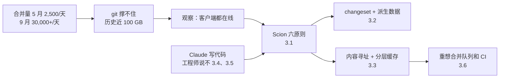

# 代码一天合并 3 万次以后：Anthropic 为什么要自己重写版本控制系统

通用（不限工具）

**一句话看懂**：2026 年 5 月，Anthropic 每天合并约 2,500 个代码改动；到 9 月，每天超过 30,000 个。写代码不再是瓶颈，**为人类规模设计的开发基础设施**成了瓶颈，首当其冲的是 git。他们用 5 个月、7 个人，在 Claude 的帮助下做出了自研版本控制系统 Scion，并把整个 monorepo 从 git 迁了过去。核心思路是：**客户端几乎都是永远在线的代理和作业，那就别让每个客户端都拿一份完整仓库，改成“问服务器”**。更值得普通团队带走的是后半篇：工程师的工作变成了对 Claude 说“不”，审查从逐行读代码变成看意图，合并队列和 CI 的老假设也要重新想。

## 读完你能带走的 6 条收获

1. **代理把代码产量放大十几倍以后，瓶颈会转移到源代码管理、构建和 CI。** 这是一个可以提前预见的问题（见 2）。
2. **git 的强项是离线和分布式，但代理和 CI 作业永远在线。** Scion 的六条原则都从这个事实出发：客户端轻、服务器重，能用 API 回答的问题就不检出代码（见 3.1）。
3. **数据只记录“改了什么”，其他信息都是派生数据**，按需计算、可以随时加新类型，而且客户端看不到内部结构（见 3.2）。
4. **内容寻址 + 分层缓存**让每层命中率超过 99%，资源占用是原来 git 镜像的 1/200，检出从几分钟变成几秒（见 3.3）。
5. **Claude 写代码比参与项目的每个工程师都好，但工程师仍然不可替代**：他们负责系统约束和设计取舍，最常做的事是对 Claude 说“不”，审查时看意图而不是逐行读（见 3.4、3.5）。
6. **代理规模下，合并队列的全局锁行不通**，Anthropic 改成合并后、部署前的自动测试，冲突交给 Claude 修（见 3.6）。

::: tip 小白先懂这几个词
- [Monorepo（单体仓库）](/glossary#monorepo)：整个公司的代码放在一个仓库里。
- [Scion](/glossary#scion)：Anthropic 自研、为永远在线的代理设计的版本控制系统。
- [CI/CD（持续集成 / 部署）](/glossary#ci-cd)：每次提交自动构建、测试、部署。
- [Adversarial Review（对抗式审查）](/glossary#adversarial-review)：让另一个代理专门挑错。
- [Claude Tag](/glossary#claude-tag)：Anthropic 内部在 Slack 等处召唤 Claude 的工具。
- [Superfan（组件守望代理）](/glossary#superfan)：专门盯一个系统组件健康状况的 Claude。
:::

## 1. 基本信息

<SourceCard type="文章" title="Redesigning source control at Anthropic" author="Nick G. 与 Anthropic 源代码管理团队" date="2026-10-13" url="https://www.anthropic.com/engineering/redesigning-source-control" />

| 项目 | 内容 |
|---|---|
| 链接 | https://www.anthropic.com/engineering/redesigning-source-control |
| 类型 | Anthropic Engineering 博客（文章，约 3,900 词） |
| 作者 | Nick G. 与源代码管理团队（S.G.、R.K.、Dan C.、Garrett H.、Ben L.、Colin M.、Joe P.，文末署名） |
| 发布日期 | 2026-10-13 |
| 涉及系统 | Scion（版本控制）、Antique（代码审查）、Spanner、Claude Mythos Preview、Claude Tag |
| 分析依据 | 原文全文，2026-10-14 用 curl 重新抓取并逐字核对引语。文中几张图表（每日合并量、架构图、性能对比）未读取，下文数字均取自正文文字，全部为 Anthropic 自报。没有代码或配置。“我觉得”开头的段落是本站评论。 |

## 2. 这篇在回答什么

如果你的团队开始大量用代理写代码，一个月后合并量翻了几倍，最先喊疼的往往不是代码质量，而是 CI 排队、检出变慢、git 服务器扛不住。

Anthropic 把这件事推到了极端。他们的开场判断是：

::: tr 现在的瓶颈，是所有为人类规模构建的开发基础设施：源代码管理、构建和 CI。
> "The bottleneck, now, is all of the developer infrastructure built for human scale: source control, builds, and CI."
:::

数字是这样的：2026 年 5 月，每天合并约 2,500 个改动；9 月，每天超过 30,000 个。作者认为增长不会慢下来，因为合并代码的潜在需求<Trans zh="几乎是无限的">“practically infinite”</Trans>，每去掉一个瓶颈，代码产量马上又涨一截。

git 撑不住的具体原因：

- main 分支的历史将近 100 GB，压缩后的工作副本超过 25 GB；
- 光 CI 每天就要检出代码约 2,500 万次，还没算开发环境、代理沙箱和研究作业；
- 如果朴素地拉取，每天会产生超过 600 PB 的 git 流量。

他们用过所有常规招数：浅克隆、稀疏检出、promisor remote、内部 git 镜像（高峰时几百个）、放在对象存储里的仓库快照。这些换来了时间，但合并量越大越难维护：快照离 main 的最新提交越来越远，在部分克隆上保住 diff、blame 这类依赖历史的操作越来越费劲。

转折点是一个观察：

::: tr 我们像大多数公司一样，把 git 当成只有一份权威副本的中心化系统在用，但我们几乎所有的客户端都是代理和作业，它们按定义就是在线的。
> "like most companies, we were using git as a centralized system with one authoritative copy, but nearly all of our clients were agents and jobs that are online by definition."
:::

于是问题变成：如果从一开始就假设代理永远在线，源代码管理该怎么设计？全文回答五个问题：

1. 代理规模的源代码管理，设计原则是什么？（3.1）
2. 数据怎么存？（3.2）
3. 怎么扛住每天几千万次检出？（3.3）
4. 7 个人怎么在 5 个月里做完？Claude 和工程师各干什么？（3.4、3.5）
5. 还有哪些为人类规模设计的流程要重新想？（3.6）

## 3. 怎么做

### 3.1 六条设计原则

大型 monorepo 的源代码管理有前人经验，主要是 Google 的 Piper 和 Meta 的 Sapling。Scion 借鉴了它们，定下六条原则：

| 原则 | git 的做法 | Scion 的做法 |
|---|---|---|
| 客户端永远在线 | 假设离线，每个客户端要完整副本 | 围绕永远可达的服务器设计，需要时再取数据 |
| 客户端和服务器不对称 | 每个客户端都能当完整的服务器 | 服务器负责历史、blame、提交、合并、rebase；客户端只维护有限的本地缓存、摆放文件、监控改动 |
| 完整的源代码管理服务能支撑新应用 | CI 作业要问一个问题，就得自己维护本地仓库 | 客户端用的所有查询都开放成 API，很多作业不需要本地仓库 |
| 一切都能水平扩展 | 几百个镜像，仓库超过镜像的磁盘或内存就扩不动 | 数据分布式存储，任何地方都没有完整物化的仓库副本；没有 packfile，不需要仓库维护 |
| 提交便宜、增量、无锁 | 本地提交再 push | 所有提交、rebase、合并都在服务器上；成本随改动大小而不是仓库大小增长；除 main 和发布分支外不鼓励用 ref |
| 工作副本可选、天生稀疏 | 默认完整检出 | 能用 API 就不检出；协议围绕稀疏检出和按需物化文件的虚拟检出设计 |

第三条原则的例子最直观：谁最后改了这一行？两个提交是什么关系？在 git 里，要回答这种问题得先有一份本地仓库。在 Scion 里，直接调 API。作者说，内部的自动 bisect（二分定位坏提交）和自动 revert 流水线，没有这种便宜的程序化访问，在这个规模下根本不现实。

为什么不鼓励用 ref（分支、标签这类指向提交的指针）？因为每个服务器都要对它达成一致，这种全局状态迟早成为扩展问题。

我觉得这六条原则里，对普通团队最有启发的是第三条和第六条。即使你不换版本控制系统，也可以问一句：我的 CI 作业里，有多少次完整检出只是为了回答一个关于历史的问题？

### 3.2 数据结构：changeset 和派生数据

Scion 的工作单位叫 **changeset**，是预写日志里的一条记录。它和 git 提交的关键区别是：git 提交存一个指向整棵目录树的指针，changeset 只存**相对第一个父提交改了哪些文件**，以及指向对象存储里压缩文件内容的内容寻址指针。changeset 在服务器端创建，创建后马上到处可用。

这样做的好处是吞吐量极高：没有 packfile 要接收，不需要加锁或跨服务器协调，也不用移动 ref。Scion 技术上支持 ref，但创建和拉取提交都不涉及它；移动 ref 只是对一行 Spanner 记录做一次比较并交换。

只记录“改了什么”，就没法直接回答“谁最后改了这一行”“哪些提交影响过这个文件”。为此 Scion 从 changeset 构建额外的数据结构：文件 blame、路径历史、提交图的跳表等。所有不属于 changeset 本身的东西都叫<Trans zh="派生数据">“derived data”</Trans>，用同一套通用机制计算：每种派生数据都递归定义，一个 changeset 的值由它父提交的值算出来。

这套机制有三个好处：

1. 某个操作需要更快时，很容易加一种新的派生数据；
2. 每种数据可以选择提前算还是用到再算，不需要的就不物化；
3. 客户端看不到这些数据结构的内部，优化它们不用改客户端。

随着系统发展，他们已经多次加了新的派生数据类型，比如做复制检测的索引、按路径搜索文件的索引。

### 3.3 扩展：内容寻址 + 分层缓存

一小组 Scion 服务器提供客户端需要的所有 API：取 changeset、算 diff、找合并基、取文件内容。所有数据都是内容寻址的，存进去就不会变，所以任何服务器都可以缓存它而不用问别人。作者说这些服务器<Trans zh="本质上是大缓存">“essentially large caches”</Trans>，还能现场计算派生数据并写回 Spanner。

迁移早期，Scion 还没有自己的客户端和协议时，只回答“元数据”查询（祖先关系、blame）。取文件内容、生成工作副本的数据量大得多，需要单独设计。

Scion 的客户端 `scn` 在拉取协议上和 git 有一个关键不同：git 协商时客户端告诉服务器“我已经有什么”，服务器算出缺什么、打包发回；`scn` 只说“我要什么”。它从根目录树开始，查本地缺哪些树就递归请求，再对文件内容重复一遍。每个请求都是一个不会变的具体对象，所以任何一层缓存都能回答；没有几 GB 的单个 packfile，过程可以断点续传；稀疏检出和虚拟检出也不需要特殊支持，客户端不请求不要的目录就行。

部署上分三层：

三层都响应相同的 RPC，客户端不需要知道缓存拓扑。理论上任何一层都能直接找任何一层，但他们严格执行分层，隔离故障域，避免某个区域缓存出问题时把上游服务器压垮。

结果（作者自报）：

- 每一层缓存命中率超过 99%，都不需要长期状态，容易扩容；
- CPU 和内存占用比原来的 git 镜像设施小 200 倍；
- CI 和研究作业检出代码快两个数量级，从几分钟变成几秒；
- 仅 CI 就省下 25% 的 CPU 容量。

### 3.4 Claude 在构建中的作用

作者说，他们开始做 Scion 时，正好赶上 Claude Mythos Preview 和 Claude Tag 在内部可用。这两样东西同时放大了对 Scion 的需求，也明显加快了建造速度。

最惊人的一个例子：年初，他们基本手写了从 git 摄取到 Scion 的第一版流水线，自认为写得不错。拿到 Mythos Preview 的早期内部快照后，他们让它重写整个流水线：

<Trans zh="没有任何额外指令，它写出的版本内存少用 20 倍、快 4 倍，同时保留了关于摄取顺序和数据结构的所有隐含不变量。">“with no further instructions, it produced a version that consumed 20x less memory and was 4x faster, while preserving all of the implicit invariants around ingestion ordering and data structures.”</Trans>

规模上：7 个人的团队做了 Scion 和代码审查工具 Antique，外加五六个相关系统，5 个月内全部迁移完成，同期每日合并量涨了 10 倍。作者认为，以前这种系统要一家公司用更多工程师、花好几年逐步迁移。

质量上：作者说 Scion 是他们做过的测试最充分、防御最好的代码库之一。他们为遇到过的每一种重要的基础设施和源代码管理交互都建了密封模拟，还有模糊测试和精细的限流。Claude 还顺手找到了重要的优化，比如祖先查询漏用了一个索引的算法问题，作者说这种优化专家要分析调优几天甚至几周。

### 3.5 工程师的工作变成了“说不”

这一节是全文对普通团队最有用的部分。作者的说法很直接：

::: tr 参与这个系统的所有工程师现在都会认为 Claude 写代码比自己好。
> "All of the engineers who worked on this system would now rate Claude as better at writing code than them."
:::

那工程师干什么？他们提供系统间组件的整体理解和设计层面的取舍，决定要解决什么问题、需要多大规模。而最常见的角色是：

<Trans zh="很多时候，我们发现工程师的角色就是对 Claude 说“不”。">“Very often, we found that the role of the engineers was to tell Claude “no.””</Trans>

为什么要说不？因为代理有时会为了迎合一个本来就不该被允许的模式，违反核心的系统约束。原文给了两个例子：

1. **迁移中的暴力查找**：好几个系统想知道一个改动什么时候合进 main，就线性读提交日志，而不是去问代码审查工具。
2. **对抗式审查的近视**：Anthropic 大量使用对抗式审查，作者说它在很多方面非常有效，但也可能<Trans zh="短视">“myopic”</Trans>。有一次审查对另一个内部服务过度防御，导致 Claude 加了过多的校验和复杂度，需要工程师把它拉回来。

审查方式也变了：团队成员仍然审查系统的每一个变更请求，但<Trans zh="现在看的是改动的意图，而不是逐行读代码">“they now examine the intent of the change as opposed to reading every line of code.”</Trans>

我觉得“对抗式审查会诱发过度设计”这一条特别值得记下来。很多团队把多代理互相挑错当成万能药，这里给出了一个具体的反例：审查者对假想的风险越敏感，写代码的代理就越倾向于堆防御代码。

### 3.6 其他经验

**安全**：Scion 从一开始就考虑了权限。除了仓库级的访问控制，还能对单个目录设权限，保护最敏感的代码，同时不失去 monorepo 的好处。代码审查工具能表达复杂的审批语义约束，比如区分只改注释的改动和敏感的逻辑改动，让人工审查者把精力放在最重要的改动上。

**运维**：团队大量使用 Claude Tag。他们给每个组件开一个 Slack 频道，让一个 Claude 专门盯这个组件的健康状况，叫它们<Trans zh="超级粉丝">“superfans”</Trans>：有 scion-daemon 的、scion-cache 的、Antique 合并队列的。它们能访问遥测和日志，像一个没别的事可做、只会刷图表找异常的资深工程师。传统告警也都有，但作者说 superfans 能发现细微和新型的问题，相比之下告警显得很单一。

**重新思考先验**：这是和“接进 PR 与 CI”阶段关系最大的一条。作者说，规范的合并队列在代理规模下没什么意义：

<Trans zh="测试还在跑的时候，就有成百上千个改动可能已经合并了，那 CI 到底意味着什么？">“What does CI even mean when hundreds or even thousands of changes can merge while tests are running?”</Trans>

他们没能复制业界标准的合并队列全局仓库锁，于是转而投资**合并后、部署前**的自动测试。代价是并发的改动可能冲突，但作者说 Claude 修这些冲突的速度通常比人发现它们还快。

## 4. 结果与局限

| 项目 | 数字（均为原文自报） |
|---|---|
| 每日合并量 | 2026 年 5 月约 2,500；9 月超过 30,000 |
| 团队与工期 | 7 人，5 个月，完成 Scion、Antique 和五六个相关系统并全部迁移 |
| 资源占用 | CPU 和内存比 git 镜像设施小 200 倍 |
| 检出速度 | 快两个数量级（几分钟 → 几秒） |
| CI CPU | 节省 25% |
| 缓存命中率 | 每层超过 99% |
| Mythos 重写摄取流水线 | 内存少 20 倍、快 4 倍 |

作者自己把适用范围说得很清楚：

<Trans zh="Scion 绝不是通用场景下 git 的合适替代品。">“Scion is by no means a suitable replacement for git for general use.”</Trans>

它只对真正巨大的 monorepo 有意义：要么有上万名工程师，要么有成群的代理在大量写代码。Anthropic 内部能花的 token 也远超一般企业愿意花的量。Scion 和 git 差异很大，要迁移整个开发生命周期，还需要配套的代码审查、代码搜索和 CI，所以很难开放给别人用。

作者预计这类问题会在未来 6 到 12 个月里变得常见，所以选择分享思路，并建议在 git 生态里改进：git 服务器不必和客户端一样工作；托管平台可以提供像 Scion 那样完整的服务端 RPC，甚至跨平台标准化；协商协议可以改；稀疏和浅克隆特性可以更好地组合。

::: warning 局限与注意
- 所有数字都是 Anthropic 自报，没有说明测量方法；图表数据未读取。
- Scion 不开放，普通团队无法直接使用；可借鉴的是设计思路，不是系统本身。
- Mythos Preview 是内部早期模型，“重写后快 4 倍”这类结果外界无法复现。
- 作者是建系统的团队本身，对“工程师仍然不可替代”的说法有立场；不过他们也写了对抗式审查的副作用这类反面经验。
:::

## 5. 结论

这篇讲的是一个大多数团队短期内不会遇到的问题，但它指出的方向值得提前想：**代理让写代码变便宜以后，所有为人类速度设计的环节都会被重新压测**。git、CI、合并队列、代码审查，都在其中。

我觉得对普通团队最实用的是两条：一是能用 API 问的问题就别检出整个仓库；二是审查重心从“这几行写得对不对”转向“这个改动想干什么、有没有破坏系统约束”。

### 你可以这样试

- [ ] 统计一下你的 CI 每天检出代码多少次、平均要多久，看看有多少作业其实只需要 diff 或历史信息。
- [ ] 下次审查代理写的大改动时，先只写一句话回答“这个改动的意图是什么、它碰了哪些系统约束”，再决定要不要逐行看。
- [ ] 如果你在用多代理对抗式审查，翻几个最近的改动，看看有没有因为审查者“过度防御”而多出来的校验代码。

### 读完自测

1. 作者为什么说 git 的优点反而成了 Anthropic 扩展的障碍？
2. Scion 的 changeset 和 git 提交有什么区别？“派生数据”解决了什么问题？
3. `scn` 客户端的拉取协议和 git 有什么不同？为什么这让缓存变简单？
4. 工程师在这个项目里最常做的事是什么？原文举了哪两个例子？
5. 为什么作者认为合并队列在代理规模下意义不大？他们改成了什么？
