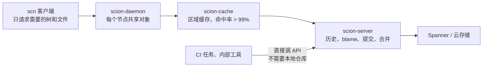

# 代码合并量涨了 12 倍之后：Anthropic 为代理重做源代码管理

通用（不限工具）

**一句话看懂**：Anthropic 每天合并的代码改动从 2026 年 5 月的约 2,500 个涨到 9 月的 30,000 多个，瓶颈从“写代码”变成了源代码管理、构建和 CI。git 是为离线、每份克隆都完整的分布式开发设计的，而他们的客户端几乎全是**永远在线的代理和任务**。于是一个 7 人团队在 5 个月里做了自研版本控制系统 Scion 并把 monorepo 从 git 完全迁过去：服务端承担历史、blame、提交和合并，客户端只按需取文件。基础设施占用比原来的 git 镜像小 200 倍，CI 拉代码从几分钟变成几秒。

::: info 为什么值得看
本站“打地基”讲的多是规则文件和代码库准备（[[26]]、[[37]]）。这篇往下再挖一层：**当代理把代码量放大一个数量级，开发基础设施本身就要重新设计**。绝大多数团队现在用不上 Scion，但文中“工程师的工作变成对 Claude 说不”“合并队列在代理规模下不成立”的经验，对任何在扩大代理使用的团队都有参考价值。
:::

::: tip 小白先懂这几个词
- [Monorepo（单体仓库）](/glossary#monorepo)：整个公司的代码放在一个仓库里。
- [Scion](/glossary#scion)：Anthropic 自研、为永远在线的代理设计的版本控制系统。
- [CI/CD（持续集成 / 部署）](/glossary#ci-cd)：每次提交自动构建、测试、部署。
- [Adversarial Review（对抗式审查）](/glossary#adversarial-review)：让另一个代理专门挑错。
- [Claude Tag](/glossary#claude-tag)：Anthropic 内部在 Slack 等处召唤 Claude 的工具。
- [Superfan（组件守望代理）](/glossary#superfan)：专门盯一个系统组件健康状况的 Claude。
:::

## 1. 基本信息

<SourceCard type="文章" title="Redesigning source control at Anthropic" author="Nick G. 与 Anthropic 源代码管理团队" date="2026-10-13" url="https://www.anthropic.com/engineering/redesigning-source-control" />

| 项目 | 内容 |
|---|---|
| 链接 | https://www.anthropic.com/engineering/redesigning-source-control |
| 类型 | Anthropic Engineering 博客（文章） |
| 作者 | Nick G. 与源代码管理团队（S.G.、R.K.、Dan C.、Garrett H.、Ben L.、Colin M.、Joe P.，文末署名） |
| 发布日期 | 2026-10-13 |
| 涉及系统 | Scion（版本控制）、Antique（代码审查）、Spanner、Claude Mythos Preview、Claude Tag |
| 分析依据 | 原文全文，2026-10-14 用 curl 抓取。文中几张图表（每日合并量、架构图、性能对比）未读取，下文数字取自正文文字。没有代码或配置。 |

## 2. 做了什么

::: tr 在 Anthropic，写代码已经不再是构建系统或做研究的瓶颈……现在的瓶颈，是所有为人类规模构建的开发基础设施：源代码管理、构建和 CI。
> "At Anthropic, coding is no longer the bottleneck to building systems or doing research. … The bottleneck, now, is all of the developer infrastructure built for human scale: source control, builds, and CI."
:::

规模：main 分支历史接近 100 GB，压缩后的工作副本超过 25 GB；CI 每天约 2,500 万次代码检出（还没算开发环境、代理沙箱和研究任务），朴素地拉取会是每天 600 PB 以上的 git 流量。他们用过浅克隆、稀疏检出、promisor remote、内部镜像、存在 blob 存储里的仓库快照，高峰期运营几百个 git 镜像，但合并速度越快越难维护。

::: tr 如果从一开始就按“代理永远在线”来设计源代码管理，它会是什么样子？
> "if we designed source control with the fact that agents are always online in mind from the start, what would it look like?"
:::

## 3. 怎么做的

### 3.1 六条设计原则

他们参考了 Google Piper 和 Meta Sapling 的经验：

- **客户端永远在线**：不需要完整副本，用到时再取。
- **客户端和服务端不对称**：服务端回答历史和 blame、创建提交、做合并和 rebase；客户端只维护有界的本地缓存、铺工作文件、监控文件变化。
- **完整的源代码管理服务**：客户端用的所有查询都开放成 API，很多任务根本不需要本地仓库。自动二分和自动回滚流水线没有这种廉价的程序化访问，在规模上就不现实。
- **一切水平扩展**：任何地方都没有完整物化的仓库副本，包括服务端；没有 packfile，也就不需要仓库维护。
- **提交要便宜、增量、无锁**：成本和改动大小成正比，而不是和仓库大小成正比；除了 main 和发布分支，不鼓励用 ref，因为所有服务器都要达成一致的全局状态是扩展隐患。
- **工作副本可选，并且天生稀疏**：CI 要的 diff 直接问服务端；需要文件时用稀疏检出或按需物化的虚拟检出，只为真正读到的文件付费。

### 3.2 数据结构：changeset 和派生数据

工作单元是 changeset，一条预写日志记录：不像 git 提交那样指向整棵树，而是记录相对第一个父提交改了哪些文件，以及指向 blob 存储里压缩内容的内容寻址指针。changeset 在服务端创建，立即全局可用。

blame、路径历史、提交图跳表这些都叫“派生数据”，用同一套机制递归计算（一个 changeset 的值由父提交的值算出）。好处：加新的数据结构容易；每种可以选择立即算还是延后算；客户端看不到内部结构，优化时不用改客户端。

### 3.3 扩展：内容寻址 + 分层缓存

所有数据内容寻址、存下就不变，所以任何服务器都能缓存而不需要互相协调。拉取协议和 git 不同：客户端不告诉服务端自己有什么，而是从根树开始，递归请求本地缺的树，再请求文件。每个请求都是一个不变的对象，任何缓存都能回答；没有几 GB 的单个响应，可以断点续传；稀疏和虚拟检出不需要特殊支持，客户端不请求不要的树就行。

daemon、cache、server 三层响应同样的 RPC，客户端不需要知道缓存拓扑；但他们严格执行分层，防止区域缓存故障把上游打垮。

### 3.4 Claude 在构建中的作用

一个例子：git 到 Scion 的数据导入流水线第一版基本是手写的原型。拿到 Claude Mythos Preview 的早期内部版本后，他们让它整个重写，没有额外指示，新版本内存少用 20 倍、快 4 倍，并保留了导入顺序和数据结构的所有隐含不变量。

### 3.5 工程师的工作变成了“说不”

::: tr 很多时候我们发现，工程师的角色是对 Claude 说“不”。代理有时会为了满足一个本不该被允许的模式而违反系统的核心约束。
> "Very often, we found that the role of the engineers was to tell Claude “no.” Agents will sometimes violate core system constraints to satisfy a pattern that should never have been allowed in the first place."
:::

- 例子：好几个系统想通过线性读提交日志来暴力查“某个改动何时合进 main”，而不是去问代码审查工具。
- 对抗式审查也会短视：有一次审查对另一个内部服务过度不信任，导致 Claude 加了过多校验和复杂度，需要工程师把它拉回来。
- 团队仍然审查每个改动请求，但看的是**改动的意图**，而不是逐行读代码。参与的工程师都认为 Claude 写代码比自己好，但系统间的高层关系和设计取舍仍由人提供。

### 3.6 其他经验

- **质量反而更高**：靠 Claude 的代码量，做了覆盖每种非平凡基础设施交互的密闭仿真、模糊测试和限流，Scion 是他们做过测试最充分的代码库之一。
- **安全**：支持仓库级和目录级权限；审查工具能表达语义约束，区分只改注释的改动和敏感的逻辑改动，让人把注意力放在后者。
- **“superfan” 运维**：用 Claude Tag 给每个组件建 Slack 频道，让一个 Claude 盯着它的遥测和日志，像一个没别的事可做、一直刷图表的资深工程师。传统告警仍然保留。
- **合并队列在代理规模下不成立**：测试还在跑时就可能有成百上千个改动合入，他们无法复制全局仓库锁，转而投资合并后、部署前的自动测试；并发改动会冲突，但 Claude 修冲突通常比人发现冲突还快。

## 4. 结果如何

| 指标 | 原文数据 |
|---|---|
| 每日合并改动 | 2026 年 5 月约 2,500 → 9 月 30,000 以上 |
| 团队与周期 | 7 人，5 个月完成 Scion、Antique 和半打相关系统，并完全迁移 |
| 基础设施占用（CPU、内存） | 比原 git 镜像小 200 倍 |
| CI / 研究任务检出 | 快两个数量级（几秒 vs 几分钟） |
| CI CPU 容量 | 节省 25% |
| 各层缓存命中率 | 超过 99% |
| Claude 重写导入流水线 | 内存 1/20、速度 4 倍 |

::: warning 局限与注意
- 作者明确说 Scion **不适合**普通场景：只对有数万工程师或大量代理的超大 monorepo 才有意义，也不打算开源成通用产品。
- Anthropic 内部用 token 的预算远超一般企业，文中的速度和规模很难照搬。
- 没有失败案例、迁移中的事故或成本数据；“Claude 写代码比工程师好”是团队自评。
- 归在“打地基”，因为它讲的是让代码库和开发基础设施能承载代理；其中合并队列、CI 的部分和“自动化”阶段相关。
:::

## 5. 可借鉴之处

1. **先找新的瓶颈**：代理把写代码变快后，看看构建、CI、源代码管理哪里先撑不住。
2. **代理大多在线，按需取数据**：大仓库优先考虑稀疏检出、按需拉取，而不是每次完整克隆。
3. **把仓库查询做成 API**：CI 和工具能直接问“谁改了这行”，就不用维护本地副本。
4. **人审意图，不逐行读**：工程师的价值在系统约束和设计取舍，要敢于对代理说不。
5. **对抗式审查也要有人把关**：防止为假想风险过度设计。
6. **给关键组件配一个专职盯梢的代理**：作为传统告警的补充。

### 你可以这样试

- [ ] 统计你团队最近一个月每天合并的改动数，以及 CI 排队、拉代码的耗时，看代理增多后哪个先变慢。
- [ ] 如果仓库很大，试一下 git 的稀疏检出或浅克隆，量一下 CI 拉代码时间的变化。
- [ ] 审查下一个代理 PR 时，先写一句“这个改动想做什么”，再判断它有没有违反系统约束。
