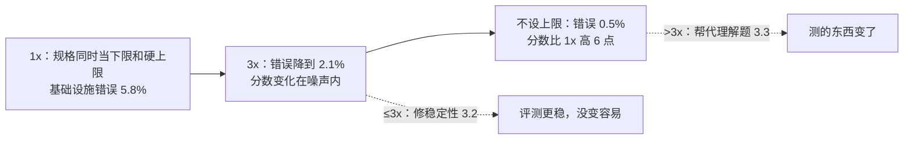

# 排行榜上差 2 分，可能只是机器更大：Anthropic 量化代理评测里的基础设施噪声

通用（不限工具）

**一句话看懂**：同一个 Claude 模型、同一套 harness、同一批题目，Anthropic 只改了容器的资源配置，Terminal-Bench 2.0 的分数就差了 6 个百分点，比很多排行榜上前几名之间的差距还大。原因在于代理评测里，运行环境本身就是解题过程的一部分。他们发现资源给到约 3 倍时，修的是**稳定性**（容器不再被误杀）；超过 3 倍，资源开始**帮代理解题**，评测测的东西变了。建议是：评测要分开写“保证分配”和“硬上限”两个参数并校准区间；在配置公开并对齐之前，**低于 3 个百分点的榜单差距都值得怀疑**。

## 读完你能带走的 6 条收获

1. **代理评测和静态评测不一样**：代理要装依赖、跑测试、反复迭代，资源和时间限制不同，就不是同一场考试（见 3.1）。
2. **“指定资源”不等于“一致地执行资源限制”**。把同一个数值同时当下限和硬上限，瞬时的内存峰值就会把本可以成功的容器杀掉（见 3.1）。
3. **资源给到约 3 倍以内，减少的是基础设施错误，分数变化在噪声范围内**：评测变稳了，但没变容易（见 3.2）。
4. **超过 3 倍，资源开始帮代理解题**：紧的限制奖励精简高效的策略，宽松的限制奖励“上重型工具”的策略（见 3.3）。
5. **效应在其他 Anthropic 模型和 SWE-bench 上也存在，只是幅度不同**；时间限制、一天中的时段等也是隐藏变量（见 3.4、3.5）。
6. **评测要写明两个资源参数，并校准到两端分数在噪声范围内**；看榜单时，配置没对齐的小于 3 个百分点的差距先存疑（见 3.6、4）。

::: tip 小白先懂这几个词
- [Benchmark（基准测试）](/glossary#benchmark)：公开的标准题集，用来比较模型。
- [Evals（评测）](/glossary#evals)：检查代理输出是否符合预期的测试。
- [Infrastructure Noise（基础设施噪声）](/glossary#infra-noise)：资源、时间、网络等环境因素造成的分数波动。
- [Sandbox（沙箱）](/glossary#sandbox)：代理执行代码的隔离环境，这里是 Kubernetes 容器。
- [Harness（代理外壳）](/glossary#harness)：调用模型、执行工具的循环。
- OOM Kill：容器内存超过上限时被系统强制结束。
:::

## 1. 基本信息

<SourceCard type="文章" title="Quantifying infrastructure noise in agentic coding evals" author="Gian Segato（Anthropic）" date="2026-02-05" url="https://www.anthropic.com/engineering/infrastructure-noise" />

| 项目 | 内容 |
|---|---|
| 链接 | https://www.anthropic.com/engineering/infrastructure-noise |
| 类型 | Anthropic Engineering 博客（文章，约 1,900 词） |
| 作者 | Gian Segato（文末署名） |
| 发布日期 | 2026-02-05（页面元数据显示 2026-04-24 有修改） |
| 涉及基准 | Terminal-Bench 2.0、SWE-bench |
| 分析依据 | 原文全文，2026-10-14 用 curl 重新抓取并逐字核对引语。正文里的图表未能读取，下文数字全部取自正文文字。实验在 Anthropic 自己的 Google Kubernetes Engine 集群上完成，非 Claude 模型没有严格测试。“我觉得”开头的段落是本站评论。 |

## 2. 这篇在回答什么

你在看一个代理编码的排行榜。A 模型 62 分，B 模型 60 分。你可能会想：A 稍强一点，选 A。

Anthropic 这篇文章想说的是：先别急。

::: tr 我们发现，光是基础设施配置就能造成超过这些差距的分数差异。
> "However, we’ve found that infrastructure configuration alone can produce differences that exceed those margins."
:::

他们的内部实验里，Terminal-Bench 2.0 上资源最多和最少的两种配置之间差了 6 个百分点（p < 0.01）。模型、harness、题目全都一样。

全文回答六个问题：

1. 为什么容器资源会影响代理评测的分数？（3.1）
2. 资源多给一点，修好的是什么？（3.2）
3. 资源再多给，又改变了什么？（3.3）
4. 换模型、换基准还成立吗？（3.4）
5. 还有哪些隐藏变量？（3.5）
6. 评测该怎么配资源，看榜单该怎么读？（3.6、4）

## 3. 怎么做

### 3.1 问题出在“怎么执行”资源规格

**静态评测和代理评测的区别。** 静态基准直接给模型的输出打分，运行环境不影响结果。代理编码评测不同：模型拿到一个完整的环境，写程序、跑测试、装依赖、多轮迭代。

<Trans zh="资源预算和时间限制不同的两个代理，参加的不是同一场考试。">“Two agents with different resource budgets and time limits aren't taking the same test.”</Trans>

评测开发者已经开始考虑这件事。Terminal-Bench 2.0 在最新版本里给每个任务写了推荐的 CPU 和内存。但作者发现，指定资源不等于一致地执行，而且**执行方式会改变评测实际测的东西**。

**他们是怎么发现的。** Anthropic 在 Google Kubernetes Engine 集群上跑 Terminal-Bench 2.0。校准时发现两件怪事：分数和官方排行榜对不上；基础设施错误率高得出奇，多达 6% 的任务因为 pod 错误而失败，大多数和模型能力无关。

**原因。** 容器运行时用两个独立参数管资源：

- **保证分配**：预先保留给容器的资源；
- **硬上限**：超过就杀掉容器的阈值。

他们的 Kubernetes 实现把每个任务的资源规格同时当成这两个值。结果是零余量：

<Trans zh="一次瞬时的内存波动，就可能让一个本来会成功的容器被 OOM 杀掉。">“a momentary memory fluctuation can OOM-kill a container that would otherwise have succeeded.”</Trans>

而 Terminal-Bench 的排行榜用的是另一家沙箱提供商，实现更宽松，允许临时超额使用而不杀容器，优先保证基础设施稳定。

### 3.2 前半段：资源修的是稳定性

为了量化影响，他们在六种资源配置下跑 Terminal-Bench 2.0：从严格执行每任务规格（1x，同时当下限和上限），一直到完全不设上限。其他全都不变：同一个 Claude 模型、同一套 harness、同一批任务。

成功率随资源余量增加而上升，主要原因是基础设施错误率**每一步都在下降**：从严格执行时的 5.8%，到不设上限时的 0.5%。从 1x 到 3x 余量，错误率从 5.8% 降到 2.1%，这个下降是显著的（p < 0.001）。

但从 1x 到 3x，**成功率的变化在噪声范围内**（p = 0.40）。为什么错误少了，分数却没明显涨？作者在数据里看到的是：1x 时崩掉的任务，大多数本来就会失败。

<Trans zh="代理在探索，撞上资源墙，被抢占，但它本来就不在通向正确解的路上。">“The agent explores, hits a resource wall, and gets preempted, but it was never on a path to a correct solution.”</Trans>

作者的解读是：到大约 3 倍规格为止，额外资源修的是基础设施可靠性问题，也就是瞬时的资源峰值。Terminal-Bench 维护者用的沙箱提供商其实在背后隐式地做了这件事：

<Trans zh="评测变得更稳定，但没有变得更容易。">“the eval gets more stable without getting easier.”</Trans>

### 3.3 后半段：资源开始帮代理解题

大约从 3x 开始，趋势变了：成功率涨得比基础设施错误降得快。

从 3x 到不设上限，基础设施错误只再降了 1.6 个百分点，成功率却涨了将近 4 个百分点。额外的资源让代理能尝试只有在资源充裕时才行得通的做法：拉进大型依赖、启动昂贵的子进程、跑吃内存的测试套件。不设上限时，相比 1x 总共提升 6 个百分点（p < 0.01）。rstan-to-pystan、compile-compcert 这类任务在给足内存后成功率明显提高。

这说明超过 3x 以后，资源限制本身就在改变评测测的东西：

<Trans zh="紧的限制无意中奖励非常高效的策略，宽松的限制更宽容，奖励那些能更好地利用全部可用资源的代理。">“Tight limits inadvertently reward very efficient strategies, while generous limits are more forgiving and reward agents that can better exploit all available resources.”</Trans>

原文的例子是 bn-fit-modify，一个要做贝叶斯网络拟合的任务。有些模型第一步就装整套 Python 数据科学工具：pandas、networkx、scikit-learn 以及它们的工具链。资源宽松时这行得通；资源紧时，pod 在安装阶段就内存耗尽，代理一行解题代码都还没写。其实有更精简的做法：只用标准库从头实现数学，有些模型默认就这么做。

作者的结论是：两种能力都值得测，但把它们压成一个分数、又不说明资源配置，差异和在真实场景下的可推广性就很难解读。

### 3.4 换模型、换基准也成立

- **换模型**：他们在不同的 Anthropic 模型上复现了核心发现，方向一致，幅度不同。非 Claude 模型上似乎也有同样趋势，但没有严格测试。
- **换基准**：在 SWE-bench 上做了交叉实验，把可用内存最多提到基线的 5 倍，227 道题、每题 10 个样本。效应同样存在但更小：分数随内存单调上升，5x 只比 1x 高 1.54 个百分点。SWE-bench 的任务没那么吃资源，效应小在意料之中，但说明资源分配在这里也不是中性的。

### 3.5 其他噪声来源

资源不是唯一的隐藏变量。某些配置下，时间限制也开始起作用。

原则上，评测环境的每个部分都可能影响最终分数：集群健康、硬件规格、并发水平，甚至出站带宽。

<Trans zh="代理评测从构造上就是端到端的系统测试，系统里任何一个组件都可能成为混杂因素。">“Agentic evals are end-to-end system tests by construction, and any component of that system can act as a confounder.”</Trans>

作者举了一个他们非正式观察到的例子：通过率会随一天中的时段波动，很可能是因为 API 延迟随流量和故障变化。这个效应没有正式量化。

模型提供商可以用专用硬件把评测设施和这些波动隔开，外部评测者却很难做到。对要公开分享的编码评测，作者建议在不同时间、不同日期多跑几次，把噪声平均掉。

### 3.6 建议：分开写两个参数，并校准区间

理想情况是每次评测都在完全相同的硬件条件下运行，包括跑评测的环境和推理服务，但这不一定现实。作者的具体建议是：

1. **每个任务分开写两个参数**：保证分配和硬上限，不要只写一个固定值。只写一个值，就等于把保证分配设成杀容器的阈值，零余量，1x 时记录到的瞬时内存峰值足以让评测不稳定。
2. **校准两者之间的区间**，让下限和上限处的分数落在彼此的噪声范围内。

Terminal-Bench 2.0 的例子：在每任务规格上设 3 倍的上限，基础设施错误率降了约三分之二（5.8% → 2.1%，p < 0.001），同时分数提升不大，完全在噪声内（p = 0.40）。作者认为这是合理的取舍：基本消除了基础设施这个混杂因素，又没有去掉有意义的资源压力。具体倍数因基准和任务分布而异，应该写进报告，但这种经验校准的原则是通用的。

对三类人，作者的建议分别是：

- **实验室**：把代理评测的资源配置当成一等实验变量，像提示词格式、采样温度一样记录和控制。
- **基准维护者**：公开推荐的资源规格（像 Terminal-Bench 2.0 那样）已经很有帮助，再写明执行方式，就能补上这篇文章发现的缺口。
- **看榜单的人**：代理评测上的小分差，不确定性比报告数字的精度看起来要大。

## 4. 结果与局限

| 项目 | 数字（原文） |
|---|---|
| Terminal-Bench 2.0：1x vs 不设上限 | 分数差 6 个百分点（p < 0.01） |
| 基础设施错误率 | 1x 5.8% → 3x 2.1%（p < 0.001）→ 不设上限 0.5% |
| 1x → 3x 的分数变化 | 在噪声内（p = 0.40） |
| 3x → 不设上限 | 错误再降 1.6 点，成功率涨近 4 点 |
| SWE-bench：内存 5x vs 1x | 高 1.54 个百分点（227 题 × 10 样本） |
| 中等资源区间内的分数差 | 略低于 2 个百分点 |
| 朴素二项置信区间 | 本身就有 1–2 个百分点，基础设施噪声叠加在上面 |

作者的结论：

::: tr 在资源方法标准化之前，我们的数据表明，低于 3 个百分点的排行榜差距，在评测配置被记录并对齐之前都值得怀疑。
> "Until resource methodology is standardized, our data suggests that leaderboard differences below 3 percentage points deserve skepticism until the eval configuration is documented and matched."
:::

最后一句话说得很直白：

<Trans zh="几分的领先可能意味着真正的能力差距——也可能只是虚拟机更大。">“A few-point lead might signal a real capability gap—or it might just be a bigger VM.”</Trans>

::: warning 局限与注意
- 实验只在 Anthropic 自己的集群和模型上做；非 Claude 模型“似乎”成立，但没有严格测试。
- “一天中的时段”影响只是非正式观察，没有量化。
- 3 倍这个分界点是 Terminal-Bench 2.0 上的结果，作者明确说其他基准要自己校准。
- 正文里的图表未能读取，具体每档配置的分数只能从文字里得到几个关键点。
:::

## 5. 结论

这篇文章用一组很干净的实验说明：**代理评测的分数里，混着一部分基础设施的“噪声”**，而且资源多到一定程度后，它就不再是噪声，而是在改变评测测的东西。

我觉得这个结论不只适用于看排行榜。你自己比较两版 prompt、两个 Skill 或两个模型时，也会遇到同样的问题：只跑一次、资源不固定、分差两三个点，很可能什么都说明不了。

### 你可以这样试

- [ ] 下次比较两个配置时，固定容器的 CPU 和内存，每个配置至少跑 3 次，看分差是否稳定超过波动范围。
- [ ] 如果你的评测在容器里跑，检查保证分配和硬上限是不是设成了同一个值；统计一下有多少失败是 OOM 或 pod 错误。
- [ ] 看排行榜时，先找它有没有写资源配置和执行方式；没写，就把 3 个百分点以内的差距当作“差不多”。

### 读完自测

1. 为什么代理评测的分数会受容器资源影响，而静态评测不会？
2. 把资源规格同时当作下限和硬上限，会出什么问题？
3. 1x 到 3x、3x 以上，额外资源分别起了什么作用？
4. bn-fit-modify 的例子说明了什么？
5. 作者建议评测怎么写资源参数？看榜单时多大的差距值得怀疑？
