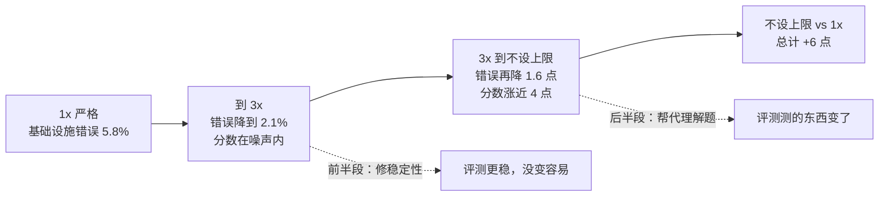

# 跑分差 3 个点，可能只是机器大小不同：代理编码评测里的基础设施噪声

通用（不限工具）

**一句话看懂**：Anthropic 在 Terminal-Bench 2.0 上只改容器的资源配置（模型、harness、题目都不变），最宽松和最严格的配置之间分数差了 **6 个百分点**（p < 0.01）。原因是代理评测里，运行环境本身就是解题过程的一部分：资源卡得死，容器会因瞬时内存峰值被杀；资源给得多，代理能用更重的办法解题。结论：**排行榜上低于 3 个百分点的差距，在评测配置公开并对齐之前要存疑**；评测应同时写明“保证分配”和“硬上限”两个参数。

::: info 为什么值得看
你可能会根据排行榜选模型，或者用自己的 eval 比较两版 prompt（[[47]]、[[19]]）。这篇用实验说明：**分数里混着基础设施的噪声**，小差距不一定是能力差距。它不教怎么写代码，但教你怎么读分数。
:::

::: tip 小白先懂这几个词
- [Benchmark（基准测试）](/glossary#benchmark)：公开的标准题集，用来比较模型。
- [Evals（评测）](/glossary#evals)：检查代理输出是否符合预期的测试。
- [Infrastructure Noise（基础设施噪声）](/glossary#infra-noise)：资源、时间、网络等环境因素造成的分数波动。
- [Sandbox（沙箱）](/glossary#sandbox)：代理执行代码的隔离环境，这里是 Kubernetes 容器。
- [Harness（代理外壳）](/glossary#harness)：调用模型、执行工具的循环。
:::

## 1. 基本信息

<SourceCard type="文章" title="Quantifying infrastructure noise in agentic coding evals" author="Gian Segato（Anthropic）" date="2026-02-05" url="https://www.anthropic.com/engineering/infrastructure-noise" />

| 项目 | 内容 |
|---|---|
| 链接 | https://www.anthropic.com/engineering/infrastructure-noise |
| 类型 | Anthropic Engineering 博客（文章） |
| 作者 | Gian Segato（文末署名） |
| 发布日期 | 2026-02-05（页面元数据显示 2026-04-24 有修改） |
| 涉及基准 | Terminal-Bench 2.0、SWE-bench |
| 分析依据 | 原文全文，2026-10-14 用 curl 抓取。正文里的图表未能读取，下文数字全部取自正文文字。 |

## 2. 做了什么

::: tr 静态基准直接给模型的输出打分，运行环境不影响结果。代理编码评测不同……运行时不再是被动的容器，而是解题过程不可分割的一部分。资源预算和时间限制不同的两个代理，考的不是同一张卷子。
> "Static benchmarks score a model's output directly—the runtime environment doesn’t factor into the result. Agentic coding evals are different … The runtime is no longer a passive container, but an integral component of the problem-solving process. Two agents with different resource budgets and time limits aren't taking the same test."
:::

起因：他们在 Google Kubernetes Engine 上跑 Terminal-Bench 2.0，分数对不上官方排行榜，而且多达 6% 的题因为 pod 错误失败，大多和模型能力无关。于是用六档资源配置重跑：从严格执行每题的推荐规格（1x，既是下限也是上限）到完全不设上限，其余全部不变。

## 3. 怎么做的

### 3.1 问题出在“怎么执行”资源规格

容器运行时用两个参数管资源：**保证分配**（预留的资源）和**硬上限**（超过就杀掉容器）。他们的 Kubernetes 实现把每题规格同时当成两者，于是瞬时内存波动就能把本来会成功的容器 OOM 杀掉。Terminal-Bench 排行榜用的沙箱提供商更宽松，允许临时超额而不杀容器。

::: tr 指定资源不等于一致地执行资源。而且我们发现，执行方式会改变基准最终测量的东西。
> "However, specifying resources isn't the same as enforcing them consistently. Moreover, we discovered that enforcement methodology can change what the benchmark ends up actually measuring."
:::

### 3.2 前半段：资源修的是稳定性

从 1x 到 3x，基础设施错误率从 5.8% 降到 2.1%（p < 0.001），但成功率的变化在噪声范围内（p = 0.40）。作者从数据里观察到，1x 下崩溃的题多数本来也会失败：代理在探索中撞上资源墙被抢占，但它本来就不在正确的路上。

### 3.3 后半段：资源开始帮代理解题

3x 之后，成功率涨得比错误率降得快：从 3x 到不设上限，错误率再降 1.6 个百分点，成功率涨了接近 4 个百分点。多出的资源让代理能用只有在宽松配置下才行得通的办法：拉大依赖、起昂贵的子进程、跑吃内存的测试。

例子 `bn-fit-modify`（贝叶斯网络拟合）：有些模型第一步就装 pandas、networkx、scikit-learn 一整套；资源宽松时行得通，资源紧时在安装阶段就 OOM，一行解题代码都没写。更省的办法（只用标准库从头实现数学）也存在，有的模型默认就这样做。

::: tr 紧的限制无意中奖励非常高效的策略，宽松的限制更宽容，奖励能更好利用全部资源的代理。
> "Tight limits inadvertently reward very efficient strategies, while generous limits are more forgiving and reward agents that can better exploit all available resources."
:::

### 3.4 换模型、换基准也成立

- 不同的 Anthropic 模型上方向一致、幅度不同；非 Claude 模型看起来趋势相同，但没有严格测试。
- SWE-bench 交叉实验：227 题、每题 10 个样本，内存加到基线的 5 倍，分数单调上升，但 5x 只比 1x 高 1.54 个百分点（任务本身不太吃资源）。

### 3.5 其他噪声来源

时间限制在某些配置下也有影响。集群健康、硬件、并发、出口带宽都可能是混杂因素。作者还观察到通过率随一天中的时段波动（可能是 API 延迟随流量变化），但**没有正式量化**。公开的编码评测在多个时间、多天运行能帮助平均掉噪声。

### 3.6 建议：分开写两个参数，并校准区间

::: tr 我们建议评测为每道题同时指定两个参数，而不是一个固定值。
> "we recommend that evals specify both parameters per task, not a single pinned value."
:::

保证分配和硬上限之间的区间，要校准到“下限和上限处的分数彼此在噪声范围内”。Terminal-Bench 2.0 上，3x 上限把基础设施错误减少约三分之二，分数提升仍在噪声内。具体倍数因基准而异，应当公开报告。

## 4. 结果如何

| 配置 | 原文数据 |
|---|---|
| 1x 严格执行 | 基础设施错误 5.8% |
| 3x 上限 | 错误 2.1%（vs 1x，p < 0.001）；成功率差异在噪声内（p = 0.40） |
| 不设上限 | 错误 0.5%；成功率比 1x 高 6 个百分点（p < 0.01） |
| 中等配置区间的分数差 | 略低于 2 个百分点 |
| SWE-bench 5x vs 1x 内存 | +1.54 个百分点 |

::: tr 在资源方法标准化之前，我们的数据表明：评测配置没有公开并对齐时，排行榜上低于 3 个百分点的差异值得怀疑。
> "Until resource methodology is standardized, our data suggests that leaderboard differences below 3 percentage points deserve skepticism until the eval configuration is documented and matched."
:::

::: warning 局限与注意
- 只在 Anthropic 自己的 GKE 集群上测；非 Claude 模型没有严格测试。
- 一天中时段的影响只是“轶事观察”，没有量化。
- 文章面向基准维护者和模型实验室；个人开发者主要能借鉴的是“怎么读分数”和“自己的 eval 要固定资源配置”。
- 原文图表未读取，图中可能有更细的分档数据。
:::

## 5. 可借鉴之处

1. **把资源配置当成实验变量**：像 prompt 格式、采样温度一样记录和控制。
2. **小差距先存疑**：配置没对齐时，3 个百分点以内的差距不足以下结论。
3. **分开写“保证分配”和“硬上限”**：给瞬时峰值留余地，又不至于让分数虚高。
4. **先看基础设施错误率**：分数异常时，先查有多少失败是环境造成的。
5. **多时段、多天重复跑**：平均掉时段和流量带来的波动。

### 你可以这样试

- [ ] 如果你有自己的代理 eval，把每次运行的 CPU、内存上限、超时和运行时间记进结果文件。
- [ ] 把同一版 prompt 在不同时间跑三次，看分数波动有多大，再决定多大的提升才算数。
- [ ] 下次看排行榜时，查一下各家分数是否公开了运行配置。
