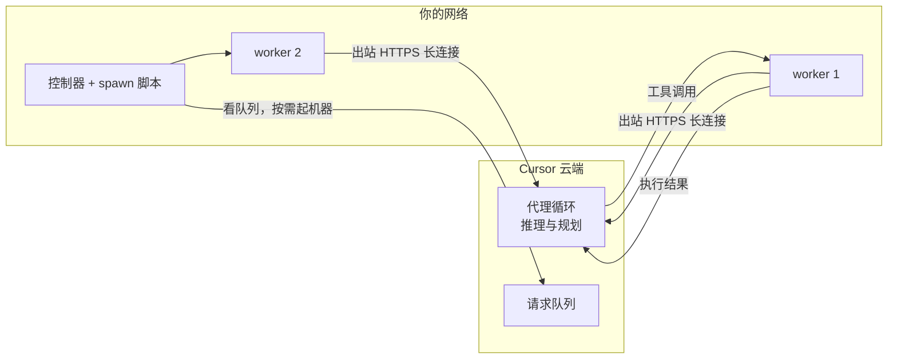

# 让云端代理跑在自己的机器上：Cursor Self-Hosted Machines

Cursor

**一句话看懂**：Cursor 云端代理默认跑在 Cursor 的 VM 上。Self-Hosted Machines 让**执行环境搬进你自己的网络**，而代理循环、推理和规划仍在 Cursor 云端：你在机器上跑 `agent worker start`，它向 Cursor 开一条长连接（只出不进），接收工具调用、在本地执行、把结果送回去。多台 worker 组成 pool，可以按排队请求自动扩容、空闲时休眠快照、一个 pool 服务多个仓库。适合需要访问内网服务、GPU 或 Mac、或构建流程难以打包的团队。

::: info 为什么值得看
[[40]] 讲了 Cursor 自己运营云端代理基础设施的经验，[[48§3.3]] 提到 Claude Code 也有 self-hosted 环境。这篇讲的是同一问题的另一种分法：**循环留在厂商云端，只把“双手”放进客户网络**，和 [[45]] 的“大脑与双手解耦”是同一个思路的产品化。
:::

::: tip 小白先懂这几个词
- [Background Agent（后台代理）](/glossary#background-agent)：不用你盯着、在云端把活干完的代理。
- [Self-Hosted Worker（自托管执行节点）](/glossary#self-hosted-worker)：跑在你自己机器上、替云端代理执行工具调用的进程。
- [Sandbox（沙箱）](/glossary#sandbox)：代理执行代码的隔离环境。
- [Egress Control（出站控制）](/glossary#egress-control)：限制代理能访问哪些外部网络。
- [Computer Use（电脑操作）](/glossary#computer-use)：代理通过截图和点击操作桌面或浏览器。
:::

## 1. 基本信息

<SourceCard type="文章" title="Run cloud agents on machines you manage" author="Jack Pertschuk（Cursor）" date="2026-09-02" url="https://cursor.com/blog/self-hosted-machines" />

| 项目 | 内容 |
|---|---|
| 链接 | https://cursor.com/blog/self-hosted-machines |
| 类型 | Cursor 博客（文章） |
| 作者 | Jack Pertschuk（页面元数据） |
| 发布日期 | 2026-09-02（页面元数据 datePublished；页面里另有一个 2026-08-13 的时间标记，按元数据记） |
| 使用工具 | Cursor 云端代理、Cursor CLI（`agent worker start`）；合作沙箱：AWS Lambda、Cloudflare、Coder、Daytona、E2B、Modal、Namespace、Vercel |
| 分析依据 | 原文全文，2026-10-14 用 curl 抓取。文中夹有合作方（Lambda、Vercel、Modal、Namespace）的推荐语，下文只引用 Cursor 的正文。没有代码、配置或性能数据。 |

## 2. 做了什么

::: tr 有了 Self-Hosted Machines，只有执行环境搬走，代理循环、推理和规划仍留在 Cursor 云端。
> "With Self-Hosted Machines, only the execution environment moves while the agent loop, inference, and planning remain in the Cursor cloud."
:::

背景：Cursor 说云端代理现在创建了他们内部合并的 PR 中超过 60%，机器在哪、长什么样变得更重要。Cursor 托管的环境仍是默认（每个会话一台独立 VM，有隔离、密钥脱敏、出站控制、签名提交），团队在以下情况会改用自托管：

- 工具执行需要在内网里，直接访问源代码管理、内部服务和仓库。
- 需要特殊硬件（GPU、做 iOS 开发的 Mac）或 Kubernetes、沙箱、托管 VM 这类基础设施。
- 操作系统或构建流程很难打包成 Cloud Agent 构建。

## 3. 怎么做的

### 3.1 worker：把机器接进代理循环

机器持有仓库的工作副本、改文件、跑命令。安装 Cursor CLI 后运行 `agent worker start`，它向 Cursor 云端开一条长期的出站 HTTPS 连接。会话开始后，Cursor 的 harness 负责推理和规划，把工具调用发给专属 worker 执行，worker 把结果送回去进入下一轮推理。

<Trans zh="Cursor 从不主动向你的网络发起连接。">“Cursor never initiates a connection into your network.”</Trans>

两种配置：**My Machines**（把一台笔记本或 VM 接到个人账户）和 **Pools**（一个命名的 worker 队列，服务团队或企业）。

### 3.2 pool 随需求扩缩

- 控制器监视请求队列，用团队提供的 spawn 脚本按需启动机器；有空闲 worker 就由它认领请求，否则请求排队，团队不用预先决定开多少台。
- 每个 worker 连接可设空闲超时，到时机器可以重置、回到池子，也可以保留工作区以备后续追问。
- **休眠**：空闲机器一直开着很贵，释放掉又要花几分钟重建工作区。休眠会给空闲机器做快照并停机；在重连窗口内来了后续请求，就恢复快照、用同一个 ID 启动 worker，否则请求转给新机器。
- pool 不绑定仓库：请求只要指明 pool，任何可用 worker 都能认领。

### 3.3 沙箱提供商和电脑操作

- 不用从零搭沙箱层：可以在 AWS Lambda、Cloudflare、Coder、Daytona、E2B、Modal、Namespace、Vercel 上启动和编排 worker。
- Linux worker 现在也支持 computer use（之前是 Mac）：装好 Chrome 或 Chromium 等依赖后，代理能点击、截图、控制浏览器，你可以在 Cursor 里看它的桌面或直接接管。

### 3.4 数据边界要看清

::: tr 工具输出会流回 Cursor 做推理，其中可能包含代码；代理的对话记录可能由 Cursor 处理和存储。
> "Tool outputs flow back to Cursor for inference and may contain code, and agent transcripts may be processed and stored by Cursor."
:::

也就是说，自托管只是把**执行**放进内网，代码片段仍会随工具结果离开你的网络。

## 4. 结果如何

| 项目 | 原文情况 |
|---|---|
| 云端代理在 Cursor 内部的占比 | 合并的 PR 中超过 60% 由云端代理创建 |
| 启动速度、成本、扩容延迟 | 未给出 |
| 支持的沙箱提供商 | 8 家（见上） |
| 配置示例、spawn 脚本 | 未给出，原文指向文档 |

::: warning 局限与注意
- 本质是产品发布文，夹带多家合作方推荐语，没有任何性能、成本或可靠性数据。
- “执行在内网”不等于“代码不出网”：工具输出和对话记录仍会到 Cursor。
- 适合有平台团队的组织；个人用户用 My Machines 可以直接试，但 pool、控制器、休眠需要自己写 spawn 脚本和运维。
:::

## 5. 可借鉴之处

1. **循环和执行分开**：推理在哪、命令在哪执行是两个独立决定。
2. **只出不进的连接**：执行节点主动连云端，不需要给内网开入站端口。
3. **按排队请求扩容**：不用预估要开多少台机器。
4. **空闲机器休眠而不是删除**：后续追问能快速恢复工作区。
5. **一个池服务多个仓库**：请求只指定池，不绑定仓库。
6. **把数据边界写清楚**：评估自托管方案时，问清哪些数据仍会离开网络。

### 你可以这样试

- [ ] 如果你用 Cursor 云端代理，列出它目前做不了、因为够不到内网或特殊硬件的任务，判断是否值得接一台 My Machines。
- [ ] 评估任何“自托管代理”方案时，画出推理、执行、对话记录三样东西分别在哪里。
- [ ] 对照 [[45§3.2]]，看你的代理执行环境挂掉时，会话是否还能恢复。
