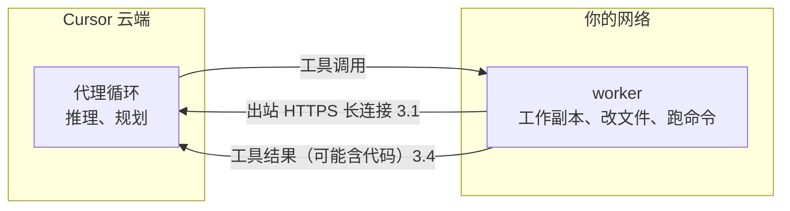

# 让云端代理在自己的机器上干活：Cursor Self-Hosted Machines 搬走了什么、留下了什么

Cursor

**一句话看懂**：Cursor 的云端代理默认跑在 Cursor 托管的虚拟机里。Self-Hosted Machines 让你把**执行环境**换成自己网络里的机器：在机器上装 Cursor CLI、跑 `agent worker start`，它主动向 Cursor 云端建一条出站 HTTPS 长连接，接收工具调用、在本地改文件跑命令、把结果送回去。机器可以是一台笔记本，也可以是一个按需扩缩的 pool，空闲时可以休眠。但要看清边界：**代理循环、推理和规划仍在 Cursor 云端**，工具输出可能带着代码回传，会话记录也可能被 Cursor 处理和存储。

## 读完你能带走的 6 条收获

1. **三种情况才需要自托管**：代理要在内网里直接碰源代码管理和内部服务；要 GPU、Mac 这类特殊硬件；操作系统或构建流程很难打包成云端镜像（见 2）。
2. **自托管只搬走“手”，不搬走“脑”**：执行在你的机器上，推理和规划还在 Cursor 云端（见 2、3.4）。
3. **worker 只向外连，Cursor 从不主动连进你的网络**，所以不用开入站端口（见 3.1）。
4. **pool 是一个命名的 worker 队列**，由一个看着请求队列的 controller 调用你写的 spawn 脚本起机器；不用事先决定留几台机器开着（见 3.2）。
5. **空闲机器可以重置回池、保留工作区，或者快照休眠**，在省钱和“后续追问时不用重建环境”之间取舍（见 3.2）。
6. **不想自己造沙箱层，可以直接用合作的沙箱提供商**；Linux worker 现在也支持电脑操作（见 3.3）。

::: tip 小白先懂这几个词
- [Background Agent（后台代理）](/glossary#background-agent)：不用你盯着、在云端把活干完的代理。
- [Self-Hosted Worker（自托管执行节点）](/glossary#self-hosted-worker)：跑在你自己机器上、替云端代理执行工具调用的进程。
- [Sandbox（沙箱）](/glossary#sandbox)：代理执行代码的隔离环境。
- [Egress Control（出站控制）](/glossary#egress-control)：限制代理能访问哪些外部网络。
- [Computer Use（电脑操作）](/glossary#computer-use)：代理通过截图和点击操作桌面或浏览器。
:::

## 1. 基本信息

<SourceCard type="文章" title="Run cloud agents on machines you manage" author="Jack Pertschuk（Cursor）" date="2026-09-02" url="https://cursor.com/blog/self-hosted-machines" />

| 项目 | 内容 |
|---|---|
| 链接 | https://cursor.com/blog/self-hosted-machines |
| 类型 | Cursor 产品博客（文章，约 1,200 词） |
| 作者 | Jack Pertschuk（页面元数据） |
| 发布日期 | 2026-09-02（页面显示 Sep 2, 2026；页面里另有一个 2026-08-13 的时间标记，按页面日期记） |
| 使用工具 | Cursor 云端代理、Cursor CLI（`agent worker start`）；合作沙箱：AWS Lambda、Cloudflare、Coder、Daytona、E2B、Modal、Namespace、Vercel |
| 分析依据 | 原文全文，2026-10-14 用 curl 重新抓取并逐字核对引语。文中夹有 5 段合作方（AWS Lambda、Cloudflare、Vercel、Modal、Namespace）的推荐语，属推广内容，下文只引用 Cursor 的正文。没有代码、配置或性能数据。“我觉得”开头的段落是本站评论。 |

## 2. 这篇在回答什么

假设你的团队想用云端代理，但代码要连内网的数据库才能跑测试，或者要在 Mac 上编 iOS 应用，或者构建流程依赖一堆很难装进 Docker 的内部工具。Cursor 托管的虚拟机在这些情况下就够不着了。

Cursor 先说明默认方案已经能满足大多数团队：每个会话一台 Cursor 云里的专属虚拟机，有每个代理独立的隔离、密钥脱敏、出站控制和签名提交。然后列出团队通常会用 Self-Hosted Machines 的三种情况：

- 代理的工具执行需要发生在团队网络里，直接访问源代码管理、内部服务和代码仓库；
- 代理需要定制硬件，比如 GPU、做 iOS 开发用的 Mac，或者 Kubernetes、沙箱、托管虚拟机这样的基础设施；
- 操作系统或构建流程很难打包成一个云端代理的构建。

关键的一句是：

::: tr 用 Self-Hosted Machines 时，只有执行环境搬走了，代理循环、推理和规划仍留在 Cursor 云端。
> "With Self-Hosted Machines, only the execution environment moves while the agent loop, inference, and planning remain in the Cursor cloud."
:::

用户这边的入口不变：桌面应用、cursor.com、手机、Slack、GitHub、Linear 都还能用。Cursor 也给了一个背景数字：内部合并的 PR 里，超过 60% 是云端代理创建的。代理用得越多，它跑在什么机器上就越重要。

全文回答四个问题：

1. 自己的机器怎么接进代理循环？（3.1）
2. 机器不够或闲着时怎么办？（3.2）
3. 一定要自己搭沙箱吗？能不能操作浏览器？（3.3）
4. 数据到底留在哪里？（3.4）

## 3. 怎么做

### 3.1 worker：把机器接进代理循环

用了 Self-Hosted Machines，工具执行就从 Cursor 托管的虚拟机搬到你环境里的一台机器上。这台机器持有仓库的工作副本，改文件、跑命令。把它和代理系统连起来的叫 worker。

注册一台机器只要两步：安装 Cursor CLI，运行 `agent worker start`。之后的流程是：

1. worker 向 Cursor 云端打开一条长期的出站 HTTPS 连接；
2. 会话开始后，Cursor 的代理 harness 负责推理和规划，把工具调用发给一个专属的 worker；
3. worker 执行完，把结果送回去，进入下一轮推理。

方向很重要：

<Trans zh="Cursor 从不主动发起连入你网络的连接。">“Cursor never initiates a connection into your network.”</Trans>

这意味着不用开放入站端口，防火墙策略简单得多。

worker 有两种配置：

| 配置 | 是什么 | 适合 |
|---|---|---|
| My Machines | 把一台笔记本或虚拟机连到你的账号 | 个人工作流 |
| Pools | 一个命名的 worker 队列，服务一个团队或企业 | 团队；容量随请求增加、随 worker 断开减少 |

### 3.2 pool 随需求扩缩

云端代理的需求常常是一阵一阵的。pool 会自动跟上：一个 controller 盯着请求队列，用**团队自己提供的 spawn 脚本**按需启动机器。

- pool 里有空闲 worker，它就认领请求；
- 没有，请求就排队，等有容量再处理。

所以团队不用事先决定要留多少台机器开着。

机器闲下来怎么办？有三种选择，各有代价：

| 做法 | 怎么做 | 代价 |
|---|---|---|
| 一直开着 | 代理空闲时机器也开着 | 贵 |
| 空闲超时后重置 | 每个 worker 连接可以设空闲超时，到期后机器重置并回到池里；也可以保留工作区，以防代理收到后续追问 | 释放后再追问，代理可能要花几分钟重建工作区 |
| 休眠 | 给空闲机器做快照再停机；重连窗口内有追问，就恢复快照，用同一个 ID 启动 worker；否则请求转到新机器 | 要有快照能力 |

还有一点：pool 不绑定具体仓库。请求只需要指明 pool，任何空闲 worker 都能认领，所以一个 pool 可以服务很多仓库。

### 3.3 沙箱提供商和电脑操作

**不用从零造沙箱层。** Cursor 和 AWS Lambda、Cloudflare、Coder、Daytona、E2B、Modal、Namespace、Vercel 合作，worker 可以在团队已有沙箱的地方启动和编排。原文里几家合作方的推荐语各讲了自己的卖点，比如 Lambda 从快照近乎瞬时启动、Namespace 为每个代理起一台真 Mac 做 iOS / macOS 开发，这些属于推广内容，不展开。

**Linux 上也能操作浏览器。** 以前电脑操作只支持 Mac 上的 worker，现在 Linux worker 也支持。装好所需依赖（包括 Chrome 或 Chromium）后，代理可以点击、截图、控制浏览器。你可以在 Cursor 里看它的桌面，也可以直接接管。

### 3.4 数据边界要看清

这是选型时最该先读的一段。Self-Hosted Machines 搬走的只是执行环境，原文写得很明确：

::: tr 工具输出会流回 Cursor 用于推理，其中可能包含代码；代理的会话记录可能由 Cursor 处理和存储。
> "Tool outputs flow back to Cursor for inference and may contain code, and agent transcripts may be processed and stored by Cursor."
:::

也就是说：代码库确实留在你的机器上，但代理读文件、跑命令得到的输出，会作为下一轮推理的输入送回 Cursor 云端。读一个文件，文件内容就在工具输出里。

我觉得这一点决定了它适合谁：如果你的顾虑是“代理要够得着内网服务、要特殊硬件”，它正好解决；如果你的顾虑是“代码一行都不能离开网络”，它解决不了，要看 Cursor 的数据处理条款或别的方案。Claude Code 的云端会话在凭据和网络上的做法可以对照看（[[48]]）。

## 4. 结果与局限

| 项目 | 原文情况 |
|---|---|
| 内部使用 | 超过 60% 的合并 PR 由云端代理创建 |
| 接入方式 | 安装 Cursor CLI，运行 `agent worker start` |
| 扩缩、休眠 | 有机制说明，无配置示例 |
| 性能、成本数据 | 未给出 |
| spawn 脚本写法 | 未给出，原文让读者看文档 |

::: warning 局限与注意
- 没有代码、配置或性能数据，spawn 脚本、pool 配置都要看 Cursor 文档。
- 工具输出可能带代码回传，会话记录可能被 Cursor 存储；有严格数据驻留要求的团队要先确认条款。
- 自托管意味着平台团队要维护 spawn 脚本、pool 和机器镜像，没有人力时先用默认的托管环境。
- 文中 5 段合作方推荐语属推广内容。
:::

## 5. 结论

Self-Hosted Machines 解决的是“云端代理够不着”的问题：内网、特殊硬件、难打包的构建。做法是把执行环境换成你自己的机器，用一条出站连接接进 Cursor 的代理循环；pool、空闲超时和休眠让它能按需扩缩、控制成本。

我觉得读这篇最该记住的是那句“只有执行环境搬走了”。它让代理能在你的网络里干活，但推理仍在云端，工具输出会回传。

### 你可以这样试

- [ ] 列出你的代理今天“够不着”的东西（内网服务、GPU、Mac、特殊构建），判断是否属于 2 节的三种情况。
- [ ] 用一台测试虚拟机装 Cursor CLI、运行 `agent worker start`，从 Cursor 发一个小任务，确认它在你的机器上执行。
- [ ] 和安全团队过一遍 3.4 的数据边界：哪些工具输出会回传，会话记录存在哪里。

### 读完自测

1. 原文列出的三种适合自托管的情况是什么？
2. worker 和 Cursor 云端之间的连接是谁发起的？这有什么好处？
3. pool 是怎么扩容的？空闲机器有哪几种处理方式？
4. 用了 Self-Hosted Machines，哪些东西仍在 Cursor 云端？
