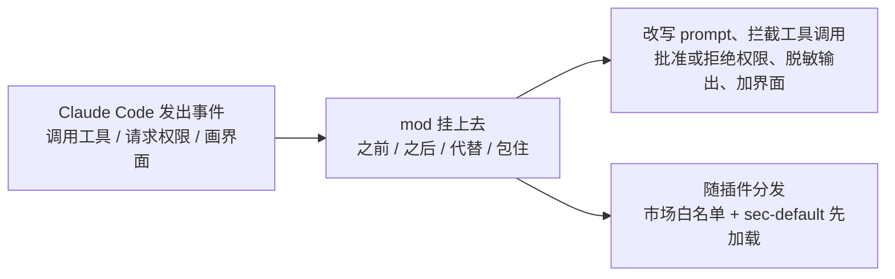
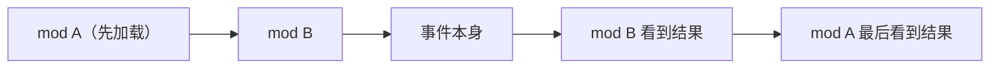

# Hooks 不够用时：Claude Code 的 mods 能改什么，又该怎么管

Claude Code

**一句话看懂**：mods 是几行 TypeScript 写的小函数，挂在 Claude Code 发出的事件上（调用工具、请求权限、画界面），可以在事件之前、之后、代替它或包住它运行。所以它能做到 Hooks 做不到的事：改写事件、画新界面、替换内置功能。代价是 mod **不在沙箱里**，权限和 Claude Code 一样大，所以团队要靠插件市场白名单和最先加载的 `sec-default` 来管住它。

## 读完你能带走的 6 条收获

1. **mod 和 Hook 的区别在于能不能“改”**：Hook 只能在固定时刻跑脚本，mod 可以改写事件、画界面、替换功能（见 3.1）。
2. **一个 mod 有四种挂法**：事件之前、之后、代替事件，或者前后都包住（见 3.1）。
3. **多个 mod 像洋葱一样叠**：先加载的先看到事件，最后看到结果（见 3.2）。
4. **内置功能也开始变成 mod**，比如 `/diff`，可以关掉或换成自己的版本（见 3.3）。
5. **mod 没有沙箱**，和 Claude Code 权限相同，只装可信来源的 mod（见 3.4）。
6. **加载顺序就是权限边界**：`sec-default` 和审计日志这类 mod 必须最先加载才有效（见 3.4）。

::: tip 小白先懂这几个词
- [Hooks（钩子）](/glossary#hooks)：在代理生命周期固定时刻自动运行的脚本。
- [Mods（模组）](/glossary#claude-code-mods)：挂在 Claude Code 事件上、能改写行为和界面的 TypeScript 函数。
- [Plugins（插件）](/glossary#plugins)：把多种扩展打包成一个可安装单元，mods 就装在插件里。
- [Tool Call（工具调用）](/glossary#tool-call)：代理请求执行一个工具，比如跑命令、读文件。
- [Sandbox（沙箱）](/glossary#sandbox)：隔离的执行环境。mods 恰恰不在里面。
:::

## 1. 基本信息

<SourceCard type="文章" title="Customize Claude Code with mods in TypeScript" author="Anthropic" date="2026-10-01" url="https://claude.com/resources/articles/claude-code-mods" />

| 项目 | 内容 |
|---|---|
| 链接 | https://claude.com/resources/articles/claude-code-mods |
| 类型 | Anthropic 产品公告（文章，正文约 700 词，页面标注阅读时间 5 分钟） |
| 作者 | 页面未署个人名字，按 Anthropic 记 |
| 发布日期 | 2026-10-01（页面显示 October 1, 2026） |
| 使用工具 | Claude Code CLI 和桌面应用；`/plugin`、Claude directory |
| 分析依据 | 原文全文，2026-10-15 用 curl 抓取，引语逐字核对。原文是发布公告，**没有 API 签名、代码示例或数据**；入门指南和文档只给了链接，本站没有展开。“我觉得”开头的段落是本站评论。 |

## 2. 这篇在回答什么

假设你想让 Claude Code 每次读到工具输出时，先把里面的 API 密钥打上码再给模型看；或者想在对话旁边放一个面板，显示 CI 跑没跑过。

用 Hooks 能做一部分：在固定时刻跑一段脚本。但原文说得很直白：

<Trans zh="Hooks 不能改写事件、画新界面或替换功能。mods 可以。">“hooks can't rewrite events, draw new UI, or replace features. Mods can.”</Trans>

mods 的定义是一句话：

<Trans zh="改变 Claude Code 工作方式的小型 TypeScript 函数">“small TypeScript functions that change how Claude Code works”</Trans>

全文回答四个问题：

1. mod 挂在哪里，能做什么？（3.1）
2. 好几个 mod 同时挂在一个事件上，谁先谁后？（3.2）
3. 内置功能变成 mod，意味着什么？（3.3）
4. 这么强的扩展，团队怎么管？（3.4）

## 3. 怎么做

### 3.1 事件模型：mod 挂在哪里

Claude Code 每做一件事都会发出一个事件。原文举的例子有三个：调用工具、请求权限、画出屏幕的一部分。

mod 就是挂在某个事件上的函数，有四种挂法：

| 挂法 | 什么时候跑 |
|---|---|
| before | 事件发生之前 |
| after | 事件发生之后 |
| instead | 代替事件本身 |
| wrap | 包住事件，前后都跑代码 |

原文列出一个函数就能做到的四件事：

- 在 prompt 送到模型之前改写它；
- 拦截、改写或重试一次工具调用；
- 批准或拒绝一个权限请求；
- 在 Claude 读到工具输出之前，把里面的密钥删掉。

mod 也能改你看到的东西：编辑或替换界面上的一部分（比如工具结果，或者 Claude 向你提的问题），加按钮和输入框，其他 mod 还能响应这些按钮。目前可以针对终端、桌面应用，或者两者都改。

写 mod 不一定要自己动手。原文说可以让 Claude Code 写：它会写好 TypeScript、安装，并在当前会话里热重载。

我觉得，“instead”这种挂法是 mod 和 Hook 本质不同的地方。Hook 只能旁观或拦下，mod 能直接接管一个行为。这既是能力，也是风险，见 3.4。

### 3.2 多个 mod 怎么叠

几个 mod 挂在同一个事件上时，按加载顺序运行：

<Trans zh="第一个加载的 mod 最先看到事件，最后看到结果。">“The first mod to load sees the event first and the result last.”</Trans>

这就是常见的洋葱模型（Web 框架的中间件也是这样）。好处是不同作者写的 mod 可以叠在一起用。

这个顺序决定了谁能“看见一切”。最外层的 mod 能看到所有里层 mod 做了什么，也能否决它们。3.4 里的安全设计就建立在这一点上。

### 3.3 内置功能也变成 mod

原文说，Claude Code 的一些内置功能现在本身就是 mod。例子是 `/diff`：可以在 `/plugin` 里关掉它，或者换成自己的版本。

Anthropic 打算把更多内置功能挪成 mod，让你可以把 Claude Code 缩成一个小核心，只加回想要的部分。

我觉得这说明 mods 不是一个边缘的扩展点，而是 Claude Code 自己的架构方向：官方功能和第三方扩展用同一套机制，你能替换的范围会越来越大。

### 3.4 安全与团队治理

先看原文的警告：

<Trans zh="mods 运行时拥有和 Claude Code 本身相同的机器访问权限。">“Mods run with the same access to your machine as Claude Code itself.”</Trans>

mod 不在沙箱里。只从可信来源安装，标准和在电脑上装任何代码一样。

团队怎么管？原文给了三层：

1. **沿用插件管控**。mods 装在插件里，所以现有的插件控制都适用：管理员可以允许或阻止插件市场。Team 和 Enterprise 方案在管理后台设置；Claude API 和第三方 API 方案由管理员把 managed settings 推到用户机器上。
2. **`sec-default` 最先加载**。在 Team、Enterprise 方案，以及任何有 managed settings 的机器上，一个叫 `sec-default`（security default）的内置 mod 会最先加载。它阻止用户装的 mod 做危险的事，比如覆盖你的权限拒绝规则。源码可以查看。
3. **管理员也可以让自己的 mod 先加载**。但这样做时要把 `sec-default` 加进列表，否则它的限制就没了。

团队还可以用 mods 做自己的管控和功能，原文举了三个例子：

| 用途 | 做法 |
|---|---|
| CI/CD 状态 | 在对话旁边的面板里显示流水线状态，构建通过或失败时更新 |
| 生产保护 | 任何命令碰到生产配置之前要求确认 |
| 审计日志 | 一个最先加载的 mod 记录其他所有 mod 的每一次调用 |

我觉得这一节的关键词是“最先加载”。`sec-default` 和审计日志都只有放在最外层才有效。所以在团队里，**谁能决定加载顺序，谁就握着安全边界**。把 mod 的安装权和加载顺序交给管理员，比审每个 mod 的代码更可行。

## 4. 结果与局限

- **这是一篇发布公告**，没有用户数据、性能数据或事故记录，也没有贴出 mod 的 API 签名和示例代码。具体写法要看它链接的入门指南和文档。
- **安全模型靠“可信来源 + 加载顺序”**。mod 本身不隔离，`sec-default` 具体拦哪些事，原文只举了“覆盖权限拒绝规则”一例，其余要看源码。
- 原文提到设计稿上线前在 GitHub 上征求过意见，但没说改了什么。

## 5. 结论

mods 让 Claude Code 从“可配置”变成“可编程”：规则文件和 Hooks 管不到的行为和界面，现在可以用 TypeScript 直接改。代价是信任边界前移了，装一个 mod 就像装一个有完整权限的程序。

我觉得顺序应该是：能用 CLAUDE.md 说清的先写规则（见 [[20]]），要确定性检查的先用 Hooks（见 [[28]]），只有要改写事件、替换功能或加界面时再写 mod。团队启用 mods 前，先把插件市场白名单和 `sec-default` 配好。

**你可以这样试**

1. 在 CLI 里运行 `/plugin`，找到 `/diff`，看看内置功能作为 mod 是什么样子。
2. 让 Claude Code 写一个只做一件事的 mod，比如工具输出脱敏，看它怎么热重载。
3. 如果是团队管理员，先确认 managed settings 里 `sec-default` 在加载列表最前面。

**读完自测**

- mod 有哪四种挂法？哪一种是 Hook 做不到的？
- 两个 mod 挂在同一事件上，先加载的那个什么时候看到结果？
- 管理员让自己的 mod 先加载时，为什么要把 `sec-default` 加回列表？
