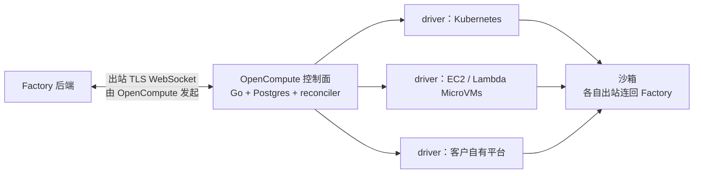

# 一台机器不等于一支机队：Factory OpenCompute 怎么给代理按需发电脑

Factory Droid

**一句话看懂**：代理开始自己处理告警、定时任务和 Slack 委托之后，问题就从“代理跑在哪台机器上”变成了“谁来按需开机、关机、休眠一整批机器”。Factory 的 OpenCompute 是一个装在你自己环境里的编排层：它只管通用的生命周期（申请、调到期望状态、跟踪活动、暂停或销毁），每种底层平台各写一个 gRPC driver。网络上只向外连，状态先写进 Postgres 再由 reconciler 慢慢调和。最值得借鉴的是它的开发方法：把“支持这个平台”改写成“实现这份合约、通过这些一致性测试”，再交给代理去写。

## 读完你能带走的 6 条收获

1. **单台远程机器解决“代理去哪干活”，机队解决“工作量忽大忽小”**：告警触发、突发委托、做完释放，都要自动开关机（见 3.1）。
2. **不要押注某一家沙箱**，在它们上面做一层通用生命周期，平台差异交给 driver（见 3.2）。
3. **开机不是一次可靠的 API 调用**：先把“想要什么”持久化，再由 reconciler 反复调和，控制面重启也不丢活（见 3.3）。
4. **统一接口要诚实地承认差异**：必选 Core 能力加可选的 Suspend、Snapshot、Fork，做不到的请求在改状态之前就拒绝（见 3.3）。
5. **只向外连**：不开入站端口，用签名挑战证明身份，私钥可以放在 KMS（见 3.4）。
6. **把开放任务改写成“合约 + 一致性测试”，代理就能接手**；首个客户的 driver 是在飞机上让代理写完的（见 3.5）。

::: tip 小白先懂这几个词
- [Sandbox（沙箱）](/glossary#sandbox)：代理执行代码的隔离环境。
- [Self-Hosted Worker（自托管执行节点）](/glossary#self-hosted-worker)：跑在你自己机器上、替云端代理执行工具的进程。
- [Reconciler（调和器）](/glossary#reconciler)：反复比较“期望状态”和“实际状态”，一步步把实际调成期望的后台循环。
- [Conformance Test（一致性测试）](/glossary#conformance-test)：检查某个实现是否真的满足接口约定的黑盒测试。
- [Droid](/glossary#droid)：Factory 的编码代理。
:::

## 1. 基本信息

<SourceCard type="文章" title="Introducing OpenCompute" author="Walker Hildebrand、Sherry Bai（Factory）" date="2026-10-14" url="https://factory.com/news/opencompute" />

| 项目 | 内容 |
|---|---|
| 链接 | https://factory.com/news/opencompute |
| 类型 | Factory 产品博客（文章，约 1,600 词，页面标注 7 分钟） |
| 作者 | Walker Hildebrand、Sherry Bai |
| 发布日期 | 2026-10-14（页面显示 October 14, 2026） |
| 使用工具 | Factory Droid、Missions、Remote Control、Automations；底层：Kubernetes、EC2、AWS Lambda MicroVMs、Kubernetes Agent Sandbox、Google Agent Substrate |
| 分析依据 | 原文全文，2026-10-15 用 curl 抓取（正文在页面脚本数据里），引语逐字核对。原文有 3 张架构图，本站用文字和 Mermaid 转述。产品处于 private preview，没有性能、成本或客户数量数据；“六周”“两天”是作者自述。“我觉得”开头的段落是本站评论。 |

## 2. 这篇在回答什么

原文开头就问：

<Trans zh="在代理能在你睡觉时干活的世界里，怎么让它们跑在你自己的基础设施上？">“In a world where agents can work while you sleep, how do we enable them to run on your infrastructure?”</Trans>

代理在聊天窗口里时，答案很简单：跑在你为这个会话准备好的机器上。但当代理开始调查告警、响应异步请求、执行定时任务、全天接 issue，问题就变了：

<Trans zh="你不再只需要一个跑代理的地方，你需要一支跟得上工作的算力机队。">“You no longer just need somewhere to run an agent. You need a compute fleet that can keep up with the work.”</Trans>

OpenCompute 是 Factory 的自托管编排器，在你选的运行时上管理代理沙箱。全文回答五个问题：

1. 已经能远程控制一台机器了，为什么还不够？（3.1）
2. 为什么做编排层，而不是自己做沙箱？（3.2）
3. 面对不熟悉的平台，怎么让开关机可靠？（3.3）
4. 网络和身份怎么设计，才不用把钥匙交出去？（3.4）
5. 六周做出来、两天部署到客户机房，靠的是什么？（3.5）

## 3. 怎么做

### 3.1 一台机器不是一支机队

Factory 在 2026 年 4 月推出了 Droid Computers：给 Droid 用的持久机器，可以开在 Factory 云里，也可以通过 Remote Control 注册自己的机器。

Remote Control 的价值是让 Droid 和算力层解耦。代理循环跑在那台机器上，所以能直接用私有仓库、包源和内部服务，不用把它们暴露到公网。

但它适合的是**一台**持久机器：一台配好的工作站、一台开发 VM、一台有特殊硬件的机器。企业要的是一整批。原文用三句话描述了缺口：

- 一条告警应该能直接触发调查，不需要有人先开一台 VM；
- 一阵 Slack 委托涌进来，团队不应该去数还剩几台机器；
- 任务做完了，不应该留下一直空转的资源。

Factory 的托管版已经能处理一部分生命周期，自托管机器却没有原生的开机、暂停、恢复。客户能在想要的地方跑 Droid，但机队得自己运维。

### 3.2 为什么做编排层，不做沙箱

客户的基础设施五花八门：有的想用已有的 Kubernetes 集群，有的要特殊硬件，有的有开发者已经依赖的内部平台，有的在上新的 microVM。

市面上的沙箱也不少。原文点名了 E2B、Daytona、Modal，以及 Kubernetes Agent Sandbox、Google 的 Agent Substrate、AWS Lambda MicroVMs。每家在隔离、持久性、启动速度、运维难度、部署灵活性上取舍不同：适合短任务的未必适合持久开发环境，创业公司好用的服务在受监管企业的网络里可能用不了，半年后的最佳选择也可能变。

所以 Factory 决定在算力层之上建一层：

| 谁 | 负责什么 |
|---|---|
| OpenCompute | 通用生命周期：申请一台电脑、把它调到期望状态、跟踪活动、按策略和平台能力暂停或销毁 |
| provider（底层平台） | 让这些操作真正发生的基础设施机制 |

原文的说法是：要把编排带到客户的环境里，而不是把每个客户搬进自己的环境。

### 3.3 不可靠的平台怎么变可靠

**先记意图，再调和。** 原文说开机不是一次可靠的 API 调用：连接会断，平台会限流，进程可能在请求成功、响应还没回来时重启。

OpenCompute 用声明式的生命周期模型应对：

1. Go 写的控制面把**期望状态**和**观测到的状态**都存进你环境里的 Postgres；
2. 创建一台电脑只是持久化一条意图，不会一直挂着请求等平台完成；
3. reconciler 持续工作：开机、观察、重试可恢复的失败、推动状态转换；
4. 意图是持久的，所以控制面重启不会抹掉没做完的工作。

另外，电脑从不可变的 Build 启动，把“准备环境”和“创建机器”分开；构建产物和快照放在 S3 兼容存储里；活动信号和每台电脑的生命周期设置决定它该继续开着还是该处理掉。

**统一行为，不统一基础设施。** 每个平台一个独立的 gRPC driver，把通用操作翻译成平台自己的机制：创建、观察、执行命令、销毁。平台特有的东西不进控制面的数据库和调和逻辑。

但统一接口要诚实：

<Trans zh="不是每个后端都能暂停电脑、给磁盘做快照或分叉。">“Not every backend can suspend a computer, snapshot its disk, or fork it.”</Trans>

所以 OpenCompute 定义了一个必选的 Core 一致性档位，加上可选的 Suspend、Snapshot、Fork 档位。黑盒测试验证 driver 声称支持的行为。不支持的请求**在修改持久状态之前**就被拒绝，而不是开机做到一半才报错。

我觉得这条“提前拒绝”很值得抄。很多抽象层的问题是假装所有后端都一样，等出错时状态已经写了一半，清理比开机还难。

### 3.4 只向外连，钥匙留在自己手里

原文的信念是：采用自主软件开发，不应该要求把基础设施的钥匙交给别人。网络和身份这样设计：

- OpenCompute 跑在你的环境里，**主动**向 Factory 建一条出站、TLS 加密的 WebSocket 连接。Factory 通过这条连接发来已授权的算力请求。不需要公网端点，也不用开入站防火墙端口。
- 注册时，OpenCompute 向 Factory 登记一个公钥；每次连接时，对一个新挑战签名，证明自己持有私钥。私钥在你手里，可以放在支持的云 KMS 里。
- 每个沙箱也各自出站连回 Factory，和远程控制的电脑一样。内部仓库和服务保持私有，Droid 从你的网络里面去访问它们。

原文专门加了一条提醒：**算力放在哪里，和推理请求发到哪里、会话存在哪里，是两回事**。想让会话数据完全留在本地，还要看推理和同步的配置。

### 3.5 六周和两天：接口让代理能干活

OpenCompute 从一开始就是用代理开发的，起点是一个 Mission（Factory 的长任务功能）。人的工作是定边界、写规格、让正确性可测试，其余由 Droid 在人的指挥下完成。

这就让接口设计变得特别重要：

::: tr “给这个平台加支持”是开放式任务；“实现这份合约并通过这些一致性测试”给代理一个有边界的问题和可验证的成功标准。
> ""Build support for this provider" is an open-ended assignment. "Implement this contract and satisfy these conformance tests" gives an agent a bounded problem and a verifiable definition of success."
:::

同样的拆分让产品灵活，也让它好开发：新 driver 只关心自己的平台，不用重写机队管理；控制面改进时也不用学新的云 API。团队用这种方式开发和评估了 AWS Lambda MicroVMs、Kubernetes、EC2、Agent Sandbox、Agent Substrate 等集成。原文承认这些集成成熟度不一，但这正是要点：架构能容纳差异。

最直接的检验是第一个客户。对方要求在一个定制的本地机房里部署，平台接口是自研的。登机去见客户之前，团队启动了一个 Mission，用手头的信息写这个环境的初始 driver。落地时 driver 已经写好。现场两天后，客户通过 OpenCompute 开出了第一个沙箱。在用户看来，这和创建一台托管的 Droid Computer 没区别，只是沙箱跑在客户自己的数据中心里。

从早期原型到首个客户部署：六周。原文也说了，这只是开始，之后还有持久化、恢复、部署工具和运维加固要做。它验证的核心赌注是：

<Trans zh="接入一个新平台可以是一个 driver 问题，而不是平台重写。">“integrating a new provider could be a driver problem, not a platform rewrite.”</Trans>

我觉得这一节比产品本身更有用。它说明“让代理写基础设施代码”的前提不是更强的模型，而是先把任务改写成合约加测试。这和 [[07]] 把规范变成 lint 和测试是同一个道理。

## 4. 结果与局限

- **原文能证明的**：架构设计（出站连接、声明式生命周期、driver 与能力档位）和一个客户案例的时间线。
- **作者自述、无法核对**：六周、两天、“落地时 driver 已经写好”。原文没说 driver 首版的质量，只说之后还有大量加固。
- **没有数据**：没有开机延迟、成本、并发规模或故障率。
- **还用不上**：private preview，要联系 Factory 的客户经理；原文说计划开源合约、一致性测试和 driver 模型，但没给时间。
- **数据边界**：算力在你这里，不代表推理和会话数据也在你这里（3.4）。

## 5. 结论

当代理从“陪人聊天”变成“自己接活”，算力就从一台机器变成一支机队。OpenCompute 的答案是：在各家沙箱之上做一层通用生命周期，用声明式状态和 reconciler 对付不可靠的平台，用能力档位诚实地处理差异，只向外连接。

和 Cursor 的自托管机器（[[51]]）比，两者都只向外连、都把执行放进你的网络；Cursor 让你写 spawn 脚本管 pool，Factory 把生命周期本身做成一个可插拔的服务。

我觉得即使你不用 Factory，这篇也值得读两遍：一遍看“意图持久化 + 调和”这种对付不可靠 API 的老办法，一遍看“合约 + 一致性测试”怎样让代理接手开放任务。

**你可以这样试**

1. 下次要让代理“给 X 加支持”时，先写一份接口和几条黑盒测试，再把任务改写成“实现这个接口、让测试通过”。
2. 检查自己的自动化：如果一个长操作中途进程重启，未完成的工作会不会丢？能不能先把意图写进数据库？
3. 设计抽象层时，列出哪些能力是必选、哪些是可选，并让不支持的请求在改状态前就失败。

**读完自测**

- 为什么 Remote Control 不能满足“告警触发调查”这类需求？
- reconciler 模式下，控制面重启为什么不会丢掉没做完的开机请求？
- OpenCompute 为什么在修改持久状态之前就拒绝不支持的请求？
