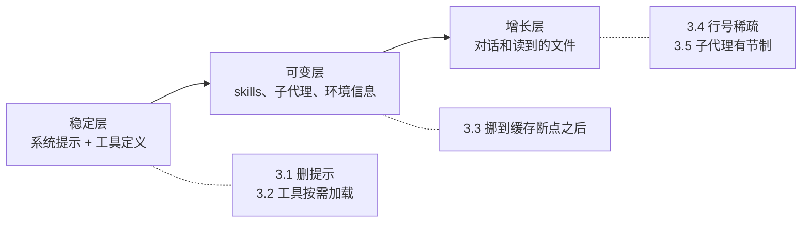

# 代理跑得越久越贵，钱花在哪：Cursor 把 token 成本降 7% 的五个做法

Cursor

**一句话看懂**：代理每一轮都要把系统提示、工具定义和整段对话重新发一遍。任务越长，这些重复内容越贵。Cursor 从 harness 下手做了五件事：系统提示删掉约 66%；不常用的工具改成用到时再加载；把缓存断点放在“稳定的前缀”和“不断增长的对话”之间；读文件时只每十行标一个行号；减少不必要的子代理和换模型。总体 token 成本降了 7%，靠线上 A/B 测试确认质量没变差。

## 读完你能带走的 6 条收获

1. **长任务的钱主要花在两处**：每轮重复发送的静态前缀，和越积越多的工作上下文（见 2）。
2. **模型变强后，大量“禁止”“必须”的规则可以删掉**，只说明工具怎么工作就够了；要用线上 A/B 而不只靠 evals 来确认（见 3.1）。
3. **大多数工具只在不到 20% 的对话里用到**，可以按需加载；但高频工具和会被“幻觉调用”的工具要留着（见 3.2）。
4. **缓存要命中，前缀就要稳定**：把易变的内容挪到缓存断点之后（见 3.3）。
5. **小改动也有账可算**：行号从每行改成每十行，cache-read token 降 1.6%（见 3.4）。
6. **子代理能省 token，也有协调税**；模型已经学会何时用子代理，就别再在提示里硬推（见 3.5）。

::: tip 小白先懂这几个词
- [Harness（代理外壳）](/glossary#harness)：包在模型外面、负责组装请求、调工具、管上下文的程序。
- [System Prompt（系统提示）](/glossary#system-prompt)：每轮都发给模型的固定说明。
- [Deferred Tools（延迟加载工具）](/glossary#deferred-tools)：工具说明不预先放进上下文，用到时再加载。
- [Prompt Caching（提示缓存）](/glossary#prompt-caching)：模型服务商复用请求里没变的前缀，便宜又快。
- [Subagent（子代理）](/glossary#subagent)：被主代理派出去、用新上下文做子任务的代理。
:::

## 1. 基本信息

<SourceCard type="文章" title="Improved token efficiency for longer agent runs" author="Jediah Katz、Connor O’Keefe、Calvin Yee（Cursor）" date="2026-09-23" url="https://cursor.com/blog/improved-token-efficiency" />

| 项目 | 内容 |
|---|---|
| 链接 | https://cursor.com/blog/improved-token-efficiency |
| 类型 | Cursor 研究博客（文章，约 1,300 词，页面标注 7 分钟） |
| 作者 | Jediah Katz、Connor O’Keefe、Calvin Yee |
| 发布日期 | 2026-09-23（页面显示 Sep 23, 2026） |
| 使用工具 | Cursor 代理 harness；OpenAI API 显式缓存断点（GPT-5.6 起） |
| 分析依据 | 原文全文，2026-10-15 用 curl 抓取，引语逐字核对。原文有三张交互图（花费构成、工具调用频率、工具下放前后），图中具体数值无法从文本核对，本站只引用正文里写出的数字。几个百分比口径各不相同（见第 4 节）。“我觉得”开头的段落是本站评论。 |

## 2. 这篇在回答什么

你让代理跑一个两小时的任务，账单上的 token 大部分花在哪？

不是模型写的代码。原文的第一张图把生产流量的花费拆成输出、未缓存输入、缓存输入三类。背后的原因是：

<Trans zh="代理现在工作得更久，从一步到下一步带着更多上下文，所以怎么组装和管理这些上下文越来越重要。">“Agents now work for longer and carry more context from one step to the next, making the way we assemble and manage that context increasingly important.”</Trans>

Cursor 能直接控制的是 harness：每个请求怎么拼、上下文怎么复用、什么时候把活分给别的代理。在这几层上改动之后：

<Trans zh="在不降低代理质量的情况下，用户的 token 成本降了 7%。">“reduced token costs for users by 7% without reducing agent quality”</Trans>

一个请求可以看成三层，五个做法分别作用在不同层上：

## 3. 怎么做

### 3.1 系统提示删掉约 66%

**是什么。** 每一轮，模型开始工作之前，Cursor 都会塞进系统提示和工具定义。它们贯穿整段对话，所以成了 Cursor 能完全控制的最大开销之一。

**为什么能删。** 早期模型能力弱，要把工具用法、任务管理、改代码流程一条条写清楚，还要防一些怪行为，比如输出超长的哈希串、二进制内容和 emoji。模型变强以后，这些大多不需要了：

<Trans zh="不再需要一长串“不要这样做”“你必须”“重要”的指令，只要定义工具怎么工作，模型一般就会照做。">“Instead of long lists of "DO NOT do this," "You must," or "Important" instructions, we could simply define how a tool behaves and models would generally comply.”</Trans>

这在不同模型家族上都成立，所以系统提示删掉了大约 66%。之后仍在持续增删：新模型需要新指导时就加，这些指导又会进入未来模型的训练。

**怎么确认没删坏。** 原文强调线上 A/B 测试：evals 快、有用，但往往代表“难题”，不能反映用户请求的真实分布。

我觉得这条对写 AGENTS.md 或 CLAUDE.md 的人同样适用：规则文件越写越长时，可以试着删掉那些“必须”“禁止”，看效果有没有变差（参见 [[20]]）。

### 3.2 工具用到时再加载

工具定义是每轮都带的另一块。这一年 Cursor 给代理加了很多能力：后台 shell 监控、云端子代理、更可靠的网页访问。工具定义随之暴涨。可是：

<Trans zh="这些工具大多很重要，但每个只在不到 20% 的对话里用到。">“Most of these tools are important, but each is needed in fewer than 20% of conversations.”</Trans>

Cursor 之前已经把 MCP 工具改成动态上下文、需要时再加载，在调用过 MCP 工具的会话里，总 token 降了 46.9%。现在把同样的办法用到了自己的内置工具上。

哪些留在静态上下文？他们按两个标准 A/B 测试了几种配置：每个工具用得多频繁，模型是否需要一开始就看到它。同时盯着 token 用量、成本、延迟、工具调用错误和整体使用量。最后留下的是：

| 留在静态上下文 | 原因 |
|---|---|
| 读、搜索、编辑、shell | 高频 |
| `ask_question` | 有些模型容易“幻觉”出对它的调用 |
| Plan Mode 里的 `create_plan` 这类工具 | 对特定产品流程至关重要 |

其余工具在代理需要时再加载。结果是静态上下文里的工具描述 token 降了 60%。

我觉得 `ask_question` 这个例子很实在：模型会凭印象去调一个它“以为存在”的工具，如果定义不在上下文里，调用就会出错。决定下放哪些工具时，不能只看频率，还要看模型的习惯。

### 3.3 让缓存多命中

每一轮都要重发一个长请求：工具、系统指令、setup、到目前为止的对话。开头大部分不变，结尾的对话不断变长。提示缓存让服务商复用没变的前缀。

问题在于缓存边界。GPT-5.6 之前，边界是根据最新请求自动决定的，工具和系统指令虽然很少变，却没有被单独标记为可复用。GPT-5.6 起，OpenAI API 允许客户端在默认的隐式缓存之外，标记显式的缓存断点。

Cursor 做了两件事：

1. **断点放在稳定层之后、增长的对话之前**，让后面的轮次复用更多前缀。
2. **让前缀本身更稳定**。工具和系统指令只放很少变化的内容；更易变的 setup 挪到缓存边界之后，放进他们所说的“phantom user message”里，包括 skills、子代理和环境信息这类跟用户或请求相关的上下文。

<Trans zh="断点只有在前缀本身保持稳定时才有用">“Breakpoints only help if the prefix itself stays stable”</Trans>

结果：冷缓存未命中率降了 20%。

### 3.4 读文件时少标行号

代理干活时加进上下文的内容，很大一部分来自读文件。Cursor 的 Read 工具以前给每一行编号，因为模型自己数不准行，又需要向用户引用具体位置。

一个行号只有 3 到 5 个 token，但一个会话里读几万行时，加起来就不少了。他们改成**每十行标一个行号**：频率仍够模型准确引用代码，cache-read token 降了 1.6%，质量没有下降。

### 3.5 子代理：省 token，也有协调税

长任务给了更多把活分给子代理的机会。子代理通常从新的上下文开始，不背着父代理的整段对话；它报告完结果，父代理也不用背着子代理的工作上下文。

但上下文隔离有代价：

<Trans zh="不共享上下文的代理可能重复工作，或者去做已经不需要的任务。">“agents that do not share context can duplicate work or pursue tasks that are no longer necessary”</Trans>

Cursor 做了两处调整：

1. **删掉强烈鼓励用子代理探索代码库的指令**。子代理在训练数据里越来越常见，研究人员也把它放进了后训练，模型已经原生学会了这种用法。去掉额外提示后，子代理的使用更均衡。
2. **收紧子代理选模型**。Cursor 的子代理可以用任何可用模型，这能弥补模型盲点，也能让贵的规划模型配便宜的实现模型。他们改了工具参数：只有用户或 harness 指定时，代理才选不同的模型。

## 4. 结果与局限

原文给出的数字口径各不相同，**不能相加，也不能互相比较**：

| 数字 | 量的是什么 |
|---|---|
| 7% | 用户的总体 token 成本 |
| 约 66% | 系统提示长度 |
| 46.9% | 调用过 MCP 工具的会话里的总 token（早前的改动） |
| 60% | 静态上下文里的工具描述 token |
| 20% | 冷缓存未命中率 |
| 1.6% | cache-read token |

局限：

- “不降低质量”的依据是 A/B 测试，但原文没有公布测了哪些质量指标的具体数值。
- 图中的花费构成和工具调用频率无法从文本核对。
- 显式缓存断点依赖服务商支持，原文只讲了 OpenAI API（GPT-5.6 起）的情况。
- 原文结尾说这些经验也用到了 Grok Bot 的 harness 上，没有给细节。

## 5. 结论

长任务省 token 的思路是把请求分层：稳定的部分尽量少、尽量被缓存；可变的部分挪到缓存之后；增长的部分少放冗余。每一步都用线上 A/B 确认质量不变。

7% 看起来不多，但它来自一串几乎没有副作用的小改动。我觉得这篇最大的价值是给了一张“可以检查的清单”：自己写 harness、写大段规则文件、接很多 MCP 工具的人，都能逐条对照。工具很多时，也可以对照 [[36]] 用代码调用 MCP 的做法。

**你可以这样试**

1. 翻一遍自己的 AGENTS.md / CLAUDE.md，找出“必须”“禁止”“重要”这类句子，删一批后对比几个真实任务的表现。
2. 统计自己接的 MCP 工具哪些很少用，看所用的客户端能不能改成按需加载。
3. 如果自己拼请求，把每轮会变的内容（时间、环境信息）从系统提示里挪到最后。

**读完自测**

- 为什么把环境信息放进系统提示会让缓存变差？
- Cursor 下放工具时，为什么要把 `ask_question` 留在静态上下文？
- 子代理的“协调税”指什么？Cursor 怎么减少它？
