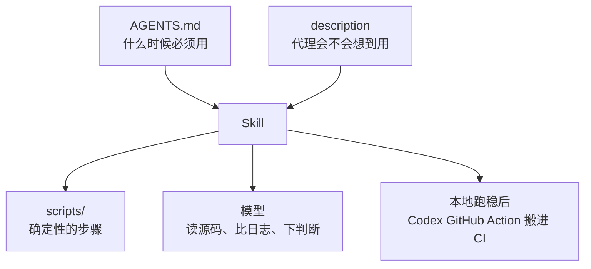

# 把维护流程写进仓库：OpenAI Agents SDK 怎么用 Skills、AGENTS.md 和 GitHub Action

<div class="meta-tags"><span class="tool-tag tool-codex">Codex</span></div>

<div class="hook">

**一句话看懂**：OpenAI 维护 Agents SDK 的两个仓库（Python 和 TypeScript）时，把验证、发版检查、示例测试、写 PR 说明这些重复活，都写成仓库里的 Skills。分工很清楚：**AGENTS.md 规定什么时候必须用哪个 Skill，Skill 的 description 决定代理会不会想到用它，scripts 管确定性的步骤，模型管需要判断的部分，本地跑稳了再用 Codex GitHub Action 搬进 CI**。同一时期两个仓库合并的 PR 从 316 个升到 457 个。

</div>

## 读完你能带走的 7 条收获

1. **好 Skill 的三个特征**：窄合约、清晰触发、具体输出；有些最有用的 Skill 先出报告、征得同意再改（见 3.1）。
2. **用 AGENTS.md 里的 if/then 规则让 Skill 变成必须**，最重要的规则放在最上面（见 3.2）。
3. **“验证通过”要有可执行的定义**：改了代码就必须跑完整套检查，不通过不算完成；只改文档就不用（见 3.2）。
4. **description 是路由合约，不是文案**：要写清什么时候用、什么改动触发、是不是必须（见 3.3）。
5. **模型反复重新摸索同一段 shell 配方，就该把它写成脚本**；脚本像小 CLI，判断留给模型（见 3.3）。
6. **发版检查默认放行，只有拿到具体证据才阻止，阻止必须附解锁清单**（见 3.4）。
7. **公开仓库把 Skill 搬进 CI 时，风险主要在触发设计**：限制谁能触发、清洗输入、保护 API key、Codex 放在最后一步（见 3.5）。

::: tip 小白先懂这几个词
- [Skills（技能包）](/glossary#skills)：一个文件夹，里面是 SKILL.md 说明，加可选的脚本和参考资料。
- [AGENTS.md](/glossary#agents-md)：放在仓库里、代理开工前会读的规则文件。
- [Progressive Disclosure（渐进披露）](/glossary#progressive-disclosure)：先只给代理看名字和描述，需要时再加载全文。
- [Changeset（变更集）](/glossary#changeset)：JavaScript 仓库里描述“这次改动该怎么升版本、写什么发布说明”的小文件。
- [CI/CD](/glossary#ci-cd)：代码提交后自动跑检查和发布的流水线。
- [Code Review（代码审查）](/glossary#code-review)：合并前检查改动。
:::

## 1. 基本信息

<SourceCard type="文章" title="Using skills to accelerate OSS maintenance" author="OpenAI" date="2026-03-09" url="https://developers.openai.com/blog/skills-agents-sdk" />

| 项目 | 内容 |
|---|---|
| 链接 | https://developers.openai.com/blog/skills-agents-sdk |
| 类型 | OpenAI 开发者博客（文章，约 3,900 词） |
| 作者 | 抓取到的页面没有显示个人署名，按 OpenAI 记 |
| 发布日期 | 2026-03-09（页面显示 Mar 9, 2026，已在原文核实；正文里的 March 6, 2026 是下载量数据的截止日） |
| 使用工具 | Codex、Codex GitHub Action、Codex GitHub PR 自动审查、OpenAI Docs MCP；仓库 openai-agents-python、openai-agents-js |
| 分析依据 | 原文全文，2026-10-15 用 curl 抓取（直接请求先遇到一次安全检查页，换浏览器 UA 后取到全文），引语和代码块逐字核对。AGENTS.md 示例是原文给的“精简版”，不是仓库里的完整文件。文中一段 Codex for OSS 的推广一笔带过。“我觉得”开头的段落是本站评论。 |

## 2. 这篇在回答什么

维护一个开源 SDK，每天有大量重复的活：改完代码跑格式化、lint、类型检查、测试；发版前对比上个版本看有没有破坏兼容；跑几十个示例看输出对不对；写 PR 标题和说明。

这些活代理都能干，难的是让它**每次都在对的时候、用对的方式**干。原文给出的答案是四件套：

- 仓库规则写在 `AGENTS.md`；
- 仓库自己的 Skills 放在 `.agents/skills/`；
- Skill 里放可选的脚本和参考资料；
- 同一个流程需要在 CI 里跑时，用 Codex GitHub Action。

效果用一组数字说明：

<Trans zh="2025 年 12 月 1 日到 2026 年 2 月 28 日，两个仓库合并了 457 个 PR，前三个月（2025 年 9 月 1 日到 11 月 30 日）是 316 个。">“Between December 1, 2025 and February 28, 2026, the two repos merged 457 PRs, up from 316 in the previous three months from September 1, 2025 through November 30, 2025”</Trans>

其中 Python 从 182 到 226，TypeScript 从 134 到 231。

全文围绕五个问题展开：

1. 哪些工作值得写成 Skill，好 Skill 长什么样？（3.1）
2. 怎么保证代理该用时一定用？（3.2）
3. 哪些交给模型，哪些交给脚本？（3.3）
4. 示例测试和发版检查怎么做？（3.4）
5. 搬进 CI 和 PR 审查时要注意什么？（3.5）



## 3. 怎么做

### 3.1 把流程放进仓库：Skill 清单和“窄合约”

一个 Skill 是一小包操作知识：一个 `SKILL.md`，加可选的 `scripts/`、`references/`、`assets/`。代理加载它是分层的：先只看名字和描述，选中后才读 `SKILL.md`，需要时才读参考资料或跑脚本。

Python 仓库是基础版，有 8 个 Skill：

| Skill | 做什么 |
|---|---|
| `code-change-verification` | 代码或构建行为变了时，跑格式化、lint、类型检查、测试 |
| `docs-sync` | 对照代码审计文档，找缺失、错误、过时的地方 |
| `examples-auto-run` | 以自动模式跑示例，带日志和重跑工具 |
| `final-release-review` | 对比上个发布 tag 和当前候选版本，检查能否发布 |
| `implementation-strategy` | 改运行时或 API 之前，先定兼容边界和实现方式 |
| `openai-knowledge` | 通过官方 Docs MCP 拉取最新的 OpenAI API 文档 |
| `pr-draft-summary` | 交接时准备分支名建议、PR 标题和描述草稿 |
| `test-coverage-improver` | 跑覆盖率、找最大缺口、提出高价值测试 |

JavaScript 仓库在同样的模式上，为 npm monorepo 和发版流程加了三个：`changeset-validation`（检查 changeset 和升版级别是否真的和包的改动匹配）、`integration-tests`（发布到本地 Verdaccio 再验证安装运行）、`pnpm-upgrade`（协调地更新 pnpm 工具链和 CI 里的版本钉）。

原文说，比具体清单更重要的是模式：

<Trans zh="每个 Skill 都有窄的合约、清晰的触发条件和具体的输出。">“Each skill has a narrow contract, a clear trigger, and a concrete output.”</Trans>

还有两个细节值得注意：

- **不是所有 Skill 都是硬门槛。** `docs-sync` 和 `test-coverage-improver` 是“先报告”的流程：看当前 diff 或覆盖率产物，排出优先级，**征得同意后才动手改**。Python 仓库的 `docs-sync` 还把源码里的 docstring 和注释当作生成文档的真相来源，不去手改生成出来的文件。
- **窄就是好。** `pnpm-upgrade` 同时更新本地 pnpm 版本、`packageManager` 字段和 workflow 里的版本钉，而不是退回到全局搜索替换。

### 3.2 让 Skill 变成必须：AGENTS.md 和“验证”的定义

Skill 写好了，代理不一定会用。原文说：

<Trans zh="当仓库在对的时机要求使用 Skill 时，Skill 才更有用。">“Skills become more useful when the repository requires them at the right time.”</Trans>

这就是 AGENTS.md 的作用。它要短，最重要的规则放在最上面。两个仓库都用简短的 if/then 规则：

- 改运行时或 API 之前，先调 `$implementation-strategy`；
- 改动影响 SDK 代码、测试、示例或构建行为，调 `$code-change-verification`；
- JavaScript 包的改动影响发版元数据，调 `$changeset-validation`；
- 涉及 OpenAI API 或平台集成，调 `$openai-knowledge`；
- 工作完成准备交接，调 `$pr-draft-summary`。

原文给的精简版 AGENTS.md（摘录自原文，2026-10-15 抓取）：

::: tr 精简版 AGENTS.md：项目概览、必须使用的 Skill、构建测试命令、兼容性规则
```markdown
# AGENTS.md

## Project overview
- Core SDK code lives under `src/agents/` or `packages/*/src/`.
- Tests live under `tests/` or `packages/*/test/`.
- Sample apps and integration surfaces live under `examples/`.

## Mandatory skill usage
- Use `$implementation-strategy` before editing runtime or API changes that may affect compatibility boundaries.
- Run `$code-change-verification` when runtime code, tests, examples, or build/test behavior changes.
- Use `$openai-knowledge` for OpenAI API or platform work.
- Use `$pr-draft-summary` when substantial code work is ready for review.

## Build and test commands
- Python: `make format`, `make lint`, `make typecheck`, `make tests`
- TypeScript: `pnpm i`, `pnpm build`, `pnpm -r build-check`, `pnpm lint`, `pnpm test`

## Compatibility rules
- Preserve positional compatibility for public constructors and dataclass fields.
```
:::

AGENTS.md 里也放和发版相关的兼容规则。Python 仓库写着：导出的构造函数参数和 dataclass 字段保持位置含义不变；新增的可选参数尽量加在末尾；实在要重排，就加兼容性测试。

**“验证”的定义。** 以 `$code-change-verification` 为例，规则不是“永远跑一整套检查”，而是：

<Trans zh="当运行时代码、测试、示例或构建/测试行为变了时运行它，在它通过之前不要把工作标成完成。">“run it when runtime code, tests, examples, or build/test behavior changed, and do not mark the work complete until it passes.”</Trans>

条件部分让只改文档的活保持轻量；强制部分保证 SDK 代码的改动一定走标准检查。具体命令写在 Skill 里：Python 是 `make format`、`make lint`、`make typecheck`、`make tests`；JavaScript 要求按固定顺序跑：

```bash
pnpm i
pnpm build
pnpm -r build-check
pnpm -r -F "@openai/*" dist:check
pnpm lint
pnpm test
```

原文的总结很精炼：Skill 写下了仓库对“已验证”的定义，AGENTS.md 让这个定义可以强制执行。

**更复杂的验证：changeset。** JavaScript 仓库里，`packages/` 或 `.changeset/` 一有改动，代理就不能只跑测试，还要创建或更新正确的 changeset、核对升版级别、确认 changeset 真的和 diff 匹配。这个 Skill 让 Codex 去判断 git diff，并把校验规则放在一个共享 prompt 里，让本地和 GitHub Actions 用同一套逻辑。它写进了一些仓库特有的政策，例如：分支上已有 changeset 就复用；摘要只写一行 Conventional Commit 风格，好兼作提交标题；1.0 之前普通功能不升 major；明确标为预览的新增、且不改变已有行为的，算 patch。

另外两个必用的 Skill 比较简单：`$openai-knowledge` 是官方 Docs MCP 的薄包装，让代理查最新文档而不是凭记忆回答；`$pr-draft-summary` 只在实质改动完成时触发，自动收集分支名、工作区状态、改动文件、diff 统计和最近提交，按固定格式输出分支名建议、PR 标题和描述草稿。

### 3.3 模型和脚本怎么分工

**description 决定代理会不会想到用这个 Skill。** 启动时，所有 Skill 只有 `name` 和 `description` 会被加载，正文、脚本和参考资料都在选中之后。所以 description 是路由信号：

<Trans zh="这是结构性的，不是文风问题。">“This is structural, not stylistic.”</Trans>

原文给了两组对比，都是仓库里真实用过的写法。

::: tr 太泛：在 OpenAI Agents JS monorepo 里运行必需的验证流程。
```yaml
description: Run the mandatory verification stack in the OpenAI Agents JS monorepo.
```
:::

::: tr 更好（实际使用的）：当改动影响运行时代码、测试或构建/测试行为时，在 OpenAI Agents JS monorepo 里运行必需的验证流程。
```yaml
description: Run the mandatory verification stack when changes affect runtime code, tests, or build/test behavior in the OpenAI Agents JS monorepo.
```
:::

前一个只说了做什么。后一个还说了什么时候适用、什么改动触发、检查是不是可选的。`pr-draft-summary` 也一样，好的版本写明了它是收尾用的 Skill、只针对中等以上的实质改动、输出是可以直接贴进 PR 的块。

原文的实用建议是：

<Trans zh="如果路由感觉不可靠，先修元数据，再考虑加代码。">“If routing feels unreliable, fix the metadata before you add more code.”</Trans>

**脚本管机械，模型管判断。** 一个可靠的划分：解读、比较、报告留给模型；确定性的、重复的 shell 工作放进 `scripts/`。

| 交给模型 | 交给脚本 |
|---|---|
| 读源码推断代码本来想做什么 | 按固定顺序跑仓库要求的检查命令 |
| 拿日志和这个意图做比较 | 启动示例、收集每个示例的日志、为失败的写重跑文件 |
| 判断发版 diff 里有没有真实的兼容风险 | 发版检查前取上一个发布 tag |
| 写出维护者能直接行动的说明 | 提供 start、stop、status、logs、tail、collect、rerun 等辅助命令 |

脚本要写得像小 CLI：从命令行跑、输出确定、出错时大声报错并给出用法、需要时把结果写到已知路径。判断标准只有一句：

<Trans zh="如果模型每次都要重新摸索同一段 shell 配方，通常说明这段配方该写成脚本。">“If the model has to rediscover the same shell recipe every time, that is usually a sign that the recipe should be a script.”</Trans>

### 3.4 示例测试和发版检查

**示例测试：先有 runner，再有 Skill。** 以前验证示例部分靠人工：跑起来以后，最后一步往往靠肉眼看日志判断对不对。一个示例还行，SDK 越来越大就扛不住。

团队先给两个仓库建了非交互运行示例的能力：

- 自动回答常见的交互提示；
- 在 runner 支持的地方，自动批准 HITL、MCP、`apply_patch` 和 shell 动作；
- 暂时不适合自动化的示例（比如需要额外运行环境的 realtime 或 Next.js 应用）放进自动跳过列表；
- 每个示例写结构化日志；
- 生成重跑文件，失败的可以单独重试。

基础搭好以后才包成 `examples-auto-run` Skill。Python 版包的是 `uv run examples/run_examples.py --auto-mode --write-rerun --main-log ... --logs-dir ...`；JavaScript 版先跑构建检查，再以自动模式跑 `pnpm examples:start-all`。

关键在后半段：runner 只负责跑和保存 stdout、stderr；Skill 让 Codex 逐个读示例源码和注释、推断本来的流程、打开对应日志、比较预期和实际输出，而且要对**每一个**成功的示例都这么做，不是抽一个看看。原文的理由是：

<Trans zh="成功的退出码有用，但对调用真实 API、使用工具或产生结构化输出的示例来说还不够。">“A successful exit code is useful, but it is not enough for examples that talk to real APIs, use tools, or produce structured output.”</Trans>

JavaScript 仓库还有第二层：`integration-tests` 把包发布到本地 Verdaccio 仓库，再在 Node.js、Bun、Deno、Cloudflare Workers 和一个 Vite React 应用里安装运行。它查的是另一类问题：不是“示例在仓库里能不能跑”，而是“包发布、安装之后还能不能正常工作”。

**发版检查：默认放行，阻止要有证据。** 发版评审流程先找到上一个发布 tag，和最新的 `main` 做 diff，然后让 Codex 查三类问题：公开 API 和用户可见行为的向后兼容；回归，包括预期行为的细小变化；需要迁移说明或发布说明却没写的改动。

最重要的是判定规则：评审从“可以安全发布”出发，**只有 diff 里有具体证据表明真实问题时**才改判为阻止；每一个阻止判定都必须附带具体的解锁清单。原文举了 openai-agents-python#2480 的例子，整体给了绿灯，同时指出了放弃 Python 3.9 支持这件事（摘录自原文）：

::: tr 发版评审摘录：可以发布；放弃 Python 3.9 属预期内的破坏性变更，风险中等；证据是 pyproject.toml 改成 >=3.10；行动项是在发布说明里写清楚
```text
Release call: 🟢 GREEN LIGHT TO SHIP. Minor-version bump includes expected breaking change (Python 3.9 drop) with no concrete regressions found.

Python 3.9 support removed
- Risk: 🟡 MODERATE. Users pinned to Python 3.9 will be unable to install the 0.9.0 release.
- Evidence: `pyproject.toml` now sets `requires-python = ">=3.10"` and drops the Python 3.9 classifier; CI skip logic for 3.9 was removed.
- Action: Ensure release notes clearly call out the Python 3.9 drop and that packaging metadata remains `>=3.10`.
```
:::

我觉得“默认放行 + 阻止必附清单”这条规则比任何具体检查项都值钱。AI 评审最常见的问题是什么都标成“可能有风险”，结果没人看。要求它给证据和下一步，输出才能用（[[31]] 讲 AI 代码审查时也是这个思路：精确率优先）。

### 3.5 搬进 CI 和 PR 审查

**本地跑稳了再上 CI。** 一个 Skill 在本地好用之后，Codex GitHub Action 可以把同一流程搬进 CI。原文强调顺序：手动使用阶段才是调试说明、打磨脚本、发现真实边界情况的地方。

对公开仓库，触发设计和 Skill 本身一样重要。原文引用的 GitHub Action 安全清单包括：

- 限制谁能触发 workflow；
- 优先用可信事件或显式批准；
- 清洗来自 PR、提交、issue、评论的 prompt 输入；
- 用 drop-sudo 或非特权用户保护 `OPENAI_API_KEY`；
- 把 Codex 放在 job 的最后一步。

原文的判断是：一个有写权限、又接收不可信公开输入的 workflow，风险通常在触发设计、输入处理和运行权限上，而不在 Skill 本身。这和 [[22]] 讲的“密钥、仓库代码和写权限不能放在一起”是同一个问题。

**PR 审查：AI 管对错，人管选择。** Codex 的 GitHub PR 自动审查在这两个仓库里是常规审查的一部分。原文说，对于直接的程序 bug、回归和缺测试，把 Codex 作为必需的审查路径“在实践中已经足够安全”。

人审仍然必要，但管的是另一类问题：

<Trans zh="主要问题不是“这段代码对不对”，而是“几个都可行的方案选哪个、怎么发布”。">“the main question is not “is this code correct?” but “which of several valid options should we choose, and how should we ship it?””</Trans>

包括：有多种合理设计、需要维护者明确选择的 API 或架构改动；影响产品预期、兼容承诺或上线策略的行为变化；命名、迁移和发布沟通；需要跨维护者或团队对齐的事。

原文认为这是吞吐量提高的一个重要原因：低风险改动的重复审查和验证不再等稀缺的审查者，维护者能把精力放在需要判断的地方。

## 4. 结果与局限

- **数字是相关，不是因果。** 457 对 316 是两个时间段的合并数。同期还接入了 Codex 的 PR 自动审查，原文自己也说审查“是吞吐量的重要贡献者”，所以这个增长不能全算在 Skills 头上。原文也没给 PR 规模或缺陷率。
- **AGENTS.md 是精简版。** 真实文件更长，原文给了两个仓库的链接。
- **“足够安全”是作者的实践判断**，没有给出 Codex 审查的漏报或误报数据。
- **推广内容**：Codex for OSS 的申请信息，本站略过。
- **可核对性好**：两个仓库公开，Skill 目录、AGENTS.md 和 #2480 都可以去看原件。

## 5. 结论

这篇最有用的不是“用了 Skills”，而是每样东西各管一件事：AGENTS.md 管“必须”，description 管“想到”，scripts 管“确定”，模型管“判断”，GitHub Action 管“搬进 CI”。原文的结尾也是这么说的。

我觉得可以直接照抄的有三条：description 写清触发条件和是否必须；“验证”写成一段有固定顺序的命令，改代码时不通过就不算完成；评审类 Skill 默认放行、阻止必附证据和解锁清单。Skill 写好以后怎么评估它有没有被正确触发，可以接着读 [[47]]。

**你可以这样试**

1. 把你仓库里最常重复的一件事（比如“改完跑全套检查”）写成 Skill，description 写成“当……改动时运行，……通过前不算完成”。
2. 在 AGENTS.md 最上面加一段 if/then 规则，指明什么改动必须调用这个 Skill。
3. 找一段代理每次都要重新拼的 shell 命令，写成一个输出确定、出错大声的小脚本，放进 Skill 的 `scripts/`。

**读完自测**

- 为什么说 description 是“结构性”的，不是文风问题？
- `code-change-verification` 的规则里，哪部分让只改文档的活保持轻量？
- 发版评审什么时候才能给出“阻止”？阻止时必须附带什么？
