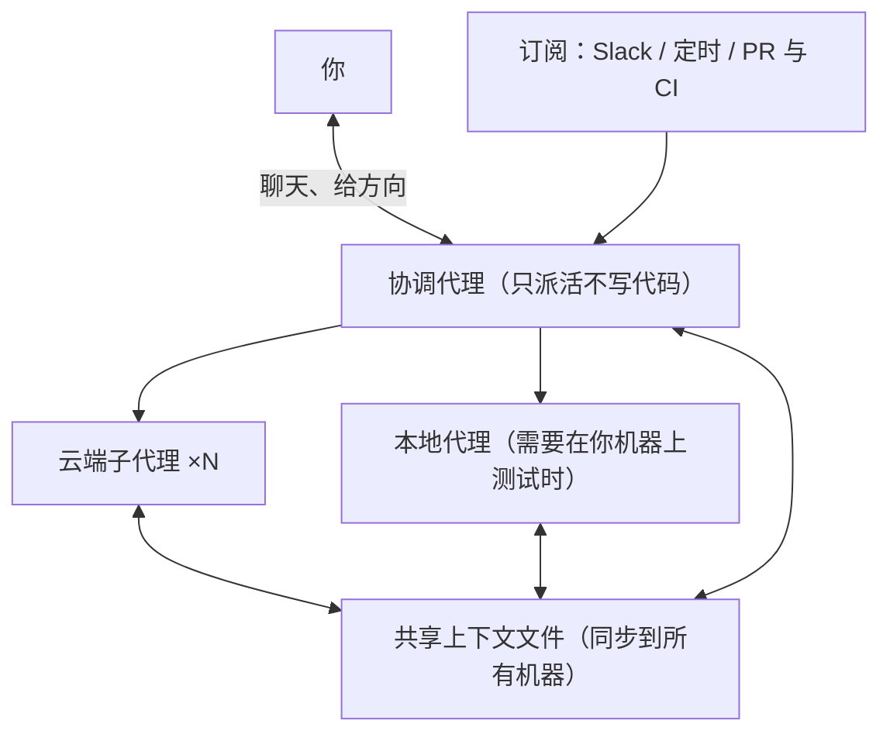

# 管一个代理容易，管一千个呢：Cursor Projects 让一个协调代理替你派活

Cursor

**一句话看懂**：一次聊天装不下的工作（一个功能、一场几百个 PR 的迁移、永远做不完的代码维护），Cursor 的做法是在你和代理之间加一层：一个只派活、不写代码的协调代理。它默认跑在云端，用一组同步到所有机器的文件积累上下文，还能订阅 Slack、定时任务和 PR 主动干活。原文是产品发布文，没有架构细节；最值得带走的是“人的审查强度随结果逐步放松”和“同样的错误出现两次就加一条 lint 规则”这两种用法。

## 读完你能带走的 5 条收获

1. **让协调者只派活、不执行**，它就永远不会被手上的活卡住，随时能听你的新指令（见 3.1）。
2. **跨月的工作要有一份共享上下文**：研究结果、产物、对代码库的认识和你的偏好写成文件，同步到每台机器，后面的代理直接用（见 3.2）。
3. **让代理被信号唤醒**：订阅 Slack 频道、定时运行、跟随所有 PR 修 CI，不用每次都开口（见 3.2）。
4. **迁移类工作，审查强度要随结果递减**：早期每个 PR 细看，修复站得住以后少看（见 3.3）。
5. **把重复出现的错误变成规则**：设计系统 Project 每当看到同一个错误出现两次，就加一条 lint 规则（见 3.3）。

::: tip 小白先懂这几个词
- [Subagent（子代理）](/glossary#subagent)：被主代理派出去完成子任务的代理。
- [Coordinator Agent（协调代理）](/glossary#coordinator-agent)：只负责拆任务、派活、收结果，自己不写代码的代理。
- [Background Agent（后台代理）](/glossary#background-agent)：不占用你的编辑器、在别处持续运行的代理。
- [Lint（静态检查）](/glossary#lint)：不运行代码，按规则扫描代码里的问题。
- [CI/CD](/glossary#ci-cd)：每次提交自动构建、测试、部署的流水线。
:::

## 1. 基本信息

<SourceCard type="文章" title="Introducing Projects" author="Alexi Robbins、Fredrika Lindh（Cursor）" date="2026-09-10" url="https://cursor.com/blog/projects" />

| 项目 | 内容 |
|---|---|
| 链接 | https://cursor.com/blog/projects |
| 类型 | Cursor 产品博客（发布文，约 900 词） |
| 作者 | Alexi Robbins、Fredrika Lindh |
| 发布日期 | 2026-09-10（页面元数据 datePublished） |
| 使用工具 | Cursor Projects（beta）、云端代理、本地代理、Slack |
| 分析依据 | 原文全文，2026-10-16 用 curl 抓取，引语逐字核对。原文是产品发布文：没有架构、成本或失败案例；“多合并 30% / 6 倍 PR”是 Cursor 自报的内部数据，没有给统计方法。“我觉得”开头的段落是本站评论。 |

## 2. 这篇在回答什么

假设你要把整个前端从一套样式系统迁到另一套。一共几百个文件，拆成几百个 PR。你可以开一个代理，做完一批再开下一个；但每开一个新会话，都要重新告诉它“我们的组件放在哪、测试怎么跑、我不喜欢什么写法”。笔记本合上，活就停了。做到第三周，你已经记不清哪些目录迁完了。

这就是原文说的“容易开始、难以收尾”的工作。Cursor 的回答是 Projects：

<Trans zh="它能在几个月的工作里保持上下文，把任务委派给成千上万个子代理，并且不需要提示就能执行重复性工作。">“It maintains context over months of work, delegates tasks to thousands of subagents, and performs recurring work without being prompted.”</Trans>

原文把它定位为 Cursor 2 月提出的“软件开发第三个时代”（成群代理承担整块工作）的具体实现：抽象往上移一层，开发者不再管理代理，而是指挥工作本身。

全文回答四个问题：

1. 为什么要在你和代理之间再加一个协调者？（3.1）
2. 跨月的工作，靠什么不停机、不丢上下文、不用每次开口？（3.2）
3. Cursor 自己的工程师具体怎么用？（3.3）
4. 原文给的数字能说明什么？（3.4）

## 3. 怎么做

### 3.1 协调者：只派活，所以永远不卡

你和一个 Project 打交道，靠的是和它的协调代理（coordinator agent）聊天。关键设计是：协调者自己不写代码。

<Trans zh="因为它委派而不是亲自执行，所以它从不会被阻塞，总能及时响应指令。">“Because it delegates rather than executes, it is never blocked and is always responsive to direction.”</Trans>

为什么这一点重要？一个亲自写代码的代理，在跑一个 20 分钟的测试时是没法听你说话的。你想改方向，只能等它跑完或者打断它。协调者把所有耗时的事都交出去，自己只做三件事：理解你要什么、拆任务、派给子代理。

我觉得这和 [[18§3.2]] 里 Cursor 早先的规划者、执行者分层是一脉相承的：上层不碰具体代码，才能看住全局。区别是这一次它变成了普通用户能直接用的产品界面，而不是研究实验。

### 3.2 三个能力：云端默认、共享上下文、订阅

原文说让 Projects 成立的有三个核心能力。

**一、默认在云端，需要时才回本地。** 每个 Project 跑在自己的计算机上，合上笔记本也不会停，能并行的子代理数也比你的笔记本多。需要在你机器上测试的东西，协调者会在本地起一个代理去跑。

**二、共享上下文。** 原文的出发点是：

<Trans zh="你不应该每开始一个任务都要给代理做一遍入职培训。">“You shouldn't have to onboard an agent every time you start a task.”</Trans>

做法是每个 Project 维护一组文件，同步到它的代理用到的每一台云端和本地机器。代理会往里写研究结果、产物、对代码库的认识，以及你喜欢怎么做事。原文举的例子是：

<Trans zh="比如一个代理弄清了怎么测试某个服务，之后的每个代理都能用这份说明。">“If one agent figures out how to test a service, for example, every future agent can use those instructions.”</Trans>

这份上下文随 Project 一起增长，协调者也会越来越好用。

**三、订阅。** 协调者可以盯一个 Slack 频道、按计划运行，或者跟随你所有的 PR，在 PR 打开或合并时修 CI、采取行动。它根据检测到的信号行动，不用等你开口。

我觉得第二点是这篇真正的看点，虽然原文只写了一段。很多人用代理时，“让它记住项目约定”靠的是规则文件（[[20]]）或记忆功能（[[46]]）；Projects 把这件事限定在一个工作单元内，由代理自己写、跨机器同步。原文没有说这些文件长什么样、会不会膨胀、错误的“经验”怎么清理，这些都是照着做时要自己补的。

### 3.3 三种用法：功能、迁移、园艺

原文说，Cursor 工程师用 Projects 做的事大多落在三种模式里。

**功能开发。** 一个功能通常先让代理研究系统，把学到的东西记进共享上下文。然后协调者出计划，派代理并行实现和测试不同部分。每一轮反馈，Project 都会更了解你的架构和偏好。功能能试用了，协调者就在你的电脑上起一个代理本地运行。上线以后，同一个 Project 还能盯日志、处理 bug 报告，因为它保留着当初做决定的完整上下文。

**迁移。** 这是原文认为 Projects 特别有用的场景：

<Trans zh="Projects 特别适合那些容易开始、难以完成的迁移。">“Projects are especially useful for migrations that are easy to start and difficult to finish.”</Trans>

Cursor 内部用它引入新框架、在几百个 PR 里替换样式系统。做法分两段：先和协调者一起定一个安全的做法，再由它逐步铺到整个代码库。审查强度随结果变化：

<Trans zh="早期你会仔细审每个 PR。随着修复经受住检验，你审得越来越少，协调者自己把迁移继续推进下去。">“Early on, you review each PR closely. As the fixes hold up, you review less, and the coordinator keeps working through the migration on its own.”</Trans>

**园艺（gardening）。** 指那些永远做不完的工作，比如维护代码质量、盯回归。你让协调者跟随新 PR、在 Slack 里听 bug 报告或者定时运行，有新活就动手。

原文举了一个设计系统 Project 的例子。一开始，负责的工程师逐个审每个修复，纠正做错的。现在协调者扫描每个新 PR，把该进设计系统的组件抽出来，而且：

<Trans zh="每当它看到同一个错误出现两次，就加一条 lint 规则。">“adds a lint rule whenever it sees the same mistake twice”</Trans>

这个 Project 预计每天会碰 20 到 100 个 PR，所以由协调者组织工作，工程师只在需要注意的地方介入。

我觉得“同样的错误两次就变成 lint 规则”是可以脱离 Cursor 单独使用的好习惯。它和 [[10§3.4]] 里 OpenAI 把反复漏过 review 的问题编码进规则、[[07]] 把规范变成 lint 和测试是同一个方向：把人的纠正沉淀成机器能执行的检查，而不是写进一段越来越长的提示词。

### 3.4 数字怎么看

原文给了两个效果数字：

<Trans zh="新用户多合并了 30% 的 PR，而主要使用 Projects 的用户合并的 PR 数是原来的六倍。">“new users merge 30% more PRs while users who primarily use Projects merge six times as many.”</Trans>

这两个数字需要谨慎看：

- 没有说和谁比、在多长时间里统计、“主要使用”怎么定义。
- “主要使用 Projects 的用户”很可能本来就是做大批量工作（比如几百个 PR 的迁移）的人，这里有明显的选择效应。
- PR 数量不等于产出质量。原文没有给回滚率、bug 率或审查时间。

原文说的内部用途（几百个 PR 的迁移、维护设计系统一致性、用 Projects 开发 Projects 本身）是定性描述，可以帮你判断它适合什么工作；数字只能当作厂商自报的方向性信号。

## 4. 结果与局限

- **原文能证明的**：产品的三个能力和三种用法的描述。功能处于 beta，从左侧导航进入。
- **厂商自报、无法核对**：30% / 6 倍 PR、“预计每天 20–100 个 PR”（这是预测，不是实测）。
- **没有讲的**：协调者如何拆任务、子代理之间如何避免冲突、共享上下文文件的格式与清理、成本、失败案例。想了解这些，站内 [[18]]（数百个代理的分层）、[[38]]（自驱动代码库）、[[40]]（云端代理的运行层）更有料。
- **适用范围**：原文说它最适合“比一次聊天活得更久”的工作，即有多个 PR 的功能、迁移，或你不在时也要有人处理的工作。

## 5. 结论

Projects 的核心思路是：把“管理代理”这件事也交给一个代理。协调者只派活所以随时响应，共享上下文让每个新代理不用重新入职，订阅让它不等你开口。

这是一篇产品发布文，不是工程复盘。它的价值不在机制细节，而在两种可以迁移的工作习惯：迁移时审查强度随结果递减；同一个错误出现两次就变成 lint 规则。

我觉得如果你还没有 Projects，也可以用现有工具模拟它的骨架：一个长期存在的“上下文目录”（比如仓库里的 `docs/agent-notes/`）+ 一个定时或 PR 触发的代理（[[41]]、[[48§3.4]]）+ 一个只负责拆任务的主会话。

**你可以这样试**

1. 挑一个拖了很久的迁移，先让代理只做 3 个 PR，逐个细审；稳定后再放大批次，记录你在每批上花的审查时间。
2. 在项目里建一个代理笔记目录，规定“学会怎么测某个服务、怎么跑某个脚本，就写进这里”。
3. 统计最近一个月代码审查里重复出现的意见，挑一条改写成 lint 规则。

**读完自测**

- 为什么“协调者不写代码”能让它始终响应？
- 共享上下文和 CLAUDE.md 这类规则文件有什么不同？
- 为什么“主要使用 Projects 的用户合并 6 倍 PR”不能直接说明 Projects 让人效率提高 6 倍？
