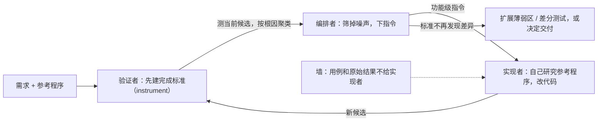

# 代理说“做完了”，其实只做了三分之一：Factory 用独立的完成标准把 gdal 复刻从 36% 推到 90%

<div class="meta-tags"><span class="tool-tag tool-factory">Factory Droid</span></div>

<div class="hook">

**一句话看懂**：大任务上，代理常常不是做不出来，而是**自己觉得做完了**。Factory 让同一个模型从零复刻 gdal：单代理写了 1.7 万行、复现 36% 的行为后主动收工；换成“先由一个验证者建好可执行的完成标准，再让实现者朝它干”的三角色系统，写到 11.5 万行、复现 90%。关键有两点：标准要在动手之前、从需求推出来；实现者永远看不到考题，只收到“哪块功能还缺”的指令。代价也很大：gdal 这一格花了 14 倍的额度、13 倍的时间，而且每格只跑了一次。

</div>

## 读完你能带走的 6 条收获

1. **代理提前收工，常常是因为它的自检只覆盖了它想到要做的部分**，没想到的部分永远测不到（见 3.2）。
2. **完成标准要在实现之前定**：一份要确立什么的清单、每部分怎么确立、以及当前产物通过这些程序的证据；可以加强，不能悄悄缩水（见 3.3）。
3. **把“出题”和“答题”分给不同角色**：验证者建标准、测候选；实现者只管做；编排者判断哪些发现是真的、决定何时交付（见 3.4）。
4. **中间要有一堵墙**：实现者不写、不跑、不看用例和原始输出，只收到按根因聚类后的功能级指令；样本一旦可见，就会变成目标（见 3.4）。
5. **效果大但不白给**：三个模型的中位数都涨了（56.7→89.3、45.1→75.4、48.6→66.2），也有任务下降；gdal 这一格花了 14 倍额度、13 倍时间（见 3.5）。
6. **日常工作的完成标准从别处来**：产品任务看用户认可的流程和设计，迁移看被替换的旧系统（见 3.6）。

::: tip 小白先懂这几个词
- [Oracle（参考程序 / 判定基准）](/glossary#oracle)：拿来对照“正确答案”的现成实现。
- [Definition of Done（完成标准）](/glossary#definition-of-done)：事先约定什么条件满足才算做完。
- [Builder / Validator（构建者 / 验证者）](/glossary#builder-validator)：一个代理做，另一个代理查。
- [Benchmark（基准测试）](/glossary#benchmark)：用一组固定任务给模型或代理打分。
- [Differential Testing（差分测试）](/glossary#differential-testing)：同一个输入同时喂给参考实现和新实现，比较输出是否一致。
- [Droid](/glossary#droid)：Factory 的编码代理。
:::

## 1. 基本信息

<SourceCard type="文章" title="What it Takes for Coding Agents to Complete Large Software Tasks" author="Factory Research、Theo Luan" date="2026-08-27" url="https://factory.com/news/what-it-takes-for-coding-agents-to-complete-large-software-tasks" />

| 项目 | 内容 |
|---|---|
| 链接 | https://factory.com/news/what-it-takes-for-coding-agents-to-complete-large-software-tasks |
| 类型 | Factory Research 研究文章（页面标注 10 分钟，正文约 2,800 词，另有多张交互图表） |
| 作者 | Factory Research、Theo Luan |
| 发布日期 | 2026-08-27（页面显示 August 27, 2026） |
| 使用工具 | Factory Droid（单代理与“编排者 + 实现者 + 验证者”三角色系统）；模型 Fable 5、Kimi K3、GPT-5.6-sol，部分格用 Opus 替代；基准 ProgramBench（评分版本 pb-1.2.0） |
| 分析依据 | 原文全文，2026-10-16 用 curl 抓取（含交互图表里的逐任务数字），引语和三段原文摘录逐字核对。每个数字都是单次运行，没有方差；系统组和单代理组不是同等算力。结尾有 Missions 的推广。“我觉得”开头的段落是本站评论。 |

## 2. 这篇在回答什么

你让代理从零写一个大程序，它干了 15 个小时，写了 1.7 万行，测试都过了，然后告诉你：做完了。

你一跑，常用功能都能用，代码也不差。但对照原版，大部分功能根本不存在。它不是没时间了，也不是没预算了。原文说得很直接：

<Trans zh="它停下来，是因为按它自己的判断，已经做完了。">“It stopped because, by its own assessment, it was done.”</Trans>

这篇文章研究的就是这个现象：**代理在大任务上为什么会提前收工，以及怎样让它自己把环闭上，而不用靠人在旁边一直盯着。** 原文的提问是：

<Trans zh="我们想知道，模型能不能自己闭合这个环。">“We wanted to know whether the model could close the loop on its own.”</Trans>

全文回答五个问题：

1. 同一个模型，换一种组织方式，差距有多大？（3.1）
2. 代理为什么会提前收工？（3.2）
3. 完成标准应该是什么样、什么时候建？（3.3）
4. 怎样组织角色，才能让标准不被“应试”？（3.4）
5. 实验结果多可信，日常工作能借鉴什么？（3.5、3.6）



## 3. 怎么做

### 3.1 同一个模型：36% 和 90%

实验对象是 gdal，一个处理地理空间数据的命令行工具。GDAL 项目从 1998 年开发至今，上游约 200 万行 C/C++，通过命令行能触达的部分约 60 万行。

Factory 让 Droid 用两种方式从零重建它。两种方式下，Droid 都可以随意运行参考程序，但看不到它的源码和测试，也不能上网。

- **单代理**：自己实现、自己检查、自己决定什么时候收工。结果写了 17,000 行 C++，复现了 36% 的行为。常用路径都能用，但大部分程序还没做。
- **多角色系统**：在任何实现之前，先由一个角色建立一个**可执行的完成标准**（它自己对“复刻品必须做到什么、什么证据能证明”的说明），之后的实现都要对着这个标准。这次写到 115,000 行，行为一致性达到 90%。

不是个例。原文说，在 24 个任务里，同一个系统把 7-Zip 的复刻从 54% 推到 95%，DuckDB 从 34% 推到 80%，好几个复刻进入了 90 分以上。原文的结论是：

<Trans zh="底层模型没有变。但当它被自己的完成标准约束时，复现出的程序行为多得多。">“The underlying model did not change. But when held to its own standard of completion, it reproduced far more of each program's behavior.”</Trans>

注意，开头这几个数字（gdal、7-Zip、DuckDB）都是 Fable 5 的单次运行（原文方法说明）。

### 3.2 为什么代理会提前收工

编码代理通常边做边验证：实现一块，写或跑几条检查，看看输出，决定要不要继续。小改动这样完全没问题，任务、实现和证据都在一个视野里。

大任务不一样。它要拆成功能、子系统和一轮又一轮的工作。代理每做到一块，也同时在决定“什么证据算数、证据够不够”。问题出在这里：

<Trans zh="这些检查继承了产出它们的那部分工作的范围。它们能确立代理想到要构建的一切，却排除了它从未表示出来的功能、交互或约束。">“These checks inherit the scope of the work that produced them. They can establish everything the agent thought to build, but exclude features, interactions, or constraints it never represented.”</Trans>

所以代理可以一步步、局部正确地往前走，最后带着大量缺失收工。原文的判断是：

<Trans zh="问题不一定是它实现不了剩下的部分。而是它从来没有建立起一份关于还剩什么的完整账目。">“The problem is not necessarily that it could not implement the rest. It never established a complete account of what remained.”</Trans>

文章开头还有一层对比：数学证明、约束优化这类问题，成功标准紧凑稳定，结果可以整体判断，所以模型进步飞快。软件需求则不同：

<Trans zh="需求说明了什么必须为真。但需求本身并不衡量工作是否做到了。">“Requirements state what must be true. By themselves, they do not measure whether the work achieves it.”</Trans>

目前，这个缺口靠人来补：人在旁边监督，盯着整体结果，把代理拉回来。

我觉得这一节是全文最值得记住的部分。它解释了一个很多人遇到过、却说不清的现象：代理不是偷懒，它的“测试全绿”是对的，只是它的测试只覆盖了它脑子里的那个版本的任务。[[12]] 里 ForrestKnight 遇到的“24 个测试全绿，代码却有问题”，是同一件事的小规模版本。

### 3.3 完成标准：在动手之前定义验证

那应该怎么做？原文说，要确立一个完整的结果，光有需求清单不够，系统需要三样东西：

<Trans zh="一份需要确立什么的清单、确立每一部分的程序，以及这些程序在要交付的产物上通过的当前证据。">“an inventory of what must be established, procedures for establishing each part, and current evidence that those procedures pass against the artifact being shipped.”</Trans>

时机很关键：这个标准要在实现把任务收窄成一个个工作项**之前**，从需求和相关的事实来源推出来。它也不是冻结的，检查可以添加、替换、细化，但有一条底线：

<Trans zh="完成标准绝不能悄悄塌缩到已经建好的那些东西上。">“the standard of completion must not quietly collapse around whatever has already been built.”</Trans>

原文还回答了一个自然的疑问：这不是什么新东西，为什么人很少这样做？需求和证据分离，安全关键项目有需求可追溯性和独立验证与确认（IV&V），标准组织会发布一致性测试套件，产品团队写验收测试。少见的是**每个项目都推导并维护一份全面的标准**。一致性套件能把成本摊到很多实现上，产品团队却要为每个应用、每次重写、每次迁移重新付这份成本。所以大多数团队增量验证，靠评审、用户反馈和人员的连续性来守住整体。

代理同时改变了这笔账的两边：

<Trans zh="它们产出工作的速度快过人能检查的速度，让非正式的监督成了瓶颈。但同样的能力也可以用在标准本身上。">“They can produce work faster than humans can inspect it, making informal supervision the bottleneck. But the same capacity can be applied to the standard itself”</Trans>

也就是让代理去盘点结果、构造检查、在产物变化时重跑。

我觉得这段把一个老问题讲透了：验收测试一直是“应该写但没人写全”的东西，因为它贵。代理让它变便宜了，于是“先建标准”从奢侈品变成了可以默认做的步骤。这和 [[16§3.3]] 里生成器和评估器先签“冲刺契约”、[[05]] 的 Builder + Validator 是同一个思路，只是这里把标准做得更全、更早，而且和实现者隔离开。

### 3.4 三个角色和一堵墙

**ProgramBench 是什么。** 这是一个洁净室软件工程基准。每个任务给一个参考程序、一些测试素材和部分文档。参考程序是个黑盒：可以运行，但不能读、反编译或跟踪。目标是从零复现它的可观察行为，用一套隐藏的行为检查打分。单个行为很好验证（同一个输入跑两边比一比），但“整体有多完整”很难衡量，因为文档只覆盖了接口的一小部分，其余行为要自己发现。

**instrument（测量工具）。** 完整的行为一致性没法直接测：程序能接受的输入、参数、文件格式、组合和错误情况几乎无穷，只能抽样。原文把这个样本叫 instrument。实现开始之前，验证者先勘察参考程序，摸清行为分布在哪，再建一组**加权**用例和判定输出的比较规则。Factory 只要求了大纲，里面测哪些行为、权重怎么定、什么算证据，全由验证者自己决定。

验证者为 gdal 建的两个用例（原文摘录，2026-10-16 抓取）：

::: tr 两个用例：用 combined 变体做山体阴影；按 120、150、180 三个高度生成等高线。每个用例只描述怎么调用。
```python
D('hillshade.combined', ['raster', 'hillshade', '--variant', 'combined', 'dem.tif', 'out.tif']),
D('contour.levels', ['raster', 'contour', '--levels', '120,150,180', 'dem.tif', 'out.geojson']),
```
:::

怎么判定结果，由评分策略说了算（原文摘录）：

::: tr 主比较器：每个用例都在同一个沙箱绝对路径里（两次之间清空）、同样的环境变量、同样的素材字节和修改时间下，先后运行参考程序和候选程序，逐字节比较四个通道：退出码、stdout、stderr，以及运行造成的完整文件树变化（新建、修改、删除了哪些文件以及每个文件的字节，包括 .aux.xml、.ovr、.msk、shapefile 附属文件、瓦片目录等）。每个通道默认要求字节完全一致；放宽只能以“具名归一化器”的形式挂在特定用例上，并各自附带许可说明。
```text
Primary comparator: for every case, the runner executes oracle and candidate sequentially in the same absolute sandbox path (wiped between runs), same env, same fixture bytes and mtimes, and byte-compares four channels:

1. exit code
2. stdout bytes
3. stderr bytes
4. full work-tree delta: the set of files created/modified/deleted by the run, and the exact bytes of each (includes sidecars: .aux.xml, .ovr, .msk, shapefile companions, tile trees).

Byte identity is the default on every channel. A relaxation exists only as a named normalizer attached to specific cases, each carrying a license below.
```
:::

标准有多严？验证者写了几百个这样的用例，全程只批准了两处放宽：调试输出里被遮掉的堆地址、文件头里嵌的日期。两处都附有记录在案的证据，证明参考程序自己在那里也产生不了稳定字节。

**外层循环。** 系统有三个角色：编排者、实现者、验证者。编排者把工作分给实现者（造候选程序）和验证者（用 instrument 测它）。验证者先建好 instrument，实现开始后，循环是：

1. 编排者选择这一轮要测什么。
2. 验证者测当前候选，解读失败。
3. 编排者判断哪些发现是真的，决定下一步做什么。
4. 实现者去研究参考程序，推进候选。

当 instrument 在相邻两个候选之间再也测不出有意义的差别，编排者可以让验证者扩充薄弱区域，或者开始针对参考程序做定向的差分测试。

**墙。** 这是整个设计里最关键的一条边界，而且是双向的：

- 验证者可以随着对参考程序了解加深而**扩充** instrument，但不能为了迁就候选程序而削弱或修改它。
- 实现者从不编写、运行或查看 instrument 的用例和原始输出。

为什么要这么严？原文的理由是：

<Trans zh="稀疏的样本一旦变得可见，就会变成目标，通过它只能确立那些用例本身，而不是它们本应代表的那片空间。">“once a sparse sample becomes visible, it becomes the target, and passing it establishes those cases, not the space they were meant to represent.”</Trans>

那实现者怎么知道该做什么？验证者把失败按根因聚类，编排者筛掉噪声和无效测量，把剩下的问题写成功能、子系统或行为层面的指令。实现者拿到指令，自己去研究参考程序，自己决定怎么改。下面是 gdal 运行里一条指令的片段（原文摘录）：

::: tr 第 1 项：桩代码前沿（占主要权重，约 60 个子命令）。按测得的权重排序（方括号里是大致的用例权重），一如既往，先拿参考程序逐个探测。列出的有 vgrid 的 11 种网格方法、多维 VRT 的 mdim group、sozip 的创建/列出/校验/优化、DEM 系列（等高线、山体阴影、坡向、坡度、可视域等）、栅格化、像素信息、计算、镶嵌、切片、轮廓范围等。
```text
## 1. Stub frontier (dominant mass, ~60 verbs)

Ordered by measured weight (approximate case mass in brackets). Probe each against the oracle first, as always.

- vgrid: all 11 grid methods [14]
- mdim group on multidim VRT + classic-input pins [12]
- sozip: create / list / validate / optimize [11]
- DEM suite [~30]: contour [7], hillshade incl. variants [6], aspect [6], slope [4], viewshed [4], roughness, tpi, tri [1-3 each]
- rasterize [7], pixel-info [7], calc [7], mosaic [6] + stack, tile [5], footprint [5]
```
:::

原文的评语是：指令告诉实现者候选哪里薄弱，却不泄露样本。

原文图注还补了一句：两个角色是同一个模型、同一推理级别，而且都能运行参考程序，所以把 instrument 留在测量一侧并不损失信息，只是去掉了一条捷径。

我觉得“墙”是这篇和站内其他“一个做、一个查”方案最大的区别。[[05]] 和 [[16]] 里的验证者会把具体失败直接反馈给构建者；这里只给功能级的方向，不给具体用例。这样做的前提是验证者的样本只是巨大空间里的一小块。如果你的验收测试本身就是完整规格（比如一份 API 契约），把测试直接给实现者未必是坏事。

### 3.5 实验怎么设计，结果有多可信

**选题。** 从 ProgramBench 的 200 个任务里，按当前公开榜单最高分手工挑了 24 个最难的，偏向公开分数低的任务。一些候选（php-src、pueue、ditaa、quickjs、chroma、miller）在筛选中被剔除，原因包括持续的安全拦截、单代理就已饱和，或分数取决于一个没写进文档的环境变量。

**对照设置。** 两组从同样的脚手架和素材出发；同一模型组里，单代理和系统的三个角色用同一个模型、同一推理级别（Fable 用 xhigh，Kimi 用 high，Sol 用 max）。两组都能无限运行参考程序，都不能读源码、看测试或上网。启动后全程无人干预。有两点要特别注意：

- **算力不对等**：每个运行都跑到单代理或编排者自己决定交付为止。
- **每格只跑一次**：没有重复，没有方差估计，原文明确说这些数字都不能当平均值看。

另外，Fable 组有 6 格（bedtools2、gromacs、pandoc、samtools、sox、tree-sitter）因为 Fable 被安全拦截，改用 Opus 替代。144 格里有 141 格完成评分；Sol 上的 gdal、gromacs 和 Kimi 上的 samtools 三个系统运行被中断，没有分数。所有分数都来自基准的隐藏测试集（pb-1.2.0），这是任何角色都没见过的样本。

**结果（官方分数中位数）：**

| 模型 | 单代理 → 系统 | 原文所说的“差距闭合” | 耗时（单代理 → 系统） |
|---|---|---|---|
| Fable 5（xhigh，部分 Opus 替代） | 56.7 → 89.3 | 73% | 8.5h → 96h |
| Kimi K3（high） | 45.1 → 75.4 | 42% | 9.0h → 64h |
| GPT-5.6-sol（max） | 48.6 → 66.2 | 25% | 1.5h → 24h |

不是每个任务都涨。逐任务表里能看到下降：Sol 上 lnav 从 43.5 掉到 20.6，tree-sitter 从 61.9 掉到 56.7，duckdb 基本持平（29.7 → 29.4）；还有几格评测超时，只能给下限或没有分数。

**成本。** 系统运行长得多、贵得多。gdal 这一格，系统用了单代理 14 倍的额度和 13 倍的墙钟时间（15.0 小时对 196.9 小时）；其中实现者花了 97%，验证者 2%，编排者 1%。原文对此的解读是：

<Trans zh="额外的算力帮不了一个不愿意花它的代理。">“Additional compute does not help an agent that will not spend it.”</Trans>

原文的依据是：每一个单代理运行都是代理自己决定结束的，没有一个是被预算或时间截断的。

我觉得这个解读成立一半。单代理确实没用完预算就停了，这说明“不知道还缺什么”是真问题。但实验没有反过来测：如果系统组也只给单代理那么多额度，结果会怎样？所以“提升来自完成标准而不是算力”是合理的推断，不是被对照实验证明的结论。好在验证者只占 2% 的花费，说明“建标准”本身并不贵，贵的是标准逼出来的那些实现工作。

### 3.6 换到日常工作：标准从哪来

ProgramBench 是一个极端情况：参考程序就摆在那里，但模型要自己发现行为空间和衡量方法。日常工作没有现成的参考程序，那标准从哪来？原文的回答是：

<Trans zh="产品任务可以从用户认可的流程和设计中提取标准；迁移任务则从被替换的系统中提取。">“A product task may draw on user-approved flows and designs; a migration, on the system being replaced.”</Trans>

能迁移的是这一条：

<Trans zh="能推广到真实软件工作中的，是对一个外部的、可执行的完成标准的需要：它从结果推导出来，在实现收窄注意力之前建立，并持续更新，直到工作满足它。">“What generalizes to real software work is the need for an external, executable standard of completion - one derived from the outcome, before implementation narrows attention, and kept current until the work meets it.”</Trans>

原文最后说 Factory 正在把这套结构做进下一代 Missions，可以联系销售排队，这一段是产品推广。

我觉得迁移任务是最容易照搬这个方法的地方，因为旧系统本身就是一个 oracle：同一组请求同时打到旧服务和新服务，逐字节比较输出，和 ProgramBench 的结构几乎一样。[[30]] 讲的大型重构、[[58§3.3]] 讲的迁移，都可以先让一个独立的代理把“旧系统的行为清单”建出来，再开工。

## 4. 结果与局限

- **原文能证明的**：在 24 个手挑的高难任务、3 个模型上，三角色系统的隐藏测试集中位数都高于单代理；gdal、7-Zip、DuckDB 等任务提升很大。所有分数来自同一版本的隐藏测试，口径一致。
- **对比不等价**：系统组和单代理组的算力不对等（gdal 一格 14 倍额度）。“提升来自完成标准而不是预算”是作者的解读（3.5）。
- **统计薄弱**：每格只跑一次，没有方差；任务是手挑的，偏向低分任务；Fable 组 6 格用 Opus 替代；3 格未评分。
- **不是全面提升**：有任务下降（Sol 上 lnav 43.5 → 20.6）、有超时。
- **验证者的 instrument 没有公开**：gdal 页面写着 “instrument not archived”，原文只给了两个用例和一段评分策略。
- **场景特殊**：ProgramBench 有一个可以无限运行的参考程序，日常任务大多没有。原文在 3.6 里说了标准还可以从哪来，但没有在非基准任务上做实验。
- **推广**：结尾是 Missions 的候补名单。

## 5. 结论

这篇研究最有价值的是一个诊断：代理在大任务上提前收工，往往不是能力不够，而是没有一份独立于实现、事先建好的完成标准。原文的结论只有一句：

<Trans zh="单代理不是缺技能，它缺的是一个完成标准。">“The single agent didn't lack skill. It lacked a standard of completion.”</Trans>

做法也清楚：动手之前先让一个角色建标准；标准只能加强、不能塌缩；实现者看不到考题，只收到功能级的指令；由第三个角色判断发现是否可信、何时交付。

我觉得对大多数团队来说，不必照搬三角色加墙的全套结构。最便宜、最先能做的一步是：大任务开工前，单独开一个会话，只做一件事，把“怎样才算做完”写成一组可执行的检查，并且这个会话不参与实现。这一条和 [[19]]、[[57]] 讲的评测思路是相通的，只是对象从“代理配置”换成了“这一次的任务”。

**你可以这样试**

1. 下一个大任务开工前，让一个独立的代理会话读需求和现有系统，产出一份加权的验收清单和对应的检查脚本，存到实现代理看不到的位置。
2. 做迁移时，把旧系统当 oracle：录一批真实请求，新旧两边各跑一遍，按退出码、输出和副作用逐项比较。
3. 实现代理说“做完了”时，不看它自己的测试，先跑那份独立清单，把失败按功能聚类后再反馈给它。

**读完自测**

- 为什么说代理的自检“继承了产出它的那部分工作的范围”？
- 为什么实现者不能看到 instrument 的用例？
- “额外的算力帮不了不愿意花它的代理”这句话，实验证明到了什么程度？
