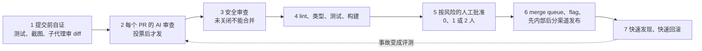

# 代码多到读不过来，审查该省什么：Claude Code 团队的七层把关

Claude Code

**一句话看懂**：Claude 写了 Claude Code 约 90% 的代码，PR 数量几个月翻了一倍多。团队没有取消审查，而是换了要优化的东西：**不是“人读了没有”，而是“人花了多少时间，回滚和事故有没有变多”**。做法是把大部分阅读交给机器，分成七层，每层各抓一部分问题；人工批准按改动的风险分档；再把“撤销一个错误”做得足够快。原文报告：6 到 9 月，合并的 PR 翻了一倍多，需要回滚的比例降了四成多。

## 读完你能带走的 7 条收获

1. **审查要省的是人的时间，护栏是回滚率和事故率**：只减少审查时间、却把时间挪到修 bug 上，不算省（见 3.1）。
2. **大部分审查发生在 PR 之前**：让代理给出能跑的证据，再用新上下文的子代理审 diff；同一条评论反复出现，就改 skill、lint 规则或 CLAUDE.md（见 3.2）。
3. **REVIEW.md 要写“在这个仓库里，失败长什么样”**：限制 nit 数量、列出跳过的路径、要求给出文件和行号作为证据（见 3.2）。
4. **AI 审查的发现要先过一轮投票再发**：几个代理并行找 bug，另一组投票确认，风格类意见直接丢掉；每条发现都必须修掉或写理由关闭（见 3.3）。
5. **人工批准按改动定档，不按作者定档**：低风险不需要人，中风险一人，高风险两人；代理的批准永远不算人的批准，批准只对一个具体 commit 有效（见 3.4）。
6. **AI 审查要能收敛**：一个 PR 一夜被审了 50 多轮；三轮后让作者退一步重想，之后只审新 diff，并且不重复已经发过的发现（见 3.5）。
7. **人留给机器不擅长的决定**：要不要做、高风险代码、会被模仿的架构、读证据、为结果负责；想了解代码，就让 Claude 写一份那一块的讲解（见 3.6）。

::: tip 小白先懂这几个词
- [Code Review（代码审查）](/glossary#code-review)：合并前让人或工具检查改动。
- [REVIEW.md](/glossary#review-md)：写给 AI 审查者看的规则文件，说明这个仓库里什么问题最要紧。
- [Merge Queue（合并队列）](/glossary#merge-queue)：合并前把改动放到最新主干上再跑一遍全部检查。
- [Feature Flag（功能开关）](/glossary#feature-flag)：不重新部署，就能打开或关掉一项新功能。
- [Risk Classifier（风险分类器）](/glossary#risk-classifier)：用模型判断一个操作或改动的风险档位。
- [Fresh-context Review（新上下文审查）](/glossary#fresh-context-review)：换一个没看过实现过程的会话来审。
:::

## 1. 基本信息

<SourceCard type="文章" title="How the Claude Code team does code review" author="Addy Osmani、Morgan Westlee Lunt、Qing Wang" date="2026-10-15" url="https://claude.dev/blog/solving-code-review-at-anthropic/" />

| 项目 | 内容 |
|---|---|
| 链接 | https://claude.dev/blog/solving-code-review-at-anthropic/ |
| 类型 | claude.dev 工程博客（页面标注 14 分钟，正文约 3,450 词，5 张示意图） |
| 作者 | Addy Osmani、Morgan Westlee Lunt、Qing Wang（Anthropic） |
| 发布日期 | 2026-10-15（页面元数据 `datePublished` 与正文 “Oct 15, 2026” 一致） |
| 使用工具 | Claude Code、Code Review for Claude Code（Team / Enterprise）、`/code-review`、`/security-review`、Claude Code GitHub Action、merge queue、feature flag |
| 分析依据 | 原文全文，2026-10-19 用 curl 抓取，引语逐字核对。PR 翻倍、回滚降 40%、16% → 54% 等数字都是团队自报，没有给出绝对数量和对照组；文中推广了自家的 Code Review 产品。“我觉得”开头的段落是本站评论。 |

## 2. 这篇在回答什么

先看一个数字。原文说，Anthropic 的 monorepo 每天落地的改动，从今年 5 月的约 2,500 个，涨到 9 月的 30,000 多个。Claude Code 自己的仓库也承受着同样的压力。

这时候还能逐行审查吗？原文的回答很干脆：几乎不可能。那问题就变成：

<Trans zh="当代理以这样的数量产出代码时，审查该怎么做？">“How do you review code at the volume agents produce it?”</Trans>

作者先换掉了一个习惯性的问题。以前大家问“这段代码有没有人读过”，他们认为这个问题不准：

<Trans zh="我们认为“有没有人读过代码？”只是一个不精确的替代指标，真正的问题是：“这个改动可能出什么错，哪一项检查（自动的或人工的）最适合抓住它？”">“We think "did a human read the code?" is an imprecise proxy for "what could go wrong with this change, and which check—automated or human—is the right one to catch it?"”</Trans>

顺着这个问题，全文回答了五件事：

1. 审查到底要优化什么？（3.1）
2. 一个改动从笔记本到用户手里，要经过哪几层检查？（3.2、3.3）
3. 人工批准怎么按风险分配，规则怎么防止被钻空子？（3.4）
4. AI 审查者自己怎么变好，又不制造噪声？（3.5）
5. 人还做什么，团队对代码的理解从哪来？（3.6、3.7）

## 3. 怎么做

### 3.1 先想清楚：要省的是人的时间

审查有两件事要做：在上线前找出并修掉问题；让团队对代码库有共同的理解。这篇主要讲第一件，第二件放在最后（3.6）。

作者认为，现在最稀缺的是人的时间和注意力。这里的“时间”包括两部分：

<Trans zh="人的时间涵盖了审查成本的两面：人们花在审查上的时间，以及他们花在修复坏代码所造成破坏上的时间。">“Human time covers both sides of review's cost: the time people spend reviewing, and the time they spend fixing what bad code breaks.”</Trans>

所以目标写得很具体：Claude Code 各个仓库（CLI、桌面和网页应用、移动应用）里的多数 PR，合并时**最多只需要一个人参与**，这个人可以就是作者本人，而且回滚和事故不能增加。

怎么衡量？他们跟踪每个 PR 的人工批准次数（中位数和 P95）、人工评论数，以及 PR 等人的时间。回滚率和事故率是护栏：

<Trans zh="如果它们上升了，我们就没有省下人的时间，只是把它挪了个地方。">“if they rise, we haven't saved human time, we've only moved it.”</Trans>

审查的时机也变了。以前审查是路的尽头的一道闸门：写完代码，开 PR，等同事。现在审查一直在进行，原文的比喻是“更像边写边跑的拼写检查”。大多数改动在人被叫来看之前，已经被 Claude 审过、修过至少一轮。

我觉得这一节最值得抄的是指标设计：一个要降的数（人工时间），配一个不许涨的数（回滚和事故）。很多团队引入 AI 审查后只看“抓到了多少问题”，这很容易被刷高；把人的时间和回滚率放在一起看，才能知道整个系统是不是真的变好了。

### 3.2 第一层：大部分审查发生在 PR 之前

原文说，现在大部分审查在 PR 出现之前就做完了。做法有两条，都来自他们的最佳实践指南：

- 给 Claude 一个它能运行的东西，比如测试、一次构建，或者一张可以和设计稿对比的截图，并且要求它**展示输出**，而不是说“做完了”。
- 再用一个新上下文的子代理审查 diff。

开 PR 之前，很多人还会跑几个内部 skill：一个专门找 bug，一个精简 diff，一个端到端检查行为。UI 改动还要对照设计规范。

Claude Code 的作者 Boris Cherny 估计，给 Claude 一个验证工作的办法，能让最终结果好两到三倍。原文引用了他的话：

<Trans zh="每个领域的验证看起来都不一样。可能简单到只是跑一条 bash 命令，也可能是跑一套测试，或者在浏览器、手机模拟器里测试应用。">“Verification looks different for each domain. It might be as simple as running a bash command, or running a test suite, or testing the app in a browser or phone simulator.”</Trans>

**同一条意见反复出现，就去源头修。** 自动审查者老是标同一类问题时，他们不去一个个回复，而是改 skill、加一条 lint 规则，或者更新指令文件。原文提到两个文件：

- **CLAUDE.md** 说明项目是什么：技术栈、约定、目标和非目标。每次审查都会加载它，所以在大代码库里要写短，其他内容用链接指出去。审查者还会标出两种情况：代码违反了 CLAUDE.md 里的约定；改动让 CLAUDE.md 里的某一行过时了。
- **REVIEW.md** 由代码的 owner 来写，告诉审查者在他们那部分代码里什么最重要。团队会单独检查审查者有没有真的照着它做。

好的 REVIEW.md 长什么样？原文的描述很具体：写得短；说清楚在这个仓库里失败长什么样（文档的失败是 “it lies”，说的不是事实；配置的失败是 “it misroutes”，把东西路由错了）；限制 nit 的数量；列出要跳过的路径；要求拿文件和行号当证据，而不是从名字猜；要求总结以一个数字开头，没有要修的就直接说没有。

我觉得 REVIEW.md 这段是全文最容易落地的一条。大多数团队的 AI 审查噪声大，不是模型不够好，而是没人告诉它“在这里，什么才算问题”。“文档的失败是说谎，配置的失败是路由错”这种一句话定义，比一长串规则管用。站内 [[20]] 讲 CLAUDE.md 要少而精，道理相同。

### 3.3 第二到第四层：AI 审查、安全审查、自动检查

**第二层：每个 PR 都先过 Claude 的审查，再给人看。** 它对照整个仓库和 PR 声明的意图读 diff，问三个问题：这个改动解决问题了吗？和系统合得上吗？会不会弄坏别的东西？如果是修 bug，它会去找根因。

公开版叫 Code Review for Claude Code，已经在 Team 和 Enterprise 套餐正式提供；本地可以用 `/code-review` 跑一个轻量版。管理员给每个仓库选 Quick、Standard 或 Deep 三档；漏掉一个 bug 的代价高于多花的审查时间时，才值得开 Deep。

研究预览上线时，内部 PR 里收到“实质性审查意见”的比例从 16% 升到 54%。超过 1,000 行的 PR 大多会有发现，小 PR 大多干干净净。

**发现要先被验证，才会交到人手里。** 原文的流程是：

1. 几个代理同时找 bug。
2. 另一组代理对每一条发现投票，只有足够多的代理认为它是真的，才会发出去。
3. 只关于风格、诊断或清理的发现直接丢掉。这些过滤规则先在自己的 PR 上做过 A/B 测试才保留。
4. 剩下的按严重程度排成行内评论，每条标上 Important、Nit 或 Pre-existing。Pre-existing 的意思是这个 bug 不是这次 PR 引入的，免得看起来像作者的错。

每一条发现都必须回应：要么修掉，要么写明理由关闭线程。原文说，常常有代理在夜里把修复做完，作者第二天回来看到的 PR 已经又过了一轮。

**第三层：可以阻断合并的安全审查。** 安全问题有单独的自动审查。只要 bug 审查或安全审查里还有一条没关闭的发现，PR 就不能合并。误报的处理方式是关闭线程并写一句理由。后续提交修好了问题，发现会自动清除。同样的流程可以用开源的安全审查 GitHub Action 或 `/security-review` 搭起来。

**第四层：会阻断的常规检查。** lint、类型检查、各平台的测试和构建。一个典型的 CLI PR 在有人看之前可能已经跑了几十项检查。PR 模板会问两个问题：这个改动怎么测的，怎么撤销。Claude 可以帮忙填，但要由提出这个改动的人签字确认。

我觉得“投票后才发、风格类直接丢”和站内 [[31]] 的“精确率优先”、[[33]] 用多次审查投票压误报是同一条路。三家各自得出了相同的结论：AI 审查的瓶颈不是找不到问题，而是噪声太多，人不再相信它。

### 3.4 第五层：人工批准按风险分档

一个改文档的 PR 和一个改自动更新器的 PR，风险不一样，审查也应该不一样。原文给了一张表：

| 风险 | 例子 | 需要的人工批准 |
|---|---|---|
| 低 | 文档、文案、仅内部的功能、藏在 flag 后面的增量改动 | 自动审查和安全检查都通过后，不需要人 |
| 中 | 普通的产品改动；以及缓存、自动更新器、系统提示词这类敏感区域的改动 | 一人 |
| 高 | 风险最高的代码，加上一小组永远需要两个人的路径 | 两人 |

这套规则怎么防止被钻空子？原文列了几条约束：

- **档位由改动决定，不由作者决定。** 一个分类器读改动、选档位；第二个分类器再问：即使档位说不需要人，这个具体改动是不是仍然需要一个人看。owner 列为敏感的路径和任何 CI workflow 文件，永远需要人。
- **只有可信作者能走轻路径。** 只有仓库可信名单上的作者（主要是拥有这个仓库的团队）能用低档；其他人都需要第二个人批准。
- **代理的批准不算人的批准。** 自动审查可以放行低风险改动，但填不了一个需要人的名额。
- **谁发起的改动，谁负责。** 在代理写的 PR 上，指挥代理的那个人算作一个必需的审查者，就像代码是他自己敲的一样。
- **批准只对一个具体 commit 有效。** 如果后来又推了系统无法担保的提交，比如代理推的、或者有人手动解决的合并冲突，批准要重新给。

我觉得这张表和这几条约束可以原样写进团队规范。尤其是最后两条：“指挥代理的人算一个审查者”把责任落到了具体的人身上；“批准绑定 commit”堵住了一个常见的漏洞，也就是批准之后代理又推了一轮改动。用分类器定档，和站内 [[56]]、[[39]] 用分类器给代理动作把关是同一种做法，只是对象从“一次工具调用”换成了“一个 PR”。

### 3.5 第六、七层与审查者的自我改进

**第六层：merge queue、flag 和分阶段发布。** merge queue 会把改动放到最新的 main 上，重跑全部检查，这样两个各自通过的 PR 合在一起也不会把 main 弄坏。新行为通常先藏在 flag 后面只给 Anthropic 员工用，他们的重度使用往往能比用户先发现回归。公开发布先到 latest 渠道，stable 渠道随后跟进。

**第七层：快速发现，快速回滚。** 总有错误能漏过去，所以最后一层是尽快抓住它们。flag 不用部署就能关；Claude Code 有每周轮换的 on-call；事故复盘会问：哪一层本该抓住它？

原文也坦白了一个缺口：发现一个坏的合并，仍然要靠作者、on-call 和回滚、事故看板。他们还没有“指标一变就自动收紧审批”的熔断器，而工程师希望先有它，再让更多代码走零人工合并。一位同事的话被引用在这里：放慢速度确实能降低错误率，但主要是因为你什么都做得少了。团队的选择是：更快地发现和修复。

**审查者自己怎么变好。** 原文给了四个做法：

1. **事故就是评测集。** 团队收集了过去引发事故的 PR，连同它们的修复和回滚，请熟悉那块代码的工程师确认每个 bug 是什么、在哪里。审查者每天对着这个集合跑一遍。
2. **看人的反应来衡量噪声。** 审查者留下的每条评论，按 PR 上的人怎么回应分类：修了、说它错了、说这是故意的、觉得不重要。他们还会在已知干净的 PR 上跑审查者，数它多少次报出“可能让人做出有害改动”的东西。写下来的优先级是：先抓真 bug，其次减少审查轮数。
3. **代理当作者时，噪声更贵。** 人可以几秒钟就忽略一个 nit；代理会去修它，于是多一次提交、多一轮审查。
4. **审查必须收敛。** 代理作者和代理审查者可以无限地互相制造工作。有一个 CLI PR 一夜之间经历了 50 多轮审查和修复，直到作者把它停下。对审查者反复标出的内容做 `git blame`，约 59% 是审查者第一轮就已经存在的代码：

<Trans zh="审查者很少发现新 bug，它只是每一轮多找出几个旧的。">“The reviewer was rarely finding new bugs, it was finding a few more old ones each round.”</Trans>

作者承认这里有自己的责任：大家习惯了默认跑好几轮，因为每轮都能多抓一点东西。在高风险改动上这值得，在每个 PR 上就不值得。现在团队把“几轮才通过”和召回率一起跟踪，并改了重审规则：

- 三轮上限。三轮之后，审查者请作者退一步，重新考虑做法。
- 前几轮之后，只审新的 diff。
- 标出 bug 的类别，让作者把所有同类问题都改掉，而不是只改一行。
- 已经发过的发现不再重复。

另外，审查代理每晚也会扫一遍存量代码，在旧 bug 冒出来之前把它找到。

我觉得“审查要收敛”是这篇里最新、也最容易被忽视的一点。站内讲 AI 审查的资料大多只讨论召回和误报，这里多了第三个维度：轮数。只要作者和审查者都是代理，没有轮数上限的审查循环就是一个会自己烧钱的死循环。

### 3.6 人留在哪里，团队怎么共享对代码的理解

把一个资深工程师从专注的工作里拉出来，去抓一个常规错误，代价远高于一次自动审查。原文说，他们的工作从读每一个 diff，变成了做机器不擅长的五类决定：

1. **要不要做。** 方向、品味和范围。一个宣布“审查瓶颈已解决”的团队，仍然保留了对团队外部改动的人工审查，好让有人问一句 “should we even do this?”（这件事我们到底该不该做？）
2. **高风险代码**，比如计费、自动更新器和 CI workflow。
3. **会被别人模仿的架构。**
4. **读证据**：测试输出、跑了什么命令、返回了什么、截图、审查者的发现。原文的标准是：

<Trans zh="如果你说不出这些检查会漏掉什么，就要求一次真正的审查，而不是快速批准。">“If you can't say what the checks would miss, ask for a real review rather than a quick approval.”</Trans>

5. **为结果负责。** 每个上线的改动都有一个人负责，不管是谁敲的代码。

**机器读了大部分代码，人怎么学代码？** 读同事的 diff，一直是了解代码怎么变、各部分怎么组合的主要途径。原文承认他们没有正式流程，而且团队里没有人在脑子里装着 Claude Code 的完整模型，他们认为也没人需要。想了解哪一块，就让 Claude 为那一小片写一份讲解，几分钟就好，而且反映的是代码现在的样子。有人更进一步，让 Claude 做一个小工件，把那部分代码可视化，用自己喜欢的方式讲给自己听。

原文的理由是：

<Trans zh="一行文案改动几乎教不了你什么。你要去改的那个模块的一份讲解，能教你很多。">“A one-line copy change teaches you almost nothing. An explainer for the module you're about to change teaches you a lot.”</Trans>

默认在公开的 Slack 频道里工作也有帮助，你能在别人做的时候就看到他们在做什么。

我觉得“按需生成讲解”替代“读 diff 学代码”是一个值得试的习惯，但它有前提：讲解来自代码的当前状态，不记录“为什么这样设计”。设计理由还得靠决策记录、PR 描述和开放的讨论。原文强调公开频道，可能正是在补这一块。

### 3.7 “你落地，你负责”，以及什么时候该放弃一个 PR

如果你合并了一个小或中等的改动，后来出了问题，团队惯例是通常由你来修。原文列了几条让这个规则不至于变坏的条件：改动小，容易审、调试和回滚；一切都可撤销，flag、回滚和分阶段发布能在几分钟内撤掉大多数错误；爆炸半径决定门槛，代价高的代码要更多人、更多检查；回归通过遥测和内部使用很快暴露；这不是追责，负责修复是因为你最有上下文，事故复盘看的是系统。

ownership 也是共享的。团队大多在公开频道工作，任何人都能看到别人在做什么、接手一个线程，或者让一个 Claude 去补一个缺口；不拥有这块代码的人也会给反馈。

**改方向。** 代理让开工变得很便宜，所以有些工作不应该落地。通常是频道里有人问一句为什么，指出之前的某个决定，或者提一个更简单的路线，作者就关掉或重做这个 PR。因为代码写得快，关掉 PR 并不觉得可惜。原文给的技巧是：

<Trans zh="诀窍是早早在线程里提出不同的方向，而不是在一个已经做完的 PR 上留一条阻断性评论。">“The trick is to raise a different direction in the thread early, not as a blocking comment on a finished PR.”</Trans>

**照着做的清单。** 原文最后给了一份分四段的清单，这里按原文整理：

- **开 PR 之前**：在简短的 CLAUDE.md 里列出代理能运行的检查，加上跑格式化和 lint 的 hooks；本地跑 `/code-review` 和 `/security-review`，或者用新上下文的子代理审查；加一个 REVIEW.md，把反复出现的审查意见移进去。
- **每个 PR**：要求 CI 通过，PR 模板加上 “Testing”“Risk”“How to revert” 三栏；先在一个仓库上加 AI 审查者，调几周 REVIEW.md 再推广；加上自动安全审查，合并前要求所有审查线程关闭；按风险决定审查力度；限制审查轮数，几轮后只审新 diff。
- **批准**：把风险档位写下来，由改动而不是作者决定，从严开始，有证据再放宽；轻路径只给可信作者；用 CODEOWNERS 和分支保护，让认证、计费、CI 和发布 workflow、安装器永远需要人；机器人的批准永远不能替代必需的人工批准，新提交要作废旧的批准。
- **合并与之后**：merge queue、feature flag、先内部使用、分阶段发布、一步回滚；把事故和回滚变成评测集，审查者的提示词、工具或模型一变就重新打分；衡量人的时间，以回滚率和事故率为护栏。

## 4. 结果与局限

- **原文报告的结果**：6 到 9 月，Claude Code 代码库合并的 PR 翻了一倍多，需要回滚的比例降了四成多；研究预览时，收到实质性审查意见的内部 PR 从 16% 升到 54%。这些都是团队自报，没有绝对数量，也没有说明同期还有哪些变化，不能把功劳全算在审查流程上。
- **16% → 54% 衡量的是“有实质评论”的比例**，不是“抓到真 bug”的比例。
- **Boris 的“两到三倍”是估计**，原文用的是 “estimates”。
- **59% 的口径**：指审查者反复标出的内容里，有约 59% 是第一轮就已存在的代码。
- **层数的说法不一**：示意图写的是“六层检查，下面垫着回滚”，正文从 1 编号到 7（第 7 层就是回滚），本文按正文写作七层。
- **作者自己承认的缺口**：还没有指标变化时自动收紧审批的熔断器；团队知识的共享没有正式流程。
- **推广**：Code Review for Claude Code 是 Anthropic 的付费功能（Team / Enterprise）；不过原文也给了开源 GitHub Action 和本地命令的替代路径。
- **适用范围**：这是一个高度自动化、有可信名单、有 flag 和分阶段发布体系的团队。没有快速回滚能力的团队，直接照搬“低风险零人工”会有风险。

## 5. 结论

这篇最重要的一句话是：审查的目标不是“人读过”，而是“用最少的人工时间，不增加回滚和事故”。围绕这个目标，把阅读交给分层的机器检查，让人去做方向、高风险和负责这几件机器做不好的事，再把撤销做到几分钟以内。原文的总结是：

<Trans zh="目标没有变：每个改动花更少的人工时间，回滚不比以前多。">“The goal hasn't changed: less human time per change, and no more reverts than before.”</Trans>

我觉得对一个刚开始让代理开 PR 的团队，不必一下子做全七层。按收益排序，最先做的三件事是：写一份短的 REVIEW.md；把风险档位和“代理批准不算数、批准绑定 commit”写进规则；给 AI 审查设一个三轮上限。快速回滚能力没到位之前，不要开“零人工合并”。

**你可以这样试**

1. 在一个仓库里加 REVIEW.md：一句话写清“在这里失败长什么样”，列出跳过的路径，要求每条发现带文件和行号，总结以数字开头。
2. 把 PR 模板加上 Testing、Risk、How to revert 三栏，让代理填，让发起人签字。
3. 统计最近一个月 AI 审查评论的去向（修了 / 说错了 / 故意的 / 不重要），再看每个 PR 平均审了几轮。

**读完自测**

- 为什么说“人有没有读过代码”是一个不精确的指标？团队换成了什么指标？
- 风险档位为什么要由改动决定，而不是由作者决定？
- 代理作者和代理审查者之间，为什么需要轮数上限？
