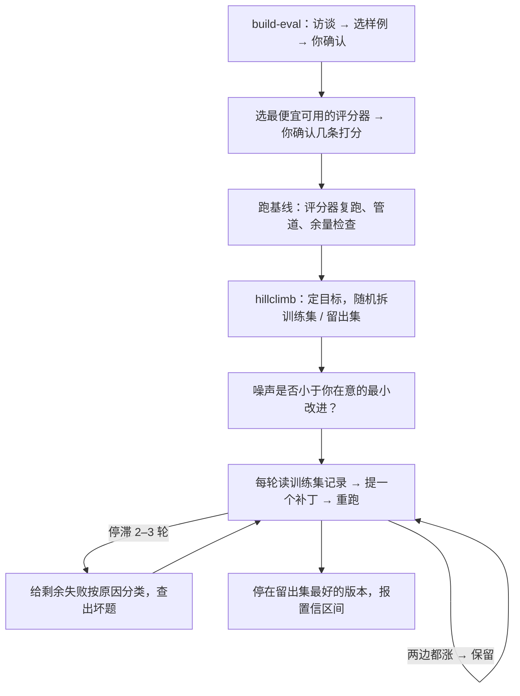

# 分数涨了，是真的变好了吗：Anthropic 怎么让 Claude 设计评测、再一次只改一处地爬分

Claude Code

**一句话看懂**：调提示词、改 skill、换模型之后分数涨了，最怕的是“自己骗自己”：评测本身不准，或者改动只是在迎合这几道题。Anthropic 的 Lance Martin 把两件事写成了原则，又做进了 Claude Code 自带的 claude-api skill：`/claude-api build-eval` 先访谈你、再在代码库里建评测，每一步都让你确认样例和评分器；`/claude-api hillclimb` 先把用例随机拆成训练集和留出集，每轮只提一个补丁，训练集涨、留出集不涨就回滚。两个内部例子：客服基准成本降到约五分之一、留出集准确率从 78.6% 到 90.5%；claude-api skill 自己的评测从 66% 爬到约 88%。

## 读完你能带走的 7 条收获

1. **好评测有四个特征**：任务贴近真实使用；更强的模型、更多思考应该得分更高；最强配置也要远低于 100%；同样的输入多跑几次，分数不该乱跳（见 3.1）。
2. **别只挑“当前模型做错的题”**：那测到的是这个模型的失败指纹；先说得出一道题为什么难，再把它放进来（见 3.1）。
3. **评分器先验证再相信**：能用代码判就别用模型判；要用模型判，评分标准写成可以逐条核对的断言，不用 1–5 分；裁判模型不能是被测模型（见 3.2）。
4. **跑基线时顺手查三件事**：评分器对同一输出跑两次结论变不变；有没有超时、API 错误、截断；基线是否已经接近 95%（见 3.2）。
5. **爬分选“便宜、能归因、目标清楚”的地方**：提示词和 skill 好改好撤；如果评测已经饱和，就把目标改成“分数不降、成本降低”（见 3.3）。
6. **防过拟合三招**：拆训练集和留出集；不把失败内容贴进提示词；答案要放在模型拿不到的地方（见 3.3）。
7. **几轮都爬不动时，先停下来给失败分类**：从来不涨的题，往往是题目或评分器本身错了（见 3.4、3.5）。

::: tip 小白先懂这几个词
- [Evals（评测）](/glossary#evals)：用一组固定任务给代理或应用打分。
- [Grader（评分器）](/glossary#grader)：判断一次输出算对还是算错的那段代码或模型。
- [LLM-as-judge（模型当裁判）](/glossary#llm-as-judge)：让另一个模型按评分标准给输出打分。
- [Hill Climbing（爬山 / 迭代调优）](/glossary#hill-climbing)：每次改一点，看分数，涨了就保留。
- [Held-out Set（留出集）](/glossary#held-out-set)：调优过程中从来不看的那部分用例，专门用来检查改进是不是真的。
- [Overfitting（过拟合）](/glossary#overfitting)：在评测上变好了，在真实使用里没有变好。
:::

## 1. 基本信息

<SourceCard type="文章" title="Automating eval design and hillclimbing with Claude" author="Lance Martin" date="2026-09-28" url="https://claude.dev/blog/automating-eval-design-and-hillclimbing/" />

| 项目 | 内容 |
|---|---|
| 链接 | https://claude.dev/blog/automating-eval-design-and-hillclimbing/ |
| 类型 | claude.dev 博客 Playbooks 栏目（页面标注 12 分钟，正文约 2,900 词，9 张示意图） |
| 作者 | Lance Martin（Anthropic） |
| 发布日期 | 2026-09-28（页面元数据与正文 “Sep 28, 2026” 一致） |
| 使用工具 | Claude Code 内置的 claude-api skill：`/claude-api build-eval`、`/claude-api hillclimb`；例子里的模型有 Opus 4.8、Opus 5.5、Sonnet 5 |
| 分析依据 | 原文全文，2026-10-19 用 curl 抓取，引语逐字核对。两个例子都是 Anthropic 内部基准，客服例子留出集只有 14 单；部分成本节省来自新模型降价，原文也明说了。示意图里的部分数据原文标注为“示意”。“我觉得”开头的段落是本站评论。 |

## 2. 这篇在回答什么

你改了一版系统提示词，跑了一遍评测，分数从 74% 涨到 80%。可以合并了吗？

至少还有三个问题没回答。第一，这把尺子准不准：评分器会不会把对的判成错的？第二，涨的 6 个点是不是噪声：同样的配置再跑一次，会不会也在 74 到 80 之间跳？第三，这个改动是真的让应用变好了，还是只是让它更会做这几道题？

原文开头就点出了难处：

<Trans zh="但设计评测，并且在评测上提升表现而不自欺，是很难的。">“But designing evaluations, and improving performance on them without fooling yourself, is hard.”</Trans>

全文分两半：前一半讲怎样把尺子做准（评测设计），后一半讲怎样用尺子爬分而不自欺（爬山）。每一半都先讲原则，再讲 claude-api skill 怎么把原则做成命令。具体回答五个问题：

1. 什么样的评测值得相信？（3.1）
2. `build-eval` 怎么选样例、选评分器、做诊断？（3.2）
3. 爬分该爬什么，怎么防过拟合？（3.3）
4. `hillclimb` 每一轮怎么决定保留还是回滚？（3.4）
5. 实际用起来效果如何？（3.5）

## 3. 怎么做

### 3.1 什么样的评测值得相信

原文说，设计得好的评测有四个共同点：

**一、任务贴近“生产”。** 从你真正关心的使用场景里抽任务。原文提醒，有时候选题只是因为它容易生成、容易打分，但任务分布必须代表你真正在乎的东西。

**二、更强的模型、更多的思考，分数应该更高。** 如果不是这样，常见原因是任务有歧义，或者评分器没校准好。

**三、前沿要留有“可以通过的”余量。** 最强的模型开最高的推理强度，也应该远低于 100%，否则你没法判断改动的影响。但这个差距不能是“不可能完成的题”或“有歧义的题”造成的。原文给了一个判断方法：

<Trans zh="一个常见的迹象是，某道题不管重复多少次，每一次评测运行都失败。">“a common tell is that a task fails every evaluation run, regardless of the number of replicates.”</Trans>

什么是一道好题？原文的标准是：

<Trans zh="一道好题是：两位领域专家会给出相同的判决，并且评分器检查的每一样东西都在题目里写明了。">“A good task is one where two domain experts would reach the same verdict and everything the grader checks is stated in the task.”</Trans>

**四、多次运行之间的方差小。** 方差大，通常是题目有歧义，或者评分器对同样的输出给出不同判决。方差也可能藏在配置里，比如推理强度没有被一致地应用。环境也会影响结果：上一次试验留下的状态（一个文件、一段 git 历史）可能直接把答案递给了代理。

**对抗式采样的陷阱。** 很多人建评测时会专挑当前模型答错的题。原文说这样做有问题：模型能力是锯齿状的，专挑它做错的，你采到的只是这一个模型能力曲面上的几个低谷。

<Trans zh="评测最后可能测的是那个模型的失败指纹，而不是对你的应用来说本质上困难或有价值的东西。">“The evaluation can end up measuring that model's failure fingerprint rather than what is intrinsically hard or valuable for your application to do.”</Trans>

原文的建议是：挑难题，要因为人判断它难；一个有用的检验是，放进来之前你能说出它为什么难。可以加入从生产流量、bug 报告、工单里来的具体失败。但也别盲信用户流量：用户往往只尝试他们预期能成功的事，完全从用户流量里抽题，分布可能偏简单。

我觉得“专挑当前模型做错的题”是最常见的建评测方式，也是这篇最有用的一条纠正。它的问题在换模型时最明显：新模型的低谷在别处，旧评测上分数大涨，真实效果却未必变好。站内 [[19]] 讲过从真实失败里攒题，这里补上了它的边界：真实失败要经过“说得出为什么难”这一关。

### 3.2 build-eval：样例、评分器和诊断

在 Claude Code 里运行 `/claude-api build-eval`，Claude 会先访谈你，然后在你的代码库里建评测，并在几个节点停下来等你批准。

**样例从哪来。** Claude 按这个顺序帮你找输入：

1. 生产环境的对话记录（先问清数据保留期限和敏感数据）；
2. bug 报告和支持工单；
3. 你亲手写的 5 到 10 条；
4. 从你的代码库合成的用例。

skill 优先用生产流量，但也能以你给的几个真实例子为锚生成合成数据。它会让 Claude 生成一个简单的页面，列出全部输入，等你确认。原文的示意图用的是一个邮件路由应用的输入。

**评分器怎么选。** 有了输入，Claude 会提议适合你的输出的**最便宜**的评分器：

- **程序化验证**：输出的可能性有限时，用代码检查，比如精确匹配、固定集合里的标签、符合 schema 的 JSON、测试是否通过。
- **LLM-as-judge**：输出空间开放、正确答案很多但质量标准清楚时，默认用这种。第二个模型读输入、输出和一份评分标准，返回分数和理由。原文特别强调评分标准要写成 “checkable claims (not a 1-to-5 scale)”，也就是可以逐条核对的断言，而不是 1 到 5 分。如果有基线可比，裁判会以随机顺序读两份输出，不告诉它哪份是基线，让它选更好的那份。裁判模型由你选，而且不应该是被测的模型。

然后 Claude 会先给几条用例打分，问你有没有哪条你会打得不一样。原文的提醒是：

<Trans zh="一般来说，在相信你的评估器之前，读一部分打过分的记录很重要；评分出错是评测配置错误最常见的方式之一。">“In general, it is important to read a sample of scored transcripts before believing your evaluator; scoring failures are among the most common ways an evaluation is misconfigured.”</Trans>

评分器确认后，skill 会告诉你评测集的规模（用例数 × 重复次数 × 模型数，以及大约要跑多久），跑一次基线，打印带置信区间的分数。你拿到的东西是：用例、评分器、运行器、每个用例一行 JSON 和一份完整记录，以及一个列出每个用例分数并链接到记录的简单页面。默认这些页面是静态文件，在本地打开，不从网络加载任何东西。

**跑基线时的诊断。** Claude 会检查三件事：

- **评分器**：对同一个输出跑两次评分器，报告判决有没有变。
- **管道**：查超时、API 错误和被截断的回答，免得基础设施噪声被当成模型的方差。
- **余量**：如果基线已经在 95% 左右或更高，skill 会提醒你，这次爬分应该去探索成本或延迟，而不是质量。

我觉得“同一输出跑两次评分器”是一个几乎零成本、却很少有人做的检查。如果裁判自己都不稳定，后面所有的“涨了 3 个点”都没有意义。这和 [[50]] 讲的基础设施噪声是同一类问题，一个出在机器上，一个出在评分器上。

### 3.3 爬分该爬什么，怎么不自欺

有了可靠的尺子，才轮到爬山。原文说，爬山适合调推理强度、提示词这类在成本和效果之间做取舍的参数。选择爬哪里，有三条建议：

- **迭代便宜**：要改的那个面，改起来在时间、成本和精力上都应该便宜。很多内部项目和客户都在文本上爬分，比如提示词和 skill，好改也好撤；相反，在爬分过程中开放式地改 agent harness，可能牵扯大量代码。
- **可以归因**：分数的变化应该能归到你改的那个面上。原文举的例子是 skill 触发：评测指标（skill 的触发率）和被修改的 skill description 直接相关。
- **目标明确**：一个常见的失败是笼统地要求“提升表现”，却不考虑评测还有多少余量。评测接近饱和，或者改动范围不清楚（比如开放式地改 harness），都容易停滞。原文说有一个普遍好用的目标是成本：即使评测已经饱和，也可以让 Claude 在效果持平的前提下找办法降成本。

**过拟合。** 即使评测设计得好，它也很少和你真正关心的生产分布完全一致，所以“对评测过拟合”很常见：系统在评测上的表现好于在生产流量上。评测可能以很多方式“泄漏”进你的 harness（模型外面那一层代码，包括提示词、工具和调用 Claude 的循环）。原文的例子是：某道评测题用 OCR 会更好做，但你的生产任务很少需要 OCR；爬分过程可能给应用加一个 OCR 工具，评测分数涨了，生产毫无变化。更一般地说，爬分可能往 harness 里加一些只处理这几道题边界情况的功能。

原文给了三招：

1. **拆分用例。** 训练集给爬分者看，测试集永远不让它看。训练集分数涨、测试集不动，就是常见的过拟合信号。
2. **永远不要把失败内容贴进提示词。** 爬分者可以读失败的记录，但不能把失败的具体内容贴进提示词。
3. **把答案结构性地放在模型够不到的地方。** 模型有时会通过直接找到评测答案来“刷分”（reward hack）。

我觉得第二招最容易被违反。人自己调提示词时，最自然的动作就是“它在这道题上错了，我在提示词里加一句专门提醒”。这一句在这道题上一定有效，在真实流量上多半没用。规则写成“修根因，不修个案”，才能挡住这种直觉。

### 3.4 hillclimb：每一轮怎么决定保留还是回滚

在 Claude Code 里运行 `/claude-api hillclimb`，Claude 会针对一个给定的评测迭代改进。你来决定它能改什么，包括：系统提示词；skill 或指令文件；工具描述；模型选择、推理强度和其他 API 参数；你的 harness 代码。

**开始之前。** Claude 先问你要优化什么（比如效果，或者效果持平下的成本），然后把评测集随机拆成测试集和训练集。如果目标是成本，它会考虑几个常见的成本因素：提示词缓存、检查提示词和所选模型是否兼容、选模型和推理强度。

第一轮之前，它还会检查评测的噪声：

<Trans zh="第一轮之前，Claude 会检查评测的噪声（分数仅凭偶然能移动多少）是否小于你会采取行动的最小改进；如果不是，它会直说，并建议增加重复次数或用例。">“Before the first round, Claude checks that the eval's noise (how far the score can move by chance alone) is smaller than the smallest improvement you'd act on; if it isn't, it says so and suggests more repetitions or cases.”</Trans>

**每一轮。** Claude 读上一轮训练集的记录，以补丁的形式提出**一个**改动。它会瞄准一个效果能高出噪声的改动：从根上修掉失败的行为（比如重写导致问题的那一节，或者补上缺的规则），而不是改写一行措辞。然后用打过补丁的版本重跑评测，按三条规则判断：

- 训练集涨了、测试集没动：怀疑过拟合，回滚这个补丁。
- 出现退步：回滚。
- 训练集和测试集都涨了：保留。

**停滞时。** 分数连续两三轮不动时，Claude 会逐条读剩下的训练集失败，按原因分类。如果没有任何单个修复能带来超过噪声的提升，它也会提前做这一步，并建议增加重复次数或用例，而不是把轮次花在小到测不出来的改动上。这一步能抓出有歧义的评测用例、harness 错误或运行间方差。只有“真正的失败”才会进入后续的爬分轮次。

**结束时。** Claude 把你的代码停在“在测试集上对你的目标最好”的那个版本，报告测试集结果和基线的对比，附置信区间。如果提升在噪声范围内，它会直说，并建议不要合并。

我觉得“一次一个补丁，训练涨测试不涨就回滚”这条规则，人自己调提示词时也该照做。它慢，但每一次保留下来的改动都有证据；一次改五处、分数涨了，你永远不知道是哪一处起的作用，也不知道有没有哪一处在悄悄拖后腿。

### 3.5 两个例子

**例一：为降成本爬分。** 内部的客服基准有 44 张工单，30 张用于搜索，14 张留出。起点是 Opus 4.8、默认（high）推理强度，搜索集上决策准确率 74.4%，每张工单 4.6 美分。

1. 爬分先审查提示词，删掉了强制的工具调用“仪式”、一个草稿步骤和互相矛盾的规则。
2. 然后试了低推理强度的 Opus 5.5：87.8%，成本降到 1.9 美分，不到起点的一半。原文说明，这部分节省有一块来自 Opus 5.5 的定价：输入和输出 token 比 Opus 4.8 便宜 20%，缓存读取便宜 60%。
3. 既然 Opus 5.5 过了线，爬分又往下试了一档：低推理强度的 Sonnet 5，88.9%，成本约一半，每单 1 美分。
4. 最后，Claude 在提示词里加了路由规则和退款上限的交叉引用，Sonnet 5 到了 98.9%，成本基本不变。

这些都是搜索集上的分数。在搜索从没见过的 14 张留出工单上：

<Trans zh="最终配置得分 90.5%，原始配置是 78.6%，成本约为五分之一。">“the final configuration scored 90.5% against the original setup's 78.6%, at about one fifth of the cost.”</Trans>

**例二：为提升效果爬分。** 对象是 claude-api skill 本身，它提供使用 Anthropic API 的指导（也包括这篇讲的两个子命令）。团队从文档里推出一套评测，测 skill 能不能正确写出调用 API 的代码。

1. 起点 66%。爬分者能访问文档和 SDK，于是发现 skill 缺了 8 个功能的说明，补上后到 74%。
2. 又发现 C# 和 Java 的类型表有错，修好后到 77%。
3. 分数停了两轮。这一步不做任何修改，只把剩下的失败按根因分类。结果发现：skill 里其实有正确内容，但 Claude 仍然在写旧的 API 形状，也就是来自训练时的先验。于是在 skill 顶部加了一张“旧写法 → 新写法”的对照表，比如从固定 token 预算的 extended thinking（最近的 Opus 模型的 API 已经拒绝这种写法）改成 adaptive thinking，以及 web search、web fetch 工具从旧版本改成新版本；还把 C# 和 Java 里“不要用固定预算思考”的警告挪到 adaptive thinking 示例的上面。到 80%。
4. 有些题补上明显的内容缺口后还是一直不涨。原文说这是题目或评分器有问题的信号：一道题要求代码只捕获一种错误类型，评分器却要求至少三层的错误链，Claude 改写了题目；另一个评分器的说明和文档矛盾，实际调用 API 证明文档是对的。处理完这些，再加上更多 skill 修改，到了约 88%（示意图标为 66.1% → 87.9%）。

**开始使用。** 先运行 `claude update`，因为 claude-api skill 随 Claude Code 一起发布，更新后就能拿到最新版本的命令；然后在 Claude Code 里运行 `/claude-api build-eval` 或 `/claude-api hillclimb`。

我觉得例二里的第 3 步和第 4 步，比最终的分数更有价值。第 3 步说明，“文档里写了”不等于“模型会照做”，训练先验会覆盖文档，要用显眼的对照表去纠正。第 4 步说明，爬分到后期找到的常常不是应用的问题，而是评测的问题。

## 4. 结果与局限

- **原文给出的结果**：客服基准上，最终配置在 14 张留出工单上 90.5%（原配置 78.6%），成本约五分之一；claude-api skill 评测从 66% 到约 88%。
- **样本很小**：客服例子的留出集只有 14 张工单，一张工单约等于 7 个百分点，原文没有给这组数字的置信区间。
- **注意口径**：98.9% 是搜索集分数，不是留出集；成本下降有一部分来自新模型降价，不全是爬分的功劳，原文明说了这一点。
- **都是内部基准**：两个例子都来自 Anthropic 内部，没有外部团队的复现。
- **示意图**：图 1 标为 “illustrative”（示意），其中的曲线不是实测数据。
- **工具绑定**：两个命令只在 Claude Code 的 claude-api skill 里，评测对象偏向“调用 Claude API 的应用”。不过前半部分的原则不依赖任何工具。
- **原文没讲的**：每轮爬分花多少钱、跑多久；拆分后的测试集太小时怎么办。

## 5. 结论

这篇的核心是一个顺序：先把尺子做准，再用尺子爬分；爬分时一次只改一处，用留出集判断是不是真的变好；爬不动时先怀疑尺子。claude-api skill 把这个顺序做成了两条命令，但原则本身适用于任何评测。

我觉得最值得记住的一条是：从来不涨的题，往往是题出错了。很多团队把这类题当作“模型的硬伤”留在评测里，结果每次改动都背着几道永远答不对的题，噪声更大，判断更难。定期把这类题拿出来逐条读一遍，是最便宜的评测维护。

**你可以这样试**

1. 拿你现有的评测，对同一批输出跑两次评分器，统计有多少条判决变了。
2. 找出每次都失败的题，逐条问：两个懂行的人会给出同样的判决吗？评分器检查的东西在题目里写了吗？
3. 下次调提示词，先把用例随机拆成两半，只看其中一半的失败记录，每次只改一处；另一半分数不涨的改动不要合并。

**读完自测**

- 为什么专挑当前模型做错的题会让评测失真？
- 爬分时“训练集涨、测试集不涨”说明什么？hillclimb 遇到这种情况怎么处理？
- 例二里，skill 已经写了正确的 API 用法，为什么 Claude 还会写错？最后是怎么解决的？
