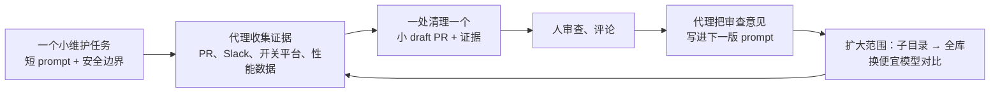

# 代理写得越快，维护债涨得越快：OpenAI 用 Codex 删死代码、清过期实验、给 CI 提速

<div class="meta-tags"><span class="tool-tag tool-codex">Codex</span></div>

<div class="hook">

**一句话看懂**：OpenAI 实验平台团队的 Rodrigo Roim 发现，代理让大家写代码更快，也让要清理的东西更多。他们的做法是：给 Codex 一个**短的、带安全边界的 prompt**，让它自己去翻历史 PR、Slack、实验平台配置和生产性能数据，找到能删的东西，**一处清理开一个小的 draft PR，并附上证据**；人负责审查，再让 Codex 把审查意见写进下一版 prompt，逐步从一个目录扩到整个代码库。结果：5 个人两周兼职合并了 1,400 多个 PR，删了 80 多万行代码；CI 中位耗时从约 10 分钟降到 4.5 分钟。文中的几段 prompt 原文都可以直接借用。

</div>

## 读完你能带走的 7 条收获

1. **维护任务适合交给代理，前提是它能拿到证据**：不只读代码，还要能看历史 PR、讨论记录、功能开关平台和性能剖析数据（见 3.1）。
2. **prompt 里写清楚“保留什么”**：生产行为、运维保护、用作 killswitch 的开关都不能动；不改线上配置（见 3.2）。
3. **一处清理一个小 draft PR，附上证据链接**：审查者看得快，出错也好撤（见 3.2）。
4. **拿不准时让代理把问题交给人**：被标成“Permanent”的开关，代理算出了 CPU 成本，但没有自己删（见 3.2）。
5. **用审查意见迭代 prompt**：先在小范围跑，人评论 PR，再让代理把评论融进一个更大范围的 `/goal` prompt（见 3.2、3.5）。
6. **贵模型和便宜模型在同一任务上比一次**：便宜模型拿到 92% 的发现、只花 14% 的成本；找出它漏掉的模式，再写进 prompt（见 3.3）。
7. **同样的思路可以用在 flaky test、AGENTS.md 和 CI 提速上**：最后一项落地了约 30 个 PR，CI 中位耗时从约 10 分钟降到 4.5 分钟（见 3.4）。

::: tip 小白先懂这几个词
- [Dead Code（死代码）](/glossary#dead-code)：还留在仓库里、但已经不会被执行的代码。
- [Feature Flag（功能开关）](/glossary#feature-flag)：不重新部署就能打开或关掉一项功能，也常用来做实验。
- [/goal](/glossary#goal)：给 Codex 一个长目标，让它自己持续干到达成为止。
- [Flaky Test（不稳定测试）](/glossary#flaky-test)：代码没变，却时过时不过的测试。
- [AGENTS.md](/glossary#agents-md)：写给代理看的仓库说明和规则文件。
- [Reasoning Effort（推理强度）](/glossary#reasoning-effort)：文中的 Medium、Ultra 就是不同的推理档位。
:::

## 1. 基本信息

<SourceCard type="文章" title="Maintaining software with the GPT-6 family" author="Rodrigo Roim" date="2026-10-14" url="https://developers.openai.com/blog/maintaining-software-with-the-gpt-6-family" />

| 项目 | 内容 |
|---|---|
| 链接 | https://developers.openai.com/blog/maintaining-software-with-the-gpt-6-family |
| 类型 | OpenAI Developers 博客（正文约 1,900 词，含 6 段 prompt 原文和一张成本对比图） |
| 作者 | Rodrigo Roim（OpenAI Core Experimentation 团队） |
| 发布日期 | 2026-10-14（页面显示 Oct 14, 2026） |
| 使用工具 | Codex；模型 GPT-5.6 Sol、GPT-6 Astra、GPT-6.1 Sol；Statsig（功能开关和实验平台）、Slack、内部项目跟踪器、生产性能剖析表 |
| 分析依据 | 原文全文，2026-10-19 用 curl 抓取，引语逐字核对，prompt 逐字摘录。所有数字都是团队自报；模型对比只跑了一次，发现由作者本人审核。文章也在推广 OpenAI 自家的新模型，结尾有招聘信息。“我觉得”开头的段落是本站评论。 |

## 2. 这篇在回答什么

你的团队用代理之后，一个月合并的 PR 多了好几倍。半年后你会发现另一个问题：仓库里堆满了没人用的代码、早就结束的实验开关、时好时坏的测试，CI 越跑越慢。

写代码的速度上来了，清理的速度没有。原文第一段就是这个观察：

<Trans zh="在 OpenAI，编码代理帮我们更快地开发，这也增加了我们的维护需求。">“At OpenAI, coding agents have helped us build faster, which has also increased our maintenance needs.”</Trans>

作者所在的 Core Experimentation 团队负责支撑全公司实验的软件，从前端改动到模型服务效率都有。这篇文章讲他们怎么让模型去找清理机会、收集证据、准备好供人审查的改动。全文回答四个问题：

1. 删死代码，怎么让代理既敢删又删得对？（3.1）
2. 更难的“过期实验”怎么清，prompt 怎么从一句话长成一份全库审计？（3.2）
3. 贵模型和便宜模型该用哪个？（3.3）
4. 这套做法还能用在哪？（3.4）

最后是作者建议的落地顺序（3.5）。



## 3. 怎么做

### 3.1 删死代码：从“规则写死”到“让代理找证据”

**以前怎么做。** 在代理之前，很多团队靠复杂的静态分析系统加运行时日志来发现和删除没用的代码。作者说，即使有这些系统、有仔细的代码审查，还是会出错，他记得好几次事故都是误删代码造成的。原因是边界情况太多：

<Trans zh="要考虑的边界情况太多了，比如反射会干扰静态分析，或者一条没用的代码路径其实是留着在未来事故中用来止损的。">“There are too many edge cases to consider, like reflection throwing off static analysis or an unused code path that can be activated to mitigate future incidents.”</Trans>

**第一步：给明确的区域和验证标准。** 用 GPT-5.6 Sol 时，作者会指定一个要调查的区域和清楚的验证标准，让模型自己写静态分析、删死代码。这些针对性的 prompt 比原来的静态分析系统更容易开发和维护，可靠性相近。

**第二步：只给一句宽泛的请求。** 拿到 GPT-6 Astra 后，他们想看它能不能从一个宽泛的请求出发，自己决定去哪看、需要什么证据来证明每一处删除是对的。他们用的是一个很短的 Codex prompt，原文说这个 prompt 对 GPT-5.6 Sol 来说太模糊、处理不完整。原文照登，连错字都保留了（方括号里是作者的注释）：

::: tr 你能帮忙找出并清理仓库里的死代码吗？可以随意去查 Slack、Statsig（我们用的功能开关和实验平台），或者任何你需要的来源，确认这些东西确实已经不再被使用，可以清理或简化。
```text
Can you help identify and clean up dead code in the repo please, feel free to check slack,
statsig [a feature flag and experimentation platform we use], or any other source you need to
confirm that things are indeed no longer being used and can be cleaned up or simplified
```
:::

Astra 做了什么？它看了过去的 PR，从 Slack 讨论里收集上下文，查了内部项目跟踪器，还读了生产环境的性能剖析表，确认要删的代码从来没被执行过。它还为每一处删除写了理由：

<Trans zh="Astra 还解释了每一处删除的理由，这加快了我们的审查。">“Astra also explained its rationale for each deletion, which accelerated our reviews.”</Trans>

**规模。** 看到效果后，5 名工程师合作，在多个仓库上跑这个 prompt 的变体，合并了 1,400 多个 PR，删掉 80 多万行代码。大部分是两周内兼职完成的，大家主要还在做别的项目。代码审查分发给了对各个项目有上下文的团队。原文给了两个可测的收益：一个服务的容器镜像从 3.31GB 缩到 1.72GB，减少 48%；另一批清理从测试套件里删掉了约 400 个视觉快照变体。

我觉得这里真正起作用的不是“模型更强”，而是代理能拿到的证据面变宽了：历史 PR、讨论记录、性能剖析数据。静态分析只能看代码，看不出“这段代码是留着救火用的”；而这类信息恰恰写在 Slack 讨论和事故记录里。如果你的代理只能读仓库，这一步就只能做到静态分析那部分。

### 3.2 清过期实验：prompt 怎么从一句话长成全库审计

**为什么更难。** 过期实验不一定是没用的代码：它的代码可能还在生产环境运行，或者依赖随时可能变化的资格判断，所以静态分析更难做。以前团队的做法是确定性静态分析加数据库查询，再用当时最强的模型（GPT-5.6 Sol）去写和改进脚本。他们知道这样会漏掉很多真正过期的实验（假阴性）。

**第一版：和模型一起写一个短 prompt。** 作者不确定怎么起步，于是先和 Astra 头脑风暴，让它写一个可以在新线程里试的短 prompt。结果是这样（原文，`{A}`、`{B}` 是项目名占位）：

::: tr 在项目 {A} 和 {B} 里，找出并删除与过期的、恒定的 Statsig 开关 / 配置或已放弃的实验相关的大块死代码。核对 Statsig 的线上配置，查看 git 历史和有重叠的 PR。保留生产行为、运维保护措施，以及用作 killswitch 或类似用途的开关 / 配置。忽略 SDK 回退值和本地覆盖。每一处清理开一个小的 draft PR，并在摘要里附上它的 Statsig 配置控制台链接。
```text
Find and remove substantial dead code associated with stale, constant Statsig gates/configs or
abandoned experiments in projects {A} and {B}. Verify live Statsig configuration and check git
history and overlapping PRs. Preserve production behavior, operational safeguards and
gates/configs intended as killswitches or similar. Ignore SDK fallbacks and local overrides.
Create one small draft PR per cleanup, linking its Statsig configuration console link in the
summary.
```
:::

这段 prompt 很短，但结构完整：范围（两个项目）、要找什么、要核对什么证据、**要保留什么**、要忽略什么、产出格式（一处清理一个小 draft PR，附证据链接）。原文说 Astra 遵守了这些保护条款，准备的改动都带着团队能审查的证据。

**第二版：用审查意见改写成全库扫描。** 作者在这些 PR 上留了评论，然后让 Astra 读他的评论、吸收反馈，再写一个扫描整个代码库的新 prompt。他担心要清理的东西太多、没法排优先级，所以也让 Astra 帮忙解决这个问题。Astra 给出的 prompt 是这样的（原文；中间一段作者省略了，方括号是作者的说明）：

::: tr 用 /goal 下目标：找出这个仓库里每一个过期的、恒定的、被放弃的或已全量发布的 Statsig 开关、配置、实验和层，并且能在不改变生产行为的前提下安全删除。审计所有 Statsig 项目和清单，不只是标了“过期”的对象。通过枚举、常量、包装函数、别名、schema、动态拼接的名字以及跨服务的使用者去找间接用法。核对每一个在生产中被引用的常量，不要在给出一份保守的短名单后就停下。考虑每个对象的云资源用量，包括 CPU；有生产遥测和性能剖析数据时用它们找出昂贵的死检查。（省略部分：由 Astra 生成的详细说明，涉及核实生产行为、优先处理较老的对象、保留有意设置的保护措施、解读 SDK 回退值。）产出一份 markdown 报告，把所有核实过的候选按可以并行的 owner / 文件工作流分组，包括生产取值、证据、owner、调用点，以及能拿到的评估次数或 CPU 成本。不要修改线上配置或服务。
```text
/goal Find every stale, constant, abandoned, or fully shipped Statsig gate, config, experiment,
and layer present in this entire repository that can safely be removed with no production
changes. Audit all Statsig projects and inventories, not just objects labeled stale.
Find indirect usages through enums, constants, wrappers, aliases, schemas, dynamically assembled
names, and cross-service consumers. Reconcile every production-referenced constant; do not stop
after producing a conservative shortlist.
Consider each object's cloud resource usage, including CPU. Use production telemetry and
profiles where available to identify expensive dead checks.
[Omitted for brevity: detailed instructions, generated by Astra, on verifying production
behavior, prioritizing older objects, preserving intentional safeguards, and interpreting SDK
fallbacks.]
Produce a markdown report grouping all verified candidates into parallelizable ownership/file
workstreams, including production values, evidence, owners, callsites, and observed evaluation
or CPU costs if available.
Do not modify live configurations or services.
```
:::

和第一版比，有三个变化：范围从两个项目扩到整个仓库；产出从“直接开 PR”变成“先出一份分组报告”，方便排优先级和并行分派；加了成本维度（CPU、评估次数），让收益最大的项排在前面。最后一行仍然是安全边界：不要改线上配置或服务。

**结果。** 报告里，排在最前面的几项是多年来没人发现已经过期的实验，带来了很大的效率收益。作者仔细核实了这几项大的结果，然后做了完整清理，删掉了几百个实验和功能开关。

**一个“交给人判断”的例子。** 几年前有工程师建了一个 Statsig 开关，允许内部开发者为了测试而覆盖所有与新功能相关的开关。实现只是一行 Python，把这个开关映射到所有其他功能上。这一行和几百行类似的映射放在一起，毫不起眼。Astra 发现它因为映射到所有功能，造成了明显的 CPU 扇出。它算了 CPU 成本，但没有自己删：

<Trans zh="它调查了 CPU 成本，但把这项发现提交给人审查，因为这个开关在我们的功能开关管理控制台里被明确标成了“Permanent”（永久），可能仍有运维用途。">“It investigated the CPU cost, but raised the finding for human review because the flag had been explicitly marked as “Permanent” in our feature flag management console and could still serve an operational purpose.”</Trans>

人审查后删掉了它，主要受影响的服务估计省下 0.42% 的 CPU。

我觉得这一节最值得学的是两版 prompt 之间的那一步：不是人自己去改 prompt，而是把人对 PR 的审查意见交给模型，让它写进下一版。这样每一轮审查都在把团队的判断沉淀成规则，和站内 [[33]] 把重复的审查意见变成规则、[[60§3.2]] 把反复出现的评论移进 REVIEW.md 是同一个思路。

### 3.3 贵模型还是便宜模型：同一个任务比一次

后来他们测试了 GPT-6.1 Sol，想看它能不能在同样的工作流上达到 GPT-6 Astra 的效果，同时更便宜。

作者用上面那个 prompt，在不同的模型 / 推理强度组合上，让 Codex 审计某个仓库里的特定子目录，找过期实验。这些子目录有 6,000 多个文件、100 万行代码，涉及 Python、TypeScript、Go 和 Rust。他本人审核了所有发现。结果如下（原文图表的数字）：

| 模型 / 推理强度 | API 成本 | 发现数 | 每条发现的成本 |
|---|---|---|---|
| GPT-6 Astra Ultra | $109.06 | 142 | $0.77 |
| GPT-6.1 Sol Ultra | $15.12 | 131 | $0.12 |
| GPT-6.1 Sol Medium | $5.27 | 86 | $0.06 |

成本按标准 API 价格计算，包括研究用的子代理和 Codex 为达成目标自动跑的后续轮次。原文的结论：

<Trans zh="在这次比较里，GPT-6.1 Sol Ultra 产出了 GPT-6 Astra Ultra 92% 的发现，只用了 14% 的 API 成本。">“In this comparison, GPT-6.1 Sol Ultra produced 92% as many findings as GPT-6 Astra Ultra at 14% of the API cost.”</Trans>

GPT-6.1 Sol Medium 被接受的发现更少，成本也更低。

**差在哪里。** 作者检查了不同组合之间的差异，发现了一些模式。比如两个 Ultra 之间的差异，大多来自“被其他开关当作依赖的恒定开关”：Astra 找到了，Sol 漏了。

这种错误模式能反过来改进 prompt，让便宜的模型接近贵模型的结果。但作者也提醒：

<Trans zh="与此同时，未来的模型发布可能让这些修正过时，所以新模型发布时重新审视 prompt 很重要。">“At the same time, future model releases can make these corrections obsolete, so it’s important to revisit prompts when new models are released.”</Trans>

我觉得这个对比的方法比结论更有用：同一个 prompt、同一块代码、人工审核所有发现，然后不只看总数，还去看“漏了什么类型的东西”。这比看公开基准分数更能回答“我的这个任务该用哪个模型”。但要注意，这只是一次运行，没有重复，也没有说明误报率。

### 3.4 另外三个可以直接试的 prompt

作者说，他最喜欢的一些 Codex 发现，都是从这种短 prompt 开始的。他建议先用 GPT-6.1 Sol Medium 试，结果不错再提高推理强度做更大范围的审计。原文给了三个：

**修 flaky test：**

::: tr 用 /goal 下目标：查看最近所有的 CI 运行，找出不稳定的测试。对每个不稳定测试尝试修复，修好了就提一个 PR。你的任务是为简单问题找到明确的修复，而不是把每个不稳定测试都修一遍。
```text
/goal Look at all recent CI runs to find flaky tests. For each flaky test, try a fix and if
successful put up a PR. Your job is to find clear fixes to simple issues, not to exhaustively
fix every flaky test.
```
:::

**改进代理的上下文（AGENTS.md）：**

::: tr 翻看我最近的 Codex 会话，找出一条看起来误导了代理或造成了多余工作的 AGENTS.md 指令。选出发生这件事的那个原始会话 prompt。在同一个仓库快照、同一个模型上把这个 prompt 重放两次：1. 当前的 AGENTS.md 指令不变；2. 只删掉或修正这一条指令。比较任务质量、代理行为、工具调用、token 用量、运行时间和成本。给出这条指令，以及修改它有没有帮助。
```text
Look through my recent Codex sessions and find one AGENTS.md instruction that appears to have
misdirected an agent or caused unnecessary work. Choose the original session prompt where that
happened. Replay that same prompt twice from the same repository snapshot and model:
1. With the current AGENTS.md instruction unchanged.
2. With only that one instruction removed or fixed.
Compare task quality, agent behavior, tool calls, token usage, runtime, and cost. Show the
instruction and whether updating it helped.
```
:::

**降低 CI 的成本和耗时：**

::: tr 你有什么办法减轻这个仓库的 CI 负载？把你的想法列成表，并根据这个仓库的 CI 运行历史，按估计每天能省下的 CI 分钟数给所有想法排序。
```text
What ideas do you have to relieve CI load in this repository? List your ideas in a table and
rank all of them by estimated CI minutes saved per day based on this repo's CI run history
```
:::

最后这个 prompt 有实际结果。跑完它、跟进其中的建议后，他们落地了约 30 个 CI 优化 PR：CI 完成时间的中位数从约 10 分钟降到 4.5 分钟，P90 从 12.5 分钟降到 6 分钟。后来还有一个修复：补上一个缺失的 mock，让一个有 63 个测试的 resolver 套件从 592.6 秒降到 29.8 秒，减少 95%，63 个测试一个没删。

我觉得第二个 prompt 是这篇里最被低估的一个。它把“这条 AGENTS.md 规则有没有用”变成了一次可控的 A/B 对照：同一快照、同一模型、只改一条指令。站内 [[57]] 在 CI 里评测配置改动、[[47]] 给 Skill 写评测，都在回答同一个问题；这个 prompt 是成本最低的版本，不用先建评测集，直接拿真实的历史会话重放。

### 3.5 从小做起，审查，再扩大

作者总结说，到目前为止，团队已经合并了 1,400 多个从 GPT-6 提案开始的维护 PR，带来了更快的测试、更小的镜像、更低的 CPU 占用等收益。他也说了不好的一面：

<Trans zh="不过，有些提案增加的复杂度超过了它预期的收益，所以排优先级和度量仍然是我们工作流里重要的一部分。">“However, some proposals added more complexity than their expected benefit justified, so prioritization and measurement remained an important part of our workflow.”</Trans>

在更大的代码库里，模型能找到的优化多到让人应接不暇。借助埋点数据和上面这些 prompt 技巧，Codex 也在帮他们排优先级。

作者建议的落地顺序：

1. 从**一个小维护任务**开始：一段没用的代码、一个过期的功能开关，或一个不稳定的测试。
2. 让 Codex 找到一个实例，收集证据，提出一个小的 draft PR。
3. 在这个小任务上比较不同的模型和推理强度，便宜的配置可能就够了。
4. 小范围跑顺了，扩到一个子目录或范围清楚的项目。
5. 每一步都让 Codex 把你的代码审查意见写进下一版 prompt。
6. 对模型的表现有信心后，再扩到整个代码库。

## 4. 结果与局限

- **原文报告的结果**：删死代码一项，5 人两周兼职合并 1,400 多个 PR、删掉 80 多万行；一个镜像缩小 48%；约 400 个视觉快照变体被删；过期实验清理删掉几百个实验和开关，其中一个开关估计省 0.42% CPU；约 30 个 CI 优化 PR，CI 中位耗时约 10 → 4.5 分钟、P90 12.5 → 6 分钟；一个测试套件 592.6 → 29.8 秒。
- **数字口径有重叠**：删死代码一节说“合并 1,400 多个 PR”，结尾又说“到目前为止合并了 1,400 多个维护 PR”。原文没有说明两者的关系，本文照原文分开写。
- **都是自报**：没有误删率、回滚次数，也没有说审查花了多少人力。“可靠性相近”没有给数据。
- **模型对比只跑一次**：在一组子目录上，由作者一人审核；没有重复，没有误报率。
- **依赖内部数据源**：效果很大程度上来自代理能读 Slack、Statsig、项目跟踪器和生产性能剖析表。只能读代码的代理做不到同样的事。
- **推广**：文章同时是 GPT-6 系列模型的展示，结尾有招聘。GPT-6 Astra、GPT-6.1 Sol 的名字和定价以 OpenAI 官方为准。
- **原文自己承认的问题**：有些提案增加的复杂度超过了收益；大代码库里候选太多，容易被淹没。

## 5. 结论

代理把写代码变快之后，维护也要跟上同样的速度，而维护恰好适合交给代理：任务边界清楚，结果可以用证据验证，每一处改动都可以很小。关键是三件事：让代理能拿到证据，不只是读代码；在 prompt 里写清楚什么不能动；一处清理一个小 PR，人来审，审查意见再变成下一版 prompt。

我觉得这篇放在“接进 PR 与 CI”阶段，最值得借的是它的节奏，而不是具体模型：先手动在一个小任务上跑通，再扩大范围，最后才考虑定时运行。站内 [[41]] 讲定时代理的规则、[[55]] 讲用 Skills 把维护流程写进仓库，这篇补上了“维护 prompt 本身怎么一步步长大”。

**你可以这样试**

1. 挑一个你确定已经全量发布的功能开关，用 3.2 的第一版 prompt 改成你的平台名，让代理只开一个 draft PR，看它给的证据够不够你放心合并。
2. 用 3.4 的 CI prompt 让代理按“每天省下的 CI 分钟数”排一张表，只做排在前三的。
3. 从最近一次代理“干了多余的活”的会话里，用 3.4 的 AGENTS.md prompt 做一次重放对照。

**读完自测**

- 第一版过期实验 prompt 里，哪几句是“安全边界”？为什么需要它们？
- 为什么 Astra 算出了那个开关的 CPU 成本，却没有自己删掉它？
- 同一任务比较模型时，作者除了看发现总数，还看了什么？
