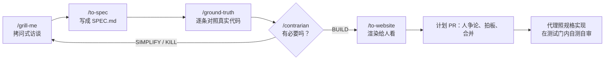

# PR 多到审不过来，就把审查挪到计划上：Giant Swarm 的规格驱动开发

通用（不限工具）

**一句话看懂**：Giant Swarm 的 PR 一年涨到原来的三倍，没人读得过来所有 diff。他们的办法是**把人的审查从代码挪到计划**：先用一条 `/plan` 命令做出一份计划，过程中有五步：拷问式访谈、写成 SPEC.md、把每条事实对照真实代码核对、专门找一个“反方”试图毙掉计划、渲染成给人看的网页。人在计划的 PR 上争论、拍板、合并；代理照着合并后的规格去实现，并在测试门内自己测、自己审。多数代码 PR 不再有人逐行读。整套流程以 skills 的形式开源在仓库里，可以直接 fork。

## 读完你能带走的 7 条收获

1. **代码便宜了，审查没有**：PR 量翻三倍，审查者要么成为瓶颈，要么开始批准没读过的东西（见 2）。
2. **人要守住的是“意图”**：做什么、不做什么、接受哪个取舍，这些不能外包给模型（见 2、3.1）。
3. **访谈时让代理给出推荐答案，再由人推翻**：好的拷问会推翻一部分推荐，被推翻的地方就是人的上下文起作用的地方（见 3.1）。
4. **规格里每一条“关于现有东西的说法”都要对照真实代码核对**：示例里 8 条有 1 条是编出来的配置项（见 3.2）。
5. **专门设一步试图毙掉计划**：结论只有 BUILD、SIMPLIFY、KILL 三种，大多数计划回来都是 SIMPLIFY（见 3.3）。
6. **不是什么都要计划**：只要改动里含有别人可能反对的决策，就写计划（见 3.4）。
7. **代码交给代理，前提是测试门和本地环境**：人在计划里写清“做完”的标准；代理在自己的循环里实现、测试、审查（见 3.5）。

::: tip 小白先懂这几个词
- [Specification-Driven Development（规格驱动开发）](/glossary#spec-driven-development)：先写清楚要什么、怎么验证，再让代理去写。
- [Spec（规格）](/glossary#spec)：一份写给代理和人看的“要做成什么样”的文件。
- [Skills](/glossary#skills)：放在仓库里、代理按需加载的一组说明和脚本。
- [拷问式访谈（grill-me）](/glossary#grill-me)：让代理沿着决策树不停提问，人来回答和拍板。
- [反方审查（Contrarian）](/glossary#contrarian-review)：专门找理由证明计划没必要或可以更简单的一步。
- [Definition of Done（完成标准）](/glossary#definition-of-done)：事先写好的“做到什么程度才算完”。
:::

## 1. 基本信息

<SourceCard type="文章" title="Spec-driven development: how we review plans, not pull requests" author="Dominik Schmidle" date="2026-10-13" url="https://www.giantswarm.io/blog/spec-driven-development" />

| 项目 | 内容 |
|---|---|
| 链接 | https://www.giantswarm.io/blog/spec-driven-development |
| 类型 | Giant Swarm 公司博客（正文约 2,000 词）；文末注明首发于 LinkedIn，2026-09-29 |
| 作者 | Dominik Schmidle（页面署名；作者页地址是 dominik-kress） |
| 发布日期 | 2026-10-13（页面显示 Oct 13, 2026） |
| 使用工具 | 开源仓库 spec-driven-development 里的一组 skills：`/plan`、`/grill-me`、`/to-spec`、`/ground-truth`、`/contrarian`、`/to-website`；本地安装器 agentlab；Slack 上的一键批准集成。原文没有说用的是哪个编码代理 |
| 分析依据 | 原文全文，2026-10-19 用 curl 抓取，引语逐字核对。没有打开开源仓库本身。所有数字和效果都是这家公司自述；例子来自仓库里一份虚构的示例计划。文末有公司的销售入口。“我觉得”开头的段落是本站评论。 |

## 2. 这篇在回答什么

Giant Swarm 是一家做 Kubernetes 平台的公司。作者给了一个数字：

<Trans zh="整个 Giant Swarm，人和他们的代理写的 pull request 数量一年里大约翻了三倍，从 2025 年夏天每月约 700 个，到 2026 年夏天每月超过 2,100 个（不算 Renovate 这类机器人）。">“Across Giant Swarm, the number of pull requests written by people and their agents has roughly tripled in a year, from around 700 a month in summer 2025 to more than 2,100 a month in summer 2026 (bots like Renovate not counted).”</Trans>

速度是真的，但带来两个问题，作者说它们可以归结为同一条规则：变快不能让产品变差。

**第一个问题是意图。** 你对模型说“给我做一个能干 X 的应用”然后走开，最好也只能得到一个平庸的产品。决定产品好坏的那些选择（做什么、不做什么、接受哪个取舍）外包不出去。作者把它们叫作“意图”：

<Trans zh="我们把它们叫作意图，而意图必须留在人手里。">“We call them intent, and intent has to stay with people.”</Trans>

**第二个问题是量。** PR 多三倍，要读的 diff 就多三倍，没人有这个时间和精力：

<Trans zh="审查者要么成了瓶颈，要么开始批准自己没读过的东西，两种情况都保护不了质量。">“Reviewers either become the bottleneck or start approving what they haven't read, and neither protects quality.”</Trans>

所以真正的问题是：读不过来每个 diff 的时候，怎么让重要的决策仍然被看见、被争论？他们的回答是规格驱动开发（SDD）：

<Trans zh="我们把人的审查从代码 diff 挪到了“我们准备做什么”的计划上。">“We moved human review from the code diff to the plan for what we're about to build.”</Trans>

作者承认这个词不是他们发明的，GitHub 的 Spec Kit 和 AWS 的 Kiro 都这么叫。他说自己的做法有四点不同：规格本身就是大家争论的那个 PR；每一条说法在被同意之前都对照真实代码核对过；有一步专门试图毙掉计划，并且能把它打回去；整套流程作为 skills 放在仓库里，不用安装。

他们新产品 Giant Swarm Agent Platform 的大部分就是这样做出来的。原文举了一个例子：GPU 节点池上的模型服务，从计划里的第一个问题到能用的功能，大约一周。作者紧接着说：不是每个 epic 都这么快。

## 3. 怎么做

一份计划就是 git 仓库里的一个目录：规格、给审查者看的渲染页面，以及过程中产生的所有产物，都带日期和版本。这个目录进一个 PR，人审的就是这个 PR。`/plan` 一条命令跑完整个流程。原文说一份典型的计划要几个小时，审查分散在一两天里。

下面的例子都来自仓库附带的示例计划：一个虚构的功能开关服务，它的安装悄悄依赖 cert-manager（Kubernetes 上管理 TLS 证书的组件）。

### 3.1 拷问：`/grill-me`

第一步是访谈。`/grill-me` 改编自 Matt Pocock 的 skills，它把计划当作一棵决策树来走，能问的都问，每个问题都附上它推荐的答案。事实它自己去查，决策留给你，每一问一答都当场记下来。

作者说有意思的是那些推荐，因为好的拷问会推翻其中一些。示例里，代理推荐把 cert-manager 作为可选的 chart 依赖一起发布、默认打开。人说不行：

<Trans zh="否决。cert-manager 是整个集群只能有一份的组件。把它打包进来，意味着有人忘了设那个值时，已经装过它的集群上会多出第二份；两个 release 会争 CRD 的归属；卸载我们的产品还会把其他工作负载依赖的证书机制一起拆掉。">“Overruled. cert-manager is a cluster-wide singleton. Bundling it means a second copy on every cluster that already has one when somebody forgets the value, CRD ownership fights between the two releases, and uninstalling our product taking down the certificate machinery that other workloads rely on.”</Trans>

作者的评语是：模型给了一个合理的默认值，人有上下文。这就是“意图”。

他们建议结对或几个人一起做规划：两三个人一起拷问一份计划，决策就得争出来，而不是随手定下。作者认为这也是新人学得最多的地方：

<Trans zh="以前，审查是大家学习代码库的地方。现在是计划。">“Review used to be where people learned a codebase. Now it's the plan.”</Trans>

### 3.2 写规格与核对事实：`/to-spec` 和 `/ground-truth`

`/to-spec` 把访谈对话变成 SPEC.md，不再二次访谈。规格是实现代理唯一的依据；计划修订时，审查者看规格的 diff 就知道改了什么。

接下来是作者说的“抓幻觉”的那一步。`/ground-truth` 把规格里所有关于“已经存在的东西”的说法抽出来（一个 API、一个配置值、一个开关、一个截止日期），并行地对照真实代码的克隆或一手来源逐条核对。示例里 8 条有 7 条成立，第 8 条不成立：

<Trans zh="不匹配：这个 chart 有一个 webhook.certificate.certManager.enabled 配置值。这个键在 chart 里任何地方都不存在。真实的配置是 webhook.certificate.source，取值为 cert-manager 或 secret 的枚举。">“MISMATCH: The chart has a webhook.certificate.certManager.enabled value. No such key exists anywhere in the chart. The real value is webhook.certificate.source, an enum of cert-manager or secret.”</Trans>

一个编造的配置值，在写一行实现代码之前就被抓住了。

我觉得这一步是整篇最容易抄的。规格里的错误事实不会自己暴露：它会被实现代理当成真的，写出能编译、但调用了不存在的配置的代码，而审查者读 diff 时也未必会去翻 chart。在计划阶段核对，成本只是几次并行查询。

### 3.3 试图毙掉计划：`/contrarian`

`/ground-truth` 问的是“计划说的是真的吗”，`/contrarian` 问的是“有必要吗”。它去找已经能解决这个问题的东西，只用现有的东西搭出最简单的路径，并要求每个新东西都写出理由。结论只有三种：BUILD、SIMPLIFY、KILL；不是 BUILD 就回到拷问那一步。

示例里，初稿想要一个 umbrella chart、一个 CRD 升级钩子和一个 CLI 包装。反方的回答是：

<Trans zh="五个问题里有两个是真的。计划应该只为这两个而做，别的都不做。">“Two of five problems are real. The plan should build for those two and nothing else.”</Trans>

返工之后，计划缩成一个现有的 chart 加一个小的新组件，结论变成 BUILD。作者说这很典型：他们跑过的大多数计划回来都是 SIMPLIFY。

这一步是后加的。作者交代了原因：早期有一份计划带着一个错误前提，一路过了拷问、规格和事实核对，最后是一个人类审查者才发现的，而答案其实就在计划克隆下来的代码里。于是他们加了一步专门抓这类问题，不用等人来抓。

最后，`/to-website` 把规格渲染成一个 HTML 页面。审查者需要图，需要能快速扫一遍的摘要，需要点一下就能看到任何一行背后的调研、事实核对或反方结论。

### 3.4 什么时候不用计划，计划改了怎么办

**不用计划的情况。** 依赖升级、原因明显的 bug 修复、已同意计划内的小改动都不用。他们的经验法则是：

<Trans zh="如果一个改动里包含有人可能会反对的决策，它就要有计划。">“if a change contains a decision someone could disagree with, it gets a plan.”</Trans>

**这是不是换了工具的瀑布流程？** 作者说这是他们听到最多的质疑，回答是不是，因为计划是讨论的起点，不是终点。计划同意之后也经常改。他们的一份 Slack 集成计划在合并的第二天就被重写了，因为实测打破了它的两个假设（其中一个是 Slack 客户端会吞掉以斜杠开头的私信）。别的计划有的被新计划取代，有的推倒重来，有的被放弃；作者说，如果另一个选项是做错东西，放弃就是好结果。

有时第一份计划只是为了学习。比如他们的代理身份工作，现在这份计划的任务是用原型证明方案像他们想的那样可行；正式功能的计划要等原型教会他们一些东西之后再写。

<Trans zh="计划故意做得很便宜。正因为便宜，改它才安全。">“Plans are cheap on purpose. That's what makes it safe to change them.”</Trans>

### 3.5 那谁来查代码

作者说，把审查挪到计划，前提是实现能可靠落地，而这部分花的功夫比规划的 skills 还多。

**判断挪进了计划。** 人在计划里决定意图和测试门。规格里的测试决策写清楚“完成”是什么意思，例如：

<Trans zh="三个验收场景就是测试门：一个实现只要通过它们、别的什么都没做，就算完成；任何一个没通过，不管它还交付了别的什么，都不算完成。">“The three acceptance scenarios are the test gate: an implementation that passes them and nothing else is complete; one that fails any of them is not, whatever else it ships.”</Trans>

**代理在自己的循环里干行级的活。** 开 PR 之前，代理先实现、测试、审查自己的改动。为了让这件事可行，他们做了四件事：提高测试覆盖率；让应用能在本地构建和运行；做了一个本地安装器 agentlab，给代理一个足够逼真的环境，让它能试自己刚做的东西、直接拿到反馈；改进交付流程，让反馈来得早、来得具体，而不是一小时后的一条红色流水线。

**多数改动不经人读 diff 就合并。** 改动的作者负责到底，合并之后也要负责；由代理还是团队来合并，按计划里写的来。他们做了一个集成，把代码 PR 以简短、可批准的摘要发到团队的 Slack，团队里任何人点一下就能批准。如果计划已经表明某个改动碰到公共 API 或安全相关的东西，人也会看 PR。作者承认这一点目前是团队习惯，还没有写进代码；下一步是专门的安全审查。

作者对这件事的立场很直接：

<Trans zh="对照一份已经同意的规格和测试门做行级检查，我们更信代理的审查，而不是一个读了八个小时 diff、已经很累的人。">“For line-level checks against an agreed spec and test gate, we trust an agent's review over a tired person's on their eighth hour of reading diffs.”</Trans>

我觉得这句要和前提一起读：它说的是“已经同意的规格”和“测试门”都在的时候。站内 [[60§3.4]] 的 Claude Code 团队走的是另一条路，按风险决定要几个人读代码。两种做法并不矛盾：Giant Swarm 把“要不要人看代码”的判断提前放进计划，Claude Code 团队在 PR 上按风险分层。但 Giant Swarm 没有给出“不经人读 diff 合并”之后出问题的数据，这一点要自己验证。

**流程还在变。** 作者说他们现在看到的缺口是计划里的视觉内容太少，经常要做出来才知道界面长什么样。接下来要试两步：一个 mockup 步骤，让前端计划在写组件前就带上按设计原则做好、大家同意的界面草图；一个 persona 步骤，让代理扮演一个客户角色，在还便宜的时候从“想不想用、好不好用”的角度审计划。作者给了一条取舍规则：能帮助讨论和做决定的留下，其余都是仪式。

## 4. 结果与局限

- **原文报告的结果**：PR 量一年约三倍（约 700/月 → 2,100+/月）；新产品大部分这样做出来；一个大 epic 从计划到可用功能约一周（作者说不是每个都这么快）；大多数计划经反方审查后回来是 SIMPLIFY。
- **缺少的数据**：没有说多少 PR 不经人读 diff 合并、合并后出过多少问题、回滚了多少；“更信代理的审查”是团队的判断，不是对比实验。
- **人看代码的边界还没写成代码**：碰到公共 API 和安全的改动要人看，目前靠团队习惯。
- **例子是虚构的**：3.1–3.3 的引用都来自仓库里的示例计划，不是真实项目记录。本文也没有打开仓库核对这些 skills 的具体写法。
- **前提条件不低**：测试覆盖率、本地能跑、agentlab 这样的本地环境、早而具体的反馈，作者说这部分比规划 skills 本身更费功夫。
- **一家公司的自述**：文章发在公司博客，结尾有销售入口。

## 5. 结论

PR 多到读不过来时，Giant Swarm 选择让人在计划上花时间，而不是在 diff 上。计划要经得起争论，所以用五步把它做扎实：拷问出决策、写成唯一的规格、对照真实代码核对事实、让反方试图毙掉它、渲染成好读的页面。代码交给代理，但代理必须在人定好的测试门内、在本地真能跑的环境里自己验证。

我觉得这篇放在“做规划”阶段，补上了站内一直缺的一块：计划怎么被审查。[[03]] 讲访谈式需求，[[06]] 讲找出未知，[[61]] 讲长任务的四份 Markdown，都在说“怎么写计划”；这篇说的是“怎么让一份计划经得起别人反对”。如果整套流程太重，作者自己的建议也是先只拿 `/ground-truth` 和 `/contrarian` 两步。

**你可以这样试**

1. 下一次给代理写规格前，加一步：让代理把规格里所有关于“现有代码、配置、API”的说法列成清单，逐条去代码里找出处，找不到的标成 MISMATCH。
2. 再让另一个会话只回答一个问题：“这里哪些是已经有的东西能解决的？最简单的做法是什么？”结论只许写 BUILD、SIMPLIFY 或 KILL。
3. 给团队定一条门槛：只有含“别人可能反对的决策”的改动才写计划，然后观察一个月，大家的争论是发生在计划 PR 上还是代码 PR 上。

**读完自测**

- `/ground-truth` 和 `/contrarian` 分别在问什么问题？为什么作者在前者之后还要加后者？
- 作者说“多数改动不经人读 diff 合并”，他为此先做了哪几件事？
- 哪些改动不需要写计划？判断标准是什么？
