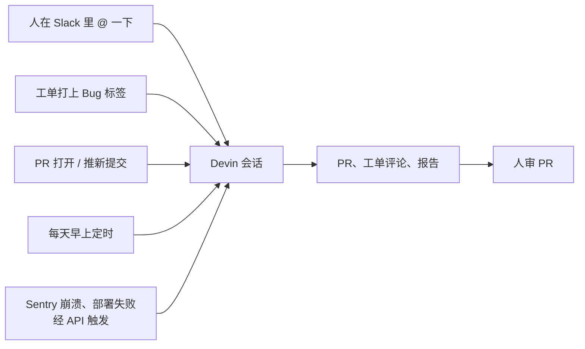

# 一周合并 659 个代理 PR，是怎么接进日常的：Cognition 用 Devin 开发 Devin

Devin

**一句话看懂**：Cognition 是 Devin 的开发商，这篇是**他们自己讲自己怎么用自家产品**，同时也是一份产品介绍。他们说上周合并了 659 个 Devin 写的 PR，而 2025 年最好的一周是 154 个。做法的核心不是“在网页里和代理聊天”，而是把代理接进团队已经在用的地方：Slack 里 @ 一下、Linear 工单打上 Bug 标签、PR 一打开、Sentry 一报崩溃，都能自动开一个 Devin 会话。最值得借的是几样不依赖 Devin 的东西：Playbook 的六个要素、“打标签就触发分诊”、给调试代理只读的数据库副本、每天审计过去 24 小时合并的代码。

## 读完你能带走的 7 条收获

1. **先问再做**：先用代码库问答把目标问清楚，再从问答结果直接开一个会话，提示词会带上刚才的上下文（见 3.1）。
2. **每个 PR 都自动审、自动修**：审查发现问题或 CI 不过，代理自己接着修，直到检查全过（见 3.2）。
3. **定时审计最近合并的代码**：每天早上扫过去 24 小时合并的 PR，找出违反设计系统的地方，开工单（见 3.3）。
4. **打一个标签就触发分诊**：工单加上 Bug 标签，代理按工程师平时的调查步骤先查一遍，把根因和建议写回工单（见 3.3）。
5. **调试代理只给只读权限**：接日志平台，查数据库的只读副本，最后交出带回归测试的 PR（见 3.4）。
6. **重复三次的指令写成 Playbook**：写清结果、步骤、完成后应满足的条件、纠正代理的成见、禁止的动作、需要的输入（见 3.5）。
7. **任务越具体越好**：大任务拆成互相独立的小任务分开跑；需要大量测试的，先确认有验证手段（见 3.6）。

::: tip 小白先懂这几个词
- [Devin（Cognition）](/glossary#devin)：Cognition 公司的云端编码代理。
- [Playbook](/glossary#playbook)：为一项重复任务写好的固定说明，相当于专用的系统提示词。
- [MCP](/glossary#mcp)：让代理连上外部工具和数据源的协议。
- [DeepWiki](/glossary#deepwiki)：自动给代码库生成带架构图和源码链接的维基。
- [Code Review（代码审查）](/glossary#code-review)：合并前检查改动。
- [Human-in-the-loop（人在回路中）](/glossary#human-in-the-loop)：关键步骤需要人确认。
:::

## 1. 基本信息

<SourceCard type="文章" title="How Cognition Uses Devin to Build Devin" author="The Cognition Team" date="2026-02-27" url="https://cognition.com/blog/how-cognition-uses-devin-to-build-devin" />

| 项目 | 内容 |
|---|---|
| 链接 | https://cognition.com/blog/how-cognition-uses-devin-to-build-devin |
| 类型 | Cognition 公司博客（正文约 1,800 词）。**厂商自述**：作者是产品的开发商，文中提到的 Devin Review、DANA、DeepWiki、MCP Marketplace、Session Insights 都是它自家的功能，结尾是注册入门步骤 |
| 作者 | The Cognition Team（未署个人名） |
| 发布日期 | 2026-02-27（页面显示 02.27.26；页面元数据里的修改日期是 2026-05-08） |
| 使用工具 | Devin（网页、Slack、Linear、Jira、CLI、API）、Devin Review、DANA、DeepWiki、Playbooks、Session Insights；外部接入 Datadog、Sentry、Redshift 等 |
| 分析依据 | 原文全文，2026-10-19 用 curl 抓取，引语逐字核对。所有数字和效果都是厂商自报，没有第三方核实。“我觉得”开头的段落是本站评论。 |

## 2. 这篇在回答什么

站内 [[32]] 讲过 Cognition 怎么让 Devin 用 Computer Use 自测、带证据交付。这一篇讲的是更外面的一层：一家公司的日常工作里，代理从哪些地方被叫起来、干完交回到哪里。

开头的数字是：

<Trans zh="上周，我们把 659 个 Devin 写的 PR 合并进了自己的代码库，而 2025 年我们最好的一周是 154 个。">“Last week, we merged 659 Devin PRs into our own codebase, up from 154 in our best week in 2025.”</Trans>

他们说内部会用到每一种入口（网页、Slack、Linear、CLI、API），看工作从哪里开始。一个直接的结果是，不懂技术的人也能贡献：

<Trans zh="在 Slack 里 @ Devin 提个请求，我们就会得到一个可以审查和试用的 PR。比如有人发现文档过时了或者有个 bug，就在 Slack 里发一句短消息让它修，然后继续忙自己的事。">“Tag @ Devin with a request and we get a PR we can review and test out. If someone notices out of date documentation or a bug for example, they send a short message in Slack to get it fixed and move on with their day.”</Trans>

文章其余部分按功能介绍用法。下面按“代理在什么时候被叫起来”重新排了一遍。

## 3. 怎么用

### 3.1 先问清楚再开工

仓库加进 Devin 后会被自动索引，Ask Devin 就成了看代码库的窗口。他们的用法是：先用 Ask Devin 探索代码、把目标问清楚，再从搜索界面直接开一个会话。这样会话一开始就带着刚才探索出的上下文，提示词也会根据任务自动生成。Jira 和 Linear 工单也一样：在工单上 @ Devin，它先分析任务、搜代码、规划做法，再生成会话提示词。

DeepWiki 是这一步的底座：它自动索引所有仓库，生成带架构图、源码链接和摘要的维基，Ask Devin 用它来找相关上下文。

### 3.2 每个 PR 都自动审、自动修

原文的判断是：

<Trans zh="随着我们用代理交付的代码越来越多，瓶颈从写代码转到了审代码。">“As we ship more code with agents, the bottleneck shifted from writing code to reviewing it.”</Trans>

他们现在每个 PR 都用 Devin Review。原文列的几个功能里，和流程最相关的是两个：

- **自动修**：Devin Review 或 GitHub 上的机器人标出 bug 时，Devin 自动修这个 PR；CI 和 lint 问题也会一直修到所有检查通过。
- **按置信度标问题**：Bug Catcher 分析 PR 的潜在问题，按置信度打标签；严重的要立刻处理，不严重的也要看。

配置好 Auto-Review 后，PR 打开、推了新提交、或者有人被加为审查者时，Devin 都会自动开始审查。其余功能（按逻辑分组 diff、识别复制和移动的代码、针对 PR 的问答）是 Devin Review 的产品介绍。

### 3.3 定时审计和打标签分诊

**设计系统审计。** 原文说设计系统总会漂移：有人写死一个颜色值，有人做一个一次性的按钮。他们用两种方式处理。一是谁看到谁修：在 Slack 里发截图 @ Devin，让它把组件改成符合设计系统。二是每天审计：

<Trans zh="每天早上，Devin 扫描过去 24 小时合并的 PR，标出写死的颜色、不标准的间距和本该用共享组件库的组件。">“Every morning Devin scans PRs merged in the last 24 hours, flags hardcoded colors, non-standard spacing, and components that should use the shared library.”</Trans>

每一处违规开一张 Linear 工单，也可以选择自动开修复 PR。

**Bug 分诊。** Linear 里来了一个 bug，总得有人停下手头的事去读工单、搜代码、查最近的提交，然后才能开始修。他们把这一步自动化了：写了一个 `!triage-bug` playbook，记下工程师平时怎么调查（读报告、搜相关代码路径、查 git 历史、总结根因和修复建议）。

<Trans zh="只要有人给工单加上 Bug 标签，自动化就会触发，不需要指派。">“The automation fires when anyone adds the Bug label to a ticket—no assignment needed.”</Trans>

原文的例子是“周五部署后 /contact 报 500”：Devin 找到文件，在 git log 里发现最近一次正则重构，把根因、受影响的文件和修复思路写回 Linear。分诊时它还通过 Datadog 的 MCP 查日志。

我觉得“打标签就触发”是这篇里最容易搬走的做法。它不需要改团队习惯：大家本来就会给 bug 打标签。代理只是在人接手之前，先把最机械的那一段调查做完。

### 3.4 端到端调试：只读权限

有的 bug 不只要分诊，还要拉日志、查数据库、追代码改动、写修复。他们把 Devin 接上 Datadog，并给了它只读的数据库权限。原文的例子是“周五部署后 Pro 用户在账单页看到 undefined”：Devin 从 Datadog 拉错误日志，查只读副本确认数据状态，在 git 历史里追到出问题的提交，写一个带回归测试的修复，开 PR。

<Trans zh="我们审 PR，不看日志。">“We review the PR, not the logs.”</Trans>

文中的数据分析代理 DANA 也是同一个思路：通过 MCP 连数据仓库，任何人在 Slack 里问“为什么周二注册量掉了”，都能拿到图表和答案，答案里附上 SQL，方便核对逻辑。

### 3.5 Playbook 和会话复盘

**Playbook。** 原文的定义是：

<Trans zh="Playbook 就像为一项重复任务定制的系统提示词。如果我们发现自己在多个会话里重复同样的指令，就该写一个 Playbook 了。">“A Playbook is like a custom system prompt for a repeated task. If we find ourselves repeating the same instructions across multiple sessions, that's when we create a Playbook.”</Trans>

一个好的 Playbook 包含六样东西：

1. 希望 Devin 达成的结果
2. 达成它需要的步骤
3. 描述完成后应满足的条件（postconditions）的规格
4. 纠正 Devin 成见的建议
5. 禁止的动作
6. 发起人需要提供的输入或上下文

他们用 Playbook 做复杂的重复工作：往 Redshift 导数据、跑数据库迁移、对接 Stripe、Plaid 和 Modal。

我觉得这六项可以直接当成任何代理的“技能文件”模板。第 4 项“纠正成见”和第 5 项“禁止的动作”尤其容易被漏掉，而它们正是代理反复犯同一个错时最该写下来的东西。

**会话复盘。** Session Insights 分析完成的会话，列出遇到的问题（技术问题、沟通缺口、范围蔓延）、时间线和关键节点、改进建议，并给出改进后的提示词。他们用一次会话的复盘指导下一次，可以直接用改进后的提示词开新会话。

**API 触发。** Devin 有完整的 REST API，所以开工不需要人在回路中。原文举了四个例子：Sentry 来了崩溃日志，Devin 调查并开 PR；有人提了 bug 报告，Devin 复现、诊断、打补丁；部署失败，Devin 分析日志、提出修复；有人请求代码审查，Devin 审查并留评论。

### 3.6 擅长什么、不擅长什么

原文的总原则是：

<Trans zh="成功程度随具体程度增长。范围清楚、标准明确的任务效果最好。">“Success scales with specificity. Well-scoped tasks with clear criteria get the best outcomes.”</Trans>

他们经常交给 Devin 的任务有：大量的迭代改进、bug 修复和边界情况、提高测试覆盖率、调查 CI 失败、lint 错误和 CVE 修复、PR 审查、维护文档、修复静态分析发现的安全漏洞、代码库问答。

原文也写了几条局限：大任务要拆成更小、互相独立的任务，放在不同会话里跑；Devin 擅长做出能用的界面，把界面做漂亮仍然是人的强项；移动端开发可以做，但 Devin 没有手机可以测；需要大量测试和验证的任务，要先确认验证手段到位。

## 4. 结果与局限

- **厂商自述**：这是 Cognition 讲自己怎么用 Devin。作者有明确的商业立场，文中的功能介绍同时是产品推广。
- **659 个 PR 缺少分母**：没有说这些 PR 多大、多少被回滚、人审花了多少时间、有多少是自动开的维护 PR。和 2025 年 154 个的对比也只是两个周数。
- **没有失败案例**：全文没有一次代理做错的例子，也没有自动修复、自动分诊的准确率。
- **前提是大量集成**：效果依赖 Slack、Linear、Datadog、Sentry、数据仓库都接好了，还要给只读数据库权限。
- **页面后来改过**：元数据的修改日期是 2026-05-08，原文没有说改了什么。
- **原文自己承认的局限**：界面美观靠人，移动端没法测，大任务要拆。

## 5. 结论

这篇最有用的不是 Devin 的哪个功能，而是“代理从哪里被叫起来”这张图：人在聊天工具里 @ 一下、工单上打一个标签、PR 打开、每天定时、外部系统报错。每个入口都对应一个已经存在的团队习惯，代理只是接在它后面，交回一个 PR 或一条工单评论，人仍然审 PR。

我觉得这篇放在“接进 PR 与 CI”阶段，可以和 [[41]] 对照着读：[[41]] 讲定时代理要守的规则（只读权限、花费上限、确认送达再记账），这篇讲一家公司把这类触发铺开之后是什么样子。读的时候要记得它是厂商在讲自家产品，数字只能当成“他们是这么说的”。

**你可以这样试**

1. 挑一个你团队已经在用的标签（比如 Bug），写一个分诊说明：读报告、搜相关代码、查最近一周的 git log、写出根因猜测和修复思路，先手动跑三次，再考虑自动触发。
2. 把你给代理重复说过三次以上的指令，按 3.5 的六项整理成一个技能文件，尤其写上“禁止的动作”。
3. 如果要让代理查线上数据，只给它只读副本的权限，并要求它在 PR 里附上查询语句。

**读完自测**

- 原文的 Playbook 六要素是哪些？哪两项最容易被漏掉？
- 为什么说“打标签就触发分诊”不需要改团队习惯？
- 659 个 PR 这个数字，你还想知道哪些信息才能判断它说明了什么？
