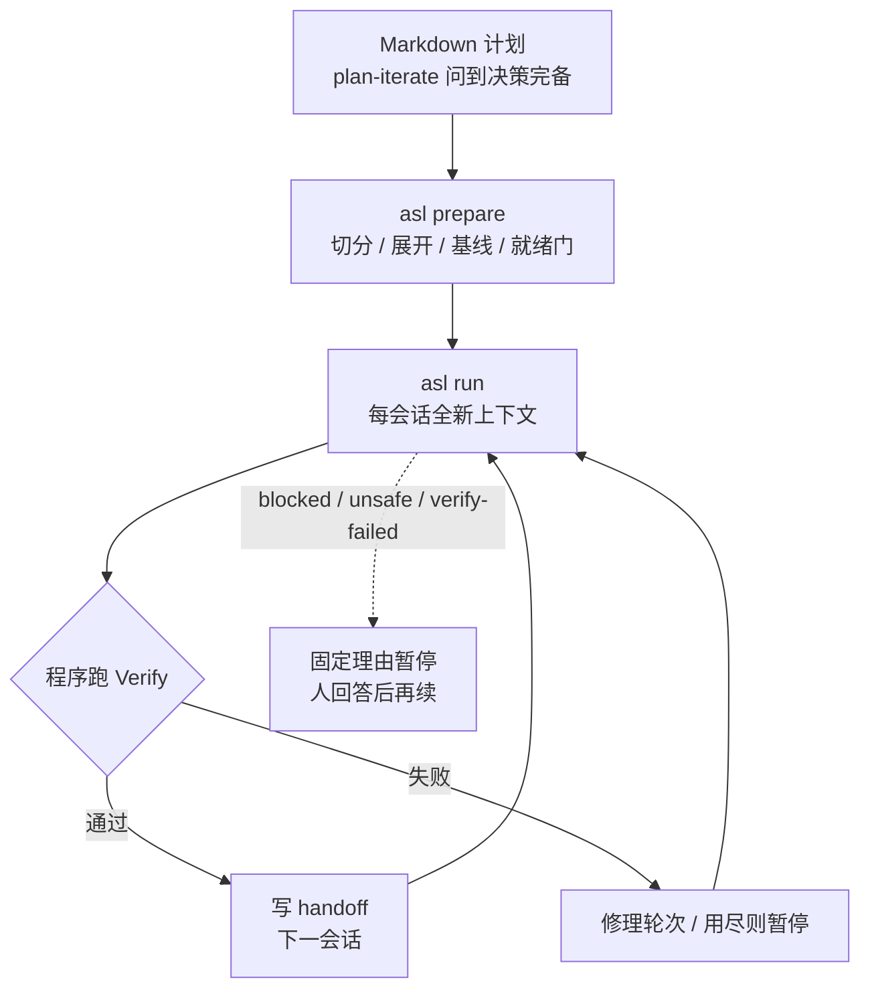

# 代理说“做完了”不算数：把计划切成带程序验收的短会话

<div class="meta-tags"><span class="tool-tag tool-general">通用（不限工具）</span></div>

<div class="hook">

**一句话看懂**：Sébastien Lavoie 发现瓶颈不在打字，而在确认代理写的是不是你要的、能不能跑。长会话会漂，“做完了”又常由代理自己说。他的做法是：先把计划问到**决策完备**，再切成许多短会话；每个会话末尾挂一份**程序跑的完成合约**（不是代理的总结）；跑的时候每会话全新上下文，失败就按固定理由暂停。工具叫 `asl`（agent session loop），同一份计划可以挂 Claude Code、Codex 或 Copilot CLI。作者开头写明：这篇初稿由 AI 根据他的笔记写成，他再审过。

</div>

## 读完你能带走的 7 条收获

1. **流利不等于正确**：生成代码读起来通、能编译，有时错得要很晚才露出来；审查才是稀缺资源（见 2）。
2. **计划要决策完备**：问自己——两个能干的实现者照这份计划，会不会做出明显不同的行为？会，就说明还藏着决策（见 3.1）。
3. **事实让代理去查，判断留在人手里**：谁在调用这个函数可以搜仓库；哪些调用方愿意打破必须你定（见 3.1）。
4. **切会话的标准是“能单独证伪”**：一个主结果、停在中间仍可审、塞进一次干净上下文；别把实现和测试拆开（见 3.2）。
5. **“完成”由程序判定，不由代理总结**：Done when 给人看，Verify 给 runner 跑；跑前先 baseline（见 3.3）。
6. **必须发生的事写成代码，需要判断的才进提示词**：暂停用固定理由词表；提示是建议，守卫才是边界（见 3.4、3.5）。
7. **多数小改不需要整套管线**：先能说清可观察结果、不该变的行为、文件边界、能证伪的检查，再上无人值守（见 3.6）。

::: tip 小白先懂这几个词
- [Completion Contract（完成合约）](/glossary#completion-contract)：事先写好、由程序检查的“做到什么才算完”。
- [Decision-complete（决策完备）](/glossary#decision-complete)：实现者不该独自拍板的选择，计划里都已经定了。
- [Baseline（基线）](/glossary#baseline-contract)：改动前先跑一遍合约，确认复现用例该红、保护行为该绿。
- [Handoff（交接）](/glossary#session-handoff)：一个短会话结束后留给下一会话的决策、事实和未决问题。
- [Spec（规格）](/glossary#spec)：动手前写下“要做成什么样”的文档。
- [Drift（漂移）](/glossary#drift)：长会话里早期决定被冲淡、代理开始重解或悄悄撤掉已做的事。
:::

## 1. 基本信息

<SourceCard type="文章" title="From a plan to unattended agent runs" author="Sébastien Lavoie" date="2026-10-09" url="https://www.sglavoie.com/posts/from-plan-to-unattended-agent-runs/" />

| 项目 | 内容 |
|---|---|
| 链接 | https://www.sglavoie.com/posts/from-plan-to-unattended-agent-runs/ |
| 类型 | 个人技术博客（正文约 4,200 词，含流程图） |
| 作者 | Sébastien Lavoie |
| 发布日期 | 2026-10-09（页面 `data-newest-post`） |
| 使用工具 | 自研 `asl`（agent session loop）；可挂 Claude Code、Codex、Copilot CLI；文中技能如 `plan-iterate`、`session-run` |
| 写作说明 | 文首注明：初稿由 AI 助手根据作者笔记、代码和工具起草，作者审改；经验、观点和错误归作者 |
| 分析依据 | 原文全文，2026-10-19 用 curl 抓取，引语逐字核对。文中 18 万行代码、27 万行测试、四个月开发史均为作者自报；未打开 `asl` 仓库源码。“我觉得”开头的段落是本站评论。 |

## 2. 这篇在回答什么

编码代理变强以后，作者一天里的瓶颈挪了位置：不再是把字打出来，而是确认打出来的是你要的、而且真能跑。他描述的头几周很典型——一个功能拖进很长的对话，上下文越堆越多，末尾代理高兴地宣布做完了，十分钟后你才发现“做完”其实是“它还记得的那几部分做完了”。

他试过 Spec Kit、OpenSpec、Kiro、各种 Skills，甚至自己写过一套与外壳无关的规格驱动框架。后来模型变强了，不需要被一步步牵着走；他真正缺的不是更多指导，而是**更少信任**：

<Trans zh="流利和正确并不相关">“Fluency and correctness are uncorrelated”</Trans>

两个问题反复出现：长会话会漂；以及“做完了”是代理自己定的，外面没有一个它辩不过去的完成定义。作者的判断是：审查才是稀缺资源——让代理多产代码、却不让验证变便宜，只是把瓶颈挪了个地方。

他做的工具叫 `asl`。主线很简单：写计划 → 切成一次对话装得下的会话 → 每个会话挂上**程序**跑的检查 → runner 按会话往下跑，人去做别的事。



## 3. 怎么做

### 3.1 先把计划问到决策完备

作者给计划定的标准叫 **decision-complete**：实现者不该自己拍板的选择，计划里都已经定了。检验方式是一句略带敌意的问题：

<Trans zh="两个能干的实现者照这份计划，会不会做出明显不同的行为？">“could two competent implementers follow this plan and end up with meaningfully different behaviour?”</Trans>

若答案是“会”，计划里就藏着一个决策——API、数据格式、错误路径、迁移顺序——代理会在 diff 中间悄悄替你做掉。

他建议把**事实**和**决策**分开。“哪些调用方用了这个函数”是事实，代理读仓库就能查；“哪些调用方我们愿意打破”是判断，留在人手里。好计划把前者写成 discovery，把后者写成明确决策。

落地靠一个 Claude Code skill：`plan-iterate`。它读计划、评估完整度（范围、接口、测试、风险），就最弱的地方问你，再把答案写回文件。加 `--ideal` 时，它先对代码库做一轮研究，描述**不受约束的理想改法**，再按影响给差距排序，让你对每一项选择采纳、推迟或拒绝；推迟的会写进计划，免得忘了。

我觉得这一步和 Giant Swarm 的拷问（[[64§3.1]]）、Codex 长任务里“写出 plans.md 之前不许写代码”（[[61§3.2]]）是同一类动作：贵的是纸上的坏主意，不是 diff 里的坏主意。

### 3.2 怎么切会话、怎么核对计划里的“声称”

`asl prepare PLAN.md` 会确定性跑完切分、校验、展开、基线和就绪门，成功后打印下一步的 `asl run` 命令。

切分产出一个目录：`manifest.md` 列出会话和就绪状态，每个会话一份 `session-<id>.md`（范围、预期动到的文件、handoff 区、完成合约）。作者说好会话要有三样东西：

1. **一个主结果**，并且有能单独失败的证据——写不出区分“成了 / 没成”的检查，就还不算一个会话。
2. **后面会话永远不跑，前面也仍是可审的连贯状态**，不是改到一半的重构。
3. **一次全新上下文装得下**：相关文件、说明、先前 handoff，还要留思考空间。重新切分比跑到四十分钟才发现装不下便宜得多。

他刻意避开两个反模式：把实现和测试拆成两个会话（测试会话最后只会测到实现碰巧做成的样子）；以及“以后再清理”的会话——缺了它，改动就不安全。会话按依赖排序：共享契约和脚手架在前，增在删前。

**展开（expanding）** 把计划里的路径、函数签名、命令、测试名都当成对仓库的 **claim**。代理读真实代码核对：文件在不在、签名是不是计划以为的那样、这个会话是不是其实是三个。规则是：

<Trans zh="纠正写进计划，不写进实现。">“corrections go into the plan, not into the implementation.”</Trans>

问题进会话的 `## Contract Issues`，而不是实现时默默绕开。若代理在实现里消化掉过时事实，唯一记录是 diff，下一会话还会继承那个过时事实。

### 3.3 完成合约：谁有权说“做完了”

作者说：如果别的都扔掉，他会留下这一块。每个会话文件末尾类似：

````markdown
## Completion Contract
### Done when
- `export` 命令为每个项目写出一个 JSON 文件。
- 现有 CLI 测试仍然通过。
### Verify
```json
{
  "session": "02",
  "checks": [
    {
      "name": "unit-suite",
      "type": "command",
      "argv": ["python3", "-m", "unittest", "-q"],
      "timeout_seconds": 180
    }
  ]
}
```
````

“Done when”给人（和代理瞄准用）；“Verify”给 runner：命令、必须存在的文件、必须出现的模式。检查失败，会话就不算完成，无论总结写得多像样。命令用参数列表、不经 shell，避免引号踩坑。

写合约时他问自己：能不能描述一个**错的、但还能通过检查**的实现？若很容易，检查不够尖，或会话声称了它证明不了的事。跑前 `asl baseline` 在未改代码上执行全部合约：复现用例应预期失败，保护行为应预期通过——保护项已经红，是坏合约不是目标；复现项已经绿，说明会话做完了或测错了东西。

设计规则收成一句：

<Trans zh="必须发生的事写成代码；只有需要判断的事才进提示词。">“anything that must happen is code; only things that require judgement go in a prompt.”</Trans>

`session-run` 技能故意不到一百行：启动时 Python 已拿锁并查过就绪；代理返回后，Python 跑验证、同步进度、刷新就绪。

### 3.4 全新上下文、持久交接、固定理由暂停

每次会话都是**全新对话**，只装需要的说明、计划、本会话文件与合约、以及它所依赖会话的 handoff。对话可扔，计划目录才是记忆。作者对 handoff 的检验很直：若丢掉对话记录会改变下一会话被允许做什么，交接就不完整。可选两节特别有用——**Discovered facts**（实现证明了计划里哪条假设成立）和 **Open questions**（尚未确定、具名传下去的东西）。

代理更常死在死循环，而不是崩溃。所以走不动就**暂停**，暂停是带稳定理由的状态迁移，不是弃谈。词表故意又小又固定：`blocked`（只有人能定的决策）、`unsafe`、`verify-failed`、`no-contract` / `malformed-contract` 等；代理不许发明新理由。

<Trans zh="必要的暂停是系统在工作。">“A necessary pause is the system working.”</Trans>

为了冲完成率而推过未决决策的运行，比停下来问一声更糟。

### 3.5 控制、冷审与守卫

常用控制：`--harness` 选外壳（中途还能换）、`stop-after-current`（礼貌版 Ctrl-C）、`--max-sessions N`（先只跑前几个再看）、`asl questions` + `--reply` 回答 `blocked`、`--review-harness` 让**另一个**外壳做终审并写入 `final-review.md`。

终审代理：不同 harness、不许改代码、**冷读**（看计划、合约和实际改动，不看实现者的自述）；每条 finding 有严重度、文件、何谓修好、证明用的检查。修理有分组上限和循环上限，避免审与修乒乓；会改设计的不进修理，退回计划开新会话。作者提醒：另一模型带来的是不同的找错习惯，不是独立证据；真正决定接受的仍是检查、复现用例和人读 diff。跑结束的“all-complete”仍只表示：

<Trans zh="合约通过了">“the contracts passed”</Trans>

不是“改动正确了”——那是你去读 diff、handoff 和审查的起点，不是合并的起点。

无人值守时，建议和强制要分开：

<Trans zh="提示表达的是意图，从来不是权威。">“A prompt expresses intent, never authority.”</Trans>

Guidance 可以塞一条偏好进对话，但不能改会话范围或完成合约。只有 guard 强制：按参数前缀拒命令（PATH shim）、或保护路径（对照本轮开始时的快照）。守卫还会按外壳报告 `active` / `degraded` / `unsupported`——宁可说“这里强制不了”，也不假装强制了。

### 3.6 什么时候整套是过度设计

作者说：多数改动不需要这些。本地、可逆、已有测试盖住的编辑，边界 + 检查 + 审查就够。整份计划 + 无人值守，留给跨多个会话、步骤顺序要紧、或希望你做别的事时仍能推进的改动。

上手建议：挑一个自己一小时内本来就会做的有界任务；交出去之前写下“完成”是什么、以及一个代理若错得像样仍会失败的检查；对照这个审 diff，而不是对照代理总结。

## 4. 结果与局限

- **自报工程规模**：`asl` 从 2026 年 6 月初的小脚本，四个月后约 18 万行仅标准库 Python、约 27 万行测试， largely 靠拿计划跑工具自身做成。作者强调 <Trans zh="测试比代码多不是虚荣指标。">“More tests than code is not a vanity metric.”</Trans>
- **教训清单**：失败要早而响；自动化按成熟度升级（手做 → 清单 / skill → 脚本确定性部分 → runner 强制）；每次运行失败变成一种控制；每个停止都有具名理由；别信任外壳强制它强制不了的事；<Trans zh="对“感觉更快了”保持怀疑。">“Be suspicious of feeling faster.”</Trans> 并引用 METR 2025 随机试验：有经验的开源维护者用早期 AI 工具在自己仓库上约慢 19%，却以为自己更快。
- **局限**：这篇是个人博客 + AI 协助起草；效果数字是自报；未附独立对照实验；`asl` 本身体积已经很大，学习成本不低。产品边界、三外壳能力差异，作者用“报告能力而不是假定”处理，但读者仍需自己验证当前 CLI 钩子。

## 5. 结论

最大的变化不是某一个功能，而是把“做完了”从代理嘴里拿走。会话可以短、可以全新开；暂停变成信息；第二个代理可以冷审；人把注意力放在计划和最终审查上，而不是盯着一段越来越长的对话。

**你可以这样试**

1. 选一个一小时内的有界任务，写下 Done when + 一条能证伪“像样的错法”的检查。
2. 让代理做完后，先跑你的检查，再读 diff；总结只作参考。
3. 若任务明显大于一次对话：先把计划问到“两个实现者不会做出明显不同行为”，再切会话；纠正写回计划，不写进实现。

**读完自测**

1. 为什么“代理说做完了”不够？完成合约里哪一半给程序、哪一半给人？
2. 切会话时，为什么把实现和测试拆开是反模式？
3. 提示和守卫的差别是什么？外壳报告 `unsupported` 时该怎么办？
