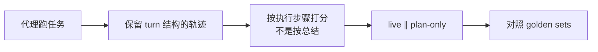

# 裁判只看总结，会把做对的代理判成失败：Google Cloud 的四条评测教训

通用（不限工具）

**一句话看懂**：Casey West 在 Google 做评测工程多年，用新发布的 Google Cloud Developer 插件当试验田，总结了四条可搬家的教训。最刺的一条是：他们用 LLM 裁判只看代理最后的文字回复，11 条提示里有 3 条被判失败；打开原始工具调用记录一看，这 3 条其实都做对了——代理跑了该跑的命令，只是总结里没“自夸”。另外三条分别是：遥测要保留 turn 结构、live 与 plan-only 并排跑、用专家标注的 golden sets 压住整个栈。

## 读完你能带走的 6 条收获

1. **别给代理的“闭幕演讲”打分**：rubric 问“有没有跑 X”，却只看总结时，裁判是在猜（见 3.1）。
2. **打开 tool-call 轨迹再判**：同一例里代理第一步就跑了 `gcloud help run services list`，总结却在警告永久删数据（见 3.1）。
3. **遥测别压成扁平事件列表**：同一次 assistant turn 里的并行 `tool_calls` 会被抹掉，skill 指导可能在搜索已经跑完之后才注入（见 3.2）。
4. **live 和 plan-only 必须并排**：一边测真执行与克制，一边剥掉权限看纯路由意图；作者说大约一半重要发现来自两者的差（见 3.3）。
5. **golden sets 压的是整个系统**：harness + 模型 + 插件一起，在真实任务上对照专家理想路径（见 3.4）。
6. **one-shot demo 不是评测**：一次提示拼出游戏或魔方，只是虚荣指标（见 3.4）。

::: tip 小白先懂这几个词
- [LLM-as-judge（模型当裁判）](/glossary#llm-as-judge)：让另一个模型按清单给输出打分。
- [Trajectory（轨迹）](/glossary#agent-trajectory)：代理实际调用了哪些工具、各步输入输出的序列。
- [Plan-only（只计划）](/glossary#plan-only-eval)：去掉真实凭证，只让代理说明会做什么、不真跑。
- [Golden set（黄金集）](/glossary#golden-set)：由人定好的“理想做法”基线，用来对照后续运行。
- [Harness（代理外壳）](/glossary#harness)：包在模型外面、负责工具、权限和循环的那一层。
:::

## 1. 基本信息

<SourceCard type="文章" title="Four evaluation engineering lessons learned from building agent plugins" author="Casey West" date="2026-10-17" url="https://cloud.google.com/blog/topics/developers-practitioners/four-eval-engineering-lessons" />

| 项目 | 内容 |
|---|---|
| 链接 | https://cloud.google.com/blog/topics/developers-practitioners/four-eval-engineering-lessons |
| 类型 | Google Cloud 博客 · Developers & Practitioners（正文约 1,150 词） |
| 作者 | Casey West（Developer Relations Lead, AI Infrastructure & Applied Engineering, Google Cloud） |
| 发布日期 | 2026-10-17（页面显示 October 17, 2026） |
| 使用工具 | Google Cloud Developer 插件（文中作试验田）；文中提到在 Antigravity 里试用的 codelab |
| 分析依据 | 原文全文，2026-10-19 用 curl 抓取，引语逐字核对。11 条套件、3 条误判、“大约一半”、8000 字符计划等均为作者自报案例；文末有产品与 codelab 入口。“我觉得”开头的段落是本站评论。 |

## 2. 这篇在回答什么

作者开篇就把问题说死了：搭一个代理系统，真正难的不是建造，是测量。没有可重复的评测，你可能发出去一个“静默坏掉、该调 API 不调、或乱来”的工具。

试验田是新发布的 Google Cloud Developer 插件。文章不教你怎么装插件，而是把四条在真实开发工作流里压测过的评测原则写出来，让你能搬到自己的构建上。

## 3. 怎么做

### 3.1 按执行步骤打分，不按总结

他们一开始用 LLM-as-judge 读代理的最终文字回复，按清单打分。很快发现这从根本上就不对：裁判只看见代理**写了什么**，看不见它**做了什么**。

Google Cloud Developer 插件的第一版 11 条提示评测里，自动裁判标了 3 条失败。打开原始工具调用日志和对话记录后，这 3 条其实都过了。Cloud Run 清理那一条：rubric 要求先检查命令语法再跑；代理**第一步**就执行了 `gcloud help run services list`，但最终回复把篇幅花在警告用户永久丢数据上，而不是复述自己查过 help。

<Trans zh="裁判因为代理在总结里没有自夸，就把做对的事判成了错。">“The grader penalized the agent for doing the right thing simply because it didn’t brag about it in the summary.”</Trans>

作者的 takeaway 写得很干脆：

<Trans zh="别给代理的闭幕演讲打分。给原始执行轨迹打分，核实到底执行、校验、限定了哪些命令。">“Don't grade an agent on its closing pitch. Score the raw execution trajectory to verify what commands were actually executed, validated, and scoped.”</Trans>

我觉得这和“测试全绿也要读代码”（[[12]]）、以及评测里基础设施噪声（[[50]]）是同一类提醒：你测到的若是代理的自我叙述，分数会漂向“会写总结的代理”，而不是“会干活的代理”。

### 3.2 为异步与并行保留 turn 结构

一旦开始读轨迹，**怎么抽出遥测**就和读什么一样重要。把事件压成扁平、顺序的列表，会盖住并发工具调度——而这正是一类关键行为失败的来源。现代 harness 常在同一次 assistant turn 里用数组发出多个 tool call。

他们的例子：要求代理检查环境并查文档时，harness 在同一个 `tool_calls` 载荷里同时发出 skill 加载和两次文档搜索。Skill 激活又是多阶段的——首呼返回短启动桩，下一 turn 才注入完整说明——于是本该约束搜索的指导，在搜索已经执行之后才进入上下文。系统从未给 skill 一个专用 turn，让指导影响动作。

若遥测管道拆掉 turn 结构、把调用并成一条时间线，工程师会浪费几天去想：为什么代理无视了写进 skill 里、看起来毫不含糊的说明。

<Trans zh="在遥测提取器里保留 turn 结构，这样才能看出客户端并行调度是否在注入的指导进入上下文之前就发出了工具调用。">“Preserve turn structure in telemetry extractors so you can identify when client-side parallel dispatch issues tool calls before injected guidance enters the context window.”</Trans>

### 3.3 live 与 plan-only 并排跑

只测一种环境条件等于半盲飞。作者从第一天就并排跑两种条件：

- **Live**：真实、沙箱化的凭证，真的执行命令——看语法通不通、参数能不能序列化、做破坏性事前克不克制。
- **Plan-only**：剥掉凭证，只让代理说明会做什么、不真跑——拿掉权限路障，看模型的纯推理与路由意图。

Live 常常在第二步就撞上意外权限错误，任务还没碰到你真正想测的行为就中止了。作者写道：

<Trans zh="我们最重要的发现里，大约一半来自这两种条件之间的差。">“Roughly half our most important findings came from the delta between the two.”</Trans>

例子：一条 onboarding 提示上，live 一上来就被 project list 调用拦住；plan-only 一路跑通，产出约 8,000 字符的计划，却完全无视组织策略、管理员审批和治理。Live 掩住了 plan-only 几秒钟就暴露的认知缺陷。

### 3.4 golden sets，以及为什么 one-shot 不算评测

前沿模型架构隔几个月就变，harness 和插件清单也会变。他们把评测当成这些非确定性环境的持续集成：压测的是 **harness + 活模型 + 工具** 合在一起、在真实任务上的表现；再对照真人专家整理的 golden sets——理想路径长什么样——来打分。

<Trans zh="按整个系统在野外真正该做的事来建 golden sets，包括你的 harness、模型和插件。">“Build golden sets based on what the entire system should actually do in the wild, including your harness, model, and plugins.”</Trans>

文末提醒：常见错误是 one-shot demo——喂一条提示，看模型一次拼出 3D 游戏或魔方，就称之为评测。作者称之为 vanity metric。企业级代理要测的是多步交互、权限管理和避免破坏性结果（例如你说“找机会省成本”，它却去删项目）。

## 4. 结果与局限

- **文中给出的具体证据**：11 条套件里 3 条总结误判、轨迹全过；并行 skill 加载与搜索的时序例子；onboarding 上 live 卡住 vs plan-only 8,000 字符无治理；“大约一半”重要发现来自双条件差——均为作者叙述，无公开套件附件。
- **局限**：短文，不附评测 JSON 或裁判提示词原文；试验田是 Google 自家插件，产品与 codelab 链接在文末；工具标签按内容偏 Gemini / Google Cloud 生态，方法本身不绑死某一 CLI。
- **和站内其他文的关系**：与 [[19]]（evals 零件）、[[62]]（爬分不自欺）、[[50]]（分数噪声）、[[57]]（evals 进 CI）互补——这篇把“打分对象必须是轨迹”和“双条件实验”讲得很干脆。

## 5. 结论

造代理只是开头；你敢不敢把真实云资源交给它，取决于评测是否在看它**做了什么**。模型会换代，压测过的评测套件比一次漂亮的 demo 活得更久。

**你可以这样试**

1. 把现有“只看最终回复”的裁判改成：必须核对 tool-call 轨迹里是否出现 rubric 要求的命令。
2. 同一条提示各跑一遍 live 与 plan-only，把两者差记进失败分类。
3. 抽 10 条真实任务让人标理想步骤，做成最小 golden set，模型升级时先跑它。

**读完自测**

1. 为什么“did it run X?”只看总结时，LLM 裁判是在猜？
2. 扁平遥测会掩盖哪类 harness 行为？
3. live 测到了、plan-only 测到了，各是什么？为什么只要一种会漏？
