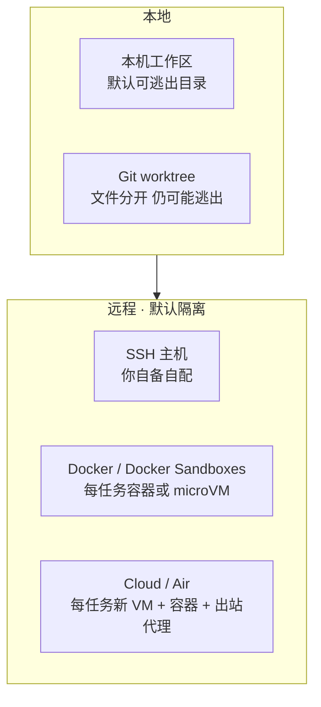

# 代理跑在哪，和它能做什么一样重要：JetBrains Air 的云端沙箱

JetBrains Air

**一句话看懂**：JetBrains 的 Dennis Ushakov 解释 Air 云端代理怎么做隔离。他把跑代理的方式收成五类——本机工作区、git worktree、SSH、Docker（含每代理一台 microVM 的 Docker Sandboxes）、云端——并说明本地默认可逃出工作目录，隔离要靠客户端去包一层；远程则默认隔离。Air 的做法是：**每个任务开一台新的云 VM，代理跑在 VM 里的 Docker 容器中，出站流量走代理**；默认只放行源码托管和包仓库域名；密钥加密后以环境变量注入，任务只拥有该开发者自己的仓库权限。这是本站第一篇 JetBrains 资料。

## 读完你能带走的 6 条收获

1. **沙箱 = 隔离 + 最小权限 + 限额 + 审计**：不是“换个目录跑跑”就够（见 3.1）。
2. **五种跑法可以按“默认可不可逃出你的机器”来记**：本机 / worktree 默认不隔离或只隔离文件变更；SSH / Docker / Cloud 默认隔离（见 3.2）。
3. **本地隔离的责任在客户端**：要用 landrun、sandbox-exec、Sandboxie 这类 OS 级工具把代理包起来（见 3.2）。
4. **Air：每任务新 VM，VM 内容器，出站经 proxy**：VM 不信任、任务间不复用（见 3.3）。
5. **网络默认白名单**：预设可信的源码托管与包仓库（如 npm）；可加域名、全开或全关（见 3.3）。
6. **密钥与权限跟人对齐**：队友能用共享密钥却看不到值；任务看不到开发者本人无权访问的仓库（见 3.3）。

::: tip 小白先懂这几个词
- [Sandbox（沙箱）](/glossary#agent-sandbox)：把代理关在受限环境里，限制它能碰的文件、网络和动作。
- [MicroVM（微虚拟机）](/glossary#microvm)：很轻量的虚拟机，常用来给每个代理单独一台“小电脑”。
- [Egress proxy（出站代理）](/glossary#egress-proxy)：代理所有外连都经它转，便于做域名白名单。
- [Least privilege（最小权限）](/glossary#least-privilege)：只给完成任务所需的最少访问。
- [Worktree（工作树）](/glossary#worktree)：同一仓库的第二份工作目录，文件改动与主目录分开。
:::

## 1. 基本信息

<SourceCard type="文章" title="How Cloud-Based Agent Sandboxing Works in Air" author="Dennis Ushakov" date="2026-10-14" url="https://blog.jetbrains.com/air/2026/10/cloud-agent-sandboxing/" />

| 项目 | 内容 |
|---|---|
| 链接 | https://blog.jetbrains.com/air/2026/10/cloud-agent-sandboxing/ |
| 类型 | JetBrains Blog · Air 栏目（正文约 1,080 词，含示意图与演示视频说明） |
| 作者 | Dennis Ushakov |
| 发布日期 | 2026-10-14（URL 路径 `/2026/10/`，页面日期一致） |
| 使用工具 | JetBrains Air（IDE 内 Air、浏览器 Air Teams）；云端代理目前面向组织用户预览，个人用户更广发布另有计划 |
| 分析依据 | 原文全文，2026-10-19 用 curl 抓取，引语逐字核对。未实测 Air；五种方式的对比表来自原文叙述与附图文字；无攻击面或逃逸测试数据。“我觉得”开头的段落是本站评论。 |

## 2. 这篇在回答什么

作者先演示：在 IntelliJ IDEA 里开一个任务，用浏览器和手机跟着看，做完再审代理的改动。然后把话题拉大——代理能读文件、执行代码、用工具、碰外部服务时，**安全地跑**到底是什么意思。

文章要回答三件事：沙箱指什么、今天有哪些执行选项、云端方案（以 Air 为例）在整幅图里处在哪。

## 3. 怎么做

### 3.1 为什么代理需要沙箱

原文给的定义是：

<Trans zh="给 AI 代理做沙箱，就是把它放进隔离且严格受控的环境里，限制它能访问哪些资源、允许它做哪些动作。">“Sandboxing an AI agent is the practice of running the agent inside an isolated and tightly controlled environment that restricts what resources it can access and what actions it is allowed to perform.”</Trans>

不是只换个工作目录：还要在文件、API、外部服务上划界，叠最小权限、资源限额、审计和追踪。原因很具体——现代代理会执行代码、用工具、自主行动，意外改系统、泄数据、或被提示注入利用时，沙箱用来限制爆炸半径。

### 3.2 五种跑法，以及谁负责隔离

作者把场景收成五类，并归成本地 / 远程两大组：

| 方式 | 工作在哪 | 默认与你的机器隔离？ | 谁来搭 |
|---|---|---|---|
| 本机工作区 | 你自己的工作副本 | 否，可离开工作目录 | 无；限额靠客户端强制 |
| Git worktree | 本机另一份副本 | 部分：文件改动分开，仍可能离开目录 | 客户端创建 worktree |
| SSH | 你提供的机器 | 是 | 你手动 |
| Docker | 每任务新容器（本地或远端）；Docker Sandboxes 每代理一台 microVM | 是 | 客户端或组织管理员 |
| Cloud | 每任务新 VM / microVM / 容器；Air = VM 里再跑容器 | 是 | 按团队 / 组织设定自动 |

本地场景下，代理很容易有意无意逃出当前工作目录，或被提示注入带走。文件系统和网络可以用 OS 级工具收紧（Linux 上的 landrun、macOS 上的 sandbox-exec、Windows 上的 Sandboxie），但那是**客户端**的责任：用户用来聊代理的程序，或 Claude Code、Codex 这类 CLI，得把启动的代理包起来并执行策略。

远程这边默认更好：

<Trans zh="远程执行默认提供更好的保证">“Remote execution provides better guarantees by default”</Trans>

代理环境与开发者隔离；可用文件系统与网络控制限制冲击面。差别主要在**手工配置量**：SSH 要你自备机器；Docker 可由客户端或管理员配；Docker Sandboxes 再进一步每代理一台 microVM；云端则应按团队设定自动配环境。

我觉得这张表的价值，是帮你在选型时先问“逃出我笔记本的默认答案是什么”，而不是先比模型谁更聪明。和 Cursor 自托管机器（[[51]]）、Factory OpenCompute（[[53]]）对照时，问的是同一类问题：隔离边界画在哪、网络默认多严、密钥怎么进任务。

### 3.3 Air 云端具体怎么做

Air 云端代理的核心路径接近 Docker Sandboxes：**每个任务在云上启动一台 VM**（microVM 即将推出），代理跑在该 VM 内的 Docker 容器里。

<Trans zh="这台 VM 被视为不信任：任务之间不复用，只允许访问有限的内部资源。">“The VM is considered untrusted: It is not reused between tasks and is allowed to access only limited internal resources.”</Trans>

VM 里架了 proxy，容器里代理的连接都经它出去。

<Trans zh="默认情况下，该代理只允许连到一份预设的可信源码托管与包仓库域名列表，例如 npm。">“By default, the proxy allows connections only to a preset list of trusted source control and package registry domains, such as npm.”</Trans>

你可以按工具链、包管理器或内部服务加域名，也可以允许全部域名，或彻底关掉互联网。

密钥加密存放，向任务暴露为环境变量；队友可以使用共享密钥但看不到值，个人密钥保持私有。每个任务还在**该开发者本人的仓库权限**内行动：

<Trans zh="因此它永远看不到开发者本人已经无权访问的仓库。">“so it never sees a repository the developer can’t already access.”</Trans>

（原文完整句：Each task also acts within the developer’s own repository permissions, so it never sees a repository the developer can’t already access.）

## 4. 结果与局限

- **文中证明的**：产品架构叙述——每任务 VM、容器、出站白名单、密钥与权限模型；五种方式的定性对比。附带“可从 IDE / 手机跟着看任务”的演示说明。
- **没给出的**：逃逸测试、误拦率、任务耗时与成本、与纯 Docker / 自托管的对照数据；个人用户更广发布的时间表只有“planned later”。
- **立场**：JetBrains 产品博客，结尾邀请组织用户试用并打 X 账号反馈。作选型清单有用，作安全结论需要你自己补测试。

## 5. 结论

代理越能干、越自主，就越不能只问“它会什么”，还要问**它在哪跑、能碰什么、出事时爆炸半径多大**。云端执行是加强默认隔离、减少本地配置、让组织握住网络与环境策略的一条路——不是唯一的路。

**你可以这样试**

1. 用原文五列对照你现在的跑法：默认隔离吗？谁强制策略？
2. 若在本机跑：查你的客户端是否真的包了 OS 级沙箱，还是只换了个目录。
3. 若上云或自建机队：先写清出站默认（白名单 / 全开 / 全关）和密钥是否按人权限注入。

**读完自测**

1. 本机工作区和 git worktree 在“默认隔离”上差在哪？
2. Air 为什么把 VM 标成 untrusted，并在任务之间不复用？
3. 出站 proxy 默认放行什么？密钥对队友可见吗？
