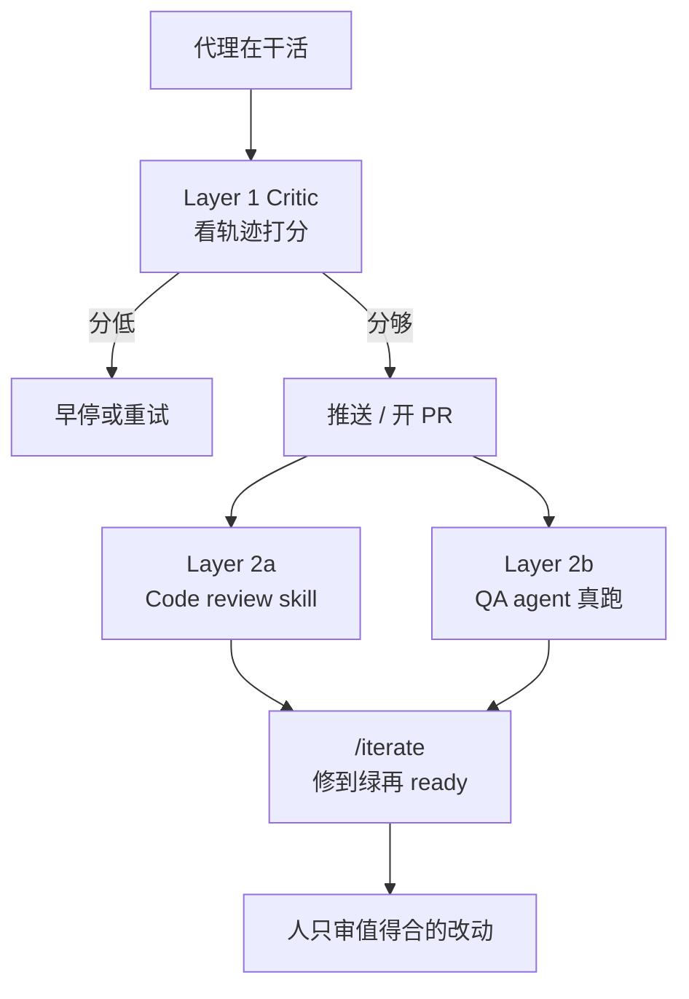

# 生成变便宜以后，瓶颈是验证：OpenHands 的两层验证栈

OpenHands

**一句话看懂**：OpenHands 的 Xingyao Wang 和 Calvin Smith 认为，代码生成变便宜之后，真正卡住交付的是**验证**——改动对不对、合不合仓库约定、团队敢不敢合。他们的验证栈分两层：推送前用小而快的 **critic 模型**看代理轨迹，分低就停或重试；推到 PR 上再用 **code review skill + QA 代理**——前者按清单写行内评论，后者真的把软件跑起来。在自家 `software-agent-sdk` 仓库跑了六个月后，他们自报：自动审查覆盖约 90% 的 PR，平均合并时间降 58%，测试覆盖率约升 25%。

## 读完你能带走的 7 条收获

1. **代理犯的错种类不同，要在不同阶段抓**：跑偏、误解任务、死循环——推送前看轨迹就能抓；风格、边界、约定漂移——放在 PR 审查里抓（见 2）。
2. **Layer 1 critic：推送前给整次运行打分**，低分可早停或触发重试，烂尝试不进人工队列（见 3.1）。
3. **Layer 2 审查 skill 按影响排序**：最高优先里包括拒纯 mock 测试、查真实风险而非理论风险（见 3.2）。
4. **审查规则可以按仓库定制**：`.agents/skills/custom-codereview-guide.md` 从 PR 分支读取，改完再审即生效（见 3.2）。
5. **QA 代理读的不是 diff，是跑起来的行为**：Understand → Setup → Exercise → Report，带命令、输出、截图证据（见 3.3）。
6. **`/iterate` 把验证变成循环**：开 draft PR、修到绿、再标 ready，避免自动合并过早开火（见 3.4）。
7. **读他们的效果数字时要看定义**：精确率把“无建议的 PR”也算完美；recall 与人类零和；Maintainability Index 下降伴有仓库行数 +144%（见 4）。

::: tip 小白先懂这几个词
- [Verification Stack（验证栈）](/glossary#verification-stack)：按阶段叠起来的一组自动验证器。
- [Critic Model（评论者 / 打分模型）](/glossary#critic-model)：看代理轨迹、预测这次运行成不成功的小模型。
- [Code Review Skill](/glossary#code-review-skill)：写成 Skill 的结构化审查清单，触发在 PR 上。
- [QA Agent（功能验收代理）](/glossary#qa-agent)：真的启动软件、像用户一样行使改动行为的代理。
- [Precision / Recall（精确率 / 召回）](/glossary#precision-recall)：建议有多少被采纳；被采纳的建议里有多少来自机器人。
:::

## 1. 基本信息

<SourceCard type="文章" title="The Verification Stack" author="Xingyao Wang, Calvin Smith" date="2026-06-22" url="https://www.openhands.dev/blog/the-verification-stack" />

| 项目 | 内容 |
|---|---|
| 链接 | https://www.openhands.dev/blog/the-verification-stack |
| 类型 | OpenHands 官方博客（正文约 1,900 词，含多张效果图） |
| 作者 | Xingyao Wang、Calvin Smith（页面与 JSON-LD） |
| 发布日期 | 2026-06-22（`datePublished` 2026-06-22T16:25:00.000Z） |
| 使用工具 | OpenHands Cloud / Agent Canvas（Critic、Iterative Refinement）；OpenHands Extensions 中的 code review skill 与 QA agent；GitHub Actions 或 org-wide Automations |
| 分析依据 | 原文全文，2026-10-19 用 curl 抓取，引语逐字核对。效果数字来自对 `OpenHands/software-agent-sdk` 约六个月的自报；精确率 / 召回由 LLM-as-judge 流水线计算；未打开 Extensions 仓库逐文件核对。“我觉得”开头的段落是本站评论。 |

## 2. 这篇在回答什么

开篇一句把问题钉死：

<Trans zh="代理让生成代码变便宜了。真正的瓶颈现在是验证">“Agents made generating code cheap. The real bottleneck is now verification”</Trans>

——检查改动是否正确、是否遵循仓库约定、是否值得团队信任、审查并合并。

验证栈的核心洞察：代理会犯不同种类的错，最好在不同阶段抓。与“代理这次工作本身”有关的问题（跑偏、误解、死循环），推送前看动作轨迹就能抓；仓库级问题（风格、漏边界、约定漂移），放进正常 PR 流程里抓。于是两层：

## 3. 怎么做

### 3.1 Layer 1：推送前的 critic

Critic 是代理还在干活、代码尚未推送时跑的验证器。它随着代理采取动作，给“这次运行有多大可能成功”打分。OpenHands 根据分数行动：

<Trans zh="分数低可以早停，或触发代理重试">“a low score can stop the run early, or trigger the agent to retry”</Trans>

——这样明显坏掉的尝试到不了人工审查队列。训练与精度细节指向旧文 *Learning to Verify AI-Generated Code* 和 critic 论文；本篇不展开数字，只定位它在栈里的位置。Cloud / Agent Canvas 里可在 Settings → Verification 打开 Enable Critic，并可打开 Iterative Refinement，让分数低于阈值时自动重试。

### 3.2 Layer 2a：按清单审查的 code review skill

PR 打开或标为 ready 时，审查代理自动对 diff 跑。驱动它的是一份详细的 code review skill，里面是按影响排序的 **10 类审查场景**。原文点名最高优先的四类：

1. **数据结构分析**（最高优先）——指出制造不必要复杂度的结构选择  
2. **安全与正确性**——真实风险（未消毒输入、硬编码密钥、竞态），不是纸上谈兵  
3. **测试缺口**——<Trans zh="拒绝纯 mock 的测试；要求行使真实代码路径并对输出断言">“rejects mock-only tests; requires tests that exercise real code paths and assert on outputs”</Trans>  
4. **依赖与供应链风险**——新依赖或降级依赖的发布来源与已知漏洞  

每条审查以风险档（绿 / 黄 / 红）和裁决收尾；高风险 PR 标给人架构师审，而不是自动合并。

关键一点：审查 skill **可按仓库定制**。团队可加 `.agents/skills/custom-codereview-guide.md`；审查者从 **PR 分支**读取，因此指南一改，再审即生效——形成持续改进环。

### 3.3 Layer 2b：真把软件跑起来的 QA 代理

与读 diff 的审查代理不同，QA 代理**实际运行软件**，四阶段：

1. **Understand**——读 PR diff / 标题 / 描述，分类改动，找入口（CLI、API、UI）  
2. **Setup**——装依赖、构建  
3. **Exercise**——起服务、开浏览器、跑 CLI、发 HTTP，像真实用户一样测改动行为  
4. **Report**——把带证据（命令、输出、截图）的结构化 QA 报告发成 PR review，并给裁决  

它知道何时放弃：一种路径多次实质不同尝试仍失败就换策略；多种根本不同路径都失败，就诚实报告验不了什么。同样可用 `AGENTS.md` 或 `.agents/skills/` 定制。

### 3.4 用 `/iterate` 把验证收成环

搭好栈只是一半；另一半是读 CI、解析评论、改代码、再推，直到全绿。对人这是盯 PR 的无聊阶段；对代理是一个环。`/iterate`：在 PR 或分支上调用后，代理开 **draft** PR（避免 auto-merge / 部署过早开火），跑仓库已有的验证层，修它们标出的问题，再推；全过之后再标 ready。可与 OpenHands Automations 配对，让每条 PR 在人看之前先跑完机械检查。

接入路径两条：仓库级 GitHub Actions；或组织级 Cloud Automations（一次定义，机器人账号能及的仓库都能触发，并带上已配的 skills、MCP 与仓库知识）。

## 4. 结果与局限

作者给出的生产证据来自对 `OpenHands/software-agent-sdk` 约六个月的运行（自报）：

- 审查机器人发表 **1,000+** 条审查，覆盖 **900+** PR、**38** 次发布  
- 约 **90%** PR 以某种形式使用自动审查，**23%** 多轮；不用的通常很小（中位 diff **34** 行）  
- 引入后平均合并时间降 **58%**  
- 用 LLM-as-judge 抽建议、看是否进最终 diff，算精确率与召回；并把**无建议的 PR 视为精确率完美**；约 **85%** 的情况下人是在 bot 留言之后才审——bot 精确率“逼近人类”时要连这一定义一起读  
- 召回与人类零和：bot 召回 > 0.5 表示多数被采纳建议来自 bot  
- radon / bandit / ruff：复杂度、smell、潜在漏洞下降；覆盖率近 **+25%**；Maintainability Index 下降，作者解释 <Trans zh="代码行数会拖累可维护性指数">“lines of code count against maintainability”</Trans>，同期仓库从 61 KLOC 增到 148 KLOC（**+144%**）

我觉得这些数字方向一致、口径也写得比较老实，但仍然是**单一仓库、厂商自报**，且精确率定义偏宽（LGTM 算满分）。和 Cursor Bugbot 用“解决率”迭代（[[33]]）、Claude Code 团队七层审查（[[60]]）、Devin 带证据自测（[[32]]）对照时，可借的是分层思路和“QA 真跑”，不是把 58% / 90% 当成你仓库的预期值。

## 5. 结论

验证栈想把验证从一次性人工步骤，变成连续的环：坏轨迹在成为 PR 之前被拦住；PR 上按仓库约定审、按真实行为做 QA；iterate 修到绿；人只在高风险或值得合的改动上花时间。

**你可以这样试**

1. 若已有编码代理：先加一个“推送前”的廉价检查（哪怕只是失败测试计数），低质量运行不要进 PR。  
2. 把审查清单写成仓库内 Skill，并加一份项目定制指南文件。  
3. 对行为向改动，加一个会真的起服务 / 打请求的 QA 步骤；用 draft PR + 循环修到绿。

**读完自测**

1. Layer 1 和 Layer 2 分别抓哪类错误？  
2. 为什么审查指南要从 PR 分支读？  
3. 读“精确率逼近人类”时，必须同时记住哪两条定义？
