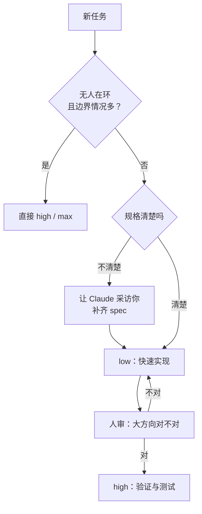

# effort 档位怎么选：低档在环迭代，高档留给验证

Claude Code

**一句话看懂**：Claude Code 团队的 Thariq Shihipar 用三个自己的小项目和 Terminal-Bench 3.0 的结果，解释 `/effort` 到底在调什么：它调的不只是“想多久”，而是**代理做多少验证、测多少边界情况、替你做多少决定**。他的日常做法是先让模型采访自己，再用 low 实现、自己审一遍，最后用 high 做验证和测试。高档的收益集中在边界情况多的任务（安全、硬件、棕地修 bug），对“方法本身选错了”的失败帮不上忙。

## 读完你能带走的 7 条收获

1. **effort 是“算力预算”的提示**：高档时代理会做更多独立判断和验证，而不只是同样的事做得更慢（见 3.1）。
2. **选档先问自己想多在环**：低档快速给起点、方便你迭代；高档做得多，但替你做的假设也多（见 3.2）。
3. **一个可以照抄的四步循环**：给 spec 让它采访你 → low 实现 → 审大方向、low 迭代 → high 验证和测试（见 3.2）。
4. **规格越清楚，档位差别越小**：同一份采访出来的 spec，四档的实现很接近；欠规格的任务，档位决定了产品长什么样（见 3.2）。
5. **高档帮的是“漏边界”，不是“方法错”**：失败分类图里，提高 effort 主要减少漏掉边界情况的失败（见 3.3）。
6. **高档的具体差别是“先复现、做对拍、比两种做法”**：低档一遍写完、测一个例子就收工（见 3.4）。
7. **四档经验法则**：low 用于头脑风暴和简单改，medium 用于常规新功能，high 用于验证要紧的棕地修 bug，max 用于完全自主的难题（见 3.5）。

::: tip 小白先懂这几个词
- [Reasoning Effort（effort 档位）](/glossary#reasoning-effort)：告诉模型这次大概想花多少算力，Claude Code 里用 `/effort` 切换。
- [Terminal-Bench](/glossary#terminal-bench)：社区出题的终端任务基准，题目跨安全、硬件、ML、科学、软件、运维和媒体。
- [边界情况（Edge Case）](/glossary#edge-case)：正常流程之外、容易被漏测的输入或状态。
- [Brownfield（棕地项目）](/glossary#brownfield)：已经有大量存量代码的项目。
- [Human-in-the-loop（人在环里）](/glossary#human-in-the-loop)：每一步都有人看、有人拍板。
:::

## 1. 基本信息

<SourceCard type="文章" title="Using Claude Code: Spending your effort" author="Thariq Shihipar" date="2026-09-25" url="https://claude.dev/blog/spending-your-effort/" />

| 项目 | 内容 |
|---|---|
| 链接 | https://claude.dev/blog/spending-your-effort/ |
| 类型 | claude.dev 官方博客 Engineering 栏目（页面标注 8 分钟，正文约 2,300 词，含三张交互图） |
| 作者 | Thariq Shihipar（页面署名与 JSON-LD） |
| 发布日期 | 2026-09-25（`datePublished` 2026-09-25，页面 “PUBLISHED Sep 25, 2026”） |
| 使用工具 | Claude Code（`/effort`）、Opus 5.5、Fable 5.1；Terminal-Bench 3.0 |
| 分析依据 | 原文全文，2026-10-20 用 curl 抓取，引语逐字脚本核对。三张图（effort 曲线、失败分类、分领域通过率）只引用页面上的文字说明和数字，没有截图。Terminal-Bench 数字是 Anthropic 内部运行，每题 5 次，Fable 5.1 关闭了生产安全干预（见原文脚注）；玩具例子只给耗时，没给 token 和成本。作者是 Anthropic 员工，文章同时在介绍新模型的 effort 曲线。“我觉得”开头的段落是本站评论。 |

## 2. 这篇在回答什么

你在 Claude Code 里敲 `/effort`，看到 low、medium、high、xhigh、max 几档。该选哪个？常见的两种直觉都不太对：一种是“越高越好，反正贵一点”，另一种是“高档只是想得更久”。

作者的结论放在开头：

<Trans zh="我发现 effort 是调节 Claude 做多少验证和边界测试、用多少自己判断的好办法">“I found that effort was a great way of modulating how much verification and edgecase testing Claude did and how much of its own judgement it used”</Trans>

所以选档其实是在回答两个问题：这次我想不想一直在旁边看？这个任务的风险是不是藏在边界情况里？

文章回答了四个问题：

1. effort 到底在调什么？
2. 日常写功能时怎么选档？
3. 什么样的任务值得开高档？
4. 这些数字该怎么读？

## 3. 怎么做

### 3.1 effort 是什么：给代理一个算力预算

**是什么**：作者的定义很朴素：

<Trans zh="effort 给模型一个近似值，表示你希望它在这个任务上花多少算力">“effort gives the model an approximation of how much compute you want it to spend on the task”</Trans>

它和你对任务难度的判断有关。

**为什么会改变行为**：他用一个类比解释。同一件事，别人让你连续做 12 小时，你会默认对方要你使劲做；只给你 1 小时，你会先交一个满足要求的版本，再等着迭代。你也可能反过来说“这事至少要 3 小时”，然后真的做 3 小时。

**结论**：高档不是“同样的步骤做得更慢”，而是多出了独立行动：

<Trans zh="Claude 总会合理地完成你的任务，但更高的 effort 意味着 Claude 会为判断和验证采取更多独立行动">“Claude will always try and do your task reasonably, but higher effort will involve Claude taking more independent action for judgement and verification”</Trans>

作者还提到，新模型切换 effort 不会破坏 Claude Code 的 prompt cache，所以可以在对话中途用 `/effort` 改档（这是厂商说法，文中没有给数据）。

### 3.2 日常开发：先想清楚你要多在环

作者用 Opus 5.5 把三个“玩具任务”在不同档位各做一遍，只看行为差别。

**欠规格的任务**：一句“build a personal fitness and workout tracker app”。low 用 1.5 分钟，只有一个日志和一张简单的图；medium 4 分钟；high 11 分钟；max 67 分钟，多了热力图。档位越高，Claude 替你做的产品决定越多。想要一个可以接着改的底子，low 就够；想要它最好的一次性成品，用 max。

**规格较轻的设计任务**：重设计 Claude Code 的 `/config` 菜单。四档的思路基本相同（子菜单 + 更好的搜索）。low 用 1 分钟，给了一个能交互、但不太像 Claude Code 的草图；max 用 28 分钟，做出很像真品的样稿和多条流程演示。作者自己的选择是 low：

<Trans zh="就这个任务来说，我想我更喜欢用低 effort 来理解 Claude 的设想">“For this particular task, I think I prefer using low effort to understand Claude’s vision.”</Trans>

**规格很清楚的任务**：先让 Claude 就健身应用深度采访他，再把采访出来的 spec 交给不同档位实现。low 16 分钟、medium 22、high 33、max 79。这一次四档的设计和实现很接近，只在细节上不同，max 还花时间简化了几处。

**为什么**：规格把大部分决定都提前做掉了，留给档位决定的东西就少了。作者的总结是：

<Trans zh="effort 档位很大程度上取决于我想多在环里">“the effort level depends a lot on how in the loop I want to be”</Trans>

低档快速给你一个起点；高档做得更多，但也会替你做更多假设。

**怎么做**：他做新功能时常用的循环（原文四步）：

1. 给 Claude 一份 spec，让它就缺的细节采访你；
2. 用 low 实现；
3. 审一遍，确认大方向对，必要时继续用 low 迭代；
4. 用 high 做验证和测试。

我觉得这个循环的价值在于把“人判断方向”和“代理做苦活验证”分开：前者需要快速来回，后者需要耐心和多试几种情况，正好对应低档和高档。

### 3.3 高档帮的是“漏边界”，不是“方法错”

玩具任务 Claude 本来就做得完。真正关心的是“做得成还是做不成”的难题，所以作者去看了 Terminal-Bench 3.0。这是社区出题的基准，题目分安全、硬件、ML、科学、软件、运维、媒体几类，比如用 Verilog 做一台能放进小 FPGA 的 8 位游戏机、在 Lean 4 里证明 Takens 嵌入定理、把 16 个分片的 MoE 检查点合成一个文件。作者说这些题比他平时遇到的任务复杂得多。

**主要结论**：

<Trans zh="更高的 effort 最适合有大量隐藏边界情况的任务">“higher effort is best for tasks with lots of hidden edge cases”</Trans>

**例子：HTML 过滤器**。`html-js-filter` 要求写一个清掉所有夹带 JavaScript 方式的 HTML 过滤器。Fable 5.1 从 low 的 1/5 升到 xhigh 的 5/5。low 每次约 2 分钟，一遍写完，只拿一个手写页面测；high 一次约 33 分钟，作者追踪的那次运行里，它先对抗式地审自己的初稿，再去读已安装解析器的源码找 bug，跑大量干净用例确认输入输出一致，跑一套标准 XSS 测试，最后写了一个随机文档 fuzzer。

**边界**：作者紧接着说，不是每个任务都要这么做。失败分类图把每次尝试按失败原因上色（原因由模型判定，作者说是近似的），结论是：

<Trans zh="总体上，提高 effort 往往会减少因遗漏边界情况导致的失败，但修不了模型方法错误的情况">“Overall, increasing effort tends to reduce failures due to missing edgecases (purple blocks), but does not fix when the model has the wrong approach (blue blocks).”</Trans>

图上的文字说明给了 Fable 5.1 的两组数字：370 次尝试里，low 通过 140 次，max 通过 214 次；“测试没抓到的 bug”从 40 次降到 14 次，而“选错了理解方式”反而从 25 次升到 47 次。

我觉得后面这个数字值得多看一眼：高档能把一条路走得更扎实，但走错路的时候它不会自己回头。方向问题还是要靠 3.2 里那一步“人审大方向”。

### 3.4 高档具体多做了什么：先复现、做对拍、比两种做法

作者挑了三道 Opus 5.5 在低档失败、高档成功的题，差别都落在“有没有去测边界”上：

| 题目 | 低档的做法 | 高档的做法 | 结果 |
|---|---|---|---|
| `mvcc-lsm-compaction`：按崩溃报告修存储引擎 bug，不能弄坏压缩 | 约 1 分钟；先改代码，再构建或跑复现，没检查新测试能不能抓到原 bug | xhigh 约 11 分钟；先复现崩溃，对着一个从不压缩的参照实现写随机测试，确认测试在半成品修复上会失败 | 0/5 → 4/5 |
| `cli-2ph-simplex`：用 Python 写命令行线性规划求解器 | 一遍写完，几个小例子，约 10k token 就停；最后提醒“大问题可能慢”，但没去查 | 用随机问题和一个暴力求解器对拍，再给大问题计时，碰到超时和崩溃就重写搜索 | 0/5 → 5/5 |
| `gsea-proteomics`：蛋白组数据的基因集富集分析 | 选一种看起来合理的预处理，跑一次就报结果 | 试两种预处理，发现显著结果变了，先查原因再选对的那种 | 0/5 → 4/5 |

第一行里“确认测试在半成品修复上会失败”，对应原文：

<Trans zh="确认它的测试在修了一半的修复上会失败">“checked that its tests failed on half-finished fixes”</Trans>

这就是“测试能不能抓到 bug”的检验：一个在错误代码上也能通过的测试，等于没有测试。

第三行作者另加了一句边界说明：

<Trans zh="如果有用户在环里，Claude 可能会问用户问题该怎么设定；但没有用户在环时，高 effort 表现更好">“If a user were in the loop, Claude may have asked the user about the way to set up the problem, but without a user in the loop, high effort does better.”</Trans>

**分领域的提升**也不一样。Fable 5.1 从低档到高档的通过率（低档合并两个最低档，高档合并三个最高档）：安全 64% → 87%，硬件 34% → 75%，ML 54% → 73%，科学 41% → 61%，软件 43% → 56%，媒体 18% → 30%，运维 12% → 22%。硬件和安全提升最大，和开头“验证和边界测试越有用的领域，越该给 effort”一致。

### 3.5 四档经验法则

原文最后给了自己的选档规则：

| 档位 | 什么时候用 | 原文例子 |
|---|---|---|
| Low | 想快速回应、自己在环里 | 头脑风暴、画草图、简单改动 |
| Medium | 大多数常规工程工作 | 新功能实现 |
| High | 验证重要、有边界情况 | 在棕地代码库里修 bug |
| Max | 让 Claude 完全自主解难题 | 端到端构建并验证一个应用、在关键软件里找安全漏洞 |

档位也可以在对话中途用 `/effort` 改，不必一开始就定死。

## 4. 结果与局限

**文章真正给出的证据**：

- 三个玩具任务在四个档位下的耗时和产出差别（只给分钟数，没给 token 和成本）；
- Terminal-Bench 3.0 上的 effort 曲线、失败分类和分领域通过率；
- 三道题的低档 / 高档行为对比。

**要注意的地方**：

- **内部运行，和公开榜单不对齐**：脚注说明这些数字来自 Anthropic 内部运行，每题 5 次；Fable 5.1 关闭了生产环境的安全干预（产品里它会把部分安全请求转给 Opus）；安全题在无网络环境下跑。作者自己说每题的计数和公开排行榜、发布文都对不上。
- **例子是单次运行**：三道题的行为描述来自个别运行，有些用的是中间档位。
- **玩具任务不代表难度分布**：作者自己承认这些是 Claude 本来就能完成的例子。
- **成本缺位**：max 档 67、79 分钟的运行花了多少钱，文中没说；在团队里推“默认 high”之前，要自己测一下花费。
- **自带立场**：作者在 Anthropic 工作，文章同时在说明新模型的 effort 曲线“是我们最好的一次”。
- **失败原因由模型判定**：图 B 的分类来自模型评判，作者说是近似值。

我觉得这篇最可靠的部分不是百分比，而是 3.4 里的行为描述：先复现、对拍、对比两种做法、确认测试会在错误代码上失败。这些是人类工程师也认可的验证习惯，不依赖某个模型版本。

## 5. 结论

effort 不是“质量开关”，是“在环还是放手”的开关。人在旁边、方向还没定的时候，用低档快速来回；方向定了，把高档留给验证、测试和边界情况多的活；没人看着、边界又多的任务，才值得直接开 max。高档救不了方向错误，方向要靠人先审。

和站内其他资料对照：#03 的 workshop 推荐 effort 默认用 xhigh（[[03§3.5]]），这篇则建议常规功能用 medium、实现阶段用 low，只在验证阶段升档。两者不矛盾：#03 的任务是先有完整 spec 再整段交给代理，正对应本篇“规格清楚、档位差别小”的情况。让代理边做边检查自己的其他做法见 [单代理推进与一人多线](/guide/solo)。

**你可以这样试**

1. 下一个新功能，先让 Claude 采访你写出 spec，然后 `/effort low` 实现。
2. 你自己审一遍大方向，有偏差就继续用 low 改。
3. 方向对了，切到 `/effort high`，明确要求它先复现、写能在错误代码上失败的测试、跑一遍边界用例。
4. 记下每一步的耗时，对比你过去“一直 high”的做法。

**读完自测**

1. 为什么规格越清楚，四个档位的结果越接近？
2. 提高 effort 能减少哪类失败，减少不了哪类？
3. `mvcc-lsm-compaction` 里，高档多做的哪一步能证明“测试真的能抓到 bug”？
