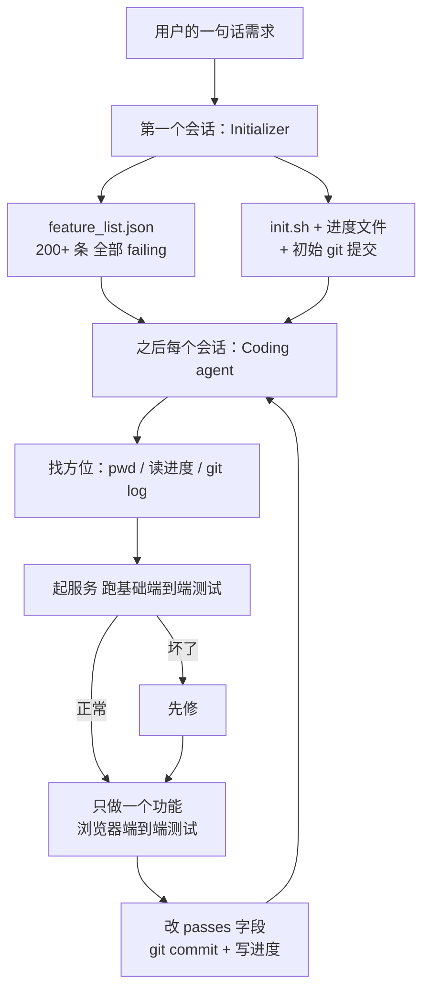

# 让代理跨几十个会话接着干：功能清单、进度文件和开工检查

<div class="meta-tags"><span class="tool-tag tool-claude">Claude Code</span></div>

<div class="hook">

**一句话看懂**：长任务一定会跨很多个上下文窗口，每个新会话都不记得上一班做了什么。Anthropic 的 Justin Young 发现，光靠自动压缩不够：代理要么想一口气做完、做到一半上下文耗尽，要么看到已有进展就宣布完工。他们的解法是两段式：**第一个会话只搭环境**（200 多条全部标为“未通过”的功能清单 JSON、`init.sh`、进度文件、初始提交）；**之后每个会话**先读进度和 git 日志、跑一遍基础端到端测试，再只做一个功能，收尾时提交 git 并更新进度。

</div>

## 读完你能带走的 7 条收获

1. **长任务的两种典型失败**：一口吃成胖子（做到一半耗尽上下文、留下没文档的半成品），以及看到有进展就宣布完工（见 3.1）。
2. **自动压缩不等于交接**：压缩不一定能把清楚的指令传给下一个会话，进度要写进文件（见 3.1）。
3. **第一个会话只搭环境**：功能清单、`init.sh`、进度文件、初始 git 提交，四样东西给后面所有会话用（见 3.2）。
4. **功能清单用 JSON，全部初始标为未通过**：代理只许改 `passes` 字段，模型乱改 JSON 的概率比 Markdown 低（见 3.2）。
5. **一次只做一个功能，收尾留“干净状态”**：描述性的 git 提交 + 进度总结，坏了能回滚，下一班不用猜（见 3.3）。
6. **每个会话先跑一遍基础端到端测试再开工**：上一班留下的 bug 先修，否则新功能只会让问题更糟（见 3.4）。
7. **单测和 curl 不算测完**：明确要求像用户一样用浏览器自动化测，效果明显变好；但工具看不见的东西（如浏览器原生弹窗）仍然测不到（见 3.5）。

::: tip 小白先懂这几个词
- [Long-running Agent（长时代理）](/glossary#long-running-agent)：连续自主工作几小时到几天的代理。
- [Compaction（上下文压缩）](/glossary#compaction)：上下文快满时把历史压成摘要，腾出空间继续跑。
- [Initializer Agent（初始化代理）](/glossary#initializer-agent)：只在第一个会话运行、负责搭好环境的代理。
- [功能清单（Feature List）](/glossary#feature-list)：把需求展开成逐条可测功能、每条带“是否通过”状态的文件。
- [进度文件（Progress File）](/glossary#progress-file)：记录“做了什么、做到哪”的文本文件，供下一个会话读。
- [Agent SDK](/glossary#agent-sdk)：把 Claude Code 的代理循环做成可编程调用的开发包。
:::

## 1. 基本信息

<SourceCard type="文章" title="Effective harnesses for long-running agents" author="Justin Young（Anthropic）" date="2025-11-26" url="https://www.anthropic.com/engineering/effective-harnesses-for-long-running-agents" />

| 项目 | 内容 |
|---|---|
| 链接 | https://www.anthropic.com/engineering/effective-harnesses-for-long-running-agents |
| 类型 | Anthropic Engineering 博客（正文约 2,100 词，含 JSON 示例、会话开头的消息序列和失败模式对照表；配套 quickstart 代码） |
| 作者 | Justin Young（正文末 “Written by Justin Young”；JSON-LD 作者为 Anthropic） |
| 发布日期 | 2025-11-26（`datePublished` 2025-11-26） |
| 使用工具 | Claude Agent SDK、Opus 4.5、Puppeteer MCP、git |
| 分析依据 | 原文全文，2026-10-20 用 curl 抓取，引语逐字脚本核对。文中没有给出完成率、成本、耗时等量化结果，实验对象只有“克隆 claude.ai”这一类全栈 web 应用；配套 quickstart 仓库未逐文件核对。本文是站内 [[16]] 的前作，#16 在它的基础上加了 Planner 和 Evaluator。“我觉得”开头的段落是本站评论。 |

## 2. 这篇在回答什么

设想一个软件项目由轮班的工程师来做，但每个新来的人都完全不记得上一班发生了什么。这就是长时代理的处境：上下文窗口有限，复杂项目一个窗口装不下，每个新会话都是从零开始。

作者的问题是：怎样让代理在很多个上下文窗口之间**稳定地往前推**？

文章回答了四个问题：

1. 为什么有了自动压缩，长任务还是会失败？
2. 第一个会话应该搭好哪些东西？
3. 之后每个会话怎么开头、怎么收尾？
4. 怎么防止代理没测完就标“完成”？



## 3. 怎么做

### 3.1 为什么光靠自动压缩不够：两种失败

Claude Agent SDK 自带上下文压缩，理论上可以一直跑下去。但作者说，即使是 Opus 4.5，在 SDK 里跨多个上下文窗口循环，只给一句 “build a clone of claude.ai”，也做不出生产级的应用。失败有两种：

**第一种：一口吃成胖子**。代理倾向于一次把整个应用做完，结果做到一半上下文用完，下一个会话面对的是一个做了一半、没有文档的功能，只能去猜，再花大量时间让基础功能重新跑起来。作者特别指出，压缩也救不了这一点：

<Trans zh="即使有压缩也会发生，因为压缩并不总能把非常清楚的指令传给下一个代理">“This happens even with compaction, which doesn’t always pass perfectly clear instructions to the next agent.”</Trans>

**第二种：过早宣布完工**。项目后期，某个新会话里的代理看了一圈，发现已经做了不少，就宣布任务完成。

**怎么拆**：作者把问题拆成两件事。第一，搭一个初始环境，给后面的会话“一个功能一个功能做”打好基础。第二，要求每个会话只做增量进展，并在结束时留下**干净状态**——作者的定义是：

<Trans zh="适合合进主分支的那种代码：没有大 bug，代码整齐、有文档，开发者可以直接开始做新功能，不必先收拾一堆无关的烂摊子">“the kind of code that would be appropriate for merging to a main branch: there are no major bugs, the code is orderly and well-documented, and in general, a developer could easily begin work on a new feature without first having to clean up an unrelated mess.”</Trans>

关键洞察是让新会话能**很快看懂当前进度**，靠的是进度文件加 git 历史。作者说这些做法的灵感来自优秀工程师每天都在做的事。

### 3.2 第一个会话只搭环境：四样东西

第一个会话用一份专门的提示词，作者叫它 **initializer agent**。它要产出：

1. **`init.sh`**：能启动开发服务器的脚本；
2. **`claude-progress.txt`**：记录各个会话做了什么的进度日志；
3. **一个初始 git 提交**：显示加了哪些文件；
4. **功能清单**：把用户那一句话需求展开成完整的功能需求文件。

功能清单是这一步的核心。在克隆 claude.ai 的例子里，它有 200 多条功能，比如“用户可以新建对话、输入问题、按回车、看到 AI 回复”。所有条目一开始都标为未通过，这样后面的代理就有了一份“全部做完长什么样”的清晰轮廓。下面是原文给出的一条（摘自原文，2026-10-20 抓取）：

::: tr 一条功能记录：类别、描述、测试步骤（打开主界面、点“新建对话”、确认新对话已创建、确认聊天区显示欢迎状态、确认对话出现在侧边栏），以及“是否通过”字段，初始为 false
```json
{
    "category": "functional",
    "description": "New chat button creates a fresh conversation",
    "steps": [
      "Navigate to main interface",
      "Click the 'New Chat' button",
      "Verify a new conversation is created",
      "Check that chat area shows welcome state",
      "Verify conversation appears in sidebar"
    ],
    "passes": false
  }
```
:::

**两条防护**：

- 后面的代理**只许改 `passes` 字段**，并配上语气很重的指令：

::: tr 删除或修改测试是不可接受的，因为这可能导致功能缺失或有 bug
> "It is unacceptable to remove or edit tests because this could lead to missing or buggy functionality."
:::

- **用 JSON 而不用 Markdown**：作者说试过之后发现，模型不太会乱改或覆盖 JSON 文件，Markdown 就容易被改。

我觉得“全部初始标为未通过”这一点特别值得抄。它把“做完了吗”从代理的感觉，变成了一张可以逐条核对的表：只要还有一条 `false`，就不能说做完。这正好对上第二种失败。

### 3.3 一次只做一个功能，收尾留干净状态

有了脚手架，后面的每个会话（作者叫它 **coding agent**）只被要求做**一个**功能。作者说这种增量做法对治“一次做太多”的倾向是关键。

做完一个改动，还要把环境留在干净状态。作者试下来最有效的办法是两件事：

- 用描述性的提交信息把进度**提交到 git**；
- 在**进度文件**里写下这次做了什么。

这样做有两个好处：代理可以用 git 回滚坏改动、找回能跑的版本；下一个会话不用再猜发生过什么，也省掉了“先让基础功能重新跑起来”的时间。

作者在脚注里说明，所谓“两个代理”只是首条用户提示不同，系统提示、工具和整个 harness 完全一样：

<Trans zh="我们在这里把它们称为不同的代理，只是因为它们的初始用户提示不同">“We refer to these as separate agents in this context only because they have different initial user prompts.”</Trans>

### 3.4 每个会话先找方位、先跑一遍基础测试

每个 coding agent 开工前都按固定步骤“找方位”，有些步骤很基础，但有用：

1. 运行 `pwd`，确认自己在哪个目录，只能改这个目录里的文件；
2. 读 git 日志和进度文件，了解最近做了什么；
3. 读功能清单，挑优先级最高、还没完成的一条来做。

作者还建议让 initializer 写好 `init.sh`，每个会话**在实现新功能之前**先用它起服务、跑一遍基础端到端测试。克隆 claude.ai 时，代理每次都先起本地服务，用 Puppeteer MCP 新建对话、发一条消息、等回复。这样上一班如果留下了坏掉的状态，它马上就能发现并先修：

<Trans zh="如果代理反而直接开始实现新功能，很可能会让问题更糟">“If the agent had instead started implementing a new feature, it would likely make the problem worse.”</Trans>

原文给出了一个典型会话开头的消息序列：先说“我先找方位”，依次 `pwd`、读 `claude-progress.txt`、读 `feature_list.json`、`git log --oneline -20`，再找 `init.sh` 起服务，测基础功能，确认正常后才去看下一条要做的功能。

作者把四种失败和对策整理成一张表（原文表格的中文整理）：

| 问题 | Initializer 做什么 | Coding agent 做什么 |
|---|---|---|
| 过早宣布整个项目完成 | 根据需求写一份结构化 JSON 功能清单，逐条写端到端功能描述 | 开工时读功能清单，只挑一条做 |
| 留下 bug 或没记录的进度 | 建初始 git 仓库和进度文件 | 开工时读进度和提交日志、在开发服务器上跑基础测试；收尾时提交 git、更新进度 |
| 过早把功能标为完成 | 写功能清单 | 自己验证所有功能，仔细测过才标为通过 |
| 花时间琢磨怎么把应用跑起来 | 写能启动开发服务器的 `init.sh` | 开工时读 `init.sh` |

### 3.5 单测和 curl 不算测完：要像用户一样端到端测

最后一种主要失败是**没好好测就把功能标为完成**。没有明确提示时，Claude 会改代码，甚至会写单测、用 curl 打开发服务器，但意识不到这个功能端到端其实不工作。

明确要求它用浏览器自动化工具、像真实用户一样测之后，情况好了很多：

<Trans zh="给 Claude 提供这类测试工具大幅提升了表现，代理能找出并修掉光看代码看不出来的 bug">“Providing Claude with these kinds of testing tools dramatically improved performance, as the agent was able to identify and fix bugs that weren’t obvious from the code alone.”</Trans>

**局限**：Claude 的视觉能力和浏览器自动化工具本身都有限，不是每种 bug 都能发现。原文的例子是 Puppeteer MCP 看不到浏览器原生的 alert 弹窗，依赖这类弹窗的功能就更容易有 bug。

## 4. 结果与局限

**文章证明了什么**：作者给出的是一套在内部实验中有效的做法，以及每条做法对应哪种失败（3.4 的表）。

**没有给出的东西**：

- **没有量化结果**：没有完成了多少条功能、跑了多少个会话、花了多少钱或多少时间。“大幅提升”是定性描述。
- **只在一类任务上试过**：作者说这个演示针对全栈 web 开发，推广到科研、金融建模等长任务是以后的方向。
- **时效**：文章写于 Opus 4.5 时期。四个月后的续篇 [[16]] 在这套 harness 上加了 Planner 和 Evaluator，并在模型升级后去掉了 context reset（[[16§3.5]]）。
- **单代理还是多代理没定论**：作者自己留了一个开放问题：

<Trans zh="最值得注意的是，目前还不清楚是单个通用编码代理在各种情境下表现最好，还是多代理架构能做得更好">“Most notably, it’s still unclear whether a single, general-purpose coding agent performs best across contexts, or if better performance can be achieved through a multi-agent architecture.”</Trans>

他猜测专门的测试代理、QA 代理、代码清理代理可能在各自的子任务上做得更好。

我觉得这篇的价值在于它很“土”：功能清单、进度文件、git 提交、启动脚本，没有一样是新发明，但组合起来正好堵住了长任务最常见的两个漏洞。和站内其他长任务做法对照：Ralph 循环（[[24]]）也是每轮重读规格、一轮一件事；C 编译器实验（[[17§3.4]]）同样靠进度文件交接；OpenAI 的 25 小时 Codex 实验（[[61§3.2]]）把同一思路拆成了四份 Markdown。四家都把记忆放在仓库里而不是会话里。完整对照见[长时自主任务专题](/guide/long-running)。

## 5. 结论

长任务要跨很多会话，就别指望会话记得住。把需求展开成一份全部标为“未通过”的 JSON 功能清单，让第一个会话只搭环境；之后每个会话先找方位、先跑一遍基础测试，再只做一个功能，用浏览器像用户一样测过才改 `passes`，最后提交 git、写进度。完成与否由清单说了算，不由代理的感觉说了算。

**你可以这样试**

1. 下一个要跨几天的任务，先开一个会话只做一件事：把需求写成 `feature_list.json`，每条带测试步骤和 `"passes": false`，再写 `init.sh` 和一个空的进度文件，提交。
2. 之后每个会话的固定开头写进提示词：`pwd` → 读进度文件和 `git log` → 跑 `init.sh` 和一条基础端到端测试 → 挑一条未通过的功能。
3. 在提示词里写明：只许改 `passes` 字段，不许删改测试；收尾必须提交 git 并更新进度。

**读完自测**

1. 为什么有了自动压缩，代理还是会留下“做了一半、没有文档”的功能？
2. 功能清单为什么全部初始标为未通过，又为什么用 JSON？
3. 每个会话在实现新功能之前先跑一遍基础测试，是为了防什么？
