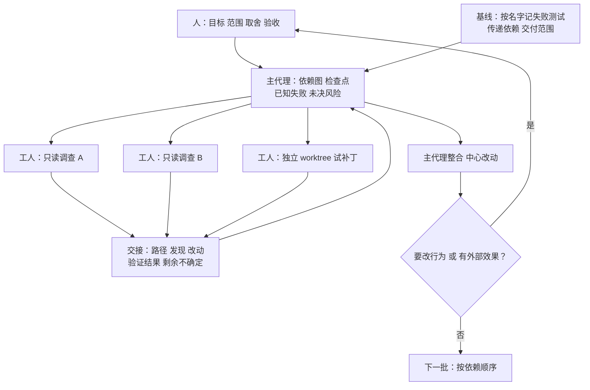

# 十个仓库的 .NET 迁移：主代理管依赖图，工人只做有边界的调查

通用（不限工具）

**一句话看懂**：布拉格的软件公司 Blocshop 复盘了一次匿名的 .NET 10 迁移：10 个仓库、66 个项目、最后 17 个应用镜像。做法是**人定目标和验收，一个用贵模型的主代理管依赖图和检查点，便宜的工人代理只做有边界的调查**；每份派活都写清问题、范围、上下文、检查、交付物和停止条件。真正值得读的是几次“看起来成功、其实没证明什么”的发现：失败测试数没变但换了一个、worktree 不是沙箱、SQLite 测试失败不代表生产有问题、流水线绿了但部署的不是那个镜像。

## 读完你能带走的 8 条收获

1. **开工前先建基线，并且按名字比失败测试**：只比总数，一个修好、一个新坏，总数不变就把新问题藏起来了（见 3.1）。
2. **项目清单不等于交付范围**：主 solution 外的测试项目、没有 solution 的库、独立的部署清单仓库，都要先找出来（见 3.1）。
3. **派活单写六件事**：问题、归属（能动哪些仓库和文件）、上下文、检查、交付物、停止条件（见 3.2）。
4. **有用的并行是“独立调查 + 集中整合”**：三个只读评估并行跑，改动由主代理统一整合；紧耦合的改动派给多个工人只会得到互相冲突的补丁（见 3.2）。
5. **被否决的方案也要记下来**：否则交接或长对话之后，代理会回到同一个失败的思路；结论要连着源文件和执行结果，不能只活在摘要里（见 3.3）。
6. **worktree 分开的是工作副本，不是权限**：读部署定义不等于可以发布，提交、推送、部署都要显式批准；终端默认的 Kubernetes context 指向生产时，每次都要写明目标（见 3.4）。
7. **测试失败时，要保护什么行为由人来定**：代理可以复现、分析、试改，但“SQLite 能不能替代 SQL Server 做这个测试”是工程判断（见 3.5）。
8. **每个改动跟到发布后果**：构建通过不代表运行时兼容，修一张表不代表数据库迁移完成，流水线绿了不代表部署的是对的镜像（见 3.6）。

::: tip 小白先懂这几个词
- [Coordinator Agent（协调代理）](/glossary#coordinator-agent)：只负责拆任务、派活、收结果的主代理。
- [Worktree（工作树）](/glossary#worktree)：同一个仓库的另一份工作目录，有自己的分支。
- [停止条件（Stop Condition）](/glossary#stop-condition)：写在派活单里的“遇到什么情况必须停下来交给人决定”。
- [传递依赖（Transitive Dependency）](/glossary#transitive-dependency)：你没直接引用、但被你的依赖带进来的包。
- [Handoff（交接报告）](/glossary#handoff)：工人做完后交回上级的总结。
- [Skills](/glossary#skills)：可以按需加载的指令和脚本包。
:::

## 1. 基本信息

<SourceCard type="文章" title="How to coordinate AI agents in a multi-repository .NET migration (case study)" author="Blocshop" date="2026-09-30" url="https://www.blocshop.io/blog/how-to-coordinate-ai-agents-in-a-multi-repository-net-migration-case-study" />

| 项目 | 内容 |
|---|---|
| 链接 | https://www.blocshop.io/blog/how-to-coordinate-ai-agents-in-a-multi-repository-net-migration-case-study |
| 类型 | Blocshop 公司博客，案例复盘（正文约 2,750 词；最后一节是公司服务介绍） |
| 作者 | Blocshop（页面无个人署名） |
| 发布日期 | 2026-09-30（页面日期 “September 30, 2026”） |
| 使用工具 | 文中未写明实际迁移用的是哪个编码代理；OpenCode 只作为“类似配置”的参照。另有 git worktree、两个迁移 skill、Context7（MCP 文档源）、.NET CLI、Docker、Azure DevOps、Kubernetes |
| 分析依据 | 原文全文，2026-10-20 用 curl 抓取，引语逐字脚本核对（页面 HTML 里正文重复出现三次，内容一致）。案例经过匿名化；文中所有数字都是作者自报，没有可核对的仓库或日志。这是一家外包公司的博客，结尾推广自家服务。“我觉得”开头的段落是本站评论。 |

## 2. 这篇在回答什么

几个应用共用一个认证库、一套构建模板。你把升级拆给几个代理，每个代理只负责一个仓库，各自都“做完了”。问题是：共享组件一改，影响的远不止分给某个代理的那个仓库。

文章开头就把要求说清楚：

<Trans zh="并行修复需要共同的版本基线、约定好的顺序，以及一个负责检查合并后结果的人">“Parallel fixes need a common version baseline, an agreed order and someone responsible for checking the combined result.”</Trans>

案例是一次匿名的 .NET 10 迁移：10 个仓库里的 66 个已有项目，之后是 17 个应用镜像。作者特别声明，OpenCode 只是用来说明“类似配置可以怎么搭”，并不是说这次迁移是用它做的。

文章回答了五个问题：

1. 大迁移开工前要建什么基线？
2. 主代理和工人怎么分工、怎么派活？
3. 工人交回来的结果，怎样才能审？
4. 代理能改文件，是不是就能动生产？
5. 测试失败了，谁来决定该保护什么行为？

## 3. 怎么做

### 3.1 开工前：先搞清范围，再建基线

**范围比清单大**。迁移涉及 API、身份服务、门户、BFF、后台处理、分析、审计、报表，还有数据库、外部集成和原生文档处理组件。最初的 66 个项目清单并没有列全交付依赖：过程中补了专门的测试项目，后期的容器阶段还牵出了共享流水线模板和一个独立的部署清单仓库。作者把项目、仓库、可部署镜像分开计数，因为它们是迁移的不同部分。

连“能不能全部构建”都要先调查：一个集成测试项目在主 solution 之外，有些库根本没有 solution 文件，跨仓库引用依赖固定的兄弟目录布局。作者的提醒是：

<Trans zh="只把代理派给那些显而易见的 solution，会让一部分系统根本没被检查过">“A lead assigning agents only to the obvious solutions would have left part of the estate unexamined.”</Trans>

**基线要细到名字**。改目标框架之前，先在独立的工作副本里记录构建结果和能安全运行的测试结果；已经存在的失败、依赖基础设施的检查都记下来，之后才能分清“迁移引入的回归”和“本来就有的问题”。比对时：

<Trans zh="检查点比对的是失败测试的具体名字，而不是总数">“Checkpoints compared exact failing test names, rather than totals.”</Trans>

原因是一个测试不再失败、另一个开始失败时，总数不变，新问题就被藏起来了。包检查也一样：要看实际选中的版本和传递路径，因为控制台干净，可能只是有人压掉了警告，不是依赖真修好了。

**怎么做**：第一份交付物就是这份基线——范围内的应用、依赖和执行路径，以及之后用来评估改动的基准，包括运行时、容器、构建环境和部署路径。

### 3.2 分工和派活：主代理管依赖图，工人只做有边界的事

**三层分工**：

- **人**：负责迁移的目标、范围、取舍和验收决定；
- **主代理**：用较贵的模型，负责依赖图、已批准的改动、迁移检查点、已知失败和未决风险；
- **工人**：用更快、更便宜的模型，做有边界的调查，比如一个包、一个测试 fixture、一组 Dockerfile。

作者顺带提醒了一个配置坑：在 OpenCode 里，子代理不单独设模型就会继承主代理的模型，所以“工人用便宜模型”要显式配置。

**派活单六要素**（原文列表的中文整理）：

1. **问题**：工人要解决的不确定点或改动；
2. **归属**：它可以动哪些仓库、文件和 worktree；
3. **上下文**：相关版本、上游变化、之前的发现和约束；
4. **检查**：它必须构建、测试、检查或比对什么；
5. **交付物**：一个可检查的补丁、可复现的发现，或两者都要；
6. **停止条件**：遇到哪种发现必须交给工程决策。

第六条的边界写得很具体：工人可以试用约定好的依赖版本，并适配已证实的兼容差异；但如果需要改应用行为，就要退回来等决定，不能顺手塞进补丁。

**顺序由依赖决定**。整套系统先过一个 .NET 9 检查点再到 .NET 10（作者说这是诊断顺序，不是中间发布）。共享库先于下游应用；跨仓库引用和共享的 SDK 版本锁定限制了能同时做多少。

**并行只用在独立调查上**。容器阶段有三个只读评估并行跑：镜像结构和依赖、原生 PDF 打包、流水线和部署映射。主代理整合它们的发现，自己负责中心的 Docker 和流水线改动。作者的结论：

<Trans zh="所以，有用的并行形式是独立调查，再加上协调后的整合">“The useful form of parallelism was therefore independent investigation followed by coordinated integration.”</Trans>

反过来，给紧耦合的改动派好几个工人，主代理最后拿到的是互相冲突的补丁，或者基于不同版本得出的结果。作者还提醒，在 OpenCode 里定义了几个代理角色，并不等于它们的工作就会并行。

我觉得“只读调查并行、写操作集中”这条最值得抄。它把多代理最常见的冲突（几个代理改同一处）从结构上避开了，代价只是主代理的整合工作多一点。

### 3.3 让工人的结果能被审：证据比摘要重要

**记什么**：计划、进度记录、问题登记和验证日志，里面保存命令、源码版本、SDK 和包版本、结果，以及还没验证的假设。

**被否决的方案也记**：

<Trans zh="被否决的方案也记录下来，这有助于防止调查在一次交接或一段长对话之后又回到同一个失败的思路">“Rejected approaches were recorded too. That helped prevent an investigation from returning to the same unsuccessful idea after a handoff or a long conversation.”</Trans>

摘要能帮代理恢复工作，但重要结论要始终连着源文件、依赖图和执行结果。

**辅助材料**：两个可复用的 skill（`migrate-dotnet8-to-dotnet9`、`migrate-dotnet9-to-dotnet10`）指导兼容性分析；Context7 通过 MCP 提供文档，用来回答 EF Core provider 行为、Testcontainers fixture 生命周期、PDF 库许可这类具体问题。作者分得很清楚：文档解释的是预期行为，实际解析出的依赖图和真正执行过的代码路径，才能证明那个解释适不适用于这个应用。

**交接报告**包括：路径、发现、建议的改动、验证结果和剩余的不确定。有了这些，主代理才能检查一个“本地正确”的答案，对下游使用方是不是也成立。

### 3.4 文件归属不等于生产权限

**worktree 不是沙箱**。迁移源码的工人各用独立的 git worktree；合进原始 checkout 之前，主代理检查 base revision、改动路径和补丁能否干净应用。和派活无关的已暂存、未暂存、未跟踪的开发工作，都不在工人的范围内。但作者强调：

<Trans zh="worktree 分开了工作副本，但不提供安全沙箱">“Worktrees separated working copies, but did not provide a security sandbox.”</Trans>

git 的仓库配置和一些引用仍是共享的。文件归属、shell 权限和对生产系统的访问，需要各自单独控制。

**读、改、外部效果三分**：读部署定义不等于授权发布；构建镜像不等于授权让应用连上持久数据启动。提交、推送和部署都需要显式批准，真实的外部集成不放进顺带跑的测试里。

**一个真实的坑**：终端默认的 Kubernetes context 指向生产，所以开发阶段的每次检查都显式写明目标 context。作者也承认这只解决了“误指”，参考实现还需要对凭据和生产访问做限制。

**配置层面**：OpenCode 的权限规则要覆盖 shell 命令和连接的工具，不能只管文件编辑；任务权限还可以限制协调者能调用哪些子代理。作者的提醒是：

<Trans zh="把一个工人叫作“只读”，并不等于建立了这种限制，如果它的 shell 仍然能改文件或连外部系统">“Calling a worker read-only does not establish that restriction if its shell can still modify files or contact external systems.”</Trans>

### 3.5 测试失败了：要保护什么行为，由人来定

这是全文最有意思的一段。一个数据库测试期望 `134567.123456788`，读回来的却是 `134567.12345678799`。这个断言要求精确保留数值——金额、费率、数量、对账都可能依赖它。

**调查过程**：测试用的是 SQLite，生产用的是 SQL Server 的定点 decimal。SQLite 的 REAL 是二进制浮点数，本来就无法精确表示大多数十进制小数。对比不同的原生 SQLite 版本后，定位到是“存储的浮点值转成文本”这一步变了；托管工件和存储的 REAL 位都没变。结论是：SQLite 支撑的测试结果出现了回归，但**不能**据此说生产里 SQL Server 的算术变了。

**被排除的方案**：把值存成文本，往返相等恢复了，但数值比较和排序挂了，于是回退。四舍五入应用值、放宽相等判断、退回到有漏洞的依赖版本，也都被排除，因为它们要么改变了测试要保证的东西，要么引入另一个问题。

**最后的决定**：工程师批准把受影响的精度测试搬到 SQL Server 容器里跑，范围只限需要生产 decimal 语义的那些测试，没有替换所有 SQLite fixture。45 个用例的聚焦测试套件反复通过。

**为什么必须是人**：代理提供了复现、依赖分析和试验实现；判断 SQLite 是不是这个行为的合适替身，是工程师的事。作者的说法很直接：

<Trans zh="一个工人可能把分配给它的问题解决得完全正确，即使这个问题已经不再服务于这次迁移">“A worker can correctly solve an assigned problem even after that problem has stopped serving the migration.”</Trans>

负责的工程师要能识别没有产出的调查、质疑它的假设，决定继续、停下还是换一个问题。这要求他理解应用和它该有的行为，而不只是批准最新的 diff 和测试数。人还负责定后续的优先级：本地能跑之后，下一阶段是 Docker 镜像和 CI 流水线，而不是再做一轮本地执行的泛泛调查。

我觉得这一节比任何流程图都更能说明“人在环里站在哪”：不是站在每个 diff 后面，而是站在“这个测试到底要保护什么”这种问题上。

### 3.6 每个改动跟到发布后果：四个“看起来成功”的陷阱

作者列了四个发现，每个都要求换一种检查和验收方式：

| 发现 | 表面上 | 实际问题 | 怎么验 |
|---|---|---|---|
| OAuth 兼容 | 消费方应用构建通过 | 第三方 OAuth 客户端针对旧的 IdentityModel 方法签名编译，运行时解析到的依赖暴露的是新重载 | 比对实际包版本、复现受影响路径；经人批准换一个兼容的公开版本，跑 30 个离线测试，加登录 URI 和 token 格式检查；离线结果不等于对真实提供方认证成功 |
| 身份服务数据库 | 修好了一张 PAR 请求表 | Duende IdentityServer 从 7.0.8 升到 8.0.2，v8 还要求新的配置表和运营表；修一张表不等于完成数据库迁移 | 规划哪些存储要改、旧版应用能不能用新 schema、新版写入的状态会不会让镜像回滚失效；对线上数据库执行另行授权 |
| 原生打包 | 托管代码发布成功 | 按运行时标识发布把 PDF 组件的 locale 资源目录拍平了，原生分发不完整 | 保留完整目录；核对 70 个原生文件（含 55 个 locale 文件）、权限和原生库链接；这只证明打包完整，不证明所有渲染场景都测过 |
| 流水线工件 | 流水线构建成功 | 部署清单里的镜像引用不跟着功能分支走，可能构建了 feature 标签的镜像，部署的却是 dev 标签 | 分别追踪源码版本、流水线资源版本、发布镜像和部署镜像；验收要证明环境跑的是预期工件 |

关于数据库那一行，作者说明了为什么要单独授权：

<Trans zh="对线上数据库的执行仍需单独授权，因为替换应用镜像并不会撤销持久状态的改动">“Execution against a live database remained separately authorised because replacing an application image does not reverse persistent-state changes.”</Trans>

作者还加了一句时效提醒：8.0.2 只是这次记录下来的历史版本，不是推荐目标。Duende 在 2026-09-28 发布公告，8.0.0 到 8.0.8 存在 PAR 校验漏洞，8.0.9 修复。

## 4. 结果与局限

**作者记录下来的结果**：

- 17 个在用的应用镜像都在本地构建为 Linux amd64，目标 .NET 10，最终镜像含 .NET 和 ASP.NET Core 10.0.12 运行时。构建机是 ARM64，amd64 靠仿真运行，所以**不算**原生 x86-64 硬件上的验证。
- 一个 API 的构建缓存实验：未缓存 34.51 秒，热重建 1.26 秒，只改源码 20.78 秒，只改版本号 20.62 秒。作者说这些只检查了缓存边界，不比较 .NET 版本，也不代表 Azure 托管构建机的表现。
- 部署后，工程师报告开发环境里的身份、报表、API 和 BFF 应用测试成功。作者说这增加了应用层面的证据，但不能证明所有负载都已具备生产条件。

**局限**：

- **不是受控对比，没有成本数据**：

<Trans zh="这个案例不是受控的生产力对比，也没有按任务计的模型成本基准">“The case was not a controlled productivity comparison and contained no per-task model-cost benchmark.”</Trans>

准备 worktree、维护记录、协调工人和审查产出，都需要投入。

- **适用范围**：作者说价值在于让派活、证据和整合决定在大系统里可追溯；适不适合取决于有多少工作能分开、能重复。紧耦合的改动即使有好几个代理可用，也需要排序和仔细审查。
- **来源**：匿名案例、无个人署名、没有可核对的仓库或日志；实际用的代理工具没写明，OpenCode 只是参照；结尾一节推广 Blocshop 的外包服务。

我觉得这篇最难得的是第 4 节本身：作者逐条写清每个数字“证明了什么、没证明什么”（仿真不算原生、离线不算真实认证、打包完整不算渲染都测过）。这种克制在厂商和外包公司的博客里很少见。和站内 OpenHands 的大重构（[[30§3.3]]：按依赖图分批、人审每个 PR）相比，这篇多讲了两层：权限边界和发布后果；和 C 编译器、Cursor 数百代理（[[17]]、[[18]]）相比，它规模小得多，但更接近一个普通团队会遇到的真实迁移。

## 5. 结论

多代理做大迁移，难点不在多开几个代理，而在三件事：依赖顺序（共享库先行、紧耦合的改动排队）、可核对的证据（按名字比失败测试、记录被否决的方案、交接带验证结果）、权限边界（worktree 不是沙箱，提交、推送、部署和线上数据库都要单独批准）。并行留给只读调查，写操作集中在主代理；“这个测试要保护什么行为”这类判断，留给懂应用的人。

**你可以这样试**

1. 下一次跨仓库升级前，先让一个代理只做盘点：列出主 solution 外的项目、没有 solution 的库、部署清单仓库，再记录一份**按名字**的失败测试基线。
2. 给每个工人的派活单写满六项，尤其是“停止条件”：需要改应用行为、碰数据库或部署时必须停。
3. 把调查类任务（镜像结构、打包、流水线映射）设为只读并行，改动由一个主代理整合；检查一下“只读”的工人的 shell 是不是真的改不了文件。

**读完自测**

1. 为什么检查点要比对失败测试的名字，而不是总数？
2. 作者说“有用的并行形式”是什么？为什么紧耦合的改动不该派给多个工人？
3. decimal 测试失败后，为什么不能直接得出“生产里的 SQL Server 算术变了”？
