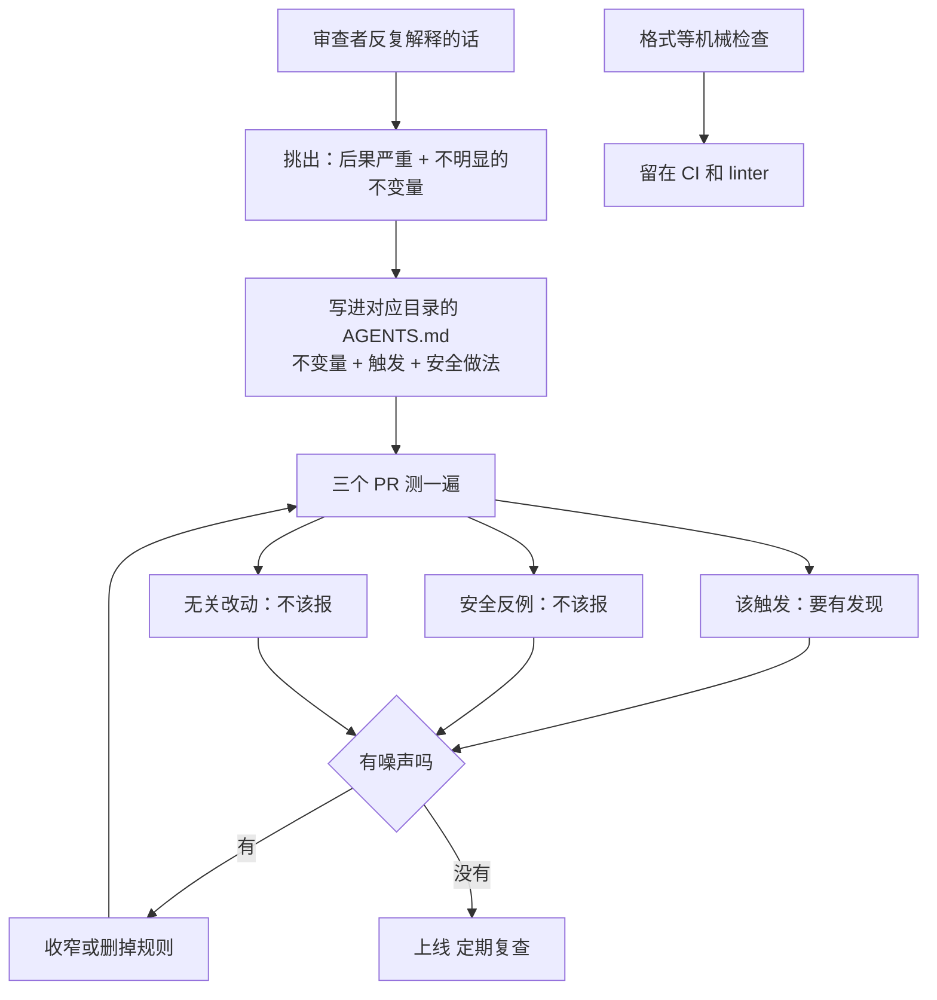

# 把审查者反复说的话写成规则：Codex Code Review 的 AGENTS.md 规则

<div class="meta-tags"><span class="tool-tag tool-codex">Codex</span></div>

<div class="hook">

**一句话看懂**：OpenAI 的 Hari Srikanth 介绍了 Codex Code Review 读取 `AGENTS.md` 里“Code Review Rules”小节的做法：把审查者一遍遍解释的、**不明显但出错代价大的不变量**（旧 API 契约、数据边界）写成有作用域的短规则，AI 审查器就能在相关改动上抓出问题并指回规则。在他们的评测里，加规则后找回了 98% 应有的定制发现，没有规则的基线是 58.3%。难点在于不制造噪声：规则要少、要按目录放、要写出安全的替代做法，并且像测代码一样测规则。

</div>

## 读完你能带走的 7 条收获

1. **AI 审查最容易漏的是“diff 里看不出来的历史”**：改个响应字段名看起来是清理，却会弄坏还在用旧字段的客户端（见 3.1）。
2. **规则写进 `AGENTS.md` 的专门小节**：同一个文件既指导写代码，也指导审查；审查器会在发现里引用规则（见 3.2）。
3. **按作用域放**：全仓库通用的放根目录，某个服务的放那个目录下的 `AGENTS.md`，无关的改动不用背无关的上下文（见 3.2）。
4. **规则和测试分工**：能确定性检查的交给测试和 linter，规则只写难以编码的判断；格式之类的机械检查留在 CI（见 3.2、3.4）。
5. **测规则要测四件事**：该抓的抓到（覆盖）、干净改动不乱报（克制）、普通 bug 照样抓（保留）、每条发现指明规则、位置和优先级（可操作）（见 3.3）。
6. **每条规则写三件事**：要保持的不变量、什么改动该被标出、作者可以怎么安全地改（见 3.4）。
7. **上手用三个 PR 验证一条规则**：一个该触发、一个安全的反例、一个无关改动；只有第一个应该出发现（见 3.5）。

::: tip 小白先懂这几个词
- [AGENTS.md](/glossary#agents-md)：写给编码代理看的仓库说明文件，可以在子目录里再放一份。
- [Code Review（代码审查）](/glossary#code-review)：合并之前由别人（或 AI）检查改动。
- [审查规则（Review Rules）](/glossary#review-rules)：写给 AI 审查器的、按目录生效的仓库专属检查项。
- [不变量（Invariant）](/glossary#invariant)：无论怎么改都必须保持为真的约束，比如“这个事件名不能变”。
- [Negative Control（反例对照）](/glossary#negative-control)：故意放进“不该触发”的用例，用来发现误报。
- [Precision / Recall（精确率 / 召回）](/glossary#precision-recall)：报出来的有多少是真的；真的问题有多少被报出来。
:::

## 1. 基本信息

<SourceCard type="文章" title="Custom Code Review rules for Codex" author="Hari Srikanth" date="2026-07-20" url="https://developers.openai.com/blog/custom-code-review-rules-for-codex" />

| 项目 | 内容 |
|---|---|
| 链接 | https://developers.openai.com/blog/custom-code-review-rules-for-codex |
| 类型 | OpenAI Developers 博客（正文约 1,300 词，含一个真实规则摘录和一张 PR 量趋势图） |
| 作者 | Hari Srikanth（页面署名） |
| 发布日期 | 2026-07-20（页面日期 “Jul 20, 2026”） |
| 使用工具 | Codex Code Review（GitHub 集成、`@codex review`）、`AGENTS.md` |
| 分析依据 | 原文全文，2026-10-20 用 curl 抓取 HTML 和官方 Markdown 版本，引语逐字脚本核对。文中链接的 Codex 仓库 `AGENTS.md` 规则未打开逐行核对，规则摘录以博客正文为准。评测只给了主套件的两个百分比，没给题目数量、基线的具体设置和四个维度的分数。这是厂商介绍自家产品功能的文章。“我觉得”开头的段落是本站评论。 |

## 2. 这篇在回答什么

你们团队的代码审查里，总有几句话被反复说：“这个字段别改名，老客户端还在用”“别把请求体打进日志”。说的人是几位老员工，他们记得为什么。新同事不知道，第一次进这块代码的编码代理更不知道。

现在 PR 越来越多，这几个人看不过来。能不能把这些话交给 AI 审查器去说？

作者的回答是：可以，但要写成**少量、有作用域、带替代做法的规则**，并且要测。文章回答了四个问题：

1. 为什么 AI 审查器需要仓库自己的规则？
2. 规则写在哪里、长什么样？
3. 怎么知道规则有用、没有制造噪声？
4. 好规则有哪些写法上的要求？



## 3. 怎么做

### 3.1 为什么需要仓库规则：diff 里看不出历史

**背景**：作者说，编码代理能做更大、更长的改动，结果是代码变多了：

<Trans zh="在 OpenAI，每周的 PR 量自第四季度以来翻了一倍多">“At OpenAI, weekly PR volume has more than doubled since Q4”</Trans>

更多的 PR 等着懂行的人来看，审查很快变成瓶颈。几个改动同时到达时更难：一个 diff 看起来完全合理，仍可能弄坏旧客户端，或者越过作者不知道的边界。

**问题的本质**：有些问题光看 diff 就是看不出来。作者的例子是：

<Trans zh="改一个响应字段的名字看起来像日常清理，但它可能会弄坏仍依赖现有契约的客户端">“Renaming a response field might look like routine cleanup, but it can break clients that still depend on the existing contract.”</Trans>

有经验的审查者可能记得这个字段为什么不能动；新来的贡献者，或者第一次在这个服务里干活的代理，大概率不知道。

我觉得这一节说中了 AI 审查器的一个盲点：模型再强，也只能看到仓库里写下来的东西。审查者脑子里的“历史教训”不写下来，对代理就等于不存在。

### 3.2 规则写在哪里、长什么样

**载体**：Codex Code Review 现在可以读 `AGENTS.md` 里的仓库规则。已经用 `AGENTS.md` 指导写代码的团队，同一个文件也能指导审查。审查时，Codex 只应用和这次改动相关的规则，并在发现里引用它。Codex 仓库自己就在 `AGENTS.md` 里放了 Code Review 规则，覆盖“模型可见的上下文”和“破坏性变更”等问题。

**真实例子**：Codex 的 app-server 会发一个内部通知 `rawResponseItem/completed`。它标着“实验性”，但 Codex Cloud 已经在用了。设想有人顺手清理了一行：

```diff
-RawResponseItemCompleted => "rawResponseItem/completed"
+RawResponseItemCompleted => "rawResponseItem/done"
```

代码能编译，但监听原通知名的客户端就再也收不到了。仓库里对应的规则摘录很短（摘自原文，2026-10-20 抓取）：

::: tr 代码审查规则 / 破坏性变更：在外部集成接口里搜索破坏性变更——包括原始响应项事件（rawResponseItem/*），即使它仍是实验性的
```md
## Code Review Rules

### Breaking changes

Search for breaking changes in external integration surfaces:

- raw response item events (`rawResponseItem/*`), even while experimental
```
:::

针对上面那个 diff，审查发现可以这样写（原文示例）：

::: tr 保留现有的 rawResponseItem/completed 通知。Codex Cloud 的使用方在监听这个通知名，所以即使事件是实验性的，改名也会弄坏它们。按 AGENTS.md 的说明，保留原名或者新增一个向后兼容的事件
> "Keep the existing `rawResponseItem/completed` notification. Codex Cloud consumers listen for this wire name, so renaming it will break them even though the event is experimental. Keep the existing name or add a backward-compatible event, as described in `AGENTS.md`."
:::

注意这条发现的结构：说明保留什么、为什么（谁在用）、作者可以怎么做、依据在哪。

**作用域**：全仓库通用的规则放根目录，某个服务的规则放该服务目录下。审查时 Codex 应用覆盖了改动文件的那些规则；和 app-server 无关的改动，不需要背 app-server 的上下文。

**和测试的分工**：

<Trans zh="测试和 linter 适合能确定性表达的检查；仓库规则帮助捕捉更难编码的判断">“Tests and linters work well for checks you can express deterministically; repository rules help capture the judgment that is harder to encode.”</Trans>

作者建议从兼容性要求和数据边界开始。

### 3.3 怎么知道规则有用：四个维度的评测

**怎么测的**：团队用一套评测检验 Code Review 能不能用好仓库规则，评测里既有已知的规则违反，也有安全的反例。结果是：

<Trans zh="在主套件中，有规则引导的版本找回了 98% 应有的定制发现，而基线对照只有 58.3%">“In the primary suite, rule-guided variants recovered 98% of the required custom findings, compared with 58.3% in the baseline control.”</Trans>

**不只看“抓到没有”**。他们还关心多条规则抢注意力、PR 本来就很忙的情况，测了该抓的违反，也测了应该放过的改动，把结果归成四个问题（原文的四项，中文整理）：

| 维度 | 问的问题 |
|---|---|
| 覆盖（Coverage） | diff 很忙、规则互相抢注意力时，Codex 还能报出该报的违反吗？ |
| 克制（Restraint） | 干净的改动和合理的例外，能避免多余的发现吗？ |
| 保留（Retention） | 仓库规则之外的普通 bug，Code Review 还能照样抓到吗？ |
| 可操作（Actionability） | 每条发现都指明了相关规则、位置和优先级吗？ |

他们还试了几种常见的写法，从简短的列表到按团队划分归属的章节。

**发现**：内部仓库里的观察和评测一致。Codex 能找到并引用默认审查会漏掉的本地规则，但：

<Trans zh="宽泛的指令很容易制造噪声">“broad instructions could easily create noise”</Trans>

小而有作用域、明确写出安全做法的规则集，能让 Codex 聚焦在最有用的地方，而不会把规则套到每个沾边的改动上。

我觉得“保留”这一维特别容易被忽略：加了一堆仓库规则之后，审查器会不会只盯着规则、反而漏掉普通 bug？作者把它单列出来测，是对的。可惜文中只给了覆盖率一个数字，另外三个维度没有分数。

### 3.4 好规则的五条写法

原文给了五条原则（中文整理，括号里是关键原话）：

1. **从后果严重、不明显的不变量开始**。写审查者反复解释的检查，比如兼容性要求或数据边界。判断标准很简单：

   <Trans zh="如果删掉一条规则不会改变审查结果，就别写它">“If removing a rule would not change the review, leave it out.”</Trans>

2. **按它管的代码放**。全仓库的放根目录，服务专属的放嵌套的 `AGENTS.md`。范围窄，无关指令就不会互相抢注意力，归属也清楚。
3. **写清不变量和安全做法**。`rawResponseItem/*` 那条规则点出了兼容风险，“保留原名或新增向后兼容的事件”给了作者一个明确的替代方案。
4. **保持持久、保持更新**。描述结果，不要写可能会改名的函数名；规则的修改也要审，反复制造噪声的规则就收窄或删掉。
5. **格式和其他机械检查留在 CI**。规则只留给“审查者否则还得再问一遍”的问题。

### 3.5 上手：三个 PR 测一条规则

**怎么开始**：仓库已经开了 Codex Code Review，就在对应的 `AGENTS.md` 里加两三条规则，开一个有代表性的 PR；还没开的，按 Code Review 快速入门在 GitHub 仓库上启用。也可以在 PR 里直接写 `@codex review` 请求审查。

**第一条写什么**：审查者一直在重复解释的话，或者一个漏掉会很严重的仓库特有错误。

**怎么测**（原文做法）：

1. 一个**应该触发**规则的改动；
2. 一个**安全的反例**；
3. 一个**无关的改动**。

确认第一个产生了有用的发现、另外两个没有制造噪声，再根据看到的结果调整规则。

**边界**：作者明确说，AI 审查只是多一个审查者：

<Trans zh="Codex Code Review 仍然只是一个额外的审查者；测试、分支保护和必需的批准仍然提供硬性约束">“Codex Code Review is still an additional reviewer; tests, branch protections, and required approvals continue to provide hard enforcement.”</Trans>

## 4. 结果与局限

**文章给出的证据**：

- 一个真实的规则和它防住的真实破坏点（`rawResponseItem/completed`）；
- 主评测套件上，有规则 98% vs 基线 58.3% 的定制发现找回率；
- 内部仓库里“宽泛指令制造噪声、小而有作用域的规则更好”的定性观察。

**局限**：

- **评测细节不全**：没有给题目数量、基线对照的具体设置（是完全不给规则，还是别的写法），也没有给克制、保留、可操作三个维度的分数。98% 只说明“该抓的抓到了”，不说明误报多少。
- **例子是设想的 diff**：规则是真的，但那一行改名是作者“设想有人这么改”，发现文本也是示例。
- **厂商文章**：主要在介绍 Codex Code Review 的新功能；“PR 量翻倍”是 OpenAI 自报。
- **工具绑定**：规则的读取和作用域机制是 Codex Code Review 的实现，换别的审查器要看它是否支持嵌套 `AGENTS.md`。

我觉得这篇可以和站内三份资料放在一起读：OpenAI 对齐团队的审查器研究强调精确率优先、允许用 `AGENTS.md` 调整松紧（[[31§3.1]]）；Claude Code 团队用 `REVIEW.md` 告诉审查者“这里的失败长什么样”（[[60§3.2]]）；OpenHands 把审查清单写成可按仓库定制的 skill（[[71§3.2]]）。四家都在做同一件事：把审查标准从人的脑子里搬到仓库文件里。这篇的独特贡献是“规则也要测”，并且测的不只是召回，还有克制和保留。

## 5. 结论

AI 审查器漏掉的，往往不是语法错误，而是“这个名字不能改”这类只有老员工知道的事。把它们写成 `AGENTS.md` 里少量、按目录生效的规则，每条写清不变量、触发条件和安全做法；然后像测代码一样测规则：该触发的触发，安全的反例和无关改动保持安静。机械检查留给 CI，硬性约束留给测试和分支保护。

**你可以这样试**

1. 翻一翻最近一个月的 PR 评论，找出被重复说了三次以上、和兼容性或数据边界有关的那一句。
2. 把它写成一条规则，放进它所管代码目录下的 `AGENTS.md`，写明“保持什么、标出什么、可以怎么改”。
3. 开三个小 PR：一个违反规则、一个安全的写法、一个无关改动，看审查器的反应；有噪声就收窄措辞。

**读完自测**

1. 为什么“改响应字段名”这种问题，光看 diff 很难发现？
2. 评测的四个维度里，哪一个检查的是“加了规则之后会不会漏掉普通 bug”？
3. 判断一条规则该不该写的简单标准是什么？
