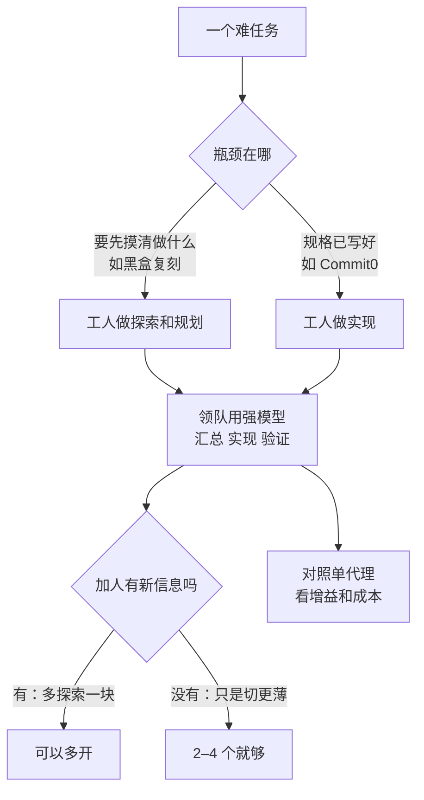

# 多代理团队花的钱值不值：Cohere 在 ProgramBench 上的受控实验

通用（不限工具）

**一句话看懂**：Cohere 的三位研究者搭了一个极简的“领队 + 工人”harness，在 ProgramBench 的 200 个黑盒复刻任务上，一次只改一个设计选择，测多代理团队到底值不值。结论是：团队确实比单代理强（最多约 10 个百分点），但要多花 3–7 倍的钱；**工人放在哪个阶段，比放多少个更重要**。这个基准的瓶颈是“弄清楚要造什么”，所以只把探索和规划交给工人，就能追平全阶段委派的效果，成本减半；再把工人换成便宜模型、领队保留强模型，成本只剩全强队的约 30%。

## 读完你能带走的 7 条收获

1. **团队是一种“多花推理算力”的方式**：Sol 团队比单个 Sol 代理多拿 5–10 个点，但每个团队要花 4–7 倍的钱（见 3.2）。
2. **先找任务的瓶颈，再决定工人放在哪**：ProgramBench 的瓶颈是摸清黑盒程序的行为，只委派规划就追平全阶段委派，成本 $249 对 $510（见 3.3）。
3. **瓶颈换了，结论也换**：在规格已经写好的 Commit0 上，最值得委派的是实现，不是规划（见 3.3）。
4. **强领队 + 便宜工人**：Sol 领队配 Luna 规划工人，用 13.9% 的额外成本拿到全强队 47.5% 的增益；但弱领队配再多工人也追不上强模型单干（见 3.4）。
5. **加人只在“能带来新信息”时有用**：规划工人越多，参考程序被跑得越多、报告越长；实现工人越多，每人分到的活越薄，领队检查的次数却不变（见 3.5）。
6. **异步领队省时间，但可能自己包办**：提示词不给结构时，异步领队委派得少，省了 60% 时间却丢了大半增益（见 3.2）。
7. **给代理开“互发消息”的通道，多数时候没用**：84% 的消息是向领队汇报，弱模型反而掉分（见 3.6）；不同模型愿不愿意委派、会不会用回报，差别很大（见 3.7）。

::: tip 小白先懂这几个词
- [Agent Teams（代理团队）](/glossary#agent-teams)：多个代理围绕同一个目标分工协作。
- [Subagent（子代理）](/glossary#subagent)：由主代理派出、在自己上下文里干活、做完把结果交回的代理。
- [Lead / Worker（领队 / 工人）](/glossary#lead-worker)：本文的团队结构：领队拿到任务、拆活、汇总，工人只看到自己的子任务。
- [ProgramBench](/glossary#programbench)：200 个“只给可执行文件和文档、从零复刻程序”的基准任务，用隐藏的行为测试打分。
- [Oracle（参照答案）](/glossary#oracle)：可以拿来对比输出的“标准答案”程序。
- [Benchmark（基准）](/glossary#benchmark)：一组固定任务和评分方法，用来比较不同系统。
:::

## 1. 基本信息

<SourceCard type="文章" title="Scaling agent teams: reach the frontier at 30% of the cost" author="Keenan Samway, Daniel D'souza, Nouha Dziri" date="2026-10-14" url="https://cohere.com/blog/lessons-from-scaling-teams-of-frontier-coding-agents" />

| 项目 | 内容 |
|---|---|
| 链接 | https://cohere.com/blog/lessons-from-scaling-teams-of-frontier-coding-agents |
| 类型 | Cohere 研究博客（正文约 4,500 词，10 张图，6 条脚注） |
| 作者 | Keenan Samway、Daniel D'souza（Research Engineer）、Nouha Dziri（Senior Research Scientist），页面署名 |
| 发布日期 | 2026-10-14（页面元数据 `datePublished`） |
| 使用工具 | 自建极简 harness（仿 mini-SWE-agent，只有 bash 工具和 `delegate_agent` 等几个工具）；主力模型 GPT-5.6 的 Luna / Terra / Sol 三档；另测 Claude Opus 4.7 / 4.8、Claude Haiku 4.5、Gemini 3.7 / 3.8 Flash；基准 ProgramBench（200 题）和 Commit0-Lite（16 题） |
| 分析依据 | 原文全文，2026-10-21 用 curl 抓取 HTML 并提取正文，引语逐字脚本核对。图只看了图注，具体数据点以正文数字为准。这是受控的基准实验，不是生产项目；主配置各跑三次，固定人数的配置和跨模型对比只跑一次。“我觉得”开头的段落是本站评论。 |

## 2. 这篇在回答什么

站内已经有好几个“很多代理一起写大项目”的案例：16 个代理写 C 编译器（[[17]]），几百个代理写浏览器（[[18]]），Factory 的三角色系统复刻 GDAL（[[59]]）。它们都跑通了，但你没法拿来回答一个很实际的问题：

> 我手上有一个难任务。多开几个代理值不值？值的话，开在哪一步、用什么模型、开几个？

原因是这些案例同时改了太多东西：模型不同、角色不同、项目也不同。作者说，拿它们互相比较 <Trans zh="几乎说明不了哪些设计选择起了作用，也说明不了和单代理比多花了多少">“says little about which design choices mattered or what they cost compared to a single agent”</Trans>。

所以 Cohere 做了一个受控实验：同一个极简 harness，一次只改一个变量。文章回答了五个问题：

1. 团队到底比单代理强多少、贵多少？
2. 工人放在哪个阶段（规划、实现、验证）最划算？
3. 领队和工人要不要都用最强的模型？
4. 工人开几个？领队要不要等？代理之间要不要互发消息？
5. 换一个模型、换一个任务，这些结论还成立吗？

## 3. 怎么做

### 3.1 实验怎么搭：一个领队、一个工具、五个变量

**harness 极简**：每个代理只有一个 bash 工具，整个团队共享一个工作区。一个代理当领队（lead），拿到任务后用 `delegate_agent` 工具分活。工人只看到分给自己的子任务，做完汇报。领队自己决定开几个工人、每个做什么、怎么合并结果。

`delegate_agent` 可以开一个全新上下文的工人，也可以“续用”之前用过的工人。续用的工人保留原来的上下文，领队就能让写了某段代码的工人自己去修那段代码的 bug，不用重新给新工人讲一遍。

**一次只改一个变量**，共五个：

| 变量 | 两种（或几种）取值 |
|---|---|
| 工人用在哪 | minimal 提示词：只说“你带一个团队，给工人分互相独立的任务”，其余都交给领队；PIV 提示词：再加一个结构化流程，探索和规划（P）、实现（I）、验证（V），并要求三个阶段都用工人 |
| 领队怎么等 | blocking：等工人汇报，期间什么都不做；asynchronous：工人跑的时候自己继续干，多两个工具 `wait_for_updates` 和 `list_agents` |
| 模型怎么配 | 同质团队：领队和工人同一个模型；异质团队：领队用强模型，工人用便宜模型 |
| 开几个工人 | 领队自己定，或者固定 2 / 4 / 8 / 16 个 |
| 怎么沟通 | 默认只通过领队；另一组给所有代理一个 `send_message` 工具，可以直接互发消息 |

异质团队的比喻是作者自己给的：

<Trans zh="可以想象成一位资深工程师指挥工作、做关键决定，初级工程师干大部分跑腿的活">“Think of a senior engineer who directs the work and makes critical decisions, with junior engineers doing most of the legwork.”</Trans>

**基准**：ProgramBench 有 200 个程序要从零复刻。代理拿到原程序的可执行文件（能跑、不能读）和文档，要自己摸索它的接口、边界情况和行为，再写一个行为一致的新实现，用一套隐藏的行为测试打分。任务从 jq、ripgrep 这样的小工具，到 SQLite、FFmpeg、PHP 解释器；FFmpeg 上公开榜单最好的成绩也只过了约 10% 的测试。站内 [[59§3.4]] 详细介绍过这个基准。

**模型和统计**：主力是 GPT-5.6 的三档模型 Luna、Terra、Sol，能力和价格依次升高。每个配置在 200 题上跑三次，取平均。单个任务的分数每次相差很大（标准差约 6 个点），但整个基准的平均分稳定得多（一般配置 0.5 个点，最吵的 1.4 个点）。所有配置跑同一批任务，所以每个团队都和它的单代理基线逐题配对比较，报 95% 置信区间。

另外用 Commit0-Lite 做次要检查：16 个删掉了实现的 Python 库，给仓库骨架、文档和单元测试，让代理补代码。和 ProgramBench 的区别是，这里“要造什么”已经写清楚了。

我觉得这个设计最值得学的是“配对比较”：同一道题，团队和单代理各跑一遍，比差值。单题噪声 6 个点，如果只比总分、每个配置只跑一次，很多“提升”其实分不清是不是运气。

### 3.2 团队比单代理强多少、贵多少

最简单的对比：一个 Sol 代理，对一队 Sol 代理。

| 配置（全是 Sol） | 平均通过率 |
|---|---|
| 单代理，minimal 提示词 | 52.1% |
| 单代理，PIV 提示词 | 57.7% |
| blocking 团队，minimal 提示词 | 61.8% |
| blocking 团队，PIV 提示词 | 63.1% |

两点值得注意：

- **只给单代理一个结构化流程，就补回了一部分差距**（52.1% → 57.7%）。团队在 PIV 下仍然领先约 5 个点。
- **代价**：四个 Sol 团队的成本都是对应单代理的 4 到 7 倍。

**异步领队**：在 PIV 提示词下，异步团队比 blocking 团队少花 19.5% 的时间，分数差不多。但在 minimal 提示词下出了问题：异步团队省了 60% 的时间，可领队自己干了更多活，每题只委派 4.4 次（blocking 是 6.1 次）。结果它比单代理只多 3.8 个点（blocking 团队多 9.7 个点），55.9% 甚至低于用 PIV 提示词的单代理（57.7%）。

我觉得这个结果很实用：给领队“不用等”的能力，它就倾向于自己动手。如果你希望它真的分工，提示词里要把“哪些阶段必须交给工人”写清楚。

### 3.3 工人放在哪个阶段最划算

为了看工人在哪里最值钱，作者让领队只在一个阶段用工人，另外两个阶段自己做：

- **P（探索和规划）**：工人去跑原程序、摸它的行为、起草计划；领队实现和验证。
- **I（实现）**：工人写代码。
- **V（验证）**：工人测领队的实现。

**规划明显胜出**。在异步团队里，只委派规划的领队，分数追平了三个阶段都委派的领队（63.6% 对 63.2%），成本只有一半（$249 对 $510）。按“每多花 $100 换来几个点”算，规划的效率大约是第二名的两倍（脚注：异步领队下规划每 $100 增益 3.4 点，第二名实现 1.7 点；blocking 领队下是 3.8 对 2.4）。

**一个具体例子**：dsq 是一个对 JSON、CSV 等数据文件跑 SQL 查询的命令行工具。用 PIV 提示词的单代理平均过 60% 的测试；只委派规划的团队过 79%（异步）和 76%（blocking），而且六次运行每一次都赢过所有单代理运行。委派实现或验证的团队只过 58% 到 71%。

**为什么是规划**：作者的解释是基准本身的设计。

<Trans zh="目标程序是一个黑盒，它的行为必须靠运行它来发现">“The target program is a black box, so its behavior has to be discovered by running it.”</Trans>

规划工人并行地各自探索程序接口的一部分，把发现交给领队；领队再自己写代码，对要造的东西了解得完整得多。作者还举了两个旁证：Factory 的验证者先探查参考程序、建立“完成”的可执行标准再写代码（[[59§3.3]]）；Carlini 的 C 编译器团队靠把 GCC 当 Oracle 对比，才在 Linux 内核上解开僵局（[[17§3.5]]）。三个例子的共同点是：**知道到底要造什么，才是瓶颈**。

**反例：Commit0**。那里的仓库已经写清楚要造什么，十个团队配置里有八个，最值得委派的是实现，不是规划。不过作者也提醒，Sol 这样的前沿模型单干就已经在 16 个任务里的 12 个上全部通过，只剩 4 个任务有提升空间，所以这只是“提示性的”，不是定论。

我觉得这一节是全文最该带走的：**不要默认“规划、实现、验证都上团队”**。先问一句：这个任务卡在哪？卡在“不知道要做什么”，就把工人派去探索；卡在“活太多写不完”，就派去实现。

### 3.4 领队和工人要不要都用强模型

**规划工人可以便宜**。规划工人主要是给领队收集信息，用不着最强的模型。作者保留 Sol 当领队，把规划工人换成便宜得多的 Luna：

- 分数比全 Sol 团队少几个点（60.5% 对 63.6%）；
- 但和单代理比，它用全 Sol 团队 13.9% 的额外成本，拿到了 47.5% 的增益，每一美元换来的分数是三倍多。

再和“不看任务、直接上全套”的做法比：强领队配强工人、三个阶段都委派，分数 63.2%，成本 $510。识别出瓶颈在规划、只在规划上放便宜工人，分数差 2.7 个点，成本是它的五分之一。

**但领队省不得**。工人固定用 Luna，领队从 Luna 升到 Terra 再到 Sol，分数一路上升：42.5% → 51.6% → 60.5%；每个团队都赢过用领队同款模型的单代理（37.4%、47.2%、57.7%）。可是 Terra 领队配 Luna 工人（51.6%）仍然追不上 Sol 单干（57.7%）。

作者把这和 Meta 关于“元推理”的工作对照：同样的工人、同样的预算，更好的控制者在 ProgramBench 上得分更高（GPT-5.5 下 71.5% 对 63.7%）。

我觉得这和站内 Blocshop 的做法完全对得上：主代理用贵模型管依赖图和决策，便宜的工人只做有边界的调查（[[74§3.2]]）。两份资料一个是生产案例、一个是受控实验，结论一致：**钱花在做决定的那个代理上**。

### 3.5 工人开几个：加人要能带来新信息

前面都是领队自己定人数。为了看人数的作用，作者固定给 Sol 领队配 2、4、8、16 个 Luna 工人。

**规划工人越多越好，但增幅不大**：从 2 个的 59.6% 升到 16 个的 61.8%。16 个 Luna 规划工人的团队花 $155，比全 Sol 规划团队（$249）便宜 38%，比全 Sol 三阶段委派团队（$510）便宜 70%，分数和两者都只差两个点以内。这就是标题里“30% 的成本”的来源。

**实现和验证工人不一样**：从 2 个到 4 个有提升，再往上反而略降。

作者翻了运行记录，找到原因：

- 每个规划工人不管团队多大，都会跑大约 7 次参考程序。所以规划工人越多，领队看到的程序行为就越多：全队跑参考程序的次数从 2 人时的 15 次涨到 16 人时的 109 次，规划报告从 17,000 字符涨到 75,000 字符。
- 多加的实现工人带不来新信息。每人分到的计划越来越薄：每人的任务说明从 2 人时约 1,400 字符缩到 16 人时的 440 字符。工人写的代码占比从 54% 升到 85%，但领队拿合并后的程序去对照参考程序的次数没变，不管合并 2 块还是 16 块，都是 5 到 6 次。

注意：固定人数的每个配置**只跑了一次**（图注写明）。

我觉得这给了一个简单的判断标准：**多开一个代理之前，问它能不能带回别人带不回的信息**。能（多探索一块未知区域），就开；只是把同一份计划切得更碎，开再多也只是增加合并的负担。

### 3.6 代理之间要不要互发消息

默认情况下，代理之间只在“领队派活”和“工人汇报”时交换信息。作者另外给每个代理一个 `send_message` 工具，可以发给任何正在跑的代理。结果：

- **消息大多是向上汇报**。PIV 提示词下的 Sol 团队，84% 的消息是工人发给领队的，内容是中间发现、拟定的接口、测试失败和问题。工人之间的消息平均每题不到一条；明确告诉工人“彼此是协作者”后，也只升到每题一条左右。
- **问题很少**：工人发给领队的消息里只有 6% 是提问；其中不到一半问“我这块怎么和别的模块接上”（比如另一个模块期待什么函数名、参数类型），三分之一多一点问“参考程序去哪了”（被某个工人的构建覆盖掉了），Sol 领队回答了其中 74%。
- **强模型用得多，但没带来分数**：Sol 写的消息量是 Luna 的 3.4 到 5 倍，Sol 领队也会给工人发更多指导。可 Sol 和 Terra 团队分数不变，Luna 团队反而掉了 4 到 7 个点。作者给了两种可能：中间更新太多，弱领队消化不了；或者 Luna 工人不会用这个工具，大约一半的 `send_message` 调用格式错误、被 harness 拒绝。

作者没有因此否定通信。他们说自己的 harness 本来就是“拆活、派活”，两个提示词都要求给工人互相独立的任务，工人之间本来就没多少需要对方知道的东西。另一项研究（Park et al.）在“共享一个目标、一个工作区、没有固定角色”的设置下，5 个互相通信的代理追平了 33 个独立代理中最好的那个；关键是代理能验证队友的发现是不是真的进步。

我觉得这和站内 OpenHands 的经验一致：共享全部上下文会撑爆窗口，真正有用的是经过筛选、可核对的东西（[[30§3.5]]）。给代理开聊天通道之前，先想清楚它们之间到底有什么需要对方知道的。

### 3.7 换一个模型，结论还成立吗

作者在 30 题的子集上（简单、中等、困难各 10 题）用同样的工具和提示词测了另外五个模型，每个模型 solo、blocking、异步，两种提示词各跑一次。作者自己提醒，每个模型只跑一次，几个点的差别可能是噪声（图注说小于约 5 个点）。

| 模型 | 表现 |
|---|---|
| GPT-5.6 | 委派频繁，比最好的单代理最多多 6.9 个点，多数团队设置都领先 |
| Claude Opus 4.8 | 和 GPT-5.6 类似，PIV + 异步领队多 5.9 个点 |
| Claude Opus 4.7 | 很少委派，每题最多 1.3 次，团队几乎没有增益 |
| Claude Haiku 4.5、Gemini 3.7 Flash | 委派得和 GPT-5.6 一样勤，但没有任何增益 |
| Gemini 3.8 Flash | PIV + blocking 多 3.1 个点，异步反而少 4.6 个点 |

作者总结说团队要帮上忙，必须两件事都做对：

<Trans zh="领队得选择去委派，还得用好交回来的东西">“The lead has to choose to delegate, and it has to make good use of what comes back.”</Trans>

Opus 4.7 卡在第一件，Haiku 4.5 和 Gemini 3.7 Flash 卡在第二件。

还有两个旁支发现：GPT-5.6 不管原程序用什么语言写，70% 到 93% 的提交都用 Python 重写；Claude 模型 72% 到 90% 用原程序的语言。脚注里还提到，Claude Opus 5 在 30 题子集上试了 8 题，全部撞上 8 小时超时，每题约 $500，是 Opus 4.8 团队每题花费的约 15 倍，于是停了。

**下一步**：作者列了四个方向：层级还是自组织（几千个代理跑几周时，一个领队盯不过来）；别的通信形式（共享目标、共享进度日志、带可核对证据的消息）；让领队自己判断任务卡在哪；把“当领队”当作一种可训练的能力。

## 4. 结果与局限

**文章真正证明了什么**：

- 在 ProgramBench 上，Sol 团队比 Sol 单代理多 5–10 个点，成本 4–7 倍；三次运行、逐题配对、报 95% 置信区间。
- 只委派规划 ≈ 三阶段全委派，成本减半；Sol 领队 + 16 个 Luna 规划工人以 $155 做到 61.8%，全 Sol 全委派是 $510、63.2%。
- 领队的模型强弱决定上限：工人不变、领队升级，分数一路涨；弱领队配工人追不上强模型单干。
- 规划工人越多，带回的信息越多；实现工人越多，每人的活越薄。

**局限与注意**：

- **场景偏向“发现规格”**：ProgramBench 的瓶颈正好在规划，作者自己也用 Commit0 说明换个任务结论就变；而 Commit0 只有 16 题、12 题已饱和。日常项目的瓶颈在哪，要自己判断。
- **一部分配置只跑一次**：固定人数的 2/4/8/16 配置、跨模型的 30 题对比都是单次。
- **只测基准，不是生产项目**：没有真实仓库、没有人审，成本按 API 推理计，不含工程师时间。
- **模型名称**：GPT-5.6 Luna / Terra / Sol 等为原文用的名称；具体价格表原文没有给，只给了总成本。
- **来源性质**：这是 Cohere 研究团队的博客，不是同行评审论文；正文没有推广具体产品，但实验用的 harness 代码没有公开链接，无法复现。

我觉得这篇填补了站内多代理资料的一个空白：之前的案例（[[17]]、[[18]]、[[59]]、[[74]]）都在讲“怎么让团队跑起来”，这篇第一次用对照实验回答“团队值不值、钱该花在哪”。

## 5. 结论

多代理团队能多做一点，但要多花好几倍的钱。要让这笔钱花得值，先判断任务卡在哪：卡在“不知道要造什么”，就派工人去探索和规划，领队自己写；卡在“写不完”，才派工人去实现。领队用最强的模型，工人可以用便宜的；加人之前先问“它能带回新信息吗”。异步领队和互发消息都不是免费的好处，前者可能让领队自己包办，后者可能让弱领队被消息淹没。

**你可以这样试**

1. 挑一个你觉得“一个代理搞不定”的任务，先用单代理 + 明确的“探索 → 实现 → 验证”流程跑一次，当基线。很多时候这一步就能补回一部分差距。
2. 再只把“探索和规划”交给 3–4 个便宜模型的子代理，每个探索一块（不同模块、不同接口），主代理用强模型汇总后自己实现。记下成本和结果，和基线比。
3. 想多开工人时，先看已有工人的报告里还有没有新信息；没有就别加。

**读完自测**

1. 为什么在 ProgramBench 上委派规划比委派实现划算，在 Commit0 上却相反？
2. Terra 领队配 Luna 工人追不上 Sol 单干，这说明了什么？
3. 实现工人从 4 个加到 16 个，为什么分数没有涨？
