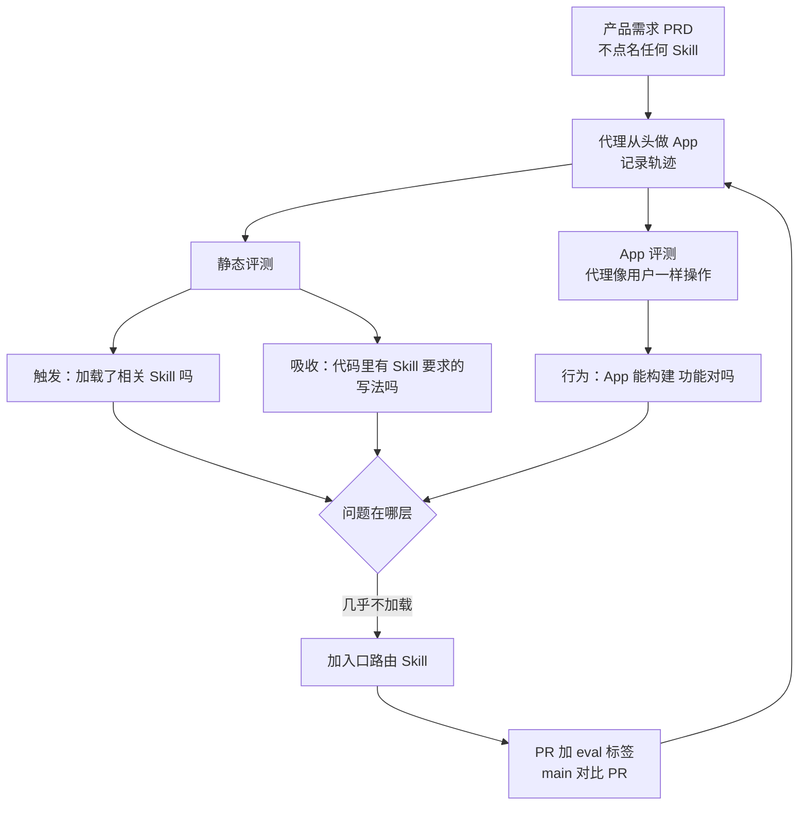

# 你的 Skill 真的会被代理用上吗：Expo 给 Skills 做评测

Claude Code

**一句话看懂**：Expo 和 Georgian AI Lab 给 Expo 的 Claude Code / Codex 插件搭了一个评测 harness：拿真实的产品需求当任务，让代理从头做一个 App，然后分三层看结果：**相关 Skill 有没有被加载、加载后有没有照做、做出来的 App 能不能用**。第一批轨迹就暴露了一个没人注意的问题：代理几乎从不加载 Expo 的 Skill。加了一个“入口 + 路由”Skill `expo-overview` 之后，加载相关 Skill 的会话从 9% 升到 55%。他们还发现，Codex 的 Skill 目录只占上下文的 2%，装的 Skill 一多，描述就会被截短甚至整条丢掉。

## 读完你能带走的 7 条收获

1. **直接调用测不出“会不会被找到”**：自己输入 `/expo-ui` 只说明 Skill 被加载后有用，用户的真实请求根本不会点名 Skill（见 3.1）。
2. **分三层评测**：触发（有没有加载）、吸收（有没有照做）、行为（App 能不能用）；三层各自独立，代理不用 Skill 也做对了不扣分（见 3.2）。
3. **评测接进 PR**：给 PR 加一个 eval 标签，就用 main 和 PR 两个版本的插件跑同一批场景，结果贴回 PR；Skill 作者像维护单测一样维护任务和判定标准（见 3.3）。
4. **Skill 多了要有入口**：20 多个 Skill 平铺时代理常常一个都不用；一个声明“任何 Expo 任务都从这里开始”、内含路由表的入口 Skill，把加载率从 9% 拉到 55%（见 3.4）。
5. **代理越往后越不查 Skill**：相关 Skill 的召回只从 2% 升到 18%；代理在任务开头刚读完入口时最常加载，后面就改用自己已有的知识（见 3.5）。
6. **Skill 目录有预算，会被截断**：Codex 检查过的版本里，Skill 目录占上下文的 2%（5,440 token）；超出后先截描述，再只留名字，最后整条丢掉（见 3.6）。
7. **把最重要的提示放在名字和第一句话里**，并在“装了很多别家 Skill”的拥挤环境里测一次（见 3.6、3.7）。

::: tip 小白先懂这几个词
- [Skills（技能）](/glossary#skills)：按需加载的说明文件夹，代理觉得相关时才读进上下文。
- [Plugins（插件）](/glossary#plugins)：把多个 Skill、命令等打包分发给 Claude Code / Codex 的形式。
- [Evals（评测）](/glossary#evals)：用固定任务和判定标准，衡量代理或配置表现的测试。
- [Agent Trajectory（代理轨迹）](/glossary#agent-trajectory)：代理一次运行中的全部步骤，读了什么、调了什么工具。
- [Skill Triggering（技能触发）](/glossary#skill-triggering)：代理在没有被点名的情况下，自己决定加载某个 Skill。
- [Skill Catalog（技能目录）](/glossary#skill-catalog)：系统提示后面列出的所有可用 Skill 的名字、描述和路径，代理靠它决定加载哪个。
:::

## 1. 基本信息

<SourceCard type="文章" title="Your skills need an evaluation mechanism" author="Aditya Shukla, Kartik Gupta, David Tingle（Georgian AI Lab）与 Expo 团队" date="2026-10-08" url="https://expo.dev/blog/your-skills-need-an-evaluation-mechanism" />

| 项目 | 内容 |
|---|---|
| 链接 | https://expo.dev/blog/your-skills-need-an-evaluation-mechanism |
| 类型 | Expo 官方博客（正文约 3,700 词，含两张示意图和一张结果表） |
| 作者 | 页面署名六人：Aditya Shukla、Kartik Gupta、David Tingle（均标注 Guest Author，来自 Georgian AI Lab），Kudo Chien、Brent Vatne、David Mokos（Expo） |
| 发布日期 | 2026-10-08（页面日期 “October 8, 2026”）；2026-10-12 转载到 dev.to |
| 使用工具 | Expo 的 Claude Code / Codex 插件（20 多个 Skill）；评测用 Claude Code（`sonnet-5-high`）；Skill 目录截断的分析针对开源 Codex CLI；CI 用 Expo 的 CI/CD Workflows |
| 分析依据 | 原文全文，2026-10-21 用 curl 抓取 HTML 并提取正文，引语逐字脚本核对。本站只引用正文写出的数字，没有引用结果表里的其他列。“吸收”和“App 行为”两层的结果文中没有给出。这是 Expo 介绍自家插件评测的文章。“我觉得”开头的段落是本站评论。 |

## 2. 这篇在回答什么

假设你给团队写了一个 Skill，教代理按你们的规范搭页面路由。你试了一下：输入 `/router-setup`，代理照着做了，很好，发布。

问题是，你的同事不会输入 `/router-setup`。他会说“给这个 App 加个设置页”。代理会不会想到去读你的 Skill？你不知道。

Expo 团队遇到的就是这个问题。作者的说法是：

<Trans zh="“在我的提示词下能用”正在变成“在我机器上能跑”的另一个版本">“"It worked with my prompt" was becoming another version of "it worked on my machine."”</Trans>

文章回答了四个问题：

1. 怎么测一个 Skill 有没有用？测什么？
2. 评测怎么接进日常开发？
3. 代理不加载 Skill，怎么办？
4. 装的 Skill 很多时，会发生什么？

## 3. 怎么做

### 3.1 为什么“自己调用一下”测不出问题

作者先承认了自己测试方法里的偏差：写 Skill 的人知道正确用法。测 Expo UI Skill 时，他们会在 Claude Code 里输入 `/expo-ui`，或在 Codex 里输入 `$expo-ui`，再看代理怎么用。

这只能说明 Skill **被加载之后**方向是对的。而大多数用户不会点名，他们会说：“Build an iOS todo app with Expo and make it feel native”（用 Expo 做一个 iOS 待办 App，要有原生的感觉），或者 “Add tabs and a settings screen to this app”（给这个 App 加标签页和设置页）。Skill 里的指导要起作用，代理得先自己认出它相关、并决定去调用。

Georgian AI Lab 之前的经验是：最终答案看不出过程中发生了什么。轨迹（trace）能让你观察代理的行为，但要靠评测才能把观察变成可以衡量和改进的东西。

我觉得这一节点出了 Skill 和普通代码的一个关键区别：代码写好就会被调用，Skill 写好了还要**被代理选中**。只测“选中之后好不好用”，等于只测了一半。

### 3.2 测什么：触发、吸收、行为三层

**harness 的设计**借鉴了 Georgian 的三步：先定义跑之前就要看的证据，再记录代理在任务上的轨迹，最后在受控条件下对比行为。

**任务**来自一组代表真实用户用法的场景：可以是一次性做完整个 App，也可以更细，比如调试一个不停崩溃的开发构建，或者给已有 App 加一个功能。

**判定标准事先写好**，不是跑完再从轨迹里倒推。每个场景都标注了：

- 预计代理会觉得哪些 Skill 有用；
- 如果照着 Skill 做了，代码里应该出现什么证据；
- 端到端任务包含哪些功能点，由评测代理去做 QA。

由此得到三层证据：

| 层 | 问的问题 |
|---|---|
| Skill 触发（triggering） | 代理有没有加载和任务相关的 Skill？ |
| Skill 吸收（uptake） | 能不能看到代理照着加载的指导做了？ |
| App 行为 | 做出来的 App 能不能构建，能不能做到 PRD 里描述的事？ |

为什么要分开测？Skill 从没被加载，就不可能影响代理，所以触发要单独测；Skill 被加载了也可能被忽略，所以吸收也要测。还有第三种情况：代理没用 Skill，凭自己已有的知识也把功能做对了。作者特别强调这不该扣分：

<Trans zh="关键是不要因为代理没用上 Expo 精心整理的经验、却把任务做对了而惩罚它">“it's crucial to not penalize the agent for performing the task correctly even if it does not reach for Expo's curated wisdom.”</Trans>

这反而可能说明某个 Skill 已经被更强的前沿模型“吃掉”了。

**两个并行的评测任务**：代理做完后，harness 把构建产物打包，同时跑：

- **静态评测**：一组细粒度、确定性的检查，看产出 App 的构建健康度、轨迹里有没有调用 Skill、Skill 里的指导有没有真正写进源码；
- **App 评测**：一个评测代理把 App 构建并启动起来，像用户一样操作，验证核心功能点（文中示意图写的是 iOS）。

### 3.3 评测接进 PR：Skill 像代码一样开发

这个 harness 跑在 Expo 自己的 CI/CD Workflows 上，接到维护插件的 Expo Skills 仓库。现在的流程是：

1. 谁发布新 Skill 或改了已有 Skill，就在 PR 上加一个 eval 标签；
2. harness 用 **main 上的插件版本**和 **PR 里的版本**跑同一批选定场景；
3. 结果直接显示在 PR 里。

作者说，这正在变成 Expo 开发流程的一部分：Skill 作者像维护单元测试一样，自己负责维护任务和判定标准。插件本身也就按写代码的方式开发：做一个改动，跑一批场景，看证据，再决定下一步。

我觉得“main 对比 PR”这一点很重要。代理的表现每次都有波动，单看 PR 版本的绝对分数很难判断；和 main 在同一批场景上对比，才知道这次改动到底有没有用。

### 3.4 第一个发现：Skill 几乎没被用上，于是加一个入口

第一批轨迹就显示，预期的 Expo Skill **几乎从来没有被加载**。

这个问题之前没人发现，因为做出来的 App 表面上看起来是成功的。代理本来就懂不少 Expo 和 React Native，能写出代码；只看最终结果或扫几个文件，根本看不出插件什么忙都没帮上。轨迹把这件事暴露了出来。

团队想到了三种可能的原因：

1. 代理觉得自己能搞定，根本不去找额外的指导；
2. Skill frontmatter 里的描述没写清楚什么情况该用它；
3. 插件里的 Skill 越来越多，本身就变得难以浏览。

他们先做了最直接的改动：改进每个 Skill 的名字和描述，因为代理决定要不要加载时看的就是描述。这让每个 Skill 的用途更清楚了，但效果不够。

于是回到第三个假设。Expo 生态覆盖 React Native、Expo SDK、Expo Router、Expo Modules、原生 UI 和云服务，每块一个专门的 Skill，这样不用每次都把整个生态塞进上下文；代价是代理一开始就要在 20 多个 Skill 里挑。

**解决办法是一个入口 Skill：`expo-overview`**。它是所有 Expo 和 EAS 任务的入口和路由：

- 描述里声明，只要请求涉及 Expo、EAS 或 React Native，就从它开始；
- 正文里有一张表，把常见目标对应到更专门的 Skill；
- 它还管几条全插件通用的设置规则，比如检测 Expo SDK 版本、用 `npx expo install` 安装包。

作者提到 Sentry 和 Convex 的 Skill 插件最近也用了类似的模式：给代理一个清楚的起点，再把它引到更专门的指导上。

为什么有效？作者的推测是：做 App 时代理本来就要做一长串决定（架构、依赖、导航、状态、实现），如果还要在中途从 20 多个 Skill 里挑，它可能干脆用已有的知识继续干，一个都不加载。作者明确说这是推测，目标只是降低“伸手去拿 Skill”的门槛。

### 3.5 结果：9% 到 55%，但召回仍然不全

**PR 上的第一个信号**：给发布 `expo-overview` 的 PR 加了 eval 标签，用三个应用场景对比旧插件和新改动。代理开始自己说出这个决定：

<Trans zh="我先加载 expo-overview skill，因为这个任务是做一个 Expo/React Native 应用……">“I'll start by loading the expo-overview skill, since this task involves building an Expo/React Native app...”</Trans>

用户的请求里没提 `expo-overview`，也没提任何下游 Skill。三个 PRD 的加载顺序是：

- Notes：`expo-overview` → `expo-project-structure`
- Hot Chocolate：`expo-overview` → `expo-project-structure` → `expo-router`
- Wiki Reader：`expo-overview` → `expo-project-structure` → `expo-router` → `expo-ui`

**扩大到 10 个 PRD**：用 Claude Code（`sonnet-5-high`）跑 10 个从零开始的移动 App PRD，提示词提到 Expo 但不点名 Skill；插件加 `expo-overview` 前后各跑三次。

| 指标 | 没有入口 | 有入口 |
|---|---|---|
| 加载任意下游 Expo Skill 的会话 | 9%（小标题和一处正文写“约 10%”） | 55% |
| 加载 `expo-overview` 的会话 | 不适用 | 100% |
| 相关 Skill 召回（Relevant Skill Recall） | 2% | 18% |

“相关 Skill 召回”是更严格的指标：数据集给每个 PRD 标注了一组应该被调用的 Skill，看实际调用了其中多少。18% 说明即使有了入口，代理也只调用了相关 Skill 中的一小部分。

**加载最多的是和早期具体决定绑定的 Skill**：搭项目骨架（`expo-project-structure`）、设置页面路由（`expo-router`）。

**漏掉的同样有意思**：

- 一个 RSS 阅读器任务里，代理加载了 `expo-overview` 和 `expo-router`，然后宣布要建数据层，实现了 RSS 和 Atom 抓取、测了真实订阅源，全程没加载可能最相关的 `expo-data-fetching`；
- 另一个任务里，代理加载了 `expo-ui`，却没加载 `expo-overview` 建议一起用的 `expo-native-ui`。生成的代码用了 `Dimensions.get()` 和 React Native 的 `SafeAreaView`，这两种写法正是被跳过的那个 Skill 会引导它避开的。

规律是：代理在任务开头、刚读完入口时最常调用相关 Skill，越往后越少。作者的一个解释是，代理把 `expo-overview` 当成起点，但没有把它当成整个任务中要反复回看的路由。

作者承认这只是少量数据点的初步信号，但他们第一次能清楚看到自己想影响的行为有没有变化。

我觉得“越往后越不查”这个现象对所有写 Skill 的人都有用：别指望代理在第 50 步想起第 1 步读过的路由表。关键的约束（比如“不要用 `SafeAreaView`”）如果在后期才会用到，可能要放进代理每次都会看到的地方，或者用确定性的检查兜底。

### 3.6 Skill 太多时：目录被截断

前面的实验都在 Claude Code 里跑。团队又去看了开源的 Codex CLI，想知道 Skill 是怎么呈现给代理的。

在系统提示后面有一个 Skill 目录（Skill Catalog），列着每个可用 Skill 的名字、描述和文件路径。在 Codex 里，这个目录有一个固定的总长度，所有 Skill 共享：

<Trans zh="在我们检查的版本里，这个额度正好是上下文窗口的 2%，即总共 272k 中的 5,440 个 token">“For the version we inspected, this allowance was set to exactly 2% of the context window, or 5,440 tokens of 272k overall.”</Trans>

受控测试发现，目录超过 5.4k token 后，Codex 的处理顺序是：

1. 先把 Skill 描述截短，只保留开头；
2. Skill 更多时，描述整个消失，只剩名字；
3. 最后，整个 Skill 从目录里被丢掉。

一个测试环境装了 175 个 Skill（其中 24 个来自 Expo 插件），在 272k 上下文下，所有 Expo Skill 都还在，但每条描述只显示了前 60 个字符左右。

所以 Skill 越多，代理要挑的选项越多，每个选项的信息反而越少。**名字和开头几个词本身就可能决定成败**。

这也暴露了他们评测设置里的一个假设：harness 在干净环境里只装 Expo 插件，没有其他厂商的 Skill 竞争。这对比较两个插件版本是好事，排除了无关变量；但真实用户可能装了很多插件，都在抢同一份目录预算和代理的注意力。作者的结论是：

<Trans zh="Skill 需要在我们预期它被发现的条件下评测">“skills need to be evaluated under the conditions in which we expect them to be discovered.”</Trans>

### 3.7 三条教训

文章最后总结了三点：

1. **单个有用的 Skill 不会自动组成一个有用的插件**。超过几个 Skill 后，插件需要某种信息编排：代理不仅要知道每个 Skill 说什么，还要知道它们之间的关系、从哪开始。
2. **按用户真实的使用方式评测**。直接调用在开发单个 Skill 内容时仍有用，但测不出代理会不会从普通请求里发现它。环境也是评测的一部分：很多 Skill 同时争夺注意力时，设计的效果可能不一样。
3. **过程指标在没有完美端到端分数之前就有用**。他们还在改进吸收检查和 App 评测，因为最终关心的是 App 有没有变好；但触发是必要的第一步，Skill 没进上下文，里面写得再好也没用。

所以他们坚持把 harness 接进 CI，不让 Skill 评测变成“预期有好结果时才跑一次”的实验。

## 4. 结果与局限

**文章真正给出的证据**：

- 第一批轨迹显示 Expo Skill 几乎不被加载，而 App 表面上看起来是成功的；
- 加入口 Skill 后，10 个 PRD × 每组 3 次，加载下游 Skill 的会话从 9% 到 55%，相关 Skill 召回从 2% 到 18%；
- Codex CLI（检查过的版本）的 Skill 目录占上下文 2%，超出后按“截描述 → 只留名 → 丢 Skill”的顺序缩减，175 个 Skill 时每条描述只剩约 60 个字符。

**局限与注意**：

- **样本小**：10 个 PRD、每组 3 次，作者自己称之为 “a handful of datapoints”（少量数据点）。
- **只在一个代理、一个模型上测了加载率**：Claude Code + `sonnet-5-high`；Codex 只分析了目录机制，没有给加载率。
- **数字有一处不一致**：基线在小标题和一处正文里写“约 10%”，开头要点和另一处正文写 9%。
- **只给了第一层的结果**：吸收和 App 行为两层文中没有数字，作者说还在改进。
- **“为什么不加载”是推测**：降低门槛的解释，作者明确说是 speculative（推测性的）。
- **截断规则随版本变化**：2% 和 5,440 token 是他们检查的那个 Codex 版本，其他版本和其他代理的规则可能不同。
- **自家插件**：这是 Expo 评测自家插件；好在结论（入口 Skill、目录预算）不依赖 Expo。

我觉得这篇和站内已有的 Skill 评测资料是互补的：[[47]] 已经指出 name 和 description 决定 Skill 会不会被触发（[[47§3.2]]），并用一小组 prompt 和 `codex exec --json` 的事件流测单个 Skill；这篇把同样的问题放到 20 多个 Skill 的插件、真实 PRD 和拥挤目录里，接进 PR 持续跑，还发现了目录截断这个很容易被忽略的机制。[[62]] 讲评测设计和爬分，这篇是一个完整的“发现问题 → 改结构 → 再测”的循环例子。

## 5. 结论

Skill 写得再好，代理不加载就等于没写。测 Skill 不能只靠自己点名调用，要用不点名的真实需求跑代理、读轨迹，分开看“有没有加载”“有没有照做”“结果对不对”。Skill 多了就给一个入口和路由；把最关键的信息放进名字和描述的第一句话；在装满别家 Skill 的环境里也测一次。最后把这套评测接进 PR，让每次改 Skill 都和 main 比一比。

**你可以这样试**

1. 写三个不提 Skill 名字、只描述需求的真实请求，各跑一次代理，翻轨迹看你的 Skill 有没有被加载。
2. 如果你有超过五六个 Skill，写一个入口 Skill：描述里写“凡是 X 相关的任务都从这里开始”，正文放“目标 → Skill”的对应表。再跑一次第 1 步对比。
3. 检查每个 Skill 描述的前 60 个字符：只看这一截，代理能不能知道它是干什么的？

**读完自测**

1. 为什么“输入 `/expo-ui` 后代理用得很好”不能说明这个 Skill 有效？
2. 代理没加载 Skill 却把 App 做对了，Expo 的评测怎么处理？为什么？
3. Skill 目录超出预算时，Codex 会依次做哪三件事？
