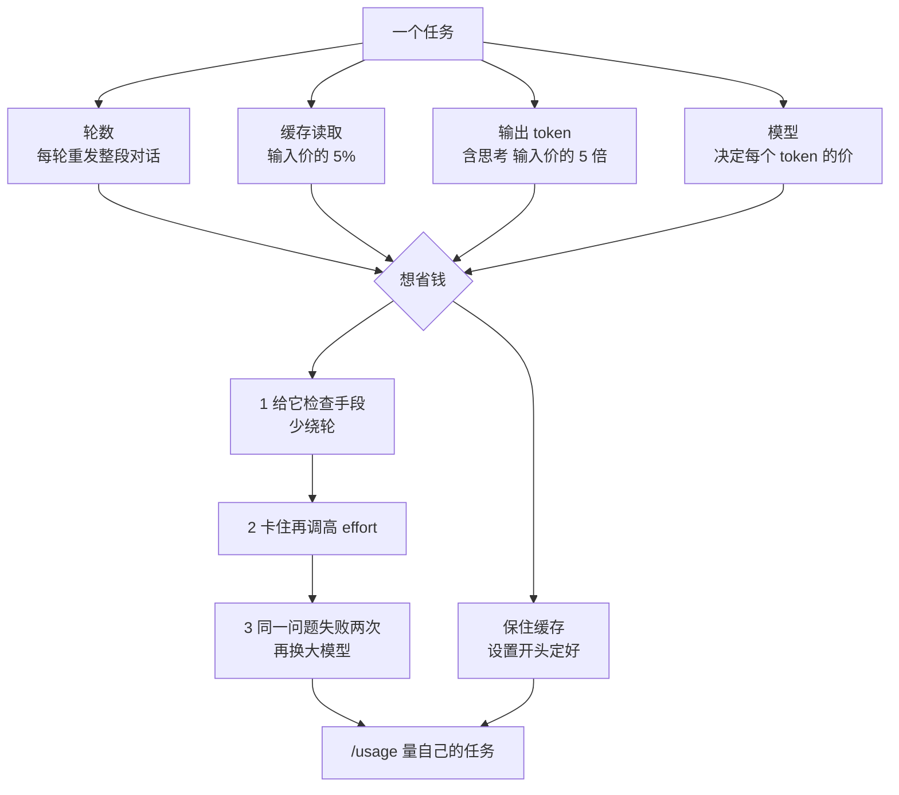

# 一个任务到底花多少钱：Addy Osmani 拆 Claude Code 的账单

Claude Code

**一句话看懂**：Addy Osmani 在 claude.dev 博客上把 Claude Code 一个任务的花费拆成四块：**轮数、缓存读取、输出 token、模型**。同样的 token 单价，多绕几轮就贵很多，因为每一轮都要把整段对话重发一遍；没命中缓存时，同一批输入贵 10 倍以上。他的建议顺序是：先给模型一个能检查自己的手段，再调高 effort，最后才换更大的模型；子代理里的查找交给小模型，写代码留在主模型；会话开始就定好设置，中途别动，保住缓存。所有数字都是示意，最终要用 `/usage` 量你自己的任务。

## 读完你能带走的 7 条收获

1. **按任务算钱，不按 token 单价算**：每一轮都重发整段对话，40 轮和 25 轮的同一个任务，输入成本差了六成（见 3.1）。
2. **最便宜的一轮是不需要的那一轮**：给模型一个测试、一次构建或一个能调接口的脚本，它能更早发现自己的错，少绕几轮（见 3.1、3.3）。
3. **缓存命中率是最大的旋钮**：同样 2.8M 输入，全不命中 $11.20，命中 90% 是 $1.62（见 3.1）。
4. **调档顺序：检查手段 → effort → 换模型**：高档多花的思考约等于一次十轮重试，能省一次重试就回本（见 3.3）。
5. **查找交给小模型，写代码留在主模型**：子代理用 `model: haiku` 或 `CLAUDE_CODE_SUBAGENT_MODEL`；判断留给主模型；代理团队约是普通会话的 7 倍 token（见 3.4）。
6. **六种情况会让缓存重写**：停顿超过缓存寿命、在云厂商或网关上改 effort、首次开 fast mode、连接或断开 MCP、换模型、压缩上下文；所以设置在开头定好（见 3.5）。
7. **`/compact` 在休息前做，不在休息后做**；无关的新任务用 `/clear`；走错路用 `/rewind`（见 3.5）。

::: tip 小白先懂这几个词
- [Token](/glossary#token)：模型计费和计算长度的单位，一个英文单词大约 1–2 个 token。
- [Prompt Caching（提示缓存）](/glossary#prompt-caching)：把请求里重复的前缀缓存起来，下次读取时按很低的价格计费。
- [Cache Hit Rate（缓存命中率）](/glossary#cache-hit-rate)：一次会话的输入里，有多大比例是从缓存读的。
- [Reasoning Effort（effort 档位）](/glossary#reasoning-effort)：告诉模型每一轮大概花多少思考、写多少字、调多少工具。
- [Compaction（上下文压缩）](/glossary#compaction)：把较早的对话总结成短摘要，让之后每一轮发送的内容变少。
- [Subagent（子代理）](/glossary#subagent)：在自己的上下文里干活、只交回摘要的代理。
:::

## 1. 基本信息

<SourceCard type="文章" title="What a task costs on Opus 5.5" author="Addy Osmani" date="2026-09-25" url="https://claude.dev/blog/what-a-task-costs-on-opus-5-5/" />

| 项目 | 内容 |
|---|---|
| 链接 | https://claude.dev/blog/what-a-task-costs-on-opus-5-5/ |
| 类型 | claude.dev 博客 Playbooks 栏目（页面标注阅读时间 21 分钟，正文约 5,000 词，含四张交互图和一张计费规则表） |
| 作者 | Addy Osmani（页面署名） |
| 发布日期 | 2026-09-25（页面元数据 `datePublished`，页面显示 “Sep 25, 2026”） |
| 使用工具 | Claude Code（`/usage`、`/effort`、`/model`、`/compact`、`/clear`、`/rewind`、`/mcp`、`/claude-api prompt-audit`）；模型 Opus 5、Opus 5.5、Fable 5.1、Sonnet、Haiku |
| 分析依据 | 原文全文，2026-10-20 用 curl 抓取 HTML、2026-10-21 提取正文，引语逐字脚本核对。交互图只能读到默认值和图注。作者自己说明：有些数字是列表价，有些是用列表价构造的示意，token 数是示意。这是 Anthropic 官方博客，同时在介绍新模型的降价。“我觉得”开头的段落是本站评论。 |

## 2. 这篇在回答什么

月底一看账单，Claude Code 花得比预想多。你可能第一反应是换个便宜点的模型，或者把 effort 调低。

作者提醒：这两招都可能让你省了 token、丢了任务。他开头就把这笔账摆出来：

<Trans zh="每一种少花 token 的办法，也都可能让你少完成一个任务">“every way to spend fewer tokens can also cost you a finished task.”</Trans>

降低 effort、换小模型、少给上下文都能省 token，但一次重试的花费比这些省下来的都多。文章想让读者能回答自己工作里的三个问题：

1. 我的典型任务在 Opus 5.5 上花多少钱？
2. 哪些设置会改变它，改变多少？
3. 怎么查看自己会话的用量？

本站把它整理成四个更具体的问题：钱花在哪；先调哪个旋钮；怎么不浪费缓存；怎么量自己的数。

## 3. 怎么做

### 3.1 一个任务的钱花在哪：四个因素

Claude Code 里的一个任务是一个循环：模型读对话、调一个工具、读结果，再转一圈，直到做完。每转一圈是一次请求。决定循环花多少钱的有四件事。

文中示例都用 Opus 5.5 的 API 列表价：输入每百万 token $4，输出 $20，缓存读取 $0.20。示例把缓存命中的输入按读取价算、其余按输入价算，不算缓存写入。

**① 轮数**。每一轮都要把到目前为止的整段对话重发一遍。作者的例子：

- 一个任务开始时有 20K token 上下文，随着读文件和工具结果涨到 120K；
- 跑 40 轮，平均每轮发送约 70K，整个任务处理约 2.8M 输入 token，虽然对话本身从没超过 120K；
- 90% 来自缓存时，输入花费约 $1.62；
- 同一个任务如果 25 轮做完，处理约 1.75M，输入约 $1.02。

<Trans zh="一轮的成本高于它新增的 token，因为它要重发之前的全部内容。所以最便宜的一轮是你不需要的那一轮">“A turn costs more than the tokens it adds, because it resends everything before it. So the cheapest turn is the one you don't need.”</Trans>

少绕轮的办法：给模型一个检查自己工作的手段，比如一个要跑的测试、一次构建、一个调接口的脚本。能检查自己的模型更早发现错误。一次收集齐需要的信息、把工具调用合并起来，也能少付几次“重发”的钱。

**② 缓存读取**。每一轮重发的内容大部分是上一轮见过的，按缓存读取计费，只是输入价的一小部分。同样 2.8M 输入：

| 缓存命中率 | 输入花费 |
|---|---|
| 0% | $11.20 |
| 90% | $1.62 |
| 96% | 约 $0.99 |

作者说，没有别的设置能让输入成本变化这么大。稳定进行的会话自然会保持高命中率。

**③ 输出 token**。最贵的 token，是输入价的 5 倍。在 Opus 5.5 上，一个输出 token 的价格是一次缓存读取的 100 倍：典型任务的 60K 输出要 $1.20，和从缓存读 6M token 一样多。**思考也算输出**，哪怕 Claude Code 只给你看摘要，你也要为全部思考付钱。这就是为什么主要改变“想多少”的 effort 对账单影响这么大。

**④ 模型**。每个模型有自己的价格，选了模型就定了每个 token 的价。缓存读取便宜的模型主要帮长会话；输出便宜的模型主要帮需要大量推理的任务。

我觉得这一节最值得记住的是“每轮重发”这个事实。很多人以为上下文 120K 就是花 120K 的钱，其实 40 轮下来是 2.8M。这也解释了为什么站内很多资料反复强调“让代理能自己验证”（[[11§3.1]]、[[72§3.4]]）：它不只提高质量，也直接省钱。

### 3.2 Opus 5.5 的价格变化：哪些是降价，哪些是估计

这一部分是新模型的介绍，本站压缩着讲，只留对算账有用的事实：

- **每一项价格都降了**：输入和输出比 Opus 5 便宜 20%，缓存读取便宜 60%（从输入价的十分之一降到二十分之一）。
- **订阅用户**：在 Pro、Max、Team 计划上，降价会体现在额度里（包括缓存的上下文），额度比 Opus 5 多用约 25%。缓存读取的额外降价是 API 价格的变化。
- **“便宜 40%”是估计**：这是 Anthropic 对按 token 计费的典型工作负载、默认设置下的估计，假设 Opus 5.5 在默认的 medium 档上每个任务用的 token 更少，再叠加降价；**不是** token 单价降了 40%。
- **只看价格变化**：同样的 token 数（2.0M 缓存读、200K 新输入、60K 输出），Opus 5 上 $3.50，Opus 5.5 上约便宜 31%。
- **Opus 5.5 可能用更多 token**：它回答前总是会思考。作者说预计大家能在 Opus 5.5 上完成更多工作，但随任务而变，要在自己的工作上量。在边界清楚的任务上，两个模型轮数差不多，只有降价的好处；差距最大的应该是开放式任务，模型可能在错的思路上耗很多轮。

### 3.3 先调哪个旋钮：检查手段 → effort → 换模型

**effort 先于换模型**。effort 决定模型每一轮花多少 token：思考、写出的文字、工具调用。档位越低，工具调用越少越短。Opus 5.5 有 low、medium、high、xhigh 四档，外加只对单个会话生效的 max。

- **medium**：边界清楚的日常工作，从这里开始。Opus 5.5 的默认就是 medium，比 Opus 5 的默认 high 低一档。
- **high**：medium 卡住时再升。每轮比 medium 花得多，但比换更大的模型便宜。
- **low**：机械性的工作，比如改名、把已知模式套到多个文件。
- **xhigh 和 max**：留给你量过、确实有收益的任务。

注意不同模型同一档位的含义不同：同一档下，Opus 5.5 每轮想得比 Opus 5 多，xhigh 和 max 尤其明显。所以别把为 Opus 5 选的档位直接搬过来。

**一笔粗账**：假设 high 在一个任务上多花 20K 思考 token，在 Opus 5.5 上是 $0.40。一个十轮的重试循环，100K 缓存上下文、总共 10K 输出，花费也差不多。所以 high 只要省下一次重试就回本；如果 medium 本来一次就能做完，那就白花了。

**什么时候该加 effort：修复停在一层**。作者的例子：API handler 里一个字段改了名。medium 档下，模型改了 handler，handler 的测试通过了，客户端还在发旧字段名。它做了你让它做的，只是没读到第二个调用方。high 档下，它在动手前花更多轮读调用点，一次把两层都改了。

但同一个 bug，一个检查也能抓住：

<Trans zh="所以在提高 effort 之前，先看看模型有没有办法检查自己的工作。跑一次测试只花一轮和它的输出；更多 effort 会给每一轮都加上思考">“So before you raise effort, check whether the model has a way to check its work. A test run costs one turn and its output. More effort adds thinking to every turn.”</Trans>

如果模型能跑一个经过客户端的测试，medium 档下旧字段也会在写出来的那一轮就失败。调高 effort 和加检查都不行，再换更大的模型。

**中途改 effort**：`/effort high` 改档，`/effort status` 看当前档，新档从下一次请求生效。在 Opus 5.5 上，用 API key 或 Claude 订阅时改 effort **会保留缓存**，可以为一个难步骤临时调高再调回。但在 Amazon Bedrock、Google Cloud 的 Agent Platform 或 Claude apps 网关上，改 effort 仍会清掉缓存，下一次请求要按缓存写入价付整段对话的钱。

我觉得这一节和站内 [[72]] 正好互补：Thariq Shihipar 从“effort 改变代理做多少验证”讲档位怎么选，Addy Osmani 从账单讲为什么要先加检查、再加 effort。两篇的共同结论是：日常从 medium（或更低）开始，验证要紧时才升档。

### 3.4 模型怎么搭：主模型、大模型、小模型

模型决定每个 token 的价格，所以比 effort 更影响账单；而且影响面更大：**每个继承主模型的子代理也继承它的价格**。作者说大多数日子需要三个模型：小模型做查找，Opus 5.5 做你密切盯着的工作，更大的模型做最难的任务。

**Opus 5.5 当日常主力**：几个文件的功能开发、调试、带后续修改的代码审查。你读它做了什么、跑偏时插手，循环就短。

**什么时候升到 Fable 5.1**：结果比 token 价格更重要时，比如你不打算盯着的长任务、代码库里没有现成模式的问题、协调很多子代理的大改动。

<Trans zh="别等到第三次失败。如果 xhigh 档的 Opus 5.5 在同一个问题上失败两次，就换，问题解决后再换回来">“Don't wait for a third failure. If Opus 5.5 on xhigh hits the same problem twice, switch, and switch back once it's solved.”</Trans>

价格：Fable 5.1 输入 $10、输出 $50（每百万 token），是 Opus 5.5 的 2.5 倍；缓存读取 $0.25，只是 Opus 5.5 的 1.25 倍。所以长的、缓存为主的任务上差距最小，大量写输出的任务上差距最大。

**换模型要在自然断点**：缓存属于前一个模型，新模型的第一轮要按写入价付整段对话。先跑 `/compact`，或者带一份简短的书面计划开新会话，让这一轮小一点。`/model` 会把选择存成新会话的默认，难的部分做完记得换回来。

**小模型做查找，不写代码**：搜索和总结的子代理、读日志和测试输出、“这个在哪定义的”这类问题，交给 Sonnet 或 Haiku。跨很多文件的机械修改，仍然用 Opus 5.5，只把 effort 调到 low。

具体配置：

- 在子代理定义里写 `model: haiku` 或 `model: sonnet`；
- 想让所有子代理用同一个模型，设环境变量 `CLAUDE_CODE_SUBAGENT_MODEL`；
- 子代理定义里写的模型优先于环境变量；没写也没设变量的，跑在主模型上。

**代理团队要格外小心**：这是实验功能，每个队友是一个独立的 Claude Code 实例，有自己的上下文，退出前一直在用 token。成本文档给的估计是，队友在 plan mode 下时，一个团队约是普通会话的 7 倍 token。作者建议团队要小、每个任务自成一体、队友干完就关掉。

**取舍**：小模型读错一个搜索结果，主模型就会被带去看错的文件，绕路的钱由主模型付。所以小模型只做“错了也容易发现”的事：找文件、跑测试、读日志。判断留在主模型上。

作者还提到 `opusplan` 别名：Opus 在 plan mode 里做计划，Sonnet 执行计划。这把写代码放在了 Sonnet 上，和上面的建议相反，作者建议先在自己的任务上量过再设为默认。

**迁移时检查提示词**：为旧模型写的指令可能让 Opus 5.5 写得更多、重复调用工具。在 Claude Code 里运行 `/claude-api prompt-audit`，可以检查 Skill、CLAUDE.md 等设置里的这类反模式。作者给了一个内部例子：一个 44 张工单的客服基准，提示词里有好几个这种模式；从 Opus 4.8 换到 Opus 5.5（low 档）成本降了约 18%，再跑 prompt-audit 又降了 9%，合计比 Opus 4.8 起点低约 25%。被删掉的是一些“仪式性”指令：一个强制的六步流程、一条草稿本规则、一条“验证两遍”规则，以及互相矛盾的指令。作者提醒这只是一个基准，当作例子，不要当作预期。

我觉得“验证两遍”被当作浪费删掉，很值得想一想：它和前面“给模型检查手段”并不矛盾。真正的检查是跑测试、跑构建；让模型在脑子里再“想一遍对不对”，只是多花输出 token。

### 3.5 保住缓存：会话的形状决定命中率

**缓存怎么计价**（Opus 5.5，按文中的当前价格）：

- 缓存读取是新输入价的 5%；
- 缓存写入比新输入贵：5 分钟缓存是输入价的 1.25 倍，1 小时缓存是 2 倍；
- 每次命中都会免费重置寿命。

**寿命取决于付费方式**：Claude 订阅是 1 小时；API key 或云厂商默认 5 分钟；订阅一旦开始用额外的用量额度，也降到 5 分钟。

一个具体的数：120K 上下文下，Opus 5.5 的 5 分钟缓存写一次约 $0.60，读一次约 $0.02，写一次等于读 25 次。

<Trans zh="用 API key 时，一次六分钟的咖啡休息，会把下一次 0.02 美元的读取变成 0.60 美元的写入">“On an API key, a six-minute coffee break turns the next $0.02 read into a $0.60 write.”</Trans>

同样大小的 1 小时缓存写入约 $0.96；在 API 上可以付这个溢价来覆盖一天里的空档。

**为什么会话形状重要**：缓存存的是前缀，只能复用和上一次请求“从头开始一致”的部分。稳定的会话每一轮只在末尾追加，命中率高；任何改动前面内容的操作都会降低命中率。改工具定义会清掉整个缓存；改系统提示会从那一处往后清掉，几乎就是全部。

作者列出了会发生缓存写入的情形：

1. 停顿超过缓存寿命；
2. 在 Amazon Bedrock、Google Cloud Agent Platform 或网关上改 effort（那里档位是缓存匹配的一部分）；
3. 在一段对话里第一次打开 fast mode；
4. 连接或断开 MCP 服务器（可能改变每次请求开头加载的内容）；
5. 换模型（新模型从空缓存开始）；
6. 对话被压缩（重写了缓存匹配的历史）。

所以这些设置在会话开始时定好，工作期间别动。

**长会话每轮更贵**：每一轮都重发全部上下文，即使缓存是热的，上下文越大每轮越贵。20K 上下文时一轮的缓存读取约 $0.004，150K 时约 $0.03；150K 下跑 30 轮，光读取就是 $0.90，20K 下同样 30 轮约 $0.12。而上下文里很多是之前的残留：一小时前的报错堆栈、已经改完的文件、已经修好的那次测试输出，每一轮都还在发送。

**`/compact`、`/clear`、`/rewind` 怎么选**：

- `/clear` 清空对话，不花钱，换到不相关的工作时用；
- `/compact` 保留连续性，花一次请求。可以说明要保留什么，作者的例子是 `/compact keep the failing test names and the schema change`（保留失败的测试名和 schema 改动）；
- 150K 时压缩一次约 $0.25（读取、几千 token 的摘要输出、在更短的上下文上重新写缓存），之后每轮省约 $0.025 读取，大约十轮回本。快结束时压缩，花的比省的多；
- 这个价格假设缓存是热的。所以**休息前压缩，不要休息后压缩**：超过寿命后再 `/compact`，要把整段对话重新读一遍、写回缓存，150K、5 分钟缓存下光输入就约 $0.75；
- 走错了路想丢掉，用 `/rewind` 回到更早的一轮，缓存热的时候回到的是已缓存的前缀；
- 压缩会丢细节：调试中途压缩，可能丢掉那一行关键日志。在自然断点压缩，下一步依赖某个具体信息时，在 `/compact` 指令里写明。

**开工前就加载的东西**：CLAUDE.md 每次会话开始都加载，每一行都是每轮重发的一部分，成本文档建议控制在 200 行以内。MCP 工具定义是延迟加载的：开始时只加载工具名和服务说明，用到某个工具时才加载完整定义。用 `/mcp` 看连了哪些服务器，关掉不用的。

**fast mode**：Opus 5.5 最多快 2.5 倍，价格翻倍（输入 $8、输出 $40）。打开后第一次请求要按 fast mode 的输入价付整段未缓存的对话，所以要在会话开始时打开，别在中途开。

### 3.6 怎么量你自己的数

作者反复强调，文中的数字是示意，要量自己的任务：

- **看会话**：运行 `/usage`（`/cost` 一样），Session 部分显示 token 用量和按列表价估算的美元数，还有一行显示多少输入来自缓存。订阅用户看到的美元数是“你干了多少活”的参考，不是账单。
- **同一个任务跑两次**：Opus 5.5 需要 Claude Code v2.1.280 或更新版本，先 `claude update`。从待办里挑一个真实任务，不要玩具例子；用 `/model` 在 Opus 5 和 Opus 5.5 之间切换，记下各自的轮数、输出 token 和花费。做三四个任务再下结论。
- **团队**：用 Claude Code Analytics API 看每个用户的估算成本，用 Usage and Cost API 按模型、按是否缓存拆分花费。
- **试 effort 阶梯**：一个难任务分别用 medium 和 high 跑，一个机械任务用 low 跑。

**任务结束时在 `/usage` 里看三件事**：

1. **缓存占比**：长会话应该很高。低的话，找找有没有长时间停顿、换模型、中途连了 MCP，或者在云厂商 / 网关上改了 effort。prompt cache 那一行常常会写出上一次未命中的可能原因。
2. **输出对输入**：一个小改动产生大量输出，通常是 effort 对这个任务太高，或者模型在重试。
3. **总输入对对话大小**：总输入是对话大小的很多倍，说明绕了很多轮，值得翻一翻对话，找到哪里在原地打转。

**参照值**：Claude Code 成本文档给的企业部署平均值是每个开发者每个活跃日约 $13，90% 的用户低于每天 $30（都是当前模型）。比你自己平时高很多的会话值得回头看一看。

作者最后说，最重要的一条是：

<Trans zh="在每个模型上跑一个真实任务，比较 /usage 报出来的数字。你自己的数字才是该信的">“run one real task on each model and compare what /usage reports. Your own numbers are the ones to trust.”</Trans>

## 4. 结果与局限

**文章给出的是计价规则和示意算账，不是实验结果**：

- 可以直接核对的是价格和计费规则：输入 / 输出 / 缓存读取 / 缓存写入的价格、缓存寿命、哪些操作会导致缓存写入、子代理模型的配置方式；
- 轮数、缓存命中率、压缩回本这些例子都是用列表价构造的示意，作者明确说 token 数是示意；
- 唯一的“实测”数字是 prompt-audit 在 44 张工单的内部客服基准上降了 9%（合计 25%），作者自己说只是一个基准；
- “便宜 40%”是 Anthropic 的估计，前提是 Opus 5.5 每个任务用更少的 token，作者也说 Opus 5.5 可能用更多 token，要自己量。

**局限与注意**：

- **价格和模型会变**：Opus 5.5、Fable 5.1 的价格和默认档位是 2026-09 的情况，具体以官方价格页为准；
- **厂商立场**：文章同时在介绍新模型降价和订阅额度提升，“额度多用约 25%”“降 31%”都是厂商自己的计算；
- **平台差异**：改 effort 是否清缓存、缓存寿命，都因 API、订阅、云厂商和网关而不同，文中的建议要对照你的付费方式看；
- **企业平均 $13/天** 来自成本文档，没有给样本规模。

我觉得这篇最可迁移的不是具体价格，而是三个习惯：按“任务”而不是“token 单价”看成本；先加检查再加档位；把缓存当成需要保护的东西，设置在开头定好、休息前压缩。这三条换个模型、换个工具都成立。

## 5. 结论

一个任务的成本主要由轮数、缓存命中率、输出量和模型决定，其中“每一轮都重发整段对话”是最容易被忽视的一点。想省钱，先给模型一个能检查自己的手段让它少绕轮，卡住了再调高 effort，同一问题失败两次再换大模型；查找交给小模型，写代码留在主模型；会话的设置在开头定好，休息前压缩、换任务就清空。最后，用 `/usage` 在自己的真实任务上量一遍，以你自己的数为准。

**你可以这样试**

1. 下一个任务结束时运行 `/usage`，记下缓存占比、输出 token 和总输入，算一下总输入是对话大小的几倍。
2. 找一个你常派给子代理的查找类任务（找文件、读日志），在子代理定义里加 `model: haiku`，对比前后花费和结果。
3. 下次要离开超过 5 分钟（API key）或 1 小时（订阅）之前，先 `/compact` 并写明要保留的东西，回来后看缓存占比。

**读完自测**

1. 上下文从没超过 120K，为什么一个 40 轮的任务会处理 2.8M 输入 token？
2. 一个字段改名只改了 handler、没改客户端，作者给了哪两种修法？哪一种更便宜，为什么？
3. 列出至少四种会让缓存重新写入的操作。
