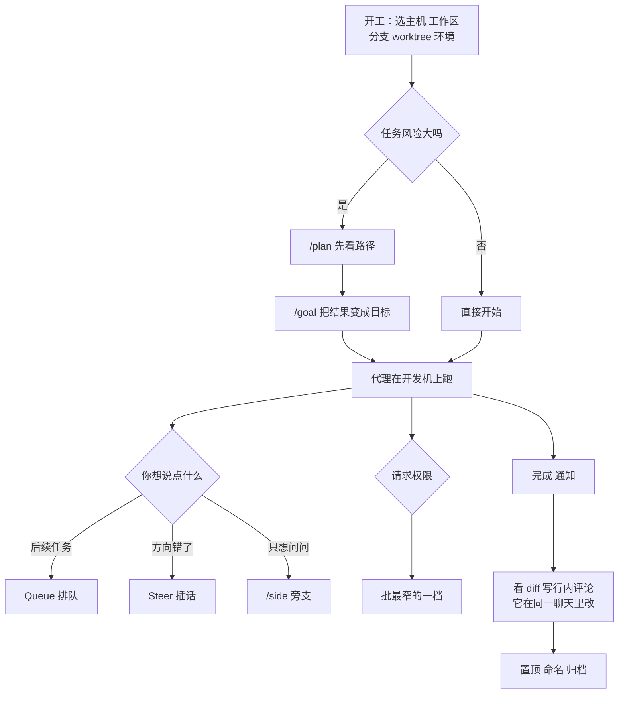

# 人不在电脑前，代理怎么继续干：用手机当 Codex 的控制台

Codex

**一句话看懂**：OpenAI Codex 团队的 Thomas Ricouard 写了一份 ChatGPT 手机端 Remote 的使用指南。核心观点是：手机不是一个缩小的终端，而是**控制平面**：代码仍然在你的 Mac、Windows 或 devbox 上跑，手机只用来做那些“能让代理继续往下走”的决定：在哪个环境开工、下一句话是排队还是插话、这条命令能不能批、改动同不同意、这件事该变成长期目标还是开个旁支问一句。文章里的大部分习惯（默认排队、只批最窄的权限、先 plan 再 goal、先看状态再压缩或分叉）离开手机也成立。

## 读完你能带走的 7 条收获

1. **把人在环里的工作看成“做决定”，不是“盯屏幕”**：作者列了六个会卡住代理的决定，手机只要让这些决定能随时做（见 3.1）。
2. **开工前花 10 秒选对执行环境**：主机、工作区、分支、是否开新 worktree、先跑环境 setup，能省 10 分钟清理（见 3.2）。
3. **跟进消息默认排队，插话要刻意**：Queue 等当前一轮做完，Steer 改变正在进行的工作；误插话通常比等一等更贵（见 3.3）。
4. **旁支问题开 side chat，方向变了才 fork**：主聊天负责干活，旁支帮你理解；fork 是继承历史的新主线（见 3.4、3.6）。
5. **Plan 管路径，Goal 管结果**：风险大的改动先 plan，接受后把结果变成 goal，让它跨多轮推进（见 3.4）。
6. **批权限选最窄的那一档**：熟悉的命令在可信聊天里按聊天批，不熟的只批一次，或者拒绝并让它解释（见 3.5）。
7. **把聊天列表当运维台管**：置顶在跑的、按结果命名、做完就归档；完成通知一键回到审查（见 3.6、3.7）。

::: tip 小白先懂这几个词
- [Control Plane（控制平面）](/glossary#control-plane)：只负责下决定、发指令的那一层，真正干活的在别处。
- [Queue / Steer（排队 / 插话）](/glossary#queue-steer)：代理正在工作时，你的下一条消息是等它做完再发，还是立刻注入当前工作。
- [Side Chat（旁支对话）](/glossary#side-chat)：挂在当前聊天旁边的轻量对话，用来问问题而不打乱主线。
- [Worktree](/glossary#worktree)：同一个仓库的另一份独立工作目录，适合把一次改动隔离开。
- [Goal（目标）](/glossary#goal)：Codex 里跨多轮持续追求的结果和完成条件。
- [Plan Mode（计划模式）](/glossary#plan-mode)：先让代理提出实施路径，确认后再改代码。
:::

## 1. 基本信息

<SourceCard type="文章" title="Mastering remote engineering work from your phone" author="Thomas Ricouard" date="2026-06-23" url="https://developers.openai.com/blog/mastering-codex-remote-for-engineering" />

| 项目 | 内容 |
|---|---|
| 链接 | https://developers.openai.com/blog/mastering-codex-remote-for-engineering |
| 类型 | OpenAI Developers 博客（正文约 2,400 词，含四张产品截图和一张命令表） |
| 作者 | Thomas Ricouard（页面署名；据其 LinkedIn 资料，在 OpenAI 做 Codex 的开发者体验） |
| 发布日期 | 2026-06-23（页面日期 “Jun 23, 2026”） |
| 使用工具 | ChatGPT 手机 App 里的 Remote，连接运行 Codex 的 Mac、Windows 或 devbox 主机；命令 `/plan`、`/goal`、`/side`、`/review`、`/status`、`/compact`、`/fork`、`/fast`、`/feedback` |
| 分析依据 | 原文全文，2026-10-21 用 curl 抓取 HTML 和官方 Markdown 版本，引语逐字脚本核对。截图未使用。文章是产品团队成员写的功能指南，没有效果数据；命令和功能可能随版本、主机和账户配置而不同（原文也这样提醒）。“我觉得”开头的段落是本站评论。 |

## 2. 这篇在回答什么

你下午让 Codex 去修一个 bug，然后出门开会。半小时后，它可能卡在三种地方：一条命令等你批准；它走错了方向，正在一个无关的模块里越陷越深；或者它做完了，等你看 diff。

这三种情况都只需要你花一分钟做个决定。但如果你不在电脑前，它就一直等着。

作者说，手机端 Remote 解决的就是这件事。他特意提醒别把它理解成“在手机上看看进度”：

<Trans zh="Remote 真正的威力在于，它让你可以启动、指挥、审查和整理在开发机上运行的工作，而不用假装 iPhone 应该是个小终端">“The real power of Remote is that it lets you start, direct, review, and organize work running on your development machines without pretending that an iPhone should be a tiny terminal.”</Trans>

文章回答了四个问题：

1. 人离开电脑时，哪些决定还必须由人来做？
2. 开工前怎么划好边界（环境、上下文、权限）？
3. 代理跑起来之后，怎么干预才不添乱？
4. 怎么审改动、怎么管好同时在跑的一堆工作？

## 3. 怎么做

### 3.1 正确的心智模型：手机是控制平面

**是什么**：代码仍然在它该在的地方跑：你的 Mac、Windows 机器、devbox 或其他连接的主机。手机端 Remote 给你一个原生界面去控制这些工作。

**为什么这个区分重要**：目标不是在小屏幕上复刻终端的每个功能，而是让那些能让代理继续推进的决定，在哪都能轻松做出。作者列了六个这样的决定：

- 该用哪个仓库和工作区？
- 在当前分支跑，还是开一个新的 worktree？
- 我的下一条消息该排队，还是去改变正在进行的这一轮？
- 这条命令批准了安全吗？
- 改了什么，我同意吗？
- 这件事该变成一个长期目标、一个单独的聊天，还是一个快速的旁支问题？

作者说，这样用之后，它就不像远程桌面软件了，更像一个“工程控制平面”。

我觉得这六个问题是这篇文章最有价值的部分，它和手机无关：它其实是“人在环里到底要做什么”的一份清单。站内 [[72§3.1]] 用 effort 档位讨论“代理替你做多少决定”，这里反过来列出了“必须留给人的决定”。

### 3.2 开工前划好边界：环境和上下文

**选对执行环境**：Remote 允许在第一个提示之前选好连接的主机和工作区。新聊天还可以选分支、建一个单独的 worktree，并运行与之关联的环境 setup。作者列了四种用法：

- 快速调查，用当前 checkout；
- 需要隔离的改动，建一个新 worktree；
- 从预期的 base 分支开始，而不是事后再修 Git 状态；
- 先让环境 setup 跑完，再让 Codex 构建或测试。

<Trans zh="花 10 秒选对执行环境，省下之后 10 分钟的清理">“Spend 10 seconds choosing the right execution context and save 10 minutes of cleanup later.”</Trans>

**上下文不只是文字**：输入框可以附文件、照片，或者直接拍一张。Skills 和插件在输入框里内联显示，发送前就能确认这次提示调用的是你想要的能力。作者的规则是：

<Trans zh="如果一张截图、一个文件或一个点名的 skill 能消除歧义，就在第一轮之前附上或提到它">“If a screenshot, file, or named skill can remove ambiguity, attach or mention it before the first turn.”</Trans>

我觉得“从预期的 base 分支开始”这条很容易被忽视。一人多线并行时（[[23§3.1]]、[[11§3.2]]），开错分支的代价不在当下，而在合并时才暴露。

### 3.3 跑起来之后：排队还是插话

作者说这可能是 Remote 里最不显眼、杠杆却最高的设置。Codex 正在工作时，你的跟进消息有两种处理方式：

| 方式 | 做什么 | 什么时候用 |
|---|---|---|
| Queue（排队） | 等当前回应结束，再作为下一轮发出 | 安全的默认：第二个任务、追加一个测试请求、任何应该在当前工作之后发生的事 |
| Steer（插话） | 把指导注入正在进行的工作 | 在“继续走错路的代价还在增长”时纠正方向 |

作者给的三条插话示例（摘自原文，2026-10-21 抓取）：

::: tr 只在 mobile 包里修，不要重构共享的渲染器。／复现只在重连之后出现，测恢复路径，不是实时路径。／别再查 UI 了，看看服务端是不是在恢复时把这一项删了。
> "Keep the fix inside the mobile package. Do not refactor the shared renderer."
>
> "The reproduction only happens after reconnect. Test the resumed path, not the live path."
>
> "Stop investigating the UI. Check whether the server removed the item during resume."
:::

这三句有一个共同点：都很短，都在**收窄范围或纠正假设**，而不是追加新需求。

默认行为可以在设置里选。作者自己的选择：

<Trans zh="我把 Queue 设为默认，有意识地才用 Steer；意外的中途改向通常比等待代价更高">“I keep Queue as the default and use Steer deliberately; accidental mid-turn redirection is usually more expensive than waiting.”</Trans>

我觉得“插话只用来收窄范围或纠正假设”这个规律值得记下来。追加需求用插话，代理可能会在半成品上叠新东西；排队则让每一轮的边界保持清楚。

### 3.4 想问问题或换方向：side chat、Plan 和 Goal

**side chat 是“思路的分支”**。长的编码聊天会积累有价值的上下文，每个旁支问题都塞进去，主记录会变嘈杂，还可能把代理从目标上拉走。

- `/side` 打开一个连着当前聊天的轻量对话；
- `/side <prompt>` 直接带着问题打开；
- 更好的办法：在记录里选中一段文字，点 **Ask in side chat**，选中的内容就是新对话的起始上下文。

作者用 side chat 问的问题包括：Codex 为什么选这个架构？这个报错到底什么意思？这个行为和桌面 App 一致吗？把这个实现细节改写成发布说明。批准这条命令之前我该核实什么？

<Trans zh="区别很有用：主聊天负责干活；旁支对话帮我理解这份工作">“The main chat owns the work; the side chat helps me understand the work.”</Trans>

**Plan 和 Goal 解决不同的问题**：

- Plan mode 让 Codex 在改代码之前先提出实施路径，适合需求不清、风险大、可能牵涉多个系统的任务；
- Goal 是持久的，告诉 Codex 跨多轮持续追求什么结果。手机上可以用 `/goal` 创建和管理，进度在工作进行中一直可见。

作者推荐的组合：

1. 风险大的改动先用 Plan mode；
2. 检查提出的边界；
3. 工作需要多轮迭代时，把接受的结果变成一个 goal；
4. 让 Codex 一路做实现、测试、处理审查意见和清理，不用每次重复目标。

::: tr Plan 回答“我们该怎么做？”Goal 回答“做完之前什么必须为真？”
> "Plans answer “How should we approach this?” Goals answer “What must be true before we are done?”"
:::

我觉得这一句把 plan 和 goal 的分工说得最清楚。站内 [[42§3.3]] 讲过 `/goal` 的完成标准要可验证，否则会“技术上做到了，但不是你要的”；先用 plan 把边界看清楚再写 goal，正好能降低这个风险。

### 3.5 审改动和批权限：在聊天里完成

**审查不离开对话**。作者说审查循环是 Remote 真正对工程有用（而不只是方便）的地方。完成的一轮可以显示改动文件摘要，从那里可以打开 diff、逐个文件看、展开折叠、长行换行、用语法高亮打开源文件，还能在相关行上写行内评论，把审查上下文发回给 Codex。

作者的移动端审查循环：

1. Codex 完成实现；
2. 我在手机上看 diff；
3. 我留两条行内评论；
4. Codex 在同一个聊天里处理；
5. 我再审更小的后续 diff。

他也说清楚了边界：手机代替不了大显示器去深读代码。重点是：

<Trans zh="很多审查只卡在一两个决定上，而这些决定不再需要等我回到桌前">“many reviews are blocked on one or two decisions, and those decisions no longer need to wait until I am back at my desk.”</Trans>

**权限是工作流的一部分**。Remote 会把命令、文件修改、网络访问和连接工具的审批请求显示出来。视请求和主机配置，一次批准可能只生效一次、对当前聊天生效，或者范围更广。

<Trans zh="高手的做法不是什么都批，而是选能让工作继续推进的最窄权限">“The power-user move is not to approve everything. It is to choose the narrowest permission that keeps the work moving.”</Trans>

具体怎么选：可信聊天里熟悉的命令，按聊天批准，减少重复打断；不熟悉的命令、敏感的仓库、效果不清楚的请求，只批一次，或者拒绝并让 Codex 解释、换一种更安全的做法。开始工作时也可以选这个聊天整体的审批行为，作者建议把它和主机、工作区、分支、模型一起当作聊天设置的一部分。

我觉得“拒绝并让它解释”是一个常被忽略的选项。很多人面对看不懂的命令只有“批”和“不批”两种反应，其实第三种（让代理换个更安全的做法）往往最好。这和站内 [[08§3.6]] 讲的“别开全权限来躲审批”是同一个思路。

### 3.6 管好上下文：status、compact、fork

代理聊天是有状态的，长聊天最终会积累足够多的上下文，变慢或不够专注。Remote 有一小组工具管理这个生命周期：

- `/status` 显示会话详情、工作区、上下文用量和可用的速率限制信息；
- 可选的上下文指示器让剩余上下文一直显示在输入框里；
- `/compact` 压缩过长的聊天，同时保留有用的工作状态；
- `/fork` 从当前聊天创建一个新聊天，共享历史但换一个方向。

作者给的顺序：先看状态；目标没变就压缩；目标已经分叉就 fork。

他特别提醒 side chat 和 fork 不能混用：side chat 是围绕当前工作的轻量提问；fork 是一个继承原聊天历史的新主聊天。

**命令表**（摘自原文，可用性取决于连接的主机、App 版本和账户配置）：

| 命令 | 用途 |
|---|---|
| `/plan` | 实现前切换 Plan mode |
| `/goal <objective>` | 创建或更新一个持久目标 |
| `/side [question]` | 问一个旁支问题，不打乱主聊天 |
| `/review` | 审查本地改动，或和某个分支对比 |
| `/status` | 查看会话、工作区、上下文和速率限制 |
| `/compact` | 压缩长聊天的上下文 |
| `/fork` | 从当前历史创建新的主聊天 |
| `/fast` | 在可用时切换标准和更快的执行 |
| `/feedback` | 发送和当前会话关联的产品反馈 |

作者说这张命令表值得学，因为它暴露了产品真正的概念模型：计划、追求、分支、审查、检查、恢复。

### 3.7 把聊天列表当成运维台：五个工作流

**保持列表干净**。作者说自己的 Codex 工作流越来越像一个小运维台：

- 把少数正在推进的聊天置顶；
- 按**结果**给它们重命名；
- 做完就果断归档。归档是整理，不是删除，随时能翻已归档的聊天。

通知也是这个系统的一部分：完成通知可以直接打开对应的 Codex 聊天，从“代理做完了”到“人来审”只要点一下。iPad 上还有快捷键，可以新建聊天、切换聊天、打开改动文件、置顶、重命名、归档。作者把这叫作 Remote 的“chief of staff”（幕僚长）用法：这里不只是发提示的地方，也是追踪哪些工作在跑、卡住、等审查或已完成的地方。

**五个特别适合手机的工作流**：

| 工作流 | 做法 |
|---|---|
| 发布队长 | 为一次发布或一个 PR 开一个专门的聊天，让 Codex 查当前分支、CI 状态、未处理的审查意见和发布包含哪些内容。置顶。新信息到来时，只有它推翻了当前调查才插话，否则排队。在手机上审最终 diff 或发布说明，发布完成后归档 |
| 被打断的 bug 修复 | 附上截图、日志或文件。让 Codex 先诊断再改。用 side chat 追问一个可疑的报错，不打乱主调查。原因清楚后回到主聊天，授权一个窄的修复 |
| 移动端审查者 | 对预期分支跑审查，看改动摘要，打开要紧的文件，写行内评论。让 Codex 只处理这些评论，再审后续 diff |
| 长期目标 | 创建一个有具体完成条件的 goal：测试全绿、审查意见处理完，或达到一个可复现的性能阈值。从通知和状态看进度，而不是反复问“做完了吗”。追加工作用排队，纠正才用插话 |
| 多机器操作员 | 主机命名清楚，按机器和工作区组织工作。用手机在有正确 checkout、凭据、模拟器或操作系统的那台机器上开聊天，比如一个聊天需要 Mac，另一个需要 Windows |

**小功能**：作者还列了一串“不是头条但影响很大”的细节，例如编辑最近发出的提示（而不是再补一轮更正）、运行中能看到排队的提示、窄屏上长 diff 行换行、用 Face ID 或设备密码保护 App、从选中的记录文字开 side chat。他说这些都没有改变代理的基本模型，但合在一起，消除了让远程工作流显得脆弱的摩擦。

作者的总结：

<Trans zh="电脑仍然在干活，手机让我保持掌控">“The computer still does the work. The phone keeps me in control.”</Trans>

## 4. 结果与局限

**这篇文章提供的是什么**：一位产品团队成员自己的使用习惯和功能说明。没有实验、没有效果数字（除了“10 秒 / 10 分钟”这样的经验说法）。

**局限与注意**：

- **厂商立场**：作者是 OpenAI Codex 团队成员，文章同时是产品功能介绍；
- **产品绑定**：Remote 在 ChatGPT 手机 App 里，需要能运行 Codex 桌面 App 或 CLI 的主机；命令和功能的可用性随主机、App 版本、账户配置而不同，原文也这样提醒；
- **时效**：文章发布于 2026-06，功能“过去两个月”加得很快，界面和名称可能已经变化，以官方最新文档为准；
- **手机审查的边界**：作者自己说手机代替不了大显示器深读代码，适合的是“卡在一两个决定上”的审查；
- **五个工作流是作者的做法**，没有说明在团队里推广的效果。

我觉得这篇放在“单代理推进与一人多线”阶段，是因为它的真正主题是“一个人怎么驾驭在别处运行的代理”：代理在哪里跑（云端还是本机）不是重点，重点是人怎么在不盯着屏幕的情况下，把该做的决定做好。和 [[27§3.4]] Mitchell Hashimoto“关掉通知、自己决定何时查看”的做法对照着看，会发现两者并不冲突：作者也是靠完成通知把人拉回来审查，而不是一直盯着。

## 5. 结论

人不在电脑前时，代理卡住的往往只是一个小决定。把人在环里的工作看成“做决定”而不是“盯屏幕”，就能用手机这样的小屏幕做好它：开工前选对环境、附上能消除歧义的上下文；跑起来后默认排队、只在方向错时插话；旁支问题开 side chat，方向变了再 fork；风险大的改动先 plan 再 goal；权限只批最窄的一档；做完靠通知回来审 diff，再把聊天列表当运维台管好。

**你可以这样试**

1. 下次让 Codex（或任何代理）跑一个较长的任务前，先写一句完成条件当作 goal，比如“测试全绿且不改 `shared/` 目录”。
2. 把跟进消息的默认行为设成排队；想插话时先问自己：这句话是在收窄范围、纠正假设，还是在加新需求？只有前两种才插话。
3. 遇到看不懂的命令审批，试一次“拒绝并让它解释 / 换更安全的做法”，看看它给出什么替代。

**读完自测**

1. Queue 和 Steer 的区别是什么？作者为什么把 Queue 设为默认？
2. side chat 和 `/fork` 分别在什么情况下用？
3. Plan 和 Goal 各自回答什么问题？
