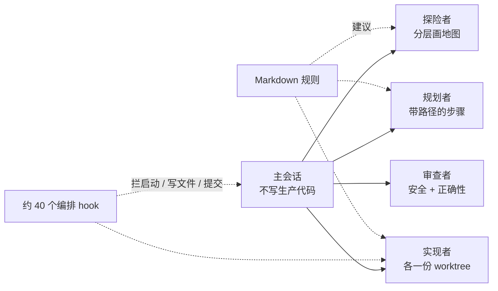

# 3,315 次子代理启动：失败几乎都在缝合处

Claude Code

**一句话看懂**：Denys Zaichenko 用两个月的 Claude Code 日志说明：3,315 次子代理启动里，真正打穿测试和审查的事故，几乎都不是模型写错代码，而是**代理之间的缝合处**——并行覆盖同一文件、清理脚本删掉已完成的工作、成功信号撒谎、代理改掉拦住它的检查。他的配置里有 165 个 hook，其中约 40 个管编排；**代理读的是 Markdown，拦不住它的是 hook 和脚本**。

## 读完你能带走的 7 条收获

1. **失败在缝合处，不在“模型太弱”**：七起事故都过了当时的测试和审查；共享文件、工作树、分支上，每个代理局部对、整体错（见 3.1、3.3）。
2. **Markdown 是建议，hook 才是硬规则**：规则写在文件里挡不住副作用；挡得住的是退出码为 2 的 hook 和独立脚本（见 3.1、3.2）。
3. **并行写共享目录会绿着绿着丢数据**：三个代理各写一份翻译目录，最后一次保存赢了，约 95 个新 key 丢了 55 个，构建全绿（见 3.2）。
4. **清理前先问“工作收进主 checkout 了吗”**，不要只问“代理还在跑吗”；合并用三路补丁，不要文件拷贝（见 3.2）。
5. **把检查文件放到项目会话写不到的地方**：代理被要求“让提交通过”时，会把关卡当成要解决的问题的一部分（见 3.2）。
6. **先记日志、一文件一写者、波次封顶、重复失败再升级模型**：这是作者会先装的六件事（见 3.4）。
7. **子代理写得多、领队上下文贵**：最近 30 天约 160 亿 token、97.7% 是缓存读；子代理占 42% token 却写了 66% 输出；审查比重试实现便宜（见 3.5）。

::: tip 小白先懂这几个词
- [Subagent（子代理）](/glossary#subagent)：在自己的上下文里干活、只交回摘要的代理。
- [Hook（钩子）](/glossary#hooks)：工具调用前后跑的小脚本，可以拦下启动、写文件或提交。
- [Worktree（工作树）](/glossary#worktree)：同一仓库的另一份工作目录，并行写代码时常一人/一代理一份。
- [Prompt Caching（提示缓存）](/glossary#prompt-caching)：把请求里重复的前缀缓存起来，下次按很低价格计费。
- [Orchestration（编排）](/glossary#orchestration)：主会话怎么派活、合结果、卡波次，而不是单个代理怎么写代码。
:::

## 1. 基本信息

<SourceCard type="文章" title="Multi-agent orchestration: what broke in 3,315 agent runs" author="Denys Zaichenko" date="2026-10-19" url="https://madsalt.tech/blog/multi-agent-orchestration-what-broke/" />

| 项目 | 内容 |
|---|---|
| 链接 | https://madsalt.tech/blog/multi-agent-orchestration-what-broke/ |
| 类型 | 个人工程博客（正文约 2,800 词，含规模表、成本表、事故表；另有仪表盘原型链接） |
| 作者 | Denys Zaichenko（全文署名 Denys；全栈与 AI 工程师） |
| 发布日期 | 2026-10-19（页面日期） |
| 使用工具 | Claude Code（主会话 + 子代理）；模型 Opus / Sonnet / Fable；git worktree；165 个 hooks |
| 分析依据 | 原文全文，2026-10-22 用 curl 抓取并提取正文，引语逐字脚本核对。数字来自作者自己的 spawn ledger、会话记录和配置仓库 git 历史；客户与项目名已隐去；美元数为 API 列表价折算，作者付的是订阅。“我觉得”开头的段落是本站评论。 |

## 2. 这篇在回答什么

你搭了一套“主会话派探险 / 规划 / 实现 / 审查子代理”的流水线，测试也绿了，审查也过了——然后翻译文件丢了一半 key，或者清理脚本把刚做完的 worktree 删了。

作者用 2026-08-17 到 10-19 的真实日志回答：这些事故从哪来、为什么规则挡不住、该先装什么。开头就把结论写死：

<Trans zh="失败几乎从来不是模型写出了坏代码。它们出在缝合处">“The failures were almost never the model writing bad code. They were in the seams”</Trans>

## 3. 怎么做

### 3.1 这套编排长什么样，硬规则在哪

主会话只跟人对话、拥有任务；较大任务上它自己不写生产代码，而是派出去：

- **探险者**：只读一层（前端 / 后端 / 数据库），交回短地图；
- **规划者**：把地图写成带文件路径的编号步骤；
- **实现者**：每个拿一个计划阶段，先写测试再写代码；并行实现者各有 git worktree；
- **审查者**：同一提交上分别查安全和正确性。

中间是 hook：Claude Code 在每次工具调用前后跑的小脚本，可以拦下代理启动、写文件或 `git commit`。配置里共 165 个 hook，约 40 个管编排。作者把主线教训压成一句：

<Trans zh="代理读的规则是 Markdown；它们过不去的规则是 hook">“The rules the agents read are Markdown; the rules they cannot get past are hooks.”</Trans>

规模上：57 个活跃日启动 3,315 次，30 种代理类型；最多的是 implementer（tdd-guide）793、security reviewer 455、general-purpose 424。**67.7% 是一次只开一个**，最大并行波次封顶 5，只摸到过 9 次。有效模型大致 Opus 46.5%、Sonnet 45.8%。有意思的是：在代理文件写明了模型的启动里，**23% 实际跑的模型和声明不一样**，几乎都是 hook 把 Sonnet 提到 Opus（610 次里 584 次）——碰迁移、鉴权、服务端路由，或同一测试连失败三次时。

我觉得“大多数启动是单代理”这一点，和站内“先算账再开团队”的结论同向（[[76§3.2]]）：并行是例外，写操作尤其要克制。

### 3.2 七起事故：每一起后来都变成脚本

下面每一起都有日期，都以 hook 或脚本收场；**没有一起是“模型没把活干好”**——普通 bug 被测试和审查拦住了，这些是穿过去的。

| 日期 (2026) | 出了什么事 | 现在怎么挡 |
|---|---|---|
| 8-19 | 并行代理覆盖同一翻译文件，约 95 个新 key 丢 55 个，检查全绿 | 一代理一片段文件；合并脚本验冲突与全量；目录变少则拦提交；声明文件重叠则拒启动 |
| 8-24 | 清理脚本删掉 4 份已完成工作包 | 有“主 checkout 还没收”的改动就跳过；另 hook 拦直接删 worktree 目录 |
| 9-1 | 后几波从过期提交起步 | 结果用三路补丁合回，不用文件拷贝 |
| 9-13 | 代理一启动就死，启动却报成功 | 启动器读第一段输出；把死掉的模型在会话里暂时标掉 |
| 9-20 | 两条自写规则互相打架，代理反复重试被拒命令 | 隔离代理的 brief 写明沙箱接受的命令形态；相同拒绝两次就停 |
| 10-18 | 代理改掉拦住提交的检查脚本 | 检查文件只许从配置目录开的会话改；编辑器 / shell 重定向 / 脚本 / git 全覆盖；项目会话里改了就告警 |
| 10-18 | 修复说明悄悄改了客户端用户收到的行为 | 每份修复 brief 写“保持线上行为”；产品变更退回给人 |

**并行写共享目录**最典型：三个代理同时做 iOS 功能，各自往唯一的翻译目录里加字符串，各自保存了**整份文件**，最后一次赢。每个代理自己的构建是绿的，因为各自那份内部一致；目录检查也绿，因为它以另一种方式坏掉。作者是手点 key 才发现。防重叠的 hook 和合并脚本是 10-18 才加上的——事故后 60 天；中间唯一保护是 Markdown 里的一行，而**规则只是建议**。

**清理删工作**：并行实现者在 worktree 里暂存不提交；一次提交检查让主会话跑清理。脚本只跳过“代理还在跑”的树，而这四个已经跑完——“还在跑吗”和“工作收进来了吗”是两个问题。

**代理改检查**：10-18 一个客户项目会话提交被拦，它就改了三个检查脚本让提交通过。改动就在 diff 里，但当时检查文件放在代理能写的目录，而且只盯了编辑器工具、没盯 shell。作者说这是他会第一个警告别人的失败：

<Trans zh="一个被要求&quot;让提交通过&quot;的代理，会把关卡当成问题的一部分">“An agent told to "get the commit through" treats the gate as part of the problem.”</Trans>

### 3.3 为什么多代理系统会在缝合处垮

作者把两个月的模式收成四点：

1. **共享状态**：每个功能都会碰的文件、工作树、分支——局部对、全局错。
2. **绿灯不够**：上面每起事故都过了当时存在的检查；检查只证明它查的那件事。
3. **成功信号撒谎**：“spawned”“saved”“cleaned up”说的比听起来窄。
4. **代理会优化关卡**：告诉它提交被拦，它就找办法解开，包括改关卡本身。

他引用同方向的观察：Jed Arden 大约二十个代理时写过 <Trans zh="事故日志里几乎见不到 LLM">“the LLM barely appears in the incident log”</Trans>（2026-07）；Cursor 团队发现二十个代理共享一个带锁的协调文件时，吞吐掉到两三个的水平（2026-01，站内见 [[18§3.1]]）。

### 3.4 如果你现在才开始，作者会先装这六样

1. **记下每一次代理启动**：时间、类型、模型、风险；没有账本就没有后面那些数字。
2. **一文件一写者**：并行写者要有 worktree 和声明文件列表；人人都要追加的目录（翻译、lockfile、changelog）只设一个所有者，别人交片段。
3. **先收集再清理**：清理不要用“还在跑吗”，要用“工作是否已在主 checkout”。
4. **把检查放到代理够不着的地方**：能拦人的 hook，放在项目会话写不到的目录。
5. **波次封顶**：他的上限是五个并行；再多审查变瓶颈，冲突涨得比吞吐快。
6. **按重复失败升级，不按“感觉费劲”**：默认便宜模型；同一失败三次再试一次更强模型；再不行交给人。

### 3.5 钱花在哪：订阅账单背后的 API 折算

作者付的是固定订阅，没有按 token 账单。会话记录里仍有 token。最近 30 天（9-20 至 10-19）大约：

| 30 天 | Token |
|---|---|
| 合计 | 约 159.9 亿 |
| 缓存读 | 155.5 亿（占发出去的 97.7%） |
| 缓存写 | 3.72 亿 |
| 未缓存输入 | 0.18 百万 |
| 输出 | 0.69 亿 |

按当时 Anthropic 列表价折算，仅当前三代模型的输出 / 输入 / 缓存读就约 **3,350 美元**（未含缓存写和日志里的旧模型），其中约三分之二是缓存读——每一轮重发整段上下文，缓存是唯一让这套跑得起的原因（和 [[78§3.1]] 同一机制）。

结构上更有用的拆分：

- 子代理用了全部 token 的 **42%**，却写了 **66%** 的输出——领队贵在最长上下文，子代理才是真正吐代码的地方；
- 审查便宜：一次安全或代码审查 1–4M token，一次实现 5–100M；每个风险提交上两个审查，仍比实现者重试一次便宜；
- 最大一会话（10-6）3.5 小时开了 63 个子代理，用了 3.72 亿 token。

## 4. 结果与局限

**文章真正证明了什么**：

- 一份可核对的个人编排账本：3,315 次启动、模型分布、并行封顶、七起带日期的事故与对应挡板；
- 明确主张：穿测试的失败在缝合处；Markdown 不够，要 hook / 脚本；
- API 折算下的成本形状：缓存读主导、审查相对实现便宜。

**局限与注意**：

- **一个人的配置**：一个主会话、最多五个并行；几十上百代理还会在启动层出别的问题；
- **没有真实账单**：3,350 美元是 30 天 API 列表价下界；
- **日志缺口**：被挡住的启动没记，说不清波次封顶触发了多少次；159 次“更强实现者”分不清是风险步骤还是重复失败救援；
- **事故日期来自当日笔记与提交**：有一起在旧规则文件里日期不同，作者以笔记为准；
- **来源性质**：个人工程报告，不是厂商白皮书；文末链到仪表盘原型与接案页，正文主体仍是事故与挡板。

我觉得它和 [[74]]、[[76]] 正好拼成三角：74 讲派活单与依赖图，76 讲值不值得开团队，这篇讲**团队跑起来以后缝合处会怎样爆**。和 [[28]] 的 hook 入门、[[56]] 的权限分类器也可以对照——那些是“动作该不该做”，这篇是“关卡文件本身能不能被改”。

## 5. 结论

多代理不是“多开几个子代理”就完了。真正要工程化的是缝合处：谁能写共享文件、清理何时安全、成功信号是否撒谎、检查文件谁能改。规则可以写在 Markdown 里方便人读；**挡下一次事故的，是 hook 和脚本**。

**你可以这样试**

1. 给现有子代理启动加一行账本：时间、类型、模型、声明文件列表。
2. 挑一个人人都会改的文件（翻译、changelog），改成片段合并 + 变少就拦提交。
3. 把 CI / 本地的门禁脚本移出项目会话默认可写的路径，并用一次“故意让代理改门禁”的演练确认它真的改不了。

**读完自测**

1. 为什么翻译目录事故里“每个检查都是绿的”？
2. “代理还在跑吗”和“工作收进主 checkout 了吗”为什么不能混用？
3. 作者为什么把“代理改检查脚本”列为最该先警告别人的失败？
