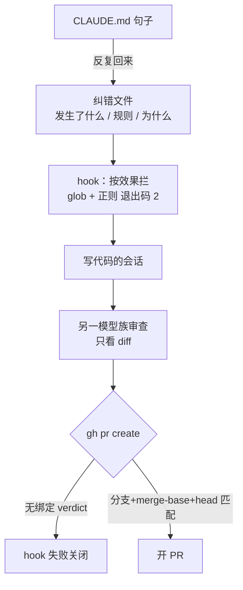

# CLAUDE.md 挡不住副作用：24,000 次提示词后的 harness 课

Claude Code

**一句话看懂**：Adit Lal 从 2026 年初起给 Claude Code 自建 harness，做 Android 应用日常开发，累计约 **24,000** 次提示。他发现：CLAUDE.md 里的规则拦不住**副作用**（Gradle 测试任务会先卸载 App）；同一条审查提示词跑两次，抓住的人审 bug 能差 7 个；真正停下来的规则，是 hook、只读模式和允许列表。第二模型审查要写进 hook，而且写代码的那次会话不能当唯一审查者。

## 读完你能带走的 7 条收获

1. **点名命令不够，要拦住效果**：规则写了不许 `pm clear` / 卸载，Gradle instrumented test 仍先卸 App 清数据（见 3.1）。
2. **会反复回来的规则，迁进代码**：hook 对照“过去失误”目录（glob + 正则，退出码 2 即拦）；Slack 提问用只读模式；测试机占用时拒安装；命令用允许列表不用拒绝列表（见 3.1）。
3. **同提示词两次审查差很大**：45 个人审 bug 回放，同一提示第一次 21/45、第二次 14/45；多数提示词改动的幅度还没这个方差大（见 3.2）。
4. **开 PR 前强制绑定审查裁决**：hook 在 `gh pr create` 前检查与分支、merge-base、head 提交绑定的 verdict；新提交要新审查；审查用另一模型族且只看 diff（见 3.3）。
5. **勾选完成不等于做了**：28 项一次勾完，构建 / lint / 3,460 单测全过，其中 3 项从未实现——唯一拦住的检查是“每项勾选对应的 diff 在哪”（见 3.3）。
6. **输出相对缓存读很小**：约三个月 5,900 万写出 token、142 亿缓存读（约 240:1）；写代码用中档、审查用最强且换家族（见 3.4）。
7. **本周可做的五步**：纠错文件、最差规则→hook、十个 bug 回放跑两遍、禁止自审自、看缓存读对输出比（见 3.5）。

::: tip 小白先懂这几个词
- [Harness（代理外壳）](/glossary#harness)：模型周围你拥有的一切——规则文件、Skills、hooks、MCP、CI、审查流程和粘合脚本。
- [Hook（钩子）](/glossary#hooks)：工具调用前后跑的脚本；Claude Code 里退出码 2 会拦下这次调用。
- [CLAUDE.md](/glossary#claude-md)：给 Claude Code 读的项目说明与规则文件。
- Diff：一次提交或分支相对基线改了哪些行。
- [Allowlist（允许列表）](/glossary#allowlist)：只允许名单上的命令；比“禁止这些危险命令”更不容易漏。
:::

## 1. 基本信息

<SourceCard type="文章" title="Harness Engineering: What I learned from 24,000 prompts building production apps" author="Adit Lal" date="2026-10-10" url="https://aditlal.dev/harness-engineering/" />

| 项目 | 内容 |
|---|---|
| 链接 | https://aditlal.dev/harness-engineering/ |
| 类型 | 个人博客（页面标注约 6 分钟阅读，正文约 1,500 词，含审查回放表与职责分工表） |
| 作者 | Adit Lal |
| 发布日期 | 2026-10-10（页面 “10 Oct 2026”） |
| 使用工具 | Claude Code（hooks、`claude -p`、本地 stats）；Codex 作第二审查；GitHub Actions；Slack 机器人 |
| 分析依据 | 原文全文，2026-10-22 抓取，引语逐字核对。24,000 为作者自述累计提示次数；审查回放是作者自己回滚到评论前的提交重跑；未公开原始 PR 列表。文末提到迁往 OpenCode + OpenRouter。“我觉得”开头的段落是本站评论。 |

## 2. 这篇在回答什么

你在 CLAUDE.md 里用大写写了“未经允许不许清 App 数据”，代理却跑了一条 Gradle 测试任务——任务自己先卸载，测试账号掉线。你不是没写规则，是规则点的是命令名，事故走的是副作用。

作者把 harness 定义成你拥有的整圈外壳，并声明自己站在**每天用代理写生产 App**的一侧，而不是造代理产品的一侧。文章要回答：哪些规则真的站住了、谁来检查代理的活、这套东西实际花多少上下文。

## 3. 怎么做

### 3.1 为什么 CLAUDE.md 里的规则站不住

8 月他让代理在测试机上跑 instrumented tests。Gradle 任务先卸载 App，数据被清，测试账号登出。CLAUDE.md 里已经用大写写了：未经允许不许清 App 数据。代理并没有自己去 `pm clear`——它跑的任务会卸。规则列了 `pm clear` 和卸载，**没列这条 Gradle 任务**，因为他当时不知道任务会先卸。

每次喊停代理说“别这样”，他就记一行：发生了什么、规则、为什么。现在有 24 条。几乎每次都是：模型能做这活，只是做多了——只要分析却改了代码、参考设计稿却直接套上、还在测的通话上又装了一包。

每条规则起初都是 CLAUDE.md 里的一句话，有几条还是回来了。全限定名规则连续两天叮了两次。**真正不再回来的，是迁进代码的那些**：

- 每次工具调用前的 hook，对照“过去失误”目录（每个文件是 glob + 正则）；退出码 2 时 Claude Code 拦住调用；
- Slack 上来的问题用只读模式，根本不给写工具；
- 知道另一会话占用测试机时，拒绝往上装；
- Slack 机器人命令从拒绝列表改成**允许列表**——拒绝列表漏过：`php` 能跑任意代码，`git update-ref` 能挪分支。

作者的收束句：

<Trans zh="点名的是效果，不是命令，并且用代码强制">“Name the effect, not the command, and enforce it in code.”</Trans>

我觉得这和 [[20]]、[[07]] 讲“把规范写清楚”不矛盾：写清楚仍必要，但**副作用路径**必须当代码缺陷修，不能当提示词缺陷修。和 [[80§3.2]] 里“代理改检查脚本”是同一类：关卡若只活在模型读得懂的地方，模型就能绕。

### 3.2 第二模型审查能抓住多少，方差有多大

他在会话里打过一行气话：一半时间要用 Codex 核验 Claude 的活，bug 还是进了 PR。随后回看约 25 个已合并 PR，捞出所有穿过开发、真机测试和他自己的 AI 审查、却被人审或用户抓住的逻辑 / 契约 bug——共 13 个。例如：网络模型里该是 `Boolean?` 写成了 `Boolean`；周期任务注册成 `KEEP` 而不是 `UPDATE`；逻辑键依赖会被 R8 改名的 `::class.simpleName`；重构时删掉“看似没用”、其实仍依赖的 fallback。

这些在演示里都不崩，写代码的代理只测自己心里的那条路径时也看不出。

于是他把 AI 审查回放到 4 个 PR 上人审标出的 45 个 bug：代码回到每条评论之前的提交。

| 设置 | 抓住的人审 bug |
|---|---|
| 同一审查提示，第一遍 | 45 中的 21 |
| 同一审查提示，第二遍 | 45 中的 14 |
| 最强模型当审查 | 45 中的 26 |
| 中档模型当审查 | 45 中的 19 |
| 九次独立跑、合并发现 | 45 中的 30 |

同提示同代码两遍差 7 个 bug；他试过的多数提示词改动，幅度还没这个大。合并多次独立审查有帮助；用更强模型审查、并用更强模型校验发现也有帮助——中档校验会丢掉 54% 的真发现，更强模型丢 14%。PR 也要小：130–177 个文件的 PR 上，哪种设置都差。

### 3.3 把“再审一次”做成 hook，并核对勾选

和规则一样，“再找人审”只有写进 hook 才稳定发生。Claude Code 要跑 `gh pr create` 之前，脚本检查是否存在与**确切分支、merge-base、head 提交**绑定的审查裁决；新提交就要新审查。审查者是另一模型族，而且只看 diff。这道门的第一版被 Codex 审过，发现可以轻易绕过，于是改成**失败关闭**（过不了就开不了 PR）。

还有一件仍让他不舒服的事：某个功能上代理一次勾完 28 项任务，构建、lint、全部 3,460 个单元测试和他的计划检查器都过了——其中 **3 项从未实现**。唯一抓住它的检查是：对每个勾选的任务，问 diff 在哪。

这和 [[59§3.2]]“实现者看不到用例”、[[12§3.1]]“测试全绿也要读代码”是同一警告的不同切面：绿灯只证明跑过的那几项。

### 3.4 成本形状，以及检查本身也有成本

4 月他写过控 token：一次会话拉起 14 个相同子代理烧掉 20.5M，改成给代码索引后降到 2.4M。再看总量：Claude Code 本地统计覆盖的约三个月，写出约 5,900 万 token，从缓存重读约 142 亿——大约 **每写出 1 个，重读 240 个**。对他来说账单里输出是小头，大头是每轮重读上下文，所以他尽量保持上下文开头不变以保住缓存（机制同 [[78§3.1]]、[[80§3.5]]）。

审查试验之后的分工：

| 活 | 什么管用 |
|---|---|
| 排序、路由、从列表里挑 | 最小模型 |
| 写代码 | 中档，重试时再升级 |
| 审查与校验发现 | 最强模型 |
| 检查做完的活 | 另一个模型族 |

检查也有成本：一个内部工具的计划检查器跑了十三轮才过，第 3 到第 10 轮都在同一自动关闭功能上挖出新边角；第 10 轮他删了这个功能。现在：同一子系统连续三轮审查失败，就改设计。

最耗他时间的失败，有时来自自己的脚本：`while read` 循环里的 `claude -p` 吞掉了 stdin，第一个之后的条目被静默跳过；超过 21,000 字符的 GitHub Actions 表达式让整个 workflow 失效且不通知人，审查机器人就这么停了。

### 3.5 作者说“这周就可以做”的五步

1. 开一个纠错文件：每次“别这样”记一行——发生了什么、规则、为什么。
2. 把最差的一条 CLAUDE.md 规则迁进 hook，按**效果**查（例如任何会清 App 数据的路径）。
3. 回放审查：上月人审抓住的十个 bug，在评论前的代码上跑你的 AI 审查，**跑两遍**，看结果抖多少。
4. 永远别让写代码的那次会话当唯一审查者。
5. 在 `~/.claude/projects` 里看缓存读对输出的比；他的大约是 240:1。

原文原话把第 4 条写得很硬：

<Trans zh="永远别让写代码的那次会话成为唯一审查它的人">“Never let the session that wrote the code be the only one reviewing it.”</Trans>

## 4. 结果与局限

**文章真正证明了什么**：

- 个人生产用法下，点名命令的规则会被副作用绕过；迁进 hook / 允许列表后更稳；
- 同提示审查存在大幅运行间方差；强模型 + 多跑合并 + 小 PR 更好；
- 开 PR 门禁可做成与提交绑定的 hook；“勾选 vs diff”能抓住假完成；
- 缓存读远高于输出；检查轮次本身可能逼你砍功能。

**局限与注意**：

- **单人、单 App（Android）经验**，不是受控实验；24,000 与 13/45 等数字无法外部复现；
- **审查回放样本小**（4 个 PR、45 个 bug），九次合并仍只到 30/45；
- **工具绑定**：Claude Code 退出码 2、`gh pr create`、Codex 第二审查；换工具要改接线；
- **文末产品迁移**：作者打算迁到自建 OpenCode + OpenRouter，本文写的是迁之前的 Claude Code 阶段。

我觉得它最适合放在“验收”而不是“看原理”：核心不是 harness 抽象定义（那是 [[07]]、[[66]] 的活），而是**这一次产出怎样被强制再看一眼**。和 [[60]] 的七层审查、[[75]] 的 AGENTS.md 规则、[[71]] 的验证栈可以串着读。

## 5. 结论

CLAUDE.md 擅长告诉模型你在乎什么；挡不住的是它顺手触发的副作用，以及“检查绿了”却没做的项。把最痛的规则写成按效果拦截的 hook，把第二模型审查绑到开 PR 的门上，并用“每个勾选对应的 diff”核对完成——这些比再写一段大写英文有用。

**你可以这样试**

1. 今天起每次喊停都记进 `corrections/`（或一个 markdown 表）。
2. 选一条反复破功的规则，写成 pre-tool hook，断言的是效果（清数据、碰生产、改门禁文件）。
3. 抽 10 个人审 bug，在评论前的提交上跑现有 AI 审查两遍，记下并集与方差，再决定要不要上强模型 / 多跑合并。

**读完自测**

1. 为什么“不许 pm clear”挡不住 Gradle instrumented test？
2. 同提示词两遍差 7 个 bug，对“再改一改审查提示词”意味着什么？
3. 3,460 个单测全绿，为什么还能有 3 项任务没实现？
