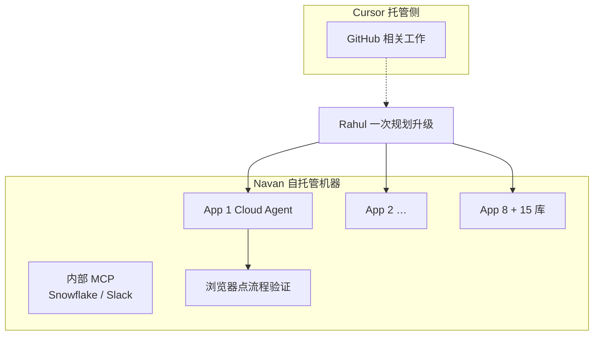

# 自托管 Cloud Agents：八个应用的迁移一周做完

Cursor

**一句话看懂**：Navan 最近一次 Spring Boot 4 迁移覆盖 **8 个应用和 15 个库**，大约一周做完，而且没有冻结开发。两年前同类迁移花了一个多月，还曾因一次坏合并锁住 master 一天。差别是 Cursor 的 **Cloud Agents 跑在 Navan 自托管机器上**：一次规划、多应用并行，同一批机器上还能拉起浏览器点流程，并接上 Snowflake / Slack 等内部 MCP。

## 读完你能带走的 6 条收获

1. **迁移时间从“一个多月”到“约一周”**：8 应用 + 15 库并行，不必锁仓等串行（见 3.1）。
2. **自托管机器跑真负载**：GitHub 类活可以在 Cursor 托管侧；内部 MCP 与浏览器验证放在自己的机器上（见 3.2）。
3. **旧方案绑死在“桌面开着会话”**：做不到并行和异步；Cloud Agents 让合上电脑也能继续（见 3.2）。
4. **产品侧也能从描述生成代理**：Cursor 跟已有设计模式，连初始 prompt 都代写，当天就能开测（见 3.3）。
5. **顶班与全栈跨界**：不熟的两个代码库，代理先拉日志和库表再讲解；约省两天冷启动（见 3.3）。
6. **审查和合并仍在人**：当结对程序员看推理、纠错假设；复杂改动进 staging 再上生产（见 3.4）。

::: tip 小白先懂这几个词
- [Cloud Agent（云端代理）](/glossary#background-agent)：不绑在你笔记本前台会话上、可在云端或自托管机器后台跑的代理。
- [Self-hosted（自托管）](/glossary#self-hosted-worker)：执行跑在你自己的机器 / 网络里，而不是全部交给厂商托管。
- [MCP（Model Context Protocol）](/glossary#mcp)：给模型接外部工具与数据源的协议；这里用来接 Snowflake、Slack 等内部系统。
- Workstream（工作流）：并行推进的一串相关改动；过去一次坏合并可能让多条工作流停摆。
:::

## 1. 基本信息

<SourceCard type="文章" title="Navan cuts a month-long migration down to a week, without freezing the codebase" author="Cursor Team" date="2026-10-16" url="https://cursor.com/blog/navan" />

| 项目 | 内容 |
|---|---|
| 链接 | https://cursor.com/blog/navan |
| 类型 | Cursor 客户故事（customers 栏目；正文约 1,200 词，含统计条与工程师引言） |
| 作者 | Cursor Team（页面 Author）；引言来自 Navan 的 Rahul Popuri、Elton Yang |
| 发布日期 | 2026-10-16（页面日期） |
| 使用工具 | Cursor Cloud Agents（自托管机器）；内部 MCP（Snowflake、Slack）；Automations / Skills / Memories；浏览器自动化 |
| 分析依据 | 原文全文，2026-10-22 抓取，引语逐字核对。时间为 Navan 口述对照；36%、10×、约 200 人等为页面统计条 / 正文数字，无原始数据表。这是厂商客户故事，带试用 CTA。“我觉得”开头的段落是本站评论。 |

## 2. 这篇在回答什么

大迁移一来，你通常得冻开发、串行改、祈祷合并别炸。Navan 说他们最近一次不用这样。

文章要讲清三块：迁移怎么从月级掉到周级；Cloud Agents 的活具体跑在哪；产品团队日常是否也被同样杠杆撬动。页面顶部给出的对照是：

- 约 1 周：跨 8 应用、15 库的 Spring Boot 迁移；
- 自 2026-04 起，积极使用 Cloud Agents 的工程师约 **10 倍**；
- 30 天窗口内，核心仓已合并 PR 里约 **36%** 带 Cursor 署名。

## 3. 怎么做

### 3.1 八个应用并行，而不是冻仓串行

两年前，把代码迁到新 Spring 版本花了高级工程师 Rahul Popuri **一个多月**。那段时间里不完整推送和回滚曾让 master **锁一天**；锁解开后，其他人还要再花几天追合并。更大的成本不是锁本身，而是一个月工程师时间耗在迁移而不是功能与缺陷。

最近一次迁到 Spring Boot 4，大约一周，对正在进行的开发打扰更小。做法是：Rahul **事先规划升级**，再把各组件交给跑在 Navan **自托管机器**上的 Cloud Agents，于是 8 个应用和 15 个库同时推进，而不是一个接一个。代理使用 Navan 内部工具，并在同一批机器上拉起浏览器，点流程验证自己的改动。

Rahul 的对比是：

::: tr 过去一次坏合并会让各条工作流停摆。这次我让八个应用同时动，同时尽量减小对正在进行的开发的打扰。
> "In the past, one bad merge brought workstreams to a standstill. This time I had eight apps moving at once while minimizing any disruption to ongoing development."
:::

他盯的不是单个任务，而是多个代理同时升级不同应用——他说这种并行规模几个月前还做不到。

### 3.2 真负载放哪：托管侧 vs 自托管侧

Rahul 几乎把工作都迁到了 Cloud Agents 上，并且拆得很清楚：

- **GitHub 相关工作**跑在 Cursor 托管基础设施上；
- **Snowflake、Slack 等内部 MCP**跑在 Navan 自己的自托管机器上；
- 同一批自托管机器上，代理还可以**拉起浏览器**验证改动；
- 其上再跑 Automations、Skills、Memories，于是评测循环和迁移可以异步继续，不必有人盯着。

这个模式已经超出一个工程师：Navan 大约 **200** 人在积极使用 Cloud Agents，相对 2026-04 约 10 倍。

对照旧方案：团队曾给前一个编码代理搭过真基础设施，但要求有人在一台桌面前**全程开着会话**——这直接排除了他们需要的并行与异步。

我觉得这一节是这篇对站内最有增量的部分：它把 [[51]] 的“执行放进自己的网络”落到一次真实迁移上，并明确**浏览器验证与内部 MCP 和写代码的代理同机**。和 [[70]] 的“每任务新 VM”不同，这里强调的是自托管持久机队上的并行，而不是每次全新沙箱；选型时要自己权衡隔离与内网可达。

### 3.3 产品团队：从描述到代理，以及顶班

费用与账单方向的 Staff 工程师 Elton Yang 从一段纯文字描述开始为工作流建新代理。Cursor 跟随团队已有设计模式，并**自己写出代理的 prompt**，于是测试可以当天开始，而不必先手写初稿几小时。

::: tr 我们甚至不必再自己写出代理的提示词。Cursor 跟着我们已有的设计，当天就能让一个代理跑起来。
> "We don't even have to write out the agent prompt ourselves anymore. Cursor follows our prior designs and gets an agent working the same day."
:::

团队承载力也变了：不少人离开原先的专职 AI-agent 团队后，**一个工程师**接手了过去要 2–3 个工程师、多个 sprint 的功能活。例子是手动银行连接：一人把 Angular 表单重做成 React，并补上后端，任务需要时从只做后端跨到全栈；个人工作流仍盯着新功能，而不是滑进纯维护。

顶班时：同事请假，Elton 要接手两个他不熟的代码库。他对代理说清问题，代理拉日志和数据库记录，在他打开任何一个文件之前先把问题铺开：

::: tr 我对这两个代码库都不是太熟。我说，&quot;问题在这，帮我搞清楚。&quot;它拉了日志和数据库，带我走了一遍，就像我已经在这个仓库里住了几个月。
> "I wasn't too familiar with either codebase. I said, 'Here is the issue, help me figure this out.' It pulled the logs and the database and walked me through it like I had been living in that repo for months."
:::

原文估计两个库合计大约省下**两天**冷启动，外加硬啃陌生仓的压力。

### 3.4 人仍负责判断和合并

审查仍在人。Elton 把代理当结对程序员，不当神谕：跑的时候看它的推理，发现错误假设立刻纠正。代码生成之后，走与其他改动相同的人审 + AI 审、测试、staging；复杂改动先在 staging 验证再进生产。代理计划和执行，**工程师做判断、对最终合并负责**。

## 4. 结果与局限

**文章真正给出的结果**（均为 Navan / Cursor 陈述，非本站实测）：

- 迁移：8 应用 + 15 库，约一周 vs 两年前一个多月，且曾锁 master 一天；
- 采用：积极使用 Cloud Agents 约 200 人、自 2026-04 约 10×；核心仓 30 天窗口约 36% 合并 PR 与 Cursor 相关；
- 产品侧：描述驱动出代理、顶班约省两天冷启动。

**局限与注意**：

- **厂商客户故事**：有试用 CTA，成功叙事完整，失败模式、成本、代理出错率几乎不写；
- **数字不可外部核对**：一周 / 一个月、36%、10×、200 人无方法说明；
- **环境细节不够**：自托管镜像怎么构建、浏览器与 MCP 的权限边界、与 [[51]] 文档的对应关系需另查；
- **迁移成功的因果**：并行 Cloud Agents 是主叙事，但“事先规划”、内部工具成熟度也可能是共因。

## 5. 结论

若你的痛点是“大迁移必须冻仓、一个人串行改八个服务”，Navan 的答案是：规划一次，把组件交给自托管 Cloud Agents 并行跑，并让内部工具和浏览器验证留在同一网络里。人从“盯一个 job”变成“监视一排代理”，但合并与 staging 判断仍留下。

**你可以这样试**

1. 列一份迁移或批量重构：哪些应用彼此文件不重叠，可以并行；重叠的共享库是否必须先串行。
2. 对照 [[51]]：哪些步骤必须碰内网（数据仓库、内部 MCP、打不开公网的管理后台），把这些放到自托管执行。
3. 给并行代理统一验收：同一套浏览器脚本或冒烟清单，避免“每个代理自己觉得绿”。

**读完自测**

1. GitHub 工作与 Snowflake MCP 为什么可以分在托管侧和自托管侧？
2. 旧编码代理“桌面会话必须开着”卡死了哪两种工作方式？
3. 文章里人仍然不能交给代理的是哪几件事？
