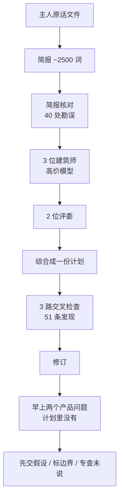

# 计划过了每一关，缺口在未说出口的假设

Claude Code

**一句话看懂**：Pierre-Laurent Medori 用十二个代理、约两小时写出一份 22,000 词的架构计划——三轮建筑师、两位评委、反方审查、51 条发现全部被接纳，代码引用还带 `file:line`。第二天早上他只问了两个产品问题，计划里都没有答案；缺口不在核对，而在**他从没说出口、却被今天的代码悄悄写成了约束**的假设。

## 读完你能带走的 7 条收获

1. **计划作者不要审自己的计划**：贵模型写计划，另一档模型（或另一模型族）负责访谈、编排和攻击（见 3.1）。
2. **证据只认可执行代码**：Markdown、docstring、目录名、提交说明都是线索，须用 `file:line` 回代码核实（见 3.2）。
3. **保留主人原话文件**：简报是改写，会漂；逐字文件才是需求核对的锚（见 3.2）。
4. **对 `file:line` 做抽查**：71 次抽查里约五分之一要修正，最糟的是把“打算加的字段”写成已存在（见 3.3）。
5. **“今天怎么工作”过了事实核对，会被读成“必须一直这样”**：未说出口的产品维度，对“对照你的话 / 对照代码”两种检查都是盲区（见 3.4）。
6. **开工前先交假设清单**：让模型写出“我默认了哪些你没说的事”，主人答完再开建筑师（见 3.5）。
7. **开放问题要当面问，不要堆在文末**：69 个问题约七十分钟逐题答完，才抽出三条原则写回计划（见 3.5）。

::: tip 小白先懂这几个词
- [Plan Mode（计划模式）](/glossary#plan-mode)：先写计划、等人批准再改代码的工作方式。
- [Subagent（子代理）](/glossary#subagent)：在独立上下文里干活、只交回结果的代理。
- [Workflow（工作流脚本）](/glossary#dynamic-workflow)：用 `agent()` / `parallel()` 编排多个子代理的脚本（见 [[85]]）。
- [完成标准](/glossary#definition-of-done)：事先写明的“什么叫做完”，不是代理自己说完成。
- [对抗式审查](/glossary#adversarial-review)：专门找茬、证伪的审查，而不是确认“看起来对”。
:::

## 1. 基本信息

<SourceCard type="文章" title="My AI-written plan went through every check I could think of. The gaps were in what I never said." author="Pierre-Laurent Medori" date="2026-10-22" url="https://dev.to/pierrelaurentmedori/my-ai-written-plan-went-through-every-check-i-could-think-of-the-gaps-were-in-what-i-never-said-3hf7" />

| 项目 | 内容 |
|---|---|
| 链接 | https://dev.to/pierrelaurentmedori/my-ai-written-plan-went-through-every-check-i-could-think-of-the-gaps-were-in-what-i-never-said-3hf7 |
| 类型 | 工程复盘（DEV Community；正文约 3,500 词） |
| 作者 | Pierre-Laurent Medori（GoodBarber 工程负责人） |
| 发布日期 | 2026-10-22（页面 Posted on Oct 22） |
| 使用工具 | Claude Code；常规模型做访谈 / 编排 / 攻击，高价模型写与改写计划；跨模型族审查 |
| 分析依据 | 原文全文，2026-10-23 用 curl 抓取并提取正文，引语逐字脚本核对。文中不披露具体系统与计划内容；数字来自作者自述的一次真实管线。“我觉得”开头的段落是本站评论。 |

## 2. 这篇在回答什么

你已经给计划上了“能想到的每一道检查”：只读映射、对照原话、对照代码、多角度建筑师、评委、反方、跨模型复核——第二天仍发现计划默认了你从未批准的产品方向。

作者回答三件事：这套管线怎么搭；缺口为什么漏网；下次先改哪几步。

## 3. 怎么做

### 3.1 角色：谁写计划，谁攻击计划

作者在 Claude Code 里问常规模型：计划该自己写，还是交给“最贵、最强”的那一档。对方选了高价模型写计划，自己留下做里程碑执行和审查，理由三条：迁移计划漏一条路径就会重付旧账——模型差距在这里最大；贵 2.5 倍对“一次性、管几周活”的计划可忽略；慢在日常难受，在一次性计划上无所谓。

它还补了一条作者差点忘的规则：

<Trans zh="计划的作者不该审自己的计划。">“the plan's author should not review its own plan.”</Trans>

角色因此定死：常规模型访谈、画地图、写简报、跑编排；高价模型规划；常规模型换身份攻击计划。我觉得这和站内“做与查分开”（[[15§3.3]]、[[59§3.4]]）同向，只是对象从代码换成了计划本身。

### 3.2 简报：只认代码，并钉住主人原话

映射邻接服务时，常规模型按目录名、路由、提交说明讲了一通。作者打了一句：

<Trans zh="别信文档。只信代码。">“Don't trust the docs. Trust only the code.”</Trans>

对方承认刚才那也是线索不是证据，改从可执行代码复核，并把规则写进后续每个代理，大意是：只读、不改库不连网；只有可执行代码算证据（引用 `file:line`）；Markdown / docstring / 注释 / 提交说明 / 目录名都是待核实线索；工作中不能问主人，不确定就写成开放问题并附上自己的假设。

另外两件作者说下次还会做：

1. **原话文件**：把主人提问与回答按顺序逐字落盘；简报是改写，会漂。
2. **开工前复述**：十二点“我理解成……”加四个会改计划走向的歧义问题；答完再写约 2,500 词简报，边跑边给人看，发现误解就停跑重开。

映射本身是三路并行的只读阅读代理，各自交回带证据的断言。

### 3.3 管线数字：评委分歧，引用仍要抽查

编排是 Claude Code 的 workflow 脚本：`agent()` 可钉模型和 effort。整次跑下来（作者表）：

| 步骤 | 谁 | 产出 |
|---|---|---|
| 简报核对 | 常规模型 ×2（对代码 / 对原话） | 40 处勘误（13 重大、27 次要），作为覆盖简报的勘误表 |
| 建筑师 | 高价模型 ×3（安全优先 / 对客户最稳迁移 / 输出质量优先） | 三份完整计划 |
| 评委 | 高价模型 ×2 | 打分、各选赢家、可嫁接想法 |
| 综合 | 高价模型，最高 effort | 一份计划 |
| 交叉检查 | 常规模型 ×3 | 51 条发现（3 阻断、26 重大、22 次要） |
| 修订 | 高价模型 | 逐条接受或拒绝并写理由 |

两次细节值得带走。**评委没达成一致**：一个选安全优先，一个选最稳迁移；把六项分数加总，前两名只差一分，且**没有评委选中自己总分最高的那份**——镜头比分数更重。综合以最稳迁移为底，嫁接另外两份。

**引用抽查**：评委对建筑师的 `file:line` 做了 71 次抽查，58 次原文成立，13 次要加限定（差几行到完全错）。最糟一类是：计划提议新增的字段，被写成“现有代码里已经有”。作者的结论是：即便是最强模型、明示只引用读过的代码，仍要抽查——**约五分之一需要修正**。

第一版还曾截断，常规模型从轨迹重建：13 个里程碑、32 个开放问题（每个带高价模型的工作假设）。

### 3.4 缺口：未说出口的，对照检查看不见

早上两个产品问题——作者不写具体内容——计划里都用“今天代码怎么工作”给了隐含答案。常规模型复盘漏因：

1. 只从主人说过的话工作，澄清的是句子里的歧义，**没有走过主人没提的产品基本维度**；
2. 简报把今天的边界写成系统事实，没标明可否挑战，高价模型叠在上面；
3. 需求核对比的是“主人说过的话”，事实核对比的是代码——**没人说出口的需求，两边都不是缺口**。

需求检查器其实抓到过一条“未明说但紧挨已说内容”的要求（切流前新系统是否必须覆盖旧系统全部能力）；真正要命的两条只被顺口带过，而今天的代码正是按相反方向建的。事实核对还帮倒忙：描述准确 → 通过 → 读成“必须如此”。

高价模型后来说得更狠：第一版把现有系统边界写成了架构保证，甚至把代码里指向那两条需求的弱信号记成了事实、没变成问题。它的处方是：计划应有一节

<Trans zh="下面这些是我默认了、但你没说的事">“here is what I'm taking for granted that you didn't say”</Trans>

### 3.5 第二轮与六条改法

作者没要补丁，而问：给高价模型这两条需求，**会不会动摇整份计划**？动摇就重写。两份独立评估加一个“存疑就取更严”的挑战者，三者同判：不是追加，是重做。重写后再受 44 条发现攻击；开放问题从 32 涨到 69，其中 14 个是盲点——未陈述、写成带假设的问题，而不是偷塞成需求。

69 个问题堆在 45,000 词文末没人答。作者改成当面问：改架构的一个一个问，其余按主题小轮；每题给代码现状、高价模型假设、常规模型建议。约七十分钟答完，抽出三条原先不在简报里的原则（并存部署不毁旧系统；只改一块不重写平台；依赖他团队时只陈述需要、方案留给对方）。第四版规则是：**发现永远盖不过主人的回答**，最多记风险。

随后另两家模型族审查 30 点（常规模型回代码核实：26 立、4 弃）；高价模型新会话先辩护再挑战主人答案——主人改掉多数被挑战的回答。第五版因用量上限，由常规模型接力拼到约 115,000 词。

作者自己要改的六条：

1. **先交假设，再开建筑师**——这里本可以几分钟，结果付了第二次两小时；
2. **把“今天如何”标成需求或可挑战事实**；
3. **专设一名只查未说维度的检查者**（工作单元、数据在哪、谁托管、终端用户是谁）；
4. **保留并持续写入原话文件**；
5. **高价模型用在一次性最值钱的地方，并写成分块以便另一模型接手**；
6. **让作者辩护计划，也允许它攻击你的回答**——对抗里主人答案才会变；模型替不了的，仍是回答那些问题。

## 4. 结果与局限

- **证明了什么**：一套可复述的多代理计划管线（角色、简报规则、步骤表、引用抽查率）；以及“全绿计划仍可能默认未授权产品方向”的诊断与改法。
- **口述 / 单次**：所有数字来自作者一次生产系统规划，无对照实验；具体系统与计划正文未公开，无法外部复现。
- **局限**：工具绑定 Claude Code workflow；跨模型审查依赖作者订阅；文末开放问题（如何让模型在交计划前主动报假设）没有标准答案。

## 5. 结论

核对越密，越容易把“今天代码里长什么样”误当成“产品必须怎样”。补检查器之前，先逼模型交出未说出口的假设，并让主人当面答开放问题。

**你可以这样试**

1. 下次开计划前，先要一节“我默认了你没说的事”，逐条答是 / 否 / 改写。
2. 简报旁保留主人原话文件；简报勘误以它为准。
3. 对计划里的 `file:line` 抽查至少二成，专抓“把提案写成现状”。

**读完自测**

- 为什么“对照代码全过”仍可能锁死错误产品方向？
- 计划作者审自己的计划，主要坏在哪一步？
- 开放问题写成文末清单，和当面逐题问，差别在哪？
