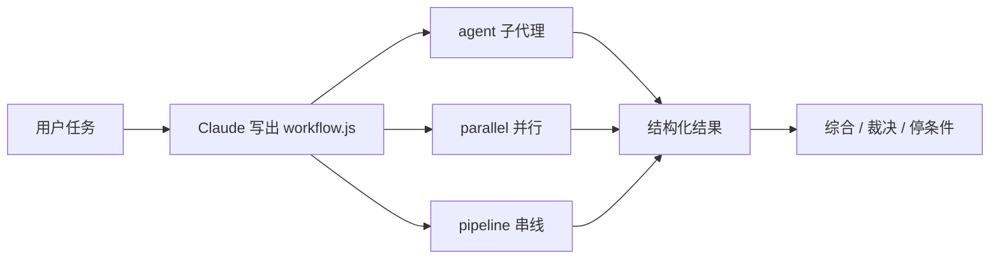

# 动态工作流：为任务现写多代理外壳

Claude Code

**一句话看懂**：Claude Code 可以在任务当场写出一段 JavaScript 工作流，用 `agent()` / `parallel()` / `pipeline()` 拉起带独立上下文的子代理。Thariq Shihipar 与 Sid Bidasaria 说明：长任务、强并行、对抗式验收时，默认单会话外壳会懒收工、偏袒自己、目标漂移；动态工作流用隔离上下文对抗这三类病，但也更费 token，不是每道题都该上。

## 读完你能带走的 7 条收获

1. **动态工作流 = 现写的多代理外壳**：一段可跑的 JS，能钉模型、是否进 worktree，中断后可从会话恢复（见 3.1）。
2. **单上下文三大病**：agentic laziness（做到一半就宣告完成）、self-preferential bias（偏袒自己的结果）、goal drift（压缩后丢约束）（见 3.2）。
3. **六种可组合模式**：分类后行动、扇出再综合、对抗式核验、生成再过滤、锦标赛、循环到停（见 3.3）。
4. **迁移 / 深研 / 逐条核验 / 检疫分流**是高频用例；Bun 从 Zig 迁 Rust 用的就是工作流（见 3.4）。
5. **触发词 `ultracode`**（或 `/effort ultracode`）可迫使写工作流；可与 `/goal`、`/loop`、token 预算合用（见 3.5）。
6. **常规写码多数不必上**：五人评审团之类的协调成本要自己挣回来（见 3.5）。
7. **保存后可当模板**：`s` 键保存到 `~/.claude/workflows`，或放进 Skill 当模板而不是逐字脚本（见 3.5）。

::: tip 小白先懂这几个词
- [Harness（外壳）](/glossary#harness)：包在模型外面的循环、工具、权限与编排。
- [Subagent（子代理）](/glossary#subagent)：独立上下文里的工人，只交回结果。
- [Worktree（工作树）](/glossary#worktree)：同一仓库的另一份工作目录，便于并行改码。
- [Context window（上下文窗口）](/glossary#context-window)：单次会话能装下的提示与历史。
- [Workflow（工作流脚本）](/glossary#dynamic-workflow)：用代码编排多个 `agent()` 调用的动态外壳。
:::

## 1. 基本信息

<SourceCard type="文章" title="A harness for every task: dynamic workflows in Claude Code" author="Thariq Shihipar and Sid Bidasaria" date="2026-06-02" url="https://claude.dev/blog/a-harness-for-every-task-dynamic-workflows-in-claude-code/" />

| 项目 | 内容 |
|---|---|
| 链接 | https://claude.dev/blog/a-harness-for-every-task-dynamic-workflows-in-claude-code/ |
| 类型 | 官方工程博客（claude.dev；约 11 分钟阅读） |
| 作者 | Thariq Shihipar、Sid Bidasaria（Anthropic，Claude Code 技术员工） |
| 发布日期 | 2026-06-02（页面 PUBLISHED） |
| 使用工具 | Claude Code 动态工作流；Claude Agent SDK / `claude -p`（静态对照）；模型可选 |
| 分析依据 | 原文 Markdown 全文（官方 `.md` 端点），2026-10-23 抓取，引语逐字脚本核对。“我觉得”开头的段落是本站评论。 |

## 2. 这篇在回答什么

默认 Claude Code 外壳很擅长写码，但安全审计、深研、代理团队、代码审查这类活，团队过去往往要在外壳外再搭一层。动态工作流让 Claude **为当前任务现写一层**，并可以分享复用。

文章回答：它怎么跑、治哪三种病、有哪些模式、什么时候别用。

## 3. 怎么做

### 3.1 工作流脚本里有什么

动态工作流执行一份 JavaScript，并提供几个特殊函数帮你拉起、协调子代理：`agent()` 起一个；`parallel()` 与 `pipeline()` 组合多个。标准的 `JSON` / `Math` / `Array` 也能用来处理数据。

尤其有用的是：工作流可以决定**子代理用哪档模型**、是否在**独立 worktree** 里跑，让 Claude 按任务选智力与隔离。会话被用户打断或终端退出后，恢复会话可以接着跑。

开头的示例提示包括：复现偶发失败并让竞争假说互相淘汰；从近 50 次会话里挖反复纠正并写成 `CLAUDE.md`；扫半年 Slack `#incidents` 找未开单的根因；从投资人 / 客户 / 竞品视角撕商业计划；给 80 份简历打分并双检前十；CLI 命名锦标赛；全库重命名；逐条核验博文技术断言。

### 3.2 为什么要动态外壳：三种失败模式

默认外壳在同一上下文里既规划又执行。许多写码任务够用；但长跑、大规模并行、强结构或对抗式任务会撞上：

- **Agentic laziness**：复杂多段任务做到一半就收工，例如安全审查 50 项只做了 35 项；
- **Self-preferential bias**：要它按量表核验或评判自己的产出时，偏袒自己；
- **Goal drift**：多轮尤其压缩之后，对原目标的保真度下降——每次摘要有损，“别做 X”一类约束会丢。

工作流的对策是：给子代理**各自的上下文**和**收窄的目标**。静态工作流（Agent SDK 或 `claude -p`）为了覆盖所有边角往往更泛；作者认为在 Claude Opus 4.8 上，模型已能写出贴合当前用例的定制外壳。

### 3.3 六种常见模式

作者给出 Claude 常组合使用的模式：

1. **Classify-and-act**：分类器决定类型，再路由到不同代理或行为；也可在结尾分类输出。
2. **Fan-out-and-synthesize**：拆成许多小步，每步一个代理，最后综合；综合是屏障——等全部扇出结束再合并结构化输出。
3. **Adversarial verification**：每个产出另派代理按量表对抗核验。
4. **Generate-and-filter**：先生成一批想法，再按量表 / 核验过滤、去重，只留高质量。
5. **Tournament**：不是分活，而是让 N 个代理用不同路径抢同一题，再两两对决直到出冠军。
6. **Loop until done**：工作量未知时循环拉起代理，直到停条件（无新发现、日志无新错误），而不是固定遍数。

### 3.4 用例：从迁移到检疫

- **迁移与重构**：把活拆成 callsite / 失败测试 / 模块等步骤；每个修复进 worktree，再对抗审查后合并。作者提到 Bun 从 Zig 重写到 Rust 用了工作流；并提醒限制高耗资源命令，以便尽量并行而不打满本机。
- **深研**：内置 `/deep-research` Skill 用动态工作流扇出检索、抓源、对抗核验主张、合成带引用报告；也可对 Slack 或代码库做同样结构。
- **深核验**：一代理列出事实主张，每条再派子代理细查，可选再派源质量审计。
- **排序**：上千行按定性标准排序时，用锦标赛或成对比较流水线——比较判断比绝对打分稳，括号由确定性循环持有。
- **规则遵守**：一条规则一个核验代理，再加怀疑者压假阳性；反向则可挖会话与审查评论，聚类、对抗验证“这条规则是否防过真错”，再写回 `CLAUDE.md`。
- **根因调查**：从日志 / 文件 / 数据等不相交证据生成假说，再过核验与反驳面板，结构上压偏袒。
- **大规模分流**：分类、去重、行动；**检疫（quarantine）**——读不可信公开内容的代理无高权限，真正行动的代理只看摘要。可与 `/loop` 合用持续跑。
- **探索与品味**：设计 / 命名等口味题，用量表审查或锦标赛选优。
- **轻量评测**：worktree 里多代理出结果，再派比较代理按量表打分，例如 refining Skill。
- **模型路由**：分类器先探复杂度，再在 Sonnet / Opus 间路由。

### 3.5 何时不用，以及提示技巧

工作流往往更费 token，适合复杂、高价值任务。作者问：这题**真的需要更多算力吗**？多数传统写码不需要五人评审团。多代理对单代理的取舍，也要让并行与专长挣回协调成本。

实用提示：

- 直接说“做一个工作流”，或触发词 <Trans zh="ultracode">“ultracode”</Trans>；
- 详细点名上面的模式，效果更好；也可要“quick workflow”做一次快对抗；
- 可重复的分流 / 研究 / 核验与 `/loop`、`/goal` 搭配；
- 可设 token 预算（例如提示 “use 10k tokens”）；
- 工作流菜单按 `s` 保存到 `~/.claude/workflows`，或放进 Skill 目录并在 `SKILL.md` 引用——作者建议把它们当**模板**，而不是必须原文照跑的脚本。

我觉得：站内 #80 讲失败在缝合处、要用 hook 硬拦；本文讲的是**何时值得为任务现写一层编排**。两者互补——工作流解决上下文与分工，hook 解决共享文件与门禁。

## 4. 结果与局限

- **证明了什么**：官方对动态工作流原语、失败模式、六模式与用例边界的说明；可核对的触发方式与保存路径。
- **未给的**：无对照实验、无 token / 成功率数字；Bun 迁移细节指向外部帖子。
- **局限**：功能随 Claude Code 版本变化；最佳实践“仍在形成中”；产品文同时推广新能力。

## 5. 结论

当任务又长又并行、又要互相拆台时，别把一切塞进同一个上下文——让模型写出一段小脚本，把工人隔开。但先问清楚：多出来的协调与 token，这题付不付得起。

**你可以这样试**

1. 对下一个“五十项清单”任务加 `ultracode`，看它是否扇出并设综合屏障。
2. 对一份报告要求“每条事实主张一个核验代理”。
3. 保存一次跑得顺的工作流，放进 Skill 当模板。

**读完自测**

- 三种单上下文失败模式各对应哪类任务？
- Fan-out-and-synthesize 的“综合屏障”解决什么？
- 检疫模式里，谁不能持有高权限？
