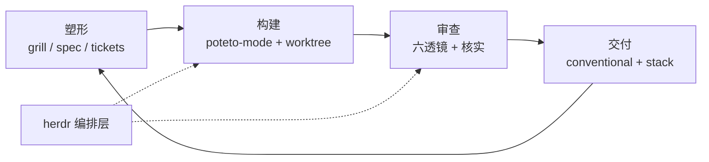

# 塑形—构建—审查—交付：一人多工具闭环

通用（不限工具）

**一句话看懂**：Damian Galarza 把日常收成一条四人环：**塑形 → 构建 → 审查 → 交付**。塑形用拷问式 Skill 先对齐问题（不是 plan mode）；构建用 pstack 的可验证 playbook 开并行；审查用六透镜并独立核实发现；工具可以在 Claude Code、Codex、Pi 之间换，**herdr** 把它们摁在同一套终端编排里。

## 读完你能带走的 7 条收获

1. **先塑形，再 plan mode**：塑形弄清问题与决策；plan mode 才谈怎么实现。问题塑好后，他很少再开 plan mode（见 3.2）。
2. **一人多外壳靠编排层**：Claude Code / Codex / Pi 按任务选；herdr 统一建 worktree、派代理、收通知，手机 SSH 续跑（见 3.1）。
3. **上下文四杠杆**：代码本身、工单（Linear MCP）、生产错误（Sentry CLI）、会议笔记与知识库路径（见 3.1）。
4. **构建用 `/poteto-mode`**：按 playbook 走；验证 Skill 让代理自证改动，编排才敢放手（见 3.3）。
5. **审查发现必须再核实**：六专科代理出意见后，主代理回代码复现，推测性条目丢掉（见 3.4）。
6. **交付用小而可叠的 PR**：Conventional Commits + GitHub stacked PRs（见 3.4）。
7. **工具会换，环不会**：弱在塑形就先投塑形，弱在验证就先投验证（见 3.5）。

::: tip 小白先懂这几个词
- [Worktree（工作树）](/glossary#worktree)：并行代理各自的工作目录。
- [MCP](/glossary#mcp)：把外部工具以标准协议接给代理。
- [Skill（技能）](/glossary#skills)：可按需加载的流程与脚本包。
- [Subagent（子代理）](/glossary#subagent)：被主代理派出去的隔离工人。
- [完成标准](/glossary#definition-of-done)：票上写清“怎样算做完”。
:::

## 1. 基本信息

<SourceCard type="文章" title="My Agentic Coding Workflow: Claude Code, Codex, and Pi" author="Damian Galarza" date="2026-10-21" url="https://www.damiangalarza.com/posts/2026-10-21-agentic-coding-workflow/" />

| 项目 | 内容 |
|---|---|
| 链接 | https://www.damiangalarza.com/posts/2026-10-21-agentic-coding-workflow/ |
| 类型 | 个人工程博客（约 27 分钟阅读） |
| 作者 | Damian Galarza |
| 发布日期 | 2026-10-21 |
| 使用工具 | Claude Code、Codex、Pi、herdr、pstack（Lauren Tan / poteto）、Matt Pocock grilling skills、Linear / Sentry / Fireflies 等 |
| 分析依据 | 原文全文，2026-10-23 抓取，引语逐字核对。文中含个人订阅与咨询 CTA；模型名与产品功能随时间变化。“我觉得”开头的段落是本站评论。 |

## 2. 这篇在回答什么

模型与外壳换得很快：作者一年前只写 Claude Code，现在一天内在三套外壳间切换。不变的是工作形状——如何让**一个人**稳定地派活、验收、叠 PR。

## 3. 怎么做

### 3.1 工具槽位与上下文

**栈**：Codex 适合较简单、一次性的活，桌面 / 手机续跑更顺；Pi（“primitives, not features”）用扩展补齐，并方便挂本地模型；Claude Code 在设计 / 前端与复杂编排上仍常回来——尤其 `ultracode`（把计划写成工作流并后台扇出）和 `/advisor`（关键节点咨询更强模型）。

**herdr**：为代理做的终端复用器。装上 agent skill 后，代理可以建 worktree、在里面起另一个代理、送 prompt；所有代理状态在一面板上；关终端不丢，可经 Tailscale + 手机 Termius 续上。作者的“工棚”是桌上一台不睡眠的 MacBook，外加 DGX Spark 跑本地 qwen。

**上下文**：Lauren Tan 的说法被引用为——代码库是代理最好的记忆，要先把错误推到架构 / 静态分析，再落到规则与 Skill。仓库外则接：

- Linear MCP 读写工单（双向写进度）；
- Sentry CLI（作者偏 CLI 甚于 MCP）拉堆栈；
- Fireflies / Granola 会议笔记 MCP；
- Notion 团队知识 + Obsidian 个人库（在各外壳的全局 `AGENTS.md` / `CLAUDE.md` 里写一行路径）。

### 3.2 塑形：拷问到决策树合拢

塑形 ≠ plan mode。作者写：

<Trans zh="Plan mode 帮代理想清楚怎么实现；塑形则保证在任何人谈到怎么做之前，我们已经理解问题。">“Plan mode helps an agent figure out how to implement a solution, while shaping makes sure we understand the problem well before anyone gets to the how.”</Trans>

塑形常用 Matt Pocock 的 Skill：`grill-me`（非写码问题的狠访谈）、`grill-with-docs`（边问边写 ADR 与术语表）、`domain-modeling`、`codebase-design`。README 原句被引用：

<Trans zh="被无情地访谈一份计划或设计，直到设计树的每个分支都解决。">“Get relentlessly interviewed about a plan or design until every branch of the design tree is resolved.”</Trans>

文中节选了一轮 artifacts 功能的拷问：谁看、词汇表、scope 模型、v1 种类、落在哪个模块——每问带推荐答案，主人覆写。结束后用内部 `spec-writer` / `issue-writer`（受 `to-spec` / `to-tickets` 启发）写成短规格与垂直切片工单：问题、方案、编号规则、决策、开放问题、怎么测、范围外；工单用规则 ID 回指规格，避免复制。

### 3.3 构建：pstack 与可验证并行

实现通常**换新会话**，避免继承塑形上下文。herdr 建 worktree 后按任务选外壳，统一用 pstack：

> pstack gives you fearless parallelism. when you can go deep on one agent and trust it to write good, verifiable code, you can truly parallelize with confidence.

入口是 `/poteto-mode`：描述任务 → 匹配约 23 个 playbook（修 bug / 功能 / 重构…）→ 把步骤拷进待办再动手。bug fix playbook 要求先复现与根因。原则层包括：偏删除与最小改动、先做杠杆（codemod/脚本）、修根因、**Prove it works**（对真值验证，不是“能编译”或代理自报）、**Never block on the human**（可逆决策先做，人事后纠偏）。

pstack **故意不提供规划 Skill**；README 写道作者不信规划，最好的规格是代码——这与塑形分工：塑形定做什么与为什么，pstack 在代码里把怎么做谈妥。

验证是底座：`/create-verification-skill` 生成项目本地驱动 CLI 与功能地图，代理才能自证。Epic 级任务由编排代理跑 `/poteto-mode`，按 issue 委派，并用 stacked PRs 串起来；形态可以是全 Claude、Claude 编排本地 qwen（经 Pi / herdr）、或全 Pi。

### 3.4 审查与交付

自建 `team-code-review`：六个专科透镜（架构、可读、测试、可维护、安全、文档）。关键一步：

主代理**独立核实每条发现**——打开引用代码、看调用方与测试、能复现才留下；推测性的丢掉。`herdr-code-review` 变体在**全新会话**里跑审查，避免继承实现上下文。

交付：`conventional-commits`；大编排用 `stacked-prs` + `gh stack`，每个 PR 一块、可审。

### 3.5 换工具也不换环

一年前这篇会只写一个工具；现在写三个加 herdr，明年名单大概又变。作者认为不变的是：好上下文、先塑形、验证让人敢放手。建议从环上最弱的一环投起——通常是塑形或验证。

我觉得：塑形段与 #64 的 `/grill-me`、#84 的“先交假设”同向；构建段的“验证才能并行”与 #26、#80 同向。全文是个人工位配置，评分要扣在可迁移性上。

## 4. 结果与局限

- **证明了什么**：一条可抄结构的环，以及具体 Skill / 命令名、角色分工。
- **未证明**：无团队对照数据、无成本与失败率；“八个 PR / 天”等不在本文（那是另一篇付费文的数字，本文未给）。
- **局限**：强依赖作者的 Skill 库与 herdr / pstack 生态；文末有咨询 CTA；模型与产品名时效快。

## 5. 结论

外壳可以换，环不能散：先把问题拷问清楚，再交给能自证的构建与核实过的审查，最后用小 PR 叠出去。

**你可以这样试**

1. 下一张大票先跑一轮 `grill-with-docs`，再拆垂直切片。
2. 给仓库生成验证 Skill，要求代理“对真值证明”，禁止只报编译通过。
3. 审查会话与实现会话分开；发现必须回代码核实。

**读完自测**

- 塑形和 plan mode 各解决什么问题？
- 为什么 pstack 不提供规划 Skill？
- 六透镜审查后，为什么还要主代理核实？
