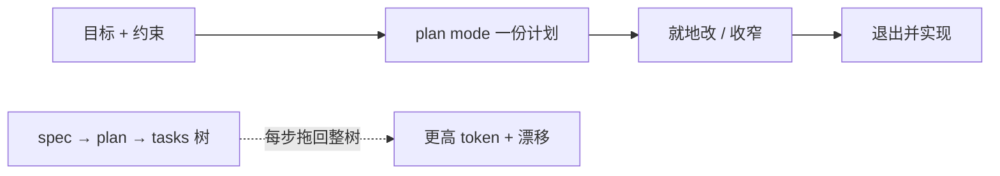

# 规格驱动贵在哪：改用 plan mode

Claude Code

**一句话看懂**：Matthew Wilson 在多项目上跑过 Spec-Driven Development（规格驱动开发）后的结论是：层级化的 spec / plan / task 脚手架**烧大量 token、文档互相漂、代码质量并不更好**。在按量计费下，他改回 Claude Code 的 plan mode——一份可改的计划、一轮对齐、再写代码。

## 读完你能带走的 6 条收获

1. **单功能的 SDD 层级会把整棵树反复塞进上下文**：每层单独推理，实现时又拖回整棵父树，账单和“上下文腐烂”一起涨（见 3.1）。
2. **产物会漂**：任务表、验收标准和高层规格、代码三者结束时常互相矛盾，没有同步机制（见 3.1）。
3. **多花的钱没换来更好的代码**：作者、Prezi、Scott Logic 都报告“差不多，甚至更慢 / 更贵”（见 3.1）。
4. **替代循环只要三步**：说清目标与约束 → 就地改计划 → 退出 plan mode 实现；大块再切成阶段（见 3.2）。
5. **长期规格仍值得**：公开 API、受监管领域、要守三年的 ADR 是另一回事；反对的是**为单次功能生成脚手架**（见 3.3）。
6. **被自己的工作流架构图打动时先停一下**：多数“仪式感”是模型周围的管道费，账单已落到工程线（见 3.3）。

::: tip 小白先懂这几个词
- [Plan Mode（计划模式）](/glossary#plan-mode)：先写计划、等人批准再改代码。
- [Spec-Driven Development（规格驱动开发）](/glossary#spec-driven-development)：先生成规格 / 计划 / 任务层级，再让代理按叶节点实现。
- [上下文工程](/glossary#context-engineering)：刻意选择放进窗口的内容，而不是堆得越多越好。
- [完成标准](/glossary#definition-of-done)：事先写明怎样算做完。
- Token：模型按输入 / 输出计费的基本单位；用量现在是工程约束，不只是财务问题。
:::

## 1. 基本信息

<SourceCard type="文章" title="Spec-driven development is dead. Long live plan mode" author="Matthew Wilson" date="2026-06-19" url="https://instil.co/blog/spec-driven-development-is-dead-long-live-plan-mode" />

| 项目 | 内容 |
|---|---|
| 链接 | https://instil.co/blog/spec-driven-development-is-dead-long-live-plan-mode |
| 类型 | 工程博客（Instil；Senior Architect） |
| 作者 | Matthew Wilson |
| 发布日期 | 2026-06-19（页面 `datePublished` 2026-06-19T08:45:00+01:00） |
| 使用工具 | Claude Code plan mode；对照 GitHub spec-kit 等 SDD 工具 |
| 分析依据 | 原文全文，2026-10-24 抓取。文中数字多为作者多项目自述并引用外部报告，非受控实验。“我觉得”开头的段落是本站评论。 |

## 2. 这篇在回答什么

同事刚论证过：token 账单已变成工程师要设计的约束，而不是别人家的财务问题。本文接着问：在这种账单下，**还该不该用一整套规格驱动脚手架**？

作者的主线是：SDD 为“无限 token”世界设计；按量计费后，它的层级产物既贵又漂，又未必更好——plan mode 留下“先想清楚”的价值，去掉其余仪式。

## 3. 怎么做

### 3.1 SDD 在项目里实际发生了什么

作者并不否认规格的价值。他引用 Sean Grove 的观点：工程师价值很大一块是“结构化沟通”——钉问题、记约束、规划、定义如何知道做对。Birgitta Böckeler 把空间分成 spec-first / spec-anchored / spec-as-source；GitHub spec-kit 偏前一类：脚手架出规格、计划、子计划、任务表，再驱动代理走叶子。

他在不同形状的项目上多次试用后，反馈总类似：

::: tr 它用了很多 token，造了很多文件，却不一定交出预期结果。
> "It used a lot of tokens, made a lot of files but didn't necessarily deliver the outcome expected."
:::

三条反复出现的观察：

1. **很贵、很慢。** 每个产物单独推理，还要带着父级上下文；到任务层时，整棵层级几乎每步都过一遍模型。作者写：spec-kit 项目上的成本是同等范围 plan-mode 流程的数倍；GitHub 工单有 Pro 档不到一小时烧光额度的报告；Scott Logic 同范围对照里 spec-kit 大约慢十倍。
2. **产物漂离代码。** 实现开始后，任务与验收标准漂离高层规格，两者又漂离代码；结束时文档互相打架。没有机制把它们钉在一起。
3. **输出并不更好。** Prezi 工程团队、Scott Logic 的复盘都落到相近位置：代码“还行”，但不比迭代提示更好，工作流甚至放过简单 bug。

更深一层，他借 Andrej Karpathy 的“上下文工程”说：工业级 LLM 应用真正的技能是**精确选择放进窗口的东西**。SDD 几乎相反——生成大量产物，再整棵拖回模型。Drew Breunig 所说的 context rot（上下文腐烂）随之而来：模型被陈旧计划分心、靠堆积上下文而不是眼前任务、开始自我重复。你付两次：一次输入账单，一次输出变差。

我觉得这和站内“计划要短、要可验收”（[[68]]、[[64]]）同向，只是把账算到了**层级脚手架本身**上。

### 3.2 他改用的循环：plan mode

替代方案很短：

1. 说清目标与约束，让代理读相关代码；
2. 在 plan mode 里就地改计划：反对、要备选、收窄范围；
3. 计划扎实后，退出 plan mode 实现。

大块工作会要求把计划拆成阶段，再用 Atlassian MCP 扇出成 Jira 子任务——但基本循环仍是：**一份文档、一轮迭代、然后代码**。

理由也不神秘：规格里大部分价值来自“开工前强迫你想清楚”；plan mode 已经强迫这件事。子计划、任务表、验收层级在纸上看像严谨，却不必然做它们声称的工作。Simon Willison 区分“接受模型给什么都行的 vibe coding”和“把 LLM 当打字助手、代码要你看过懂过”；plan mode 按设计是后者——你签署的是自己读过的计划。

### 3.3 什么时候规格仍值得；什么时候别再加仪式

作者不反对规格，反对的是**通往写代码路上由 AI 生成的产物层级**。若规格是长期产物、活过任意一次实现（公开 API、受监管领域、三年后还要辩护的 ADR、多团队会重做的产品面），账就不同：规格做真工作，付一次、用多次。他反对的是为**单个功能**生成 spec / plan / sub-plan / tasks。

同文还点了两类“把人的协调税搬给模型”的模式：多角色子代理演敏捷仪式、把 TDD 红绿重构编码成额外回合——对人有用的协调协议，模型窗口里往往只是全价 token。测试仍重要，但强迫模型按固定顺序先发明测试，常常不划算。

结语：

::: tr 如果你发现自己被 AI 工作流的架构图打动，把这当成警告旗。
> "If you find yourself impressed by the architecture diagram of your AI workflow, treat that as a flag."
:::

按量计费后，仍能交付的最便宜工作流会默认胜出——那通常不是 SDD。

## 4. 结果与局限

- **真正支持的**：多项目上的定性复盘 + 外部报告（spec-kit 工单、Scott Logic、Prezi、Böckeler 综述）指向“贵、漂、未必更好”。
- **未给出的**：作者自己的逐项目 token 表、与 plan mode 的成对 A/B。
- **局限**：立场鲜明的一篇反对文；样本是“一把项目 + 最近两周和三位资深工程师的对话”。长期规格场景被明确留出例外。工具绑定 Claude Code plan mode 的手感，原则可迁移。

## 5. 结论

规格驱动的层级脚手架，在按量计费下经常是**为一次功能付一整棵文档税**。plan mode 留下“先对齐再动手”，去掉其余仪式。

**你可以这样试**：下次中等功能只开 plan mode，改到你愿签字；刻意不生成 task 树。记一笔：改了几轮、实现后计划漂了没有、账单体感如何。

**读完自测**：你仓库里的“规格”是活过多次实现的契约，还是单次功能的脚手架？若是后者，删掉哪一层最不心疼？
