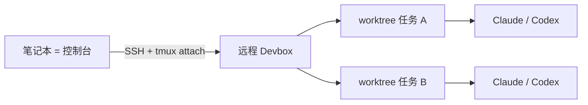

# 远程 Devbox + tmux + worktrunk：笔记本变控制台

通用（不限工具）

**一句话看懂**：Charles 把日常定成三件套——**远程常开的 Devbox、tmux 保活会话、worktrunk 给每个任务单独 worktree**。模型不会因此更聪明，但解决了两件更土的事：并行任务互不踩文件，合上笔记本也不中断。

## 读完你能带走的 6 条收获

1. **人从写手变成调度**：拆需求、分上下文、回来审结果（见 3.1）。
2. **并行靠 worktree，不靠多克隆**：worktrunk 管目录命名与切换；会话历史跟工作目录绑得更干净，`--resume` 更不易串台（见 3.2）。
3. **执行放远程，笔记本只做入口**：Devbox 常开；断网、合盖不影响远程任务（见 3.2）。
4. **tmux 让 SSH 断开也可续**：`tmux new -A -s agents` 一别名即可重回同一会话（见 3.2）。
5. **离开前写清 `/goal`**：目标、边界、如何验收；比 24/7 空转烧 token 更重要（见 3.3）。
6. **未解：多机配置同步、剪贴板图进远程**；不必为了“代理平台”再买一套 GUI / 网关（见 3.3）。

::: tip 小白先懂这几个词
- [Worktree（工作树）](/glossary#worktree)：同一仓库的第二份工作目录，分支隔离。
- Devbox：常开的远程开发机；笔记本只 SSH 进去。
- tmux：终端复用器；断线后会话仍在服务器上。
- [完成标准](/glossary#definition-of-done)：离开前写进 `/goal` 的验收方式。
- 控制台：人只连上去看输出、下指令，不在本机跑重活。
:::

## 1. 基本信息

<SourceCard type="文章" title="My Coding Agent Workflow — devbox + tmux + worktrunk" author="Charles" date="2026-07-05" url="https://rustc.cloud/posts/coding-agent-workflow/" />

| 项目 | 内容 |
|---|---|
| 链接 | https://rustc.cloud/posts/coding-agent-workflow/ |
| 类型 | 个人工程博客（约短文） |
| 作者 | Charles（rustc.cloud） |
| 发布日期 | 2026-07-05 |
| 使用工具 | Claude Code / Codex + worktrunk + 远程 Devbox + tmux |
| 分析依据 | 原文全文，2026-10-24 抓取。配置片段来自原文；无团队对照数据。“我觉得”开头的段落是本站评论。 |

## 2. 这篇在回答什么

本地跑代理时，他常不敢合盖：通勤还得热点挂着看有没有卡住。同一仓库并行多个需求时，曾经靠多次 `clone`，目录和分支互相污染，还要先搞清“我到底在哪个副本、哪条分支”。

文章回答：不换更强模型，用三件常见工具把**并行**和**不断线**钉住。

## 3. 怎么做

### 3.1 角色怎么变

路径是：手写 → Copilot 补全 → Cursor Apply → Claude Code / Codex 这类托管代理。写代码不再单线程“开一个仓、做一个需求”；任务可以交给代理，人更像调度：拆需求、分上下文、回来审查。

### 3.2 三件套与可复制配置

| 部件 | 解决什么 | 作者怎么用 |
|---|---|---|
| worktrunk | 同仓多任务互踩文件 | 约定主干在 `git-repo/`，任务在 `git-repo-worktree/{branch}/`；少手写 `git worktree` |
| Devbox | 合盖 / 断网任务停 | 代理跑在常开机器；笔记本只做入口 |
| tmux | SSH 掉线丢现场 | 远程窗口、日志、交互态仍在；重连续看 |

额外好处：Claude Code / Codex 把会话历史跟工作目录绑得更紧，`--resume` 更不易恢复到错误上下文。

配置原文：

::: tr 本地别名：SSH 上去并附着（或创建）名为 agents 的 tmux 会话。
> alias devbox=' ssh -t host "tmux new -A -s agents"'
:::

`host` 写在 `~/.ssh/config`。`new -A`：有则附着，无则创建。

worktrunk 目录规则：

::: tr worktree 路径模板：仓库旁的 `仓库名-worktree/经消毒的分支名`。
> worktree-path = "{{ repo_path }}/../{{ repo }}-worktree/{{ branch | sanitize }}"
:::

`~/.tmux.conf` 他只开了鼠标：`set -g mouse on`。

### 3.3 日常循环与边界

日常四步：

1. 在主仓用 worktrunk 为任务开 worktree；
2. 进入该目录，启动 Claude Code 或 Codex；
3. 用 `/goal` 写清目标、边界、如何验收；
4. 回来再跑 `devbox`，看该窗口的输出、diff、测试。

重点不是“我睡觉时代理把一切做完”，而是**任务状态不被我自己的设备状态打断**——笔记本从执行环境变成控制台。

他试过把内网机暴露到公网网关、换 GUI、买新项目管理模型的社区方案，觉得都不如直接复用 SSH、tmux、git worktree 自然。未解两题：多台远程机之间的配置同步（chezmoi / syncthing 仍有小不一致）；远程 tmux 对剪贴板图片不友好，截图还得先传到远程。

结语很克制：他不太需要手机遥控；**想清楚让代理做什么、把 `/goal` 验收写清**，比 24/7 空转产垃圾代码更重要。

我觉得这和 [[23]]、[[11]] 的 worktree 并行同族，补上的是**远程保活**这一层；和 [[79]] 手机控制台不同路径——他刻意把“想清楚”放在连接方式之前。

## 4. 结果与局限

- **证明了什么**：一套可抄的个人工位；痛点与配置具体。
- **没证明什么**：无速度 / 合并率 / 失败率数据；单人经验。
- **局限**：依赖你有一台常开远程机；worktrunk 是作者偏好的封装，也可用原生 `git worktree`；剪贴板与多机同步仍手搓。

## 5. 结论

并行靠隔离，不断线靠远程会话；模型智商之外，先把执行环境从笔记本上拆走。

**你可以这样试**：一台小 VPS 或闲置主机，装好 tmux；一个仓库用 worktrunk（或手写 worktree）开两个任务窗口；每个窗口启动前写三条 `/goal`（目标 / 不做 / 如何验）。合上笔记本一小时，再 attach 看还在不在。

**读完自测**：你现在的“并行”是多 clone、同目录多会话，还是一任务一 worktree？合盖后任务会不会死？
