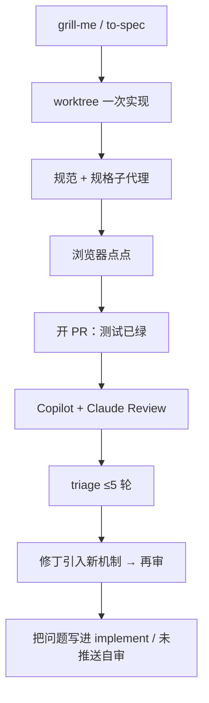

# 六轮机器人审查：补丁踩踏机与提前发问

Claude Code

**一句话看懂**：Chris Jones 用一次已绿的 PR 说明——自测、规范审查、规格审查、浏览器点点都过了，Copilot 与 Claude Code Review 仍挖出 **32 条真问题**，修了五轮还在转。原因不是机器人更神，而是**预审在问别的问题**；修丁引入的 job / 锁 / 重试又变成下一轮的审查面。

## 读完你能带走的 7 条收获

1. **预审与机器人在回答不同问题**：规范、规格忠实、快乐路径点点，不问队列失败、磁盘返回值、webhook 是否重试（见 3.2）。
2. **32 真 / 0 幻觉**（另有设计选择与次要项）：五族失败模式可收成检查清单（见 3.2）。
3. **修丁会制造新审查面**：给超时拆 job、给删除加唯一键……下一轮审的是新机制（见 3.3）。
4. **硬上限很重要**：`triage-github-pr` 最多五轮修；用满后还有第六轮进来（见 3.1）。
5. **把机器人的问题前移**：`implement` 开 PR 前加正确性一轮；triage 先审未推送的修丁（见 3.4）。
6. **代码库事实写进持久记忆**：磁盘不抛错、webhook 60 秒超时等，下次功能开工就带着（见 3.4）。
7. **本文不证明机器人强于代理自审**：证明的是审查指令里缺了它们会问的那类问题（见 3.4）。

::: tip 小白先懂这几个词
- [PR 审查机器人](/glossary#pr-review-bot)：在 Pull Request 上自动留言的审查代理（本文为 Copilot 与 Claude Code Review）。
- [完成标准](/glossary#definition-of-done)：开 PR 前自检问的是不是同一批问题。
- [Worktree（工作树）](/glossary#worktree)：实现放在隔离目录再开 PR。
- triage：分类每条机器人意见——真问题 / 设计选择 / 过时 / 次要。
- 踩踏机：修 A 引入机制 B，B 再被审出 C。
:::

## 1. 基本信息

<SourceCard type="文章" title="Six Rounds of Bot Review on One PR" author="Chris Jones" date="2026-10-03" url="https://leek.io/articles/six-rounds-of-bot-review-on-one-pr" />

| 项目 | 内容 |
|---|---|
| 链接 | https://leek.io/articles/six-rounds-of-bot-review-on-one-pr |
| 类型 | 个人工程复盘（约 1,640 词） |
| 作者 | Chris Jones（leek.io） |
| 发布日期 | 2026-10-03（`dateModified` 2026-10-06） |
| 使用工具 | Claude Code；GitHub Copilot 与 Claude Code Review；自研 `triage-github-pr` 等 Skill |
| 分析依据 | 原文全文，2026-10-24 抓取。数字来自作者单次 PR 自述；医疗 CME 场景细节从略。“我觉得”开头的段落是本站评论。 |

## 2. 这篇在回答什么

功能已过测试、静态分析、代理自审和人工点点，作者仍觉得“做完了”。机器人却挖出 32 条他逐条核实为真的问题——六轮审查、五次修丁提交、又添约 1,600 行。他要弄清：**为什么必须一推一审地磨**，以及下次把哪些问题提前问。

## 3. 怎么做

### 3.1 开 PR 之前已经很重

整条管线在一次长 Claude Code 会话里：一句话需求 → `/grill-me`（六个决策，十一个默认并列出可推翻；中途还派研究子代理读监管一手材料）→ `/to-spec`（PRD、构建契约、27 用户故事、测试缝）→ 不拆票、在 worktree 里按规格一次做完并开 PR（UI 三方向、后端测驱、邮件适配器、治理过的 AI 用途与评测集、提醒、三语、Terraform）→ 两个全新上下文子代理（对仓库规范、对规格）→ 浏览器点完全流程 → PR：**121 文件、约 8,100 行、70 个功能测试，全绿**。

规格审查已抓到一个真 bug（提前开始下一执照周期会藏住仍在进行的周期），先写失败测试再修。浏览器又抓到测试环境有、线上 PHP-FPM `PATH` 没有 `pdftotext` 这类问题。

### 3.2 机器人找到了什么

仓内每个 PR 固定接 Copilot 与 Claude Code Review。另有 `triage-github-pr`：先自己审 diff，再对照机器人结论分类、修真问题、回帖并 resolve，**硬顶五轮**以免在新鲜吹毛求疵上无限转。这次用满五轮，上限后又来第六轮。

最终：32 真、4 条驳回为已记录设计、4 次要、1 过时、**零幻觉**。按类而不是按轮看，大致五族：

| 族 | 约数 | 例子 |
|---|---|---|
| 副作用失败时怎样 | ~10 | 存储磁盘返回 `false` 不抛错 → 写 PDF 失败仍建了记录 |
| （其上）成功标在持久化之前 | — | “已回复”标记在通知入队前就提交 |
| 竞态与重复 | 4 | 重叠校验在事务与锁外 |
| 新入口缺旧闸门 | 4 | 禁用账号不能登录，仍能转发证书邮件 |
| 一边有界另一边无 | 7 | 手填拒未来日期，AI 读取路径不拒 |
| 两个写者对同一事实不一致 | 4 | demo seeder 与真实摄入哈希 PDF 方式不同 → 重传双计 |

作者原话点破：

::: tr 代理在开 PR 前跑的每一项检查，回答的问题都和机器人问的不同。
> "Every check the agent ran before the PR answered a different question from the one the bots asked."
:::

规范审查明示“不是找 bug”；规格审查看忠实；点点看快乐路径；测试覆盖作者想到的。没人问队列推送失败、磁盘失败返回值、webhook 提供方是否重试 401（SNS 不重试——第六轮）。每轮审查大约半小时。

### 3.3 踩踏机：修丁变新代码

他本预期轮次会缩小。实际是：修超时 → 每个 PDF 可恢复 job → 下一轮发现“已回复”标在入队前；修删除共享路径 → 唯一键 → 下一轮发现删除失败仍报成功、私有 PDF 孤儿；提醒失败释放 claim 再抛错 → 下一轮发现抛错中止了同批其他医生的提醒。

::: tr 加上机制的修丁就是新代码，新代码要被审查。你推送前不审，机器人会一轮一轮审。
> "A fix that adds a mechanism is new code, and new code gets reviewed. If you don’t review it before you push, the bots will, one round at a time."
:::

### 3.4 他改了 Skill，而不是怪机器人

32 次机器人是对的。他把问题写进更早的步骤：

- `implement` 在规范 / 规格审查之外，开 PR 前加一轮**全新上下文的正确性检查**（副作用失败返回值、成功是否在持久化前、catch 是否把瞬时变终态、单条失败是否中止整批、串行是否卡在 job 超时、重复 / 并发、新入口是否继承登录闸门与表单边界、两写者是否同算法、抄的兄弟模块你漏了哪段——Terraform 那次漏绑了一个 IAM 主体，第二轮才抓到）。
- `triage` 以前是修 → 推 → 再审新范围；现在**先审未推送的修丁**，对修丁新加的机制问同一批问题，同轮内再修，争取少一轮半小时。
- 仓特异事实（磁盘不抛错、webhook 60 秒、某匹配不查禁用账号）写入代理持久记忆。

本文不证明机器人比代理自审更强：规格审查在机器人见代码前就抓过矛盾。它证明审查指令里缺了那类问题。下次他要看的是：清单能否在机器人之前拦住同类失败，以及它们还会找出哪些他仍没想到要问的。

我觉得这和 [[33]] Bugbot、[[22]] CI 自动修、[[60]] 七层把关同属“接进 PR”轴，独特处是把**踩踏机**写清楚，并落到可改的 Skill 文本。

## 4. 结果与局限

- **证明**：单次真实 PR 上 32 条经人工核实的真问题、零幻觉；五轮上限与踩踏机机制可核对叙述。
- **未证明**：清单在下一功能上的效果（作者写明还不知道）；机器人相对自审的系统优势。
- **局限**：单仓、单 PR、医疗合规领域；机器人组合与 Skill 名绑定作者工位。

## 5. 结论

绿灯与“问错了题的预审”挡不住另一类缺陷；修丁若引入机制，就会续租审查轮次。把机器人已经证明会问的问题，写进开 PR 前和推送前。

**你可以这样试**：从最近一次机器人真阳性里摘 8–10 条问句，贴进开 PR 前的自审 Skill；给自动修循环加硬顶，并规定“未推送先自审”。

**读完自测**：你的预审在问规范 / 规格 / 快乐路径，还是也在问副作用失败与双写者？修 CI 时有没有先审修丁本身？
