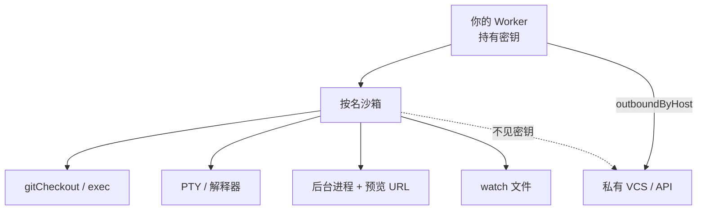

# 代理也要一台完整电脑：Cloudflare Sandboxes GA

<div class="meta-tags"><span class="tool-tag tool-general">通用（不限工具）</span></div>

<div class="hook">

**一句话看懂**：Cloudflare 把 Sandboxes 推到 GA：每个会话一台可休眠的隔离环境，带真终端、可持久的代码解释器、预览 URL、文件监视、**网络层注入凭据（代理永远拿不到密钥）**，以及快照冷启动。目标不是“能跑一条命令”，而是让代理拥有和人一样紧的反馈环。

</div>

## 读完你能带走的 7 条收获

1. **按名取沙箱**：同 ID 全球可找回；空闲休眠，请求再醒（见 3.1）。
2. **凭据走出口代理**：`outboundByHost` 在网络层加头，沙箱进程不见密钥（见 3.2）。
3. **真 PTY，不是请求—响应假终端**：WebSocket + xterm；服务端缓冲，重连可回放（见 3.3）。
4. **解释器上下文跨调用保状态**：像笔记本一样，上一步的 `df` 下一步还在（见 3.3）。
5. **后台进程 + `waitForLog` / `exposePort`**：用真实就绪信号代替 `sleep(2000)`（见 3.4）。
6. **`watch()` 吃 inotify**：保存即触发类型检查 / 测试（见 3.4）。
7. **快照 / 备份**：从“clone+install 约 30 秒”降到“恢复约 2 秒”；可从同一快照叉出多个并行沙箱（见 3.5）。

::: tip 小白先懂这几个词
- [沙箱（Sandbox）](/glossary#sandbox)：隔离的执行环境；这里是持久、可休眠的容器电脑。
- [凭据注入](/glossary#credential-injection)：在网络出口代填认证，不把密钥放进代理可见环境。
- PTY：伪终端；支持交互、中断、重连，而不只是“跑完返回字符串”。
- 预览 URL：把沙箱内开发服务器端口暴露成可点开的公网地址。
- 快照：把磁盘（未来含内存）冻住，下次快速还原。
:::

## 1. 基本信息

<SourceCard type="文章" title="Agents have their own computers with Sandboxes GA" author="Kate Reznykova, Mike Nomitch, Naresh Ramesh" date="2026-04-13" url="https://blog.cloudflare.com/sandbox-ga/" />

| 项目 | 内容 |
|---|---|
| 链接 | https://blog.cloudflare.com/sandbox-ga/ |
| 类型 | 官方工程博客（Cloudflare；与 Containers 同日 GA） |
| 作者 | Kate Reznykova、Mike Nomitch、Naresh Ramesh |
| 发布日期 | 2026-04-13（`datePublished` 2026-04-13T13:08:35.087Z） |
| 使用工具 | Cloudflare Sandboxes / Containers；可跑 Claude Code、Codex 等 |
| 分析依据 | 原文全文，2026-10-24 抓取。含产品 GA 与定价表述；技术 API 与 Figma 引言可核对。快照写明“未来数周推出”。“我觉得”开头的段落是本站评论。 |

## 2. 这篇在回答什么

代理若要像开发者一样 clone、多语言构建、起开发服务器，就需要一台真电脑。自拼 VM / 容器会撞上：突发多会话、快速恢复状态、不能把密钥交给不可信代理、可编程控制生命周期、以及人和代理都好用的接口。

本文展示 GA 后的原语如何对准这些点。



## 3. 怎么做

### 3.1 沙箱 101

`getSandbox(env.Sandbox, "agent-session-47")`：有则复用，无则拉起。可 `gitCheckout`，再 `exec` 并流式回传。空闲自动睡，有请求再醒。同一 ID，后续请求可从全球别处回到同一沙箱。

Figma Make 的引言强调：需要可扩展、可靠的沙箱跑**不可信的代理与用户代码**——选的是 Cloudflare Containers。

### 3.2 安全凭据注入

代理常要访问私有服务，又不能被完全信任持有原样密钥。做法是可编程出口代理，在网络层注入：

```js
class OpenCodeInABox extends Sandbox {
  static outboundByHost = {
    "my-internal-vcs.dev": (request, env, ctx) => {
      const headersWithAuth = new Headers(request.headers);
      headersWithAuth.set("x-auth-token", env.SECRET);
      return fetch(request, { headers: headersWithAuth });
    }
  }
}
```

沙箱里的代理进程看不到 `env.SECRET`。更深的身份感知注入与 Workers 绑定，文中指向另一篇 Sandbox auth 博文。

我觉得这和 [[70]] Air 每任务新 VM、[[51]] 自托管机器同属“代理在哪跑”，独特处是**密钥永不进沙箱**的默认姿势。

### 3.3 真终端与有记忆的解释器

早期代理系统常把 shell 做成请求—响应：跑命令、等输出、塞回提示词。人不是这么用终端的——跑起来、盯流、打断、稍后再连。2026 年 2 月起他们提供 PTY：经 WebSocket，兼容 xterm.js；`sandbox.terminal(request, { cols, rows })`。输出在服务端缓冲，重连可回放错过的内容。每会话独立 shell、工作目录与环境。

数据 / 脚本场景另有**持久代码上下文**：`createCodeContext({ language: "python" })` 后多次 `runCode`，变量与 import 保留，像 Jupyter。许多解释器每次片段隔离，上一步的 `df` 下一步就没了。

### 3.4 开发服务器与文件监视

代理要能构建并立刻给人看：`startProcess("npm run dev")` → `waitForLog(/Local:.*localhost:(\d+)/)` → `exposePort(3000)` 得到可分享的预览 URL。用日志 / 端口就绪，而不是 `sleep` 后碰运气。

`sandbox.watch('/workspace/src', { recursive, include })` 返回基于 Linux inotify 的 SSE。保存 `.ts` 即可触发 `tsc --noEmit`。人靠“存盘—重跑”循环；代理有了同一原语。

### 3.5 快照、定价与边界

快照（文称未来数周推出）：休眠时可自动盘快照；也可手动 `snapshot()` 再 `start({ snapshot })` 叉出多个并行实例。存在账户内 R2。对比：冷启动 clone axios + `npm install` 约 30 秒；从 backup 恢复约 2 秒。现有 `backup` / `restore` 已可用，但不如 VM 级快照快。

计费改为主要按**活跃 CPU**，代理等模型回复时少为闲置 CPU 付钱。文中给出并发实例档位（lite / basic / 更大规格），并欢迎谈更高配额。

SDK 文末版本号为 0.8.9；能力仍在迭代——快照与“活内存恢复”写明了未完全落地部分。

## 4. 结果与局限

- **证明**：一套可引用的 API 与设计选择（凭据注入、PTY、上下文、预览、watch、快照规划）；Figma 生产引言。
- **未证明**：你业务上的成本曲线、与自建 Firecracker / 裸 VM 的系统对照实验。
- **局限**：厂商 GA 文，含定价与限额宣传；快照当时尚未全量；绑定 Cloudflare Workers / Containers 生态。

## 5. 结论

给代理“能跑命令的容器”不够；要的是可恢复的电脑、看不见密钥的出网、以及和人一样的就绪信号与文件事件。

**你可以这样试**：若已在 Workers 上，跟文档建一个 runner：clone 公开仓 → 跑测试流式输出 → 给私有 host 配 `outboundByHost`（密钥只留 Worker）。先体验“沙箱无密钥”再谈快照。

**读完自测**：你的云端代理能否在不等 `sleep` 的情况下知道 dev server 就绪？密钥是在环境变量里，还是只在出口注入？
