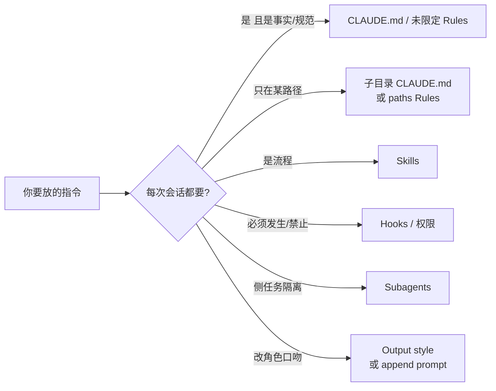

# 七种方式：何时用 CLAUDE.md / Skills / Hooks

<div class="meta-tags"><span class="tool-tag tool-claude">Claude Code</span></div>

<div class="hook">

**一句话看懂**：Anthropic 把 Claude Code 的指令投放拆成七种通道——CLAUDE.md、Rules、Skills、Subagents、Hooks、Output styles、追加 system prompt。选哪一种，看的是**何时进上下文、压缩后还在不在、以及约束有多硬**，而不是把一切都塞进根目录的 CLAUDE.md。

</div>

## 读完你能带走的 7 条收获

1. **七种通道按“加载时机 × 压缩行为 × 上下文成本 × 权威”区分**，不要按文件名习惯乱放（见 3.1）。
2. **根 CLAUDE.md 只放永远要用的事实**：构建命令、目录布局、团队规范；建议控制在约 200 行并设主人（见 3.2）。
3. **子目录 CLAUDE.md / 带 `paths` 的 Rules 按需加载**，避免无关会话也付 token（见 3.2、3.3）。
4. **流程类说明进 Skills**：会话开始只露名字和简介，正文在调用时才加载（见 3.3）。
5. **“每次都要做 / 绝对不能做”不要靠提示词**：改用 Hooks 或托管权限，模型压力大时会漏跟规则（见 3.4）。
6. **Subagents 隔离副作用**：主会话只拿回最终摘要；适合深搜、日志分析、依赖审计（见 3.5）。
7. **Output style 会替换默认“软件工程助手”指令**；日常偏好优先用追加 system prompt 或内置风格（见 3.5）。

::: tip 小白先懂这几个词
- [CLAUDE.md](/glossary#claude-md)：项目根（或子目录）的常驻说明文件。
- [Skills](/glossary#skills)：按需加载的流程包（名字+简介常驻，正文调用时才进）。
- [Hooks](/glossary#hooks)：挂在生命周期事件上的确定性自动化。
- [Subagent](/glossary#subagent)：独立上下文窗口里跑的侧任务助手。
- [Compaction](/glossary#compaction)：长会话压缩上下文；不同通道被保留 / 重注入 / 丢弃的规则不同。
:::

## 1. 基本信息

<SourceCard type="文章" title="Steering Claude Code: when to use CLAUDE.md, skills, hooks, and subagents" author="Michael Segner" date="2026-06-18" url="https://claude.com/resources/articles/steering-claude-code-skills-hooks-rules-subagents-and-more" />

| 项目 | 内容 |
|---|---|
| 链接 | https://claude.com/resources/articles/steering-claude-code-skills-hooks-rules-subagents-and-more |
| 类型 | 官方产品文章（Anthropic / Claude） |
| 作者 | Michael Segner（文末写明 Anthropic staff） |
| 发布日期 | 2026-06-18（页面 `datePublished`） |
| 使用工具 | Claude Code（CLAUDE.md、`.claude/rules/`、`.claude/skills/`、`.claude/agents/`、hooks、output styles、`--append-system-prompt`） |
| 分析依据 | 原文全文，2026-10-25 抓取。文末相关文章日期晚于本篇，属站内推荐，不计入本篇论据。“我觉得”开头的段落是本站评论。 |

## 2. 这篇在回答什么

团队一上手 Claude Code，最常见的动作是往 `CLAUDE.md` 里堆指令：构建命令、API 校验规矩、发布清单、“永远不要做 X”。文件越长，每次会话都付一份 token；压缩之后，早期约束还可能被挤掉。

本文给出一张决策表：同样是“告诉 Claude 该怎么做”，七种通道在**何时加载、压缩后怎样、上下文贵不贵、该用在哪**上不一样。



## 3. 怎么做

### 3.1 七种通道差在哪

文首把问题说清楚：

::: tr 定制 Claude 行为有七种方法：CLAUDE.md、rules、skills、subagents、hooks、output styles，以及追加 system prompt。
> "There are seven methods for instructing Claude's behavior: CLAUDE.md files, rules, skills, subagents, hooks, output styles, and appending the system prompt."
:::

每种都管三件事：指令何时进上下文、长会话压缩后还在不在、权威有多高。作者的总原则是：

::: tr 每种方法都在上下文成本与权威之间做交换。
> "Each method trades context cost against authority."
:::

表意摘要（细节以原文表为准）：

| 方法 | 何时加载 | 压缩后 | 成本感 | 典型用途 |
|---|---|---|---|---|
| 根 CLAUDE.md | 会话开始，常驻 | 记忆化；压缩后清缓存再读 | 高：每行都付钱 | 构建、布局、规范 |
| 子目录 CLAUDE.md | 读到该目录文件时 | 直到再碰该目录才回来 | 低 | 目录专属约定 |
| Rules | 用户级常驻，或路径命中 | 压缩后重注入 | 中（未限定时偏高） | 硬约束 / 约定 |
| Skills | 名字+简介常驻；正文调用时 | 已调用的按共享预算重注入，最旧先丢 | 低 | 部署/发布/审查流程 |
| Subagents | 名字+工具列表常驻；正文调用时 | 只把最终消息送回主会话 | 主会话成本低 | 并行侧任务 |
| Hooks | 生命周期事件触发 | 绕过压缩（配置在上下文外） | 低 | lint、拦截命令、备份 |
| Output styles | 进 system prompt | 从不被压缩 | 高 | 大幅改角色 |
| 追加 system prompt | CLI 当次传入 | 当次有效，缓存后成本降 | 中 | 语气、格式偏好 |

我觉得这和 [[20]]“少即是多”、[[07]]“规范要回到上下文”是同一问题的官方拆解：不是再写一篇更长的规则文件，而是**换通道**。

### 3.2 CLAUDE.md：索引，不是百科全书

根文件在会话开始加载并常驻；适合构建命令、目录布局、monorepo 结构、编码约定、团队规范。子目录文件是按需的：例如 `app/api/CLAUDE.md` 要等 Claude 读到 `app/api` 下的文件才进上下文。

共享仓库里，无人认领的配置会无限追加：

::: tr 在共享仓库里，CLAUDE.md 会像任何无主人的配置文件一样膨胀：每个团队都往上追加，没有人删除。
> "In a shared repository, CLAUDE.md grows the way any unowned config file does: every team appends its own instructions and nothing gets deleted."
:::

代价是每个工程师、每个会话都加载全部行，相关与否都付 token，还会稀释真正重要指令的遵从度。作者建议：

::: tr 把 CLAUDE.md 控制在 200 行以内，指定主人，并像改代码一样审查对它的修改。
> "Keep CLAUDE.md under 200 lines, give it an owner, and review changes to it like code."
:::

把它当成代码库概览或索引，指向别处即可。Monorepo 里给各团队目录各自的子目录 CLAUDE.md，开发者可用 `claudeMdExcludes` 跳过从不碰的团队文件。组织级安全 / 合规可用 MDM 下发、无法被个人 settings 排除的中央 CLAUDE.md。

### 3.3 Rules 与 Skills：硬约束 vs 流程剧本

Rules 放在 `.claude/rules/`。未限定路径的 Rules 和根 CLAUDE.md 一样会话开始就加载，压缩后重注入——无关任务也会占上下文。带 `paths` 的 frontmatter 可按路径命中加载，例如只在 `src/api/**` 或 `**/*.handler.ts` 时要求 Zod 校验：

```yaml
---
paths:
 - "src/api/**"
 - "**/*.handler.ts"
---
All API handlers must validate input with Zod before processing.
```

跨多个角落、但不是全仓的约束，优先用 path-scoped rule，而不是再嵌一份 CLAUDE.md。

Skills 在 `.claude/skills/`：文件夹 + `SKILL.md`（name、description、body）。会话开始只加载名字和简介；`/code-review` 这类 slash 或任务自动匹配时才加载正文。压缩时，已调用 Skills 按**共享预算**重注入，超预算时最旧的先丢。作者明确：

::: tr 流程性指令，例如部署工作流、发布清单或审查流程，应放在 skill 里，而不是 CLAUDE.md。
> "Instructions that are procedural, like deploy workflows, release checklists, or review processes, belong in a skill rather than in CLAUDE.md."
:::

这和 [[21]] 的渐进披露、[[28]] 的 Hooks 文档是同一工具箱的不同抽屉。

### 3.4 何时必须离开提示词

文中有一段“如果你发现自己在做下面这些事，考虑换地方”的清单，最硬的两条是：

1. **“每次 X，总是做 Y”写在 CLAUDE.md** → 若必须可靠发生（编辑后跑 prettier、完成时发 Slack），用 `settings.json` 里的 hook。模型选择跑格式化 ≠ 格式化自动跑。
2. **“永远不要做这个”写在 CLAUDE.md** → 绝对禁止不适合靠指令：

::: tr 当有些事绝对不能发生时，指令是错误的工具。
> "When there's something that absolutely must not happen, an instruction is the wrong tool."
:::

长会话、压力、歧义或文件里的提示注入，都可能让模型漏跟规则。真正的护栏要确定性：Hooks 与权限。`PreToolUse` hook 可检查调用并以 exit code 2 拒绝；托管（managed）settings 由管理员下发、本地配置无法覆盖，是组织级确定性护栏的唯一方式。

另外三条迁移也实用：30 行流程 → Skills；只作用于 `src/api/**` 却未加 `paths` 的 rule → 加路径（否则机械上等同塞进 CLAUDE.md）；个人偏好写进项目级 CLAUDE.md → 改用用户级文件，项目级留给团队共享约定。

### 3.5 Subagents、Output styles 与追加 prompt

Subagents（`.claude/agents/`）在独立上下文窗口跑；正文**从不**进入父会话，只返回最终消息（常是多步结果的汇总）加元数据。可用嵌套（文中写最多五层）和动态工作流编排大量后台代理，中间结果放在脚本变量里而不是主窗口。选用标准：

- 侧任务会把中间结果塞满主对话、且你不会再引用 → Subagent（深搜、日志分析、依赖审计）。
- 希望流程在主线程展开、可逐步干预 → Skill。

Output styles 注入 system prompt，从不被压缩，指令遵从权重最高。自定义风格默认**替换**默认的软件工程助手指令（如何限定改动范围、注释、安全、完成前跑测试等），除非 frontmatter 设 `keep-coding-instructions: true`。作者建议先试内置 Proactive / Explanatory / Learning。

追加 system prompt（CLI flag）只做加法、不改角色，且仅当次调用有效；指令越多、越互相矛盾，遵从度越差。适合语气、格式、领域知识的轻量补充。

跑通几种之后，可以把 Skills、Subagents、Hooks、Output styles 打成 plugin，在团队或项目间共享。

## 4. 结果与局限

- **证明**：官方给出的通道对照表与迁移清单；与既有 CLAUDE.md / Skills / Hooks 文档一致。
- **未证明**：没有对照实验数字（token 节省、遵从率）；“200 行”是经验上限而非测量结果。
- **局限**：产品文，偏 Claude Code 文件布局；其他工具有类似概念但路径不同。页脚相关文章日期可晚于本篇。

## 5. 结论

别再问“规则写不写进 CLAUDE.md”，先问：要不要每次加载？压缩后还要不要？必须确定性执行吗？侧任务要不要隔离？

**你可以这样试**：打开现有 CLAUDE.md，把“每次 / 永远不要 / 超过十几行的步骤清单”分别挪到 hook、权限和 skill；给只作用于某目录的约束加上 `paths`。

**读完自测**：你仓库里有没有一条“永远不要”其实只写在 markdown 里？发布清单是常驻全文，还是 `/deploy` 才加载？
