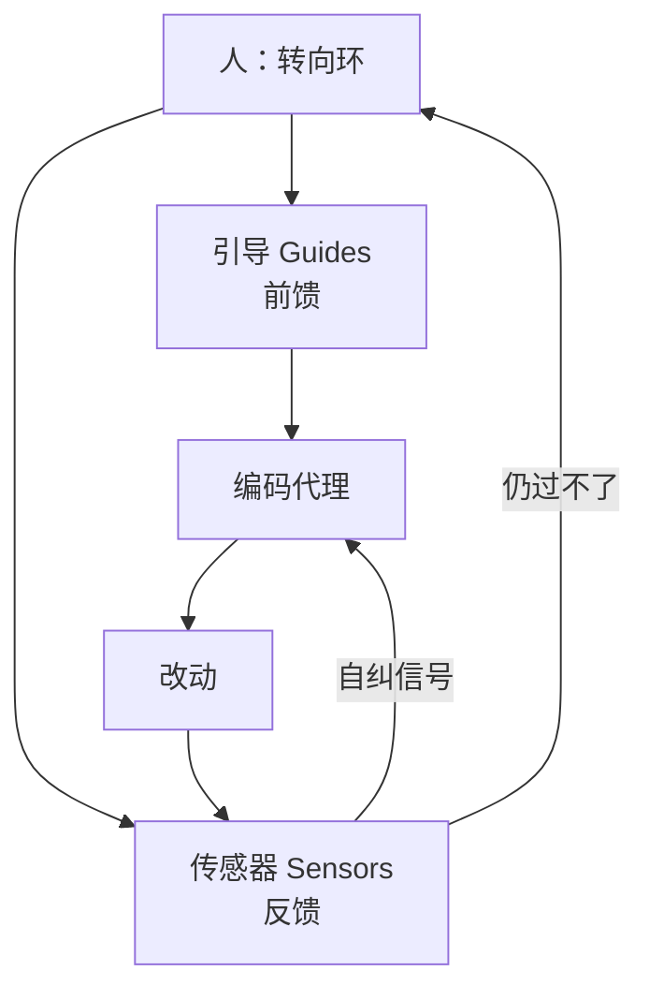

# 用户侧外壳：引导与传感器

通用（不限工具）

**一句话看懂**：Thoughtworks 的 Birgitta Böckeler 把编码代理用户能搭的那层叫**外层 harness**：用**引导（guides / feedforward）**提高一次做对的概率，用**传感器（sensors / feedback）**让代理在人看见之前自纠。再按计算型 / 推断型、以及可维护性 / 架构健康 / 行为三类，讨论外壳该管什么、管不了什么。

## 读完你能带走的 7 条收获

1. **Agent = Model + Harness**；产品已带内层，用户还能为用例搭外层外壳（见 3.1）。
2. **引导防错于未发，传感器纠错于已发**；只做一边会重复犯错或不知规则是否生效（见 3.2）。
3. **计算型**（测试、lint、类型、结构分析）快且确定；**推断型**（语义审查、LLM 裁判）贵且非确定（见 3.2）。
4. **人的工作是转向环**：同一问题多次出现，就改引导与传感器（见 3.3）。
5. **质量左移**：便宜传感器尽量在提交前；贵的放集成后；漂移用持续扫描（见 3.3）。
6. **行为外壳仍是缺口**：规格 + 代理自写测试全绿 + 手测还不够稳地减监督（见 3.4）。
7. **外壳不是消灭人，而是把人的注意力推到最关键处**（见 3.5）。

::: tip 小白先懂这几个词
- [Harness](/glossary#harness)：模型之外的驾驭层；本文特指用户侧外层。
- [引导（Guides）](/glossary#guides)：行动前的前馈控制，提高一次做对的概率。
- [传感器（Sensors）](/glossary#sensors)：行动后的反馈信号，最好对 LLM 可读（含修复指引）。
- 计算型 / 推断型：确定性工具跑 vs 模型语义判断。
- 环境可供性：代码库本身是否“好被外壳约束”（类型、模块边界等）。
:::

## 1. 基本信息

<SourceCard type="文章" title="Harness engineering for coding agent users" author="Birgitta Böckeler" date="2026-04-02" url="https://martinfowler.com/articles/harness-engineering.html" />

| 项目 | 内容 |
|---|---|
| 链接 | https://martinfowler.com/articles/harness-engineering.html |
| 类型 | 工程长文（Martin Fowler 站点；Thoughtworks Distinguished Engineer） |
| 作者 | Birgitta Böckeler |
| 发布日期 | 2026-04-02（全文发表；早前 2026-02-17 memo 已重定向至此） |
| 使用工具 | 通用；举例涉及 AGENTS.md、Skills、ArchUnit、OpenRewrite、Stripe / OpenAI 实践 |
| 分析依据 | 原文全文，2026-10-25 抓取。文中声明用 GenAI 做研究与润色。后续另有 maintainability sensors 跟进文，本篇不展开。“我觉得”开头的段落是本站评论。 |

## 2. 这篇在回答什么

工程师对 AI 生成代码天然不信任：非确定、缺上下文、按 token 想而不是“懂代码”。要少盯梢，就要提高对结果的信心。流行说法是：

::: tr 外壳已成为一种简称，指 AI 代理里除模型以外的一切——Agent = Model + Harness。
> "The term harness has emerged as a shorthand to mean everything in an AI agent except the model itself - Agent = Model + Harness."
:::

定义太宽。作者收窄到**使用编码代理**这一边界：产品已有系统提示、检索、编排等内层；用户还能用代理提供的扩展点，为自己的系统搭一层**外层外壳**。目标有二：提高一次做对的概率；在问题进到人眼前之前尽量自纠——少审查苦工、提系统质量，并少浪费 token。

## 3. 怎么做

### 3.1 外层外壳是什么

内层由厂商实现；外层是你放进仓库与设置的东西：`AGENTS.md` / Skills、结构测试、自定义 lint、pre-commit / agent hooks、评审技能、服务模板化的约束包。好的外层同时提高“第一次就对”和“错了能自己改回来”的概率。

侧栏承认“外壳套外壳”隐喻不完美（“你试过给狗的内侧戴挽具吗？”），但若有助于导航这个词的用法，作者愿意接受。

我觉得站内 [[07]]（规范变 lint）、[[66]]（十一系统解剖）、[[16]]（Planner/Generator/Evaluator）多在讲**产品或团队内层**；本篇补的是**用户怎么想外层**的词汇表，后面 [[94]] 正是用这里的 guides/sensors 做成本实验。

### 3.2 引导 × 传感器，计算型 × 推断型

**引导（feedforward）**：在代理行动前预判坏输出并转向，提高首轮质量。  
**传感器（feedback）**：行动后观察并帮助自纠；若信号对 LLM 友好——例如带修复指引的自定义 lint——作者称之为一种**正面的提示注入**。

只做反馈：代理会反复犯同一类错。只做前馈：规则写了，却不知道有没有生效。

执行方式再分两类：

- **计算型**：CPU 上的确定性工具——测试、lint、类型检查、结构分析；毫秒到秒级，结果可靠。
- **推断型**：语义分析、AI 代码审查、LLM as judge；更慢更贵，结果更非确定；在合适模型上仍能提高信任。

文中举例（方向 × 类型）：编码约定 → 前馈 + 推断（AGENTS.md、Skills）；脚手架说明 → 前馈 + 两者（Skill + 脚本）；code mods → 前馈 + 计算（OpenRewrite）；模块边界结构测试 → 反馈 + 计算（ArchUnit hook）；审查说明 → 反馈 + 推断（Skills）。

与 context engineering 的关系：上下文工程提供**把引导和传感器送到代理面前**的手段；为编码代理做用户外壳，是一种具体的上下文工程。

### 3.3 转向环与质量左移

人的职责是**转向**：同一问题多次出现，就改进引导与传感器，降低再犯概率。也可用代理帮建外壳——写结构测试、从观察模式起草规则、搭自定义 lint、从代码考古生成 how-to。

时机上沿用持续交付的左移：越早发现越便宜。

- 多快、是否应在集成甚至提交前跑？（lint、快测、基础审查代理）
- 哪些更贵，应放集成后管道，并重复跑快控？（变异测试、更大范围审查）
- 哪些漂移是渐积的，要在变更生命周期外持续扫？（死代码、覆盖质量、依赖）
- 运行时反馈代理能否盯 SLO / 日志异常？

### 3.4 三类管制：可维护性、架构、行为

外壳像控制论里的调节器。作者暂分三类（管制对象不同，可外壳化程度也不同）：

**可维护性外壳**最容易：现成工具多。计算型传感器能稳抓重复代码、圈复杂度、缺测、架构漂移、风格违规。LLM 能部分处理语义重复、冗余测试、蛮力修复、过度设计——但贵且概率性，不宜每提交都跑。两边都**不可靠**抓住的高影响问题包括：误诊、过度工程与多余功能、误解指令。若人一开始就没说清要什么，正确性不在任何传感器的职责内。

**架构健康外壳**≈ Fitness Functions：例如性能要求的 Skill + 性能测试反馈；可观测性约定的 Skill + 让代理反思日志是否够用。

**行为外壳**是房间里的大象。常见高自治做法是：前馈一份功能规格（短 prompt 到多文件）+ 反馈看代理生成的测试是否绿、覆盖是否够、有时加变异测试，再加手测。作者认为这把太多信心押在 AI 写的测试上，还不够。同事在部分场景用 approved fixtures 有成效，但不是全面答案。

::: tr 总体而言，我们仍有大量工作要做，才能设计出足以提高信心、从而减少监督与手测的功能行为外壳。
> "So overall, we still have a lot to do to figure out good harnesses for functional behaviour that increase our confidence enough to reduce supervision and manual testing."
:::

### 3.5 可外壳性、模板与人的角色

不是每个代码库都同样好套外壳：强类型语言自带类型传感器；清晰模块边界才撑得住架构约束；框架（如 Spring）抽象掉细节，也间接提高成功率。Ned Letcher 称之为**环境可供性（ambient affordances）**——环境本身是否对代理可读、可导航、可处理。绿场可从第一天烘焙进去；遗产、尤其债重的系统，最需要外壳却最难建。

企业常见服务拓扑（API 业务服务、事件处理、看板）或可演化为**外壳模板**：一捆对准该拓扑的引导与传感器。Ashby 必要多样性定律被用来论证：提交一种拓扑是在降维，让全面外壳更可行。挑战与服务模板相同——实例会与上游漂移，非确定的引导/传感器更难测、更难版本管理。

人带来的隐性外壳：惯例、对复杂度的厌恶、提交署名、组织对齐、小步节奏。代理没有这些。外壳试图外化经验，但只能走这么远：

::: tr 好的外壳不必以完全消灭人类输入为目标，而应把人类输入导向最重要之处。
> "A good harness should not necessarily aim to fully eliminate human input, but to direct it to where our input is most important."
:::

文末列举正在发生的实践（OpenAI 层化架构 + garbage collection、Stripe minions 的左移与 blueprints、变异/结构测试回潮、LSP 接入、Thoughtworks 的 janitor army），并留下开放问题：外壳变大后如何保持引导与传感器一致、信号冲突时代理如何权衡、传感器从不触发是高质量还是检测不够、如何度量外壳覆盖率。结论：搭外层外壳正在成为**持续工程实践**，而不是一次性配置。

## 4. 结果与局限

- **证明**：一套可复用的词汇与分类；与公开工程叙事对齐的例子。
- **未证明**：无自有对照实验数字（成本、缺陷率）；行为外壳方案仍开放。
- **局限**：概念框架文；GenAI 参与润色；“三类管制”是作者当下有用划分，非封闭枚举。

## 5. 结论

先画你的外层：哪些引导、哪些传感器、计算还是推断、管的是可维护性 / 架构 / 行为哪一类。缺行为外壳时，不要假装“测试全绿 = 可减监督”。

**你可以这样试**：列最近两周代理反复犯的三类错；每类标成“缺引导 / 缺传感器 / 传感器信号对 LLM 不友好”；先补一个带修复说明的计算型传感器。

**读完自测**：你的 AGENTS.md 里有没有一条从未被任何 lint/测试检查过？行为正确性现在靠什么传感器——还是主要靠人点一点？
