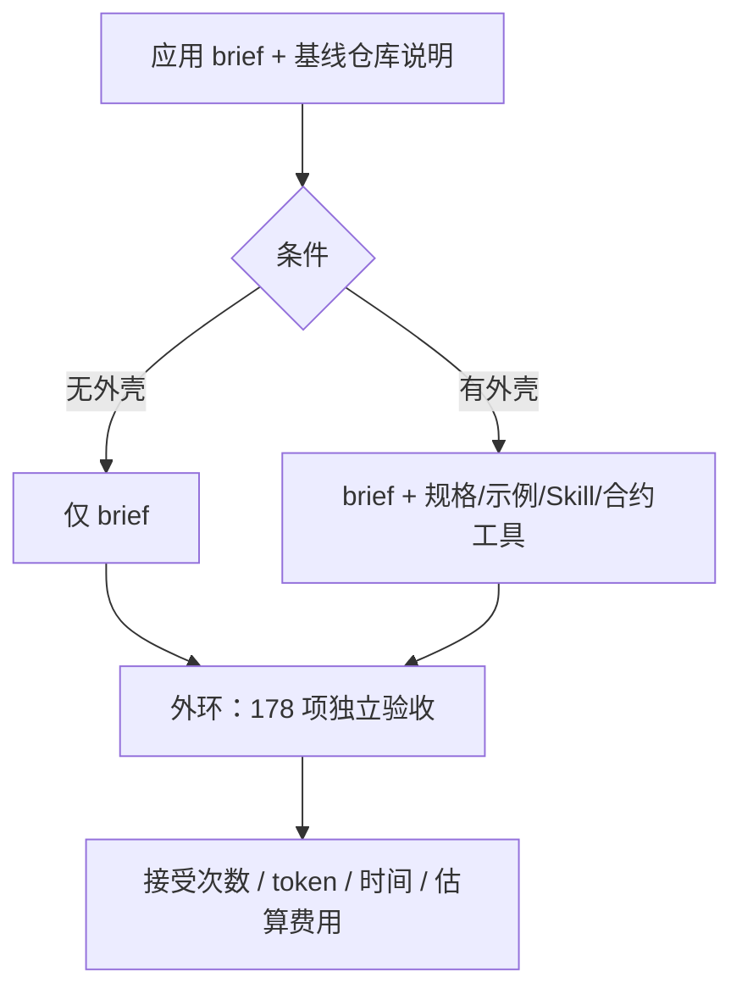

# 外壳值不值得：便宜模型的实验

Codex

**一句话看懂**：Naresh Jain 用同一套 BFF 任务，对照“有 / 无行为外壳”各跑 10 次。前沿模型 GPT-6 Sol 两种条件都是 10/10，外壳大约多花 10.5× token、近 3× 时间、约 7× 费用。成本优化的 GPT-6 Luna 无外壳 3/10、有外壳 10/10；带外壳的 Luna 平均约 $0.273，比无外壳 Sol 的 $0.406 还便宜约 33%。

## 读完你能带走的 8 条收获

1. **行为外壳 = 引导 + 传感器**（沿用 [[93]]）；本实验用 OpenAPI/AsyncAPI、示例与合约测试做内环（见 3.1）。
2. **Sol 有无外壳都是 10/10**：外壳未提高验收，但大幅提高成本（见 3.2）。
3. **Luna 无外壳 3/10，有外壳 10/10**：外壳把不稳定变成可重复交付（见 3.3）。
4. **带外壳 Luna 比无外壳 Sol 约便宜 33%**，且同为 10/10（见 3.3）。
5. **失败多在协议边界与韧性路径**：超时延迟创建、缺 monitor 链接、Kafka 头/空值、HTTP 状态码、环境变量名（见 3.4）。
6. **外壳是可执行的注意力**：书面需求在实现中丢失影响力时，传感器变红把它拉回焦点（见 3.5）。
7. **实践建议按模型能力选节奏**：便宜模型开发全程跑传感器；前沿模型至少保留独立终验门（见 3.5）。
8. **样本边界要诚实**：10 对跑次、一个绿场 Java、详细 brief、低 reasoning；未拆开引导与传感器各自贡献（见 4）。

::: tip 小白先懂这几个词
- [引导（Guides）](/glossary#guides) / [传感器（Sensors）](/glossary#sensors)：见 [[93]]。
- 行为外壳（behavioral harness）：针对功能行为的引导+传感器组合。
- 内环 / 外环：开发中反馈 vs 完成后独立验收（本实验 178 项）。
- 可执行注意力：把易被丢掉的需求变成环境里会变红的检查。
:::

## 1. 基本信息

<SourceCard type="文章" title="Are Harnesses Worth the Cost?" author="Naresh Jain" date="2026-10-13" url="https://martinfowler.com/articles/are-harnesses-worth-the-cost.html" />

| 项目 | 内容 |
|---|---|
| 链接 | https://martinfowler.com/articles/are-harnesses-worth-the-cost.html |
| 类型 | 受控实验报告（Martin Fowler《Exploring Gen AI》系列） |
| 作者 | Naresh Jain（Specmatic / Xnsio / ConfEngine） |
| 发布日期 | 2026-10-13 |
| 使用工具 | Codex + GPT-6 Sol / GPT-6 Luna（low reasoning）；探索性跑过 Claude Sonnet 4.6、Opus 4.6、Gemini 3.8 Flash；外壳实现用 Specmatic |
| 分析依据 | 原文全文，2026-10-25 抓取。费用为按 token 与标价估算的 API 等价成本，非账单。文中声明 GenAI 参与研究与 harness 部分构建。“我觉得”开头的段落是本站评论。 |

## 2. 这篇在回答什么

作者原以为行为外壳会让代理更稳地达标、省 token、少做无用功。结果对前沿模型**打脸**：Sol 有无外壳都通过全部 178 项外部验收，外壳却让平均时间与费用暴涨。问题变成：可执行反馈能不能帮**成本优化模型**达到同样稳定？

## 3. 怎么做

### 3.1 实验怎么搭

沿用 Böckeler 的框架：引导在行动前转向，传感器在行动后给自纠信号。两种条件都从同一份应用 brief 与基线仓库说明起步，分处私有工作区；有外壳的一方额外拿到 API 规格、示例与内环工具。开发与评价分开：内环只服务有外壳的代理；做完后外环用**同一套** 178 项自动化验收测生成服务；内环**从不接触**评价套件的答案。每次在独立 Docker、全新 Codex home 中跑（共享认证与语言依赖缓存除外）。

“可接受”= 能启动且 178 项全过。可靠性 = 重复跑次中做出可接受应用的比例。Token、耗时、估算费用是效率指标，与是否接受分开记。

任务是做一个产品发现用的 BFF：暴露消费端 HTTP API，校验请求与下游响应，调用 Order API；可用性搜索成功后**只**把返回的第一个产品发到 Kafka（发全部会让代理不用实现选择逻辑）。brief 还规定：产品创建超时 → 202 + 可轮询的 monitor 链接；短暂搜索失败 → 429 + 可用恢复间隔；依赖不可用或事件发布失败 → 503；下游成功但仍违反请求过滤 → 502。作者强调这是对**无辅助**代理也偏友好的起点——brief 异常详细；更短 brief 会怎样尚未测。

内环引导：OpenAPI（BFF 与 Order）、AsyncAPI（Kafka）、请求-响应示例（超时、畸形载荷、过滤违规、重试、Kafka 确认）、以及一份 API 开发 Skill（依赖模拟、行为验证、失败诊断）。传感器：合约符合性、HTTP 响应值、对下游 mock 与 Kafka 的可观察副作用；结果经测试输出、CTRF、API 覆盖报告回给代理。计算型检查不靠 LLM 裁判对错；代理仍须按 Skill 解读并决定怎么修。代理通过项目的 test 命令调用外壳——校验配置与示例、构建与单测、起 mock、起应用、再跑上述检查——**不是**每次改代码后自动跑。

引导与传感器对齐：跑测前 `examples validate` 保证示例符合规格；合约检查由规格确定性生成，值与副作用断言来自人工提供的示例/夹具；代理被要求**保留**这些输入与验证助手，修实现或执行设置，而不是削弱期望。同一传感器在开发中是“可执行注意力”，在完成时是独立验收基础。

### 3.2 前沿模型：外壳没有换来更高通过率

GPT-6 Sol（10 次平均）：

| 外壳 | Tokens | 时间 | 估算费用 | 接受 |
|---|---|---|---|---|
| 有 | 11,331,970 | 19 分 53 秒 | ~$2.679 | 10/10 |
| 无 | 1,076,371 | 6 分 51 秒 | ~$0.406 | 10/10 |

文中概括：外壳大约用了 10.5 倍 token、近 3 倍时间、约 7 倍费用，两种条件却都是 10/10。探索性跑中，Claude Sonnet 4.6、Opus 4.6、Gemini 3.8 Flash（均 low effort）也能在无辅助下首次完成。

::: tr 对我原先的预期而言，结果完全相反，让我吃惊。
> "The results flatly contradicted that expectation and surprised me."
:::

### 3.3 成本优化模型：外壳把 3/10 变成 10/10

OpenAI 把 Sol 定位为复杂专业工作的旗舰，Luna 面向成本敏感、高通量（大致对应更早 GPT-5 家族的 nano 档）。同一实验、Luna、low effort：

| 外壳 | Tokens | 时间 | 估算费用 | 接受 |
|---|---|---|---|---|
| 有 | 22,933,648 | 35 分 | ~$0.273 | 10/10 |
| 无 | 5,860,736 | 15 分 56 秒 | ~$0.086 | 3/10 |

::: tr 在这个样本里，外壳并没有解锁 Luna 所缺乏的能力；它把 3/10 的基线变成了 10/10 的可靠性。
> "In this sample, the harness did not unlock a capability Luna lacked; it turned a 3-in-10 baseline into 10-for-10 reliability."
:::

相对无外壳 Luna，有外壳平均多约 17.07M token、19 分 4 秒、约 $0.187。但比较经济学：有外壳 Luna（$0.273）仍比无外壳 Sol（$0.406）大约便宜 33%，且同为 10/10。

无外壳 Luna 其实已通过约 94.8% 的功能检查——栽在细边上，不是完全不会做。Sol 无外壳 10 次全部一次过。异步 202、Kafka 与搜索事务绑定、边界校验等，在接受的应用里表现不错。

### 3.4 无外壳失败聚在哪

失败的无外壳 Java 应用并非语法烂或完全误解 brief：每个仍至少通过 178 项中的 144 项。缺口集中在：

- **延迟创建的超时边界**：下游创建超时本应 202 + monitor 并后台重试至 201；4 个返回 503，2 个 400，1 个 429；有的建了 monitor 但重试到不了终端 201。
- **缺 monitor 链接的连锁失败**：7 次错误响应导致无 URL，后续评价步骤再失败——作者视为 202 流断裂的后果，不单计缺陷。
- **Kafka 送到了但合约不过**：3 次消息都到了，却因多余 `__TypeId__` 头或可选字段写成 `null`（合约要求有则必须是数组）被拒。
- **错误响应的精确 HTTP 合约**：如 brief 要求无效请求用 400，返回 415 仍算违约；或落到通用 500。
- **配置名缝**：客户端读 `ORDER_API_API_KEY`，启动供给 `ORDER_API_KEY` → 创建变 503。有外壳时合约驱动的 mock 与配置检查能在部署前校验这类变量。

### 3.5 可执行注意力与实践含义

这些行为都写在 brief 里，仍会在实现中丢失影响力——作者称为注意力失联。外壳把差距变成可观察信号。

修订后的条件假设：

::: tr 随模型能力变化的，不是是否需要独立传感器，而是它们何时运行。
> "What changes with model capability is not whether independent sensors are needed, but when they run."
:::

实践三条：

1. **成本优化模型**结果不稳时：开发全程跑行为外壳，当可执行注意力。
2. **前沿模型**即使常一次过：仍保留独立验收；可改为终验门一次跑，减开发期开销（该工作流的成本本文**未测**）。
3. **规格与示例要人维护**：检查只能强制人写进期望的东西；覆盖缺口仍靠人审。

费用数字只含自主生成的 API 等价成本与机器时间，**不含**编写维护合约/示例/断言的前置成本，也不含修不可接受结果的人工。引导与传感器绑在一起加，无法拆开各自贡献。

我觉得这是少见的、把 [[93]] 词汇落到对照数字上的文章；读时要连样本边界一起带走，避免把 10 次、一个服务的比例推成普遍规律。

## 4. 结果与局限

- **证明**：Sol / Luna 各 10 对跑次的接受率与效率表；失败模式分类；条件化实践建议。
- **未证明**：长期失败率、达到可接受应用的总成本、终验门-only 开销、更短 brief / 遗产代码 / 其他语言 / 本地开源权重模型。
- **局限**：作者所属 Specmatic 即内环工具实现；费用为估算；探索性多模型无同表统计。

## 5. 结论

行为外壳不是对每个模型、每项任务的自动胜利。对 Sol，全程外壳加了开销却未见验收收益；对 Luna，外壳提高了一致性，且在本样本中平均比无外壳 Sol 更便宜。

**你可以这样试**：选一个你已有合约或可写成 OpenAPI 的服务，用便宜模型跑 5 次无外壳、5 次有内环反馈，只比外部验收通过率与费用——先复现“是否值得”，再谈模板化。

**读完自测**：你对前沿模型省掉的是“独立验收”，还是只省了“开发中的连续传感器”？团队选模型时，有没有把外壳成本算进单位经济？
