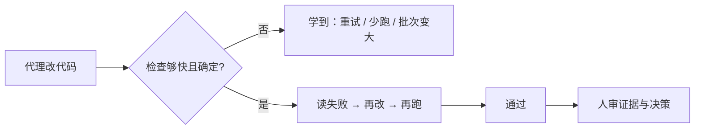

# 代理验证：E2E / 属性 / 差分测试

通用（不限工具）

**一句话看懂**：Addy Osmani 认为瓶颈已从“写出代码”转到“知道它对不对”。给代理独立、快速、确定的验证手段——尤其是 E2E、基于属性的测试、新旧系统差分——质量来自代理能自己跑的闭环；人审的是证据，不只是 diff。

## 读完你能带走的 7 条收获

1. **更愿要好得多的反馈环，而不是稍好一点的模型**（见 3.1）。
2. **品味要沉淀**：错一次就写进共享配置、hook 或测试，避免重犯（见 3.1）。
3. **首选 E2E 当“完成”的 oracle**：难骗、定义 done、失败信息要可操作（见 3.2）。
4. **属性测试写“绝不能怎样”**，用生成器找人想不到的输入（见 3.3）。
5. **重写/迁移用旧系统当 oracle 做差分**；规范化无语义差异，维护“已批准变更”清单（见 3.4）。
6. **慢或不稳定的测试会训练代理去重试而不是修**（见 3.5）。
7. **先写检查再写代码**：人定义成功长什么样，代理在环里迭代（见 3.5）。

::: tip 小白先懂这几个词
- E2E：端到端，模拟真实用户路径，几乎只看用户能看见的结果。
- [差分测试](/glossary#differential-testing)：同一输入跑新旧实现，比输出。
- 基于属性的测试：陈述不变量，由工具生成大量输入试图打破它。
- Oracle：判定对错的权威来源（E2E、属性、旧系统等）。
:::

## 1. 基本信息

<SourceCard type="文章" title="Agentic Verification" author="Addy Osmani" date="2026-10-14" url="https://addyo.substack.com/p/agentic-verification" />

| 项目 | 内容 |
|---|---|
| 链接 | https://addyo.substack.com/p/agentic-verification |
| 类型 | 实践随笔（Elevate / Substack） |
| 作者 | Addy Osmani |
| 发布日期 | 2026-10-14 |
| 使用工具 | 通用；举例 fast-check、Hypothesis、Hypothesis/proptest；提及 Claude Code 生态中的正式建模尝试 |
| 分析依据 | 原文全文，2026-10-25 抓取。评论区有“谁来写 E2E”等追问，正文未系统回答。“我觉得”开头的段落是本站评论。 |

## 2. 这篇在回答什么

副标题直接点题：

::: tr 瓶颈已经从写代码，转到确认它正确。
> "The bottleneck has moved from writing code to knowing it’s correct."
:::

代理“平均在规模上写得更好”——规模来自验证变便宜。测试、基准、规格、真 E2E 曾昂贵，现在可以交给代理反复跑。工作从“审每一行”变成“搭代理能自己跑的环”；人仍对上线负责，但审的是证据。

## 3. 怎么做

### 3.1 验证才是瓶颈

若代理不能自验，本质上在猜，错猜最终由你的测试套件和人来验——读 diff、跑测、点应用、找 bug、回报——这是最慢、最贵、也最难扩展到多人以上的环。若代理能自测：改 → 跑检查 → 读输出 → 再试，直到过关，人甚至还没看见。作者的取舍很清楚：

::: tr 我总是更愿意要一个好得多的反馈环，而不是稍好一点的模型。
> "I would always prefer a much better feedback loop to a slightly better model."
:::

测试的定义也扩了：它们仍帮人抓 bug、安全重构；对代理而言，测试还是**感知世界、知道何时做完**的方式。不是每一种测试对这件事同等有价值。作者建议重点投入：

- 模拟真实用户流的 E2E，作为 ground truth
- 基于属性的测试：规定绝不能发生什么，生成数千用例去打破
- 替换系统时，用随机输入对比新旧
- 要求测试快且确定——否则会强化“环慢或不稳时就重试”

示例测试说“应该发生什么”；属性说“绝不能怎样”。

我觉得这和 [[25]] 的 TDD / 先跑测试、[[32]] 的带证据交付、[[71]] 的验证栈同属“验收”阶段，但本篇更强调**oracle 种类**与**环的激励**，而不是某家产品的审查流水线。

### 3.2 E2E：若只能选一种

E2E 描述真实用户会做的事：注册、加购、结账、看确认。它忽略内部结构，只看用户能看见的。基于 mock 的单测可能全绿，功能仍坏——因为代理和测试共享同一种误解。E2E 很难被这种共享误解骗过：整条路径通或不通。

对代理特别有价值的点：只覆盖重要用户流；失败应带截图、追踪、失败步骤（“30 秒超时”几乎无信息）；本地与部署环境都能跑；把 “实现这个功能” 收成 “让这条 E2E 通过”。代价真实：更慢、更脆——所以要**一小套高价值**，而不是消灭或堆满。旁注提到：给代理“手和眼”（能启动、驱动、观察真实系统的 skill/CLI）外加一张用户视角的 feature map，同样值得。

### 3.3 属性测试：人想不到的失败

很多人写的测试是例子：“这个输入 → 那个输出”。它们擅长保证某事能工作，不擅长保证某事永不失败——人枚举不全。属性测试反过来：你写应成立的规则，工具生成成百上千输入去打破；失败时缩到最小复现。常见属性：编解码往返、不变量（排序不改元素个数、余额不为负）、幂等、优化版与朴素版等价。

对代理尤其关键：代理会按自己的内部逻辑编造能过的例子；属性强迫它面对**任意生成输入**。上手：从纯函数（解析、格式化、计价）开始；先用白话写属性再落代码；保存最小化失败作回归；让代理写属性而不是只写例子——“一旦你要求，它很擅长”。

旁注：Boris Cherny（Claude Code）等在最难的状态机 / 并发 / 数据流上用 Lean、TLA+ 等建模找反例——属性与差分覆盖大量场景，最硬核处仍可上正式方法。

### 3.4 差分：旧系统当 oracle

重写经典失败模式：新套件全绿，却在许多未文档化的边角与旧系统分叉——用户依赖的是实际行为，不是规格声称。差分测试：同一输入并跑新旧；输出不一致则要么新系统有 bug，要么是应记下的破坏性变更。输入要用随机生成和/或抽样线上流量，而不是只靠手选用例——等价于属性“新输出 = 旧输出”。

实操：先规范化无语义差异（无关排序等），否则假差分无穷；维护“已批准变更”清单（每条带理由），避免“不同”变成可接受常态；差分 harness 给足信心后再拆旧系统——双轨长期跑成本是理解任一系统的两倍，且多一条断裂方式。

### 3.5 让环又快又确定；先写检查

慢或不稳不只浪费时间——它在训练：

::: tr 如果测试又慢又不稳定，代理会学到：有时重启测试比尝试修问题更好。
> "If the tests are slow or unstable, the agent will learn that sometimes just restarting the test is better than trying to fix the problem."
:::

人对坏基建更宽容（知道哪些是 flake、愿意等 20 分钟）；代理跟环的激励走。可偶发重试成功 → 偏好重试；要 15 分钟才跑完 → 少跑、两次之间攒更多改动、更难定位哪次改坏的。两种失败模式都让产出变差，却没有显眼的“红灯”。

“好”的样子：核心环尽量亚秒，命令好找、可加 quiet；结果可复现（种子随机、冻时钟、控网络、隔离状态）；flake 立刻隔离或删除——主套件里的 flake 比没有测试更糟，因为它破坏对其它结果的信任；失败输出短而具体；重 E2E/差分放在集成前，轻环给日常迭代。把测试基建当成代理依赖的组件之一——改进它会复利到所有任务。

额外习惯：编码前先让代理复述成功标准；用新鲜上下文或独立审查代理做验证；把生成的测试本身当工件审查——它是否真能区分正确实现与“看起来对”的错误实现？

评论里有人问：若同一代理既写功能又写定义 done 的 E2E，会不会共享误解？正文未系统回答。我觉得这正好接到 [[59]]“实现者看不到用例”和 [[94]]“期望源独立于实现代理”：E2E 最好由人定场景或至少由独立来源固化，而不是让实现代理独自发明“完成”的定义。

收束：在让代理动手前，先知道成功长什么样——E2E 流、某条属性、或与旧系统对比——并保证快且确定，再放它迭代。人的工作不必是读每一行输出，而是定义成功；示例管“应该怎样”，属性管“绝不能怎样”。

## 4. 结果与局限

- **证明**：清晰的投资优先级与激励分析；与常见工程实践对齐的操作建议。
- **未证明**：无自有对照实验或通过率数字；工具版本与命令级模板很少。
- **局限**：随笔体；“谁写 E2E”的代理/人分工留在评论区；正式方法仅作旁注。

## 5. 结论

给代理独立验证手段，质量主要来自环，而不是多盯几眼 diff。优先一小套真用户 E2E、关键路径上的属性、迁移时的差分，并死守快与确定。

**你可以这样试**：选一条最值钱的用户路径写/修好一条 E2E，让代理的完成定义变成“这条必须绿”；再给一个纯函数加一条属性测试，保存一次最小化失败。

**读完自测**：你的代理失败时，是更常“再跑一遍 CI”，还是改代码？定义 done 的检查，是实现代理自己写的，还是来自人/旧系统/独立合约？
