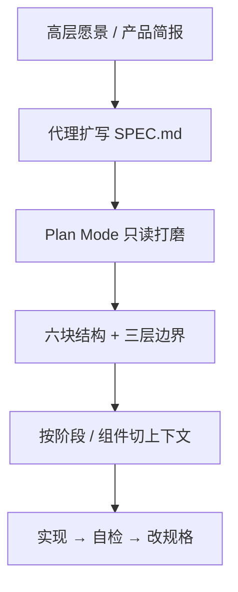

# 给代理写好规格：五条原则

通用（不限工具）

**一句话看懂**：Addy Osmani 认为扔一份 RFC 级超长规格给代理行不通——上下文上限和“注意力预算”会拖垮模型。要写**聪明的规格**：够细、可演进、能拆成模块；先用只读计划模式对齐，再按块执行，并在规格里写进 Always / Ask first / Never 三层边界。

## 读完你能带走的 7 条收获

1. **先写高层愿景，让代理扩成详细规格**，再在 plan mode 里改到没有歧义才执行（见 3.1）。
2. **规格按专业 PRD 分段**：命令、测试、结构、风格、Git 工作流、边界六块最常缺一不可（见 3.2）。
3. **Spec Kit 式四门闸**：Specify → Plan → Tasks → Implement，每阶段验证过才进下一阶段（见 3.2）。
4. **一次只塞一个聚焦任务**，避免“指令诅咒”——指令堆多了，每条遵从率都掉（见 3.3）。
5. **边界用三层**：Always / Ask first / Never，比一张禁令清单更可执行（见 3.4）。
6. **规格是活文档**：测、改规格、再同步代理；失败就回规格，不要只改聊天（见 3.5）。
7. **反模式**：空泛 prompt、无摘要的超长上下文、跳过人工审、把 vibe coding 当上线工程（见 3.5）。

::: tip 小白先懂这几个词
- [Plan Mode（计划模式）](/glossary#plan-mode)：只读分析与写计划，不改代码，直到你批准。
- [Spec-Driven Development（规格驱动开发）](/glossary#spec-driven-development)：以规格为共享真相，驱动实现与任务拆分。
- [上下文工程](/glossary#context-engineering)：刻意选择放进窗口的内容。
- PRD：产品需求文档；这里借用来组织给代理看的规格。
- 指令诅咒（curse of instructions）：指令条数一多，模型对每条的遵从都会变差。
:::

## 1. 基本信息

<SourceCard type="文章" title="How to write a good spec for AI agents" author="Addy Osmani" date="2026-01-13" url="https://addyosmani.com/blog/good-spec/" />

| 项目 | 内容 |
|---|---|
| 链接 | https://addyosmani.com/blog/good-spec/ |
| 类型 | 实践指南（个人博客） |
| 作者 | Addy Osmani |
| 发布日期 | 2026-01-13 |
| 使用工具 | 通用；举例 Claude Code、Gemini CLI、GitHub Spec Kit、Copilot agents.md |
| 分析依据 | 原文全文，2026-10-26 抓取。文中“GitHub 分析 2,500+ agent 配置”等数字来自作者转述 GitHub 研究，本站未另核原始报告。文末提到用 Gemini 排版与出书宣传，分析时略过。“我觉得”开头的段落是本站评论。 |

## 2. 这篇在回答什么

开场就有人抱怨：规格能写到 RFC 厚度，但上下文太大模型就崩。作者的 TL;DR：

::: tr 目标是写一份够清楚、只含刚好够用的细节的规格，引导 AI 又不把它压垮；大任务拆小，别塞进一个大提示。先在只读模式里规划，再执行并持续迭代。
> "Aim for a clear spec covering just enough nuance (this may include structure, style, testing, boundaries) to guide the AI without overwhelming it. Break large tasks into smaller ones vs. keeping everything in one large prompt. Plan first in read-only mode, then execute and iterate continuously."
:::

主线不是“要不要规格”，而是**规格怎么写才进得了代理的注意力预算**——结构、模块化、边界、迭代。

我觉得这和 [[88]]「单功能别造层级脚手架」、[[64]]「审计划 PR」不是对立：Osmani 保留结构化规格，但强调**模块喂入**和**门闸**，正好卡在“空 prompt”和“整棵 SDD 树反复灌上下文”之间。

## 3. 怎么做

### 3.1 先愿景，让代理起草细节；Plan Mode 钉死再动手

不要一上来自己写满技术细节。先给短目标（谁用、解决什么、成功长什么样），让代理扩成带功能列表、栈建议、数据模型的草稿，你再改幻觉和跑偏。GitHub Spec Kit 的说法是：你提供高层 what/why，代理生成偏用户体验与成功标准的详细规格。

工具侧：Claude Code 的 Plan Mode（文中写 Shift+Tab）限制只读——可以分析代码库、写计划、追问歧义、检查架构与安全，**在你满意前不写代码**。批准后把规格存成 `SPEC.md`（或分段），会话重启时仍可当锚点，减轻“对话一长就忘”。

### 3.2 按专业 PRD 组织；六块清单与四阶段门闸

作者转述 GitHub 对 2,500+ agent 配置文件的分析：有效规格常覆盖六块——

1. **Commands**：可执行命令带参数（`npm test`、`pytest -v`），不是只写工具名。  
2. **Testing**：怎么跑、框架、测试目录、覆盖期望。  
3. **Project structure**：源码 / 测试 / 文档路径写死。  
4. **Code style**：一段真实样例胜过三段形容词。  
5. **Git workflow**：分支名、提交信息、PR 要求。  
6. **Boundaries**：永远别碰的密钥、vendor、生产配置；“Never commit secrets”是研究里最常见的有用约束。

栈要写具体：“React 18 + TypeScript + Vite + Tailwind”，不要“React 项目”。格式上用 Markdown 标题甚至 XML 式分段，方便模型定位。

更深一层是把规格嵌进工具链，当**可执行产物**。Spec Kit 四阶段：Specify（用户旅程与成功）→ Plan（技术栈与约束）→ Tasks（可独立实现并测试的小块）→ Implement。每阶段你验证过才往下——用来对抗 Willison 说的 <Trans zh="纸牌屋代码">“house of cards code”</Trans>：看起来能过、一压就塌的 AI 产出。文中还提到 `agents.md` 给人设（文档 / 测试 / 安全）各写一份聚焦规格，以及为“Agent Experience”准备可解析格式（OpenAPI、llms.txt 等）——本站只取“规格要能被工具消费”这一点。

### 3.3 模块化上下文：一次一个任务

把整仓需求、代码、规矩一次塞进提示，容易撞 token 上限，也撞上研究里的 <Trans zh="指令诅咒">“curse of instructions”</Trans>：指令一多，模型对每一条的遵从都变差。做法：

- 规格按前后端等切开，当前任务只贴相关节；  
- 让代理先做**扩展目录 / 摘要 TOC**，细文按需再展开；  
- 子代理 / Skills 各拿一块规格与独立上下文；  
- 大功能之间**新开会话**清上下文，只重贴全局硬约束。

文中有单代理 vs 并行多代理对照表：并行吞吐高，但要共享记忆与边界，起步建议 2–3 个代理。

### 3.4 自检、三层边界、领域知识写进规格

规格既是待办，也是质控与裁判。GitHub 研究推崇三层边界，而不是一张“不要”：

- **Always**：提交前跑测试、跟命名规范——直接做；  
- **Ask first**：改库表、加依赖、动 CI——先问人；  
- **Never**：提交密钥、改 `node_modules/`、未经批准删失败测试——硬停。

再加：实现后对照规格自查缺项；主观项可用第二个代理当 LLM-as-judge；把符合性套件（如 YAML 用例）写进成功标准。你的领域坑（多对多关系、某库版本内存泄漏）要写进规格，不要指望模型猜。简单任务则**故意少写**，避免过度规格。

### 3.5 迭代活规格；避开常见坑

规格写完不是结束：每段里程碑就测；规格不清就改文档并显式告诉代理“按新规格调整”。可用 RAG / MCP 按任务拉相关节。规格进 Git，当代码一样维护。模型选型上：规划和关键步骤用强模型，机械展开可用更便宜的。

作者汇总的反模式：空泛“build something cool”；无摘要的 50 页倾倒；跳过人审（Willison：不会解释给别人听的代码不提交）；把探索用的 vibe coding 直接当上线工程；忽视速度 / 非确定性 / 成本组成的“致命三件套”；漏掉六块清单里的任一块。

## 4. 结果与局限

- **结果**：本文是框架文，没有作者自有的对照实验数字；GitHub 2,500+ 文件与“Never commit secrets 最常见”等为转述。  
- **局限**：偏 Claude / Spec Kit / Copilot 生态举例；与 [[88]] 对“单功能 SDD 烧 token”的批评需并用——结构化规格有用，**整树反复灌上下文**仍贵。文末出书与排版工具宣传与规格框架无关。

## 5. 结论

给代理的好规格 = **清楚的使命 + 可解析结构 + 模块化喂入 + 写进运行时的边界与自检 + 持续改规格**。不是写得越长越好，是注意力预算内把歧义挤掉。

**你可以这样试**

1. 新建 `SPEC.md`：目标一段 + 六块标题先填 Commands / Testing / Boundaries。  
2. 在 plan mode 让代理扩写并追问歧义；你改完再退出执行。  
3. 实现时只贴当前任务相关节；全局 Never 规则每会话重贴一遍。

**读完自测**

1. 你的仓库规格里，六块里缺了哪几块？  
2. 哪些动作应升到 Ask first / Never，而不是写在散文禁令里？  
3. 上次失败是规格太长、太糊，还是一次塞了太多无关上下文？
