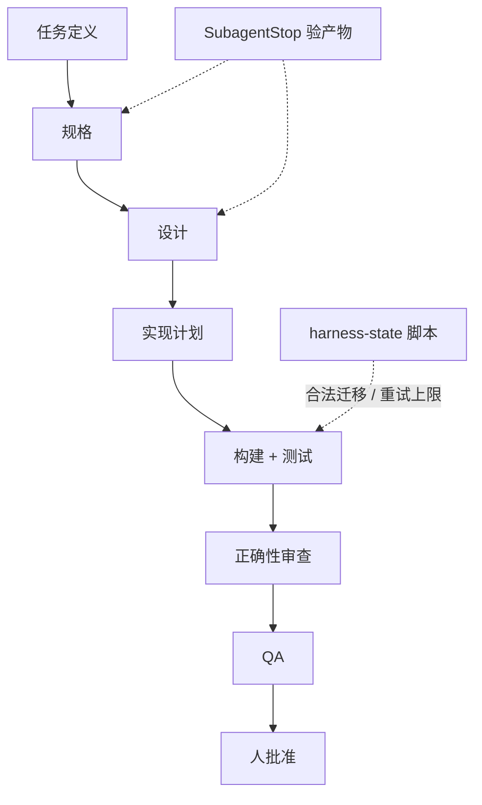

# 放弃跨 IDE 可移植：Claude 原生多阶段流水线

Claude Code

**一句话看懂**：Rob Earlam 把原先“共享角色文件 + Claude / Cursor / Copilot 薄适配”的可移植 harness，改成**只跑 Claude Code 原生**——阶段用子代理、标准进 Skills、状态机进脚本、交接用 hook 验产物。换来的是真隔离上下文和更小的 token 窗；代价是换 IDE 要重做强制层。他拿这套和 Anthropic《AI-native SDLC》对照，发现机制同向。

## 读完你能带走的 7 条收获

1. **共享指令 ≠ 相同执行行为**；slash command 适配器跑在主会话里，会污染后续阶段上下文（见 3.1）。
2. **标准做成 Skills，阶段代理 frontmatter 只预载需要的**；代理定义压到约 40–80 行，并可按角色选 Opus / Sonnet（见 3.2）。
3. **编排判断留给模型，合法迁移交给 `harness-state` 脚本**（见 3.3）。
4. **`SubagentStop` 验产物文件与必备标题；`SessionStart` 加载活状态**（见 3.4）。
5. **治理进 settings**：禁改 harness 控制文件；`/approve` 只许人调；仍防不住 shell 重定向绕过（见 3.4）。
6. **QA 前跑 `/code-review high`；最多三轮 Build，再多就该回查任务定义 / 规格**（见 3.5）。
7. **与 Anthropic playbook 对齐的是产物链与确定性护栏，不是代理起名**（见 3.6）。

::: tip 小白先懂这几个词
- [子代理（Subagent）](/glossary#subagent)：独立上下文窗口的阶段代理，做完把结果交回。
- [Skills（技能包）](/glossary#skills)：可按任务加载的 Markdown 行为包；这里承载编码 / 测试 / UI 标准。
- [Hooks（钩子）](/glossary#hooks)：工具调用前后由运行时触发的脚本。
- 状态机：用代码规定阶段能否前进，而不是每次让 LLM 重读流程说明书。
- 产物（artifact）：阶段输出的设计说明 / 计划等，作为下一阶段的显式输入。
:::

## 1. 基本信息

<SourceCard type="文章" title="Harness Engineering: Anthropic's AI SDLC" author="Rob Earlam" date="2026-10-20" url="https://robearlam.com/blog/harness-engineering-anthropics-ai-sdlc" />

| 项目 | 内容 |
|---|---|
| 链接 | https://robearlam.com/blog/harness-engineering-anthropics-ai-sdlc（DEV 转载 2026-10-21：https://dev.to/robearlam/harness-engineering-anthropics-ai-sdlc-26c6） |
| 类型 | 工程博客（系列「Harness Engineering」之一） |
| 作者 | Rob Earlam |
| 发布日期 | 2026-10-20（作者站）；DEV 标注 Originally published at robearlam.com |
| 使用工具 | Claude Code（agents、skills、settings、hooks）；对照 Louis Claxton《The AI-native SDLC playbook》（2026-08-21） |
| 分析依据 | DEV 与作者站全文，2026-10-26 抓取。系列前文与 GitHub 仓库细节以本文描述为准，未逐文件复核仓库。“我觉得”开头的段落是本站评论。 |

## 2. 这篇在回答什么

作者从 2026 年 4–5 月起写一套“待办 → 规格 → 设计 → 计划 → 构建 → 审查 → QA → 人批准”的流水线。当时强调 IDE 无关：共享角色文件，三套薄适配。几个月后他**反转**了这一条——仓库里的 harness **只跑 Claude Code**。问题是：

::: tr 在工具之间共享指令，和从它们得到相同的执行行为，不是一回事。
> "sharing instructions between tools isn't the same thing as getting the same execution behaviour from them."
:::

主线：多阶段交付里，**隔离、状态与护栏**该由运行时与脚本承担，而不是反复用提示词请模型自己守规矩。

我觉得归类在「多代理协作与大任务拆分」比「看原理」更准：读者带走的是**阶段分工、产物交接、编排与阻塞策略**，不是 harness 循环的内部算法。与 [[85]] 动态工作流、[[73]] 长任务清单同属“管多阶段”，但本文把**可移植性主动扔掉**讲透了。

## 3. 怎么做

### 3.1 为何放弃可移植：适配器污染了有界上下文

旧结构把代理定义和角色定义拆开，便于换工具，但要维护三套适配，且 Claude 侧适配落在 `.claude/commands/`——那是 **slash command，不是隔离子代理**。阶段在主对话里内联跑，到 Build 时，会话里已经堆满编排器阅读与前几阶段工作。作者强调自己曾把 <Trans zh="有界上下文">bounded context</Trans> 当核心收益，却发现用现成 harness 的原生能力，选单一 IDE 对齐，更简单拿到隔离。

流程外形没变（任务定义 → … → 人批准）；变的是**结构更多来自运行时与可执行检查**，而不是让模型自己维持流程说明书。

### 3.2 标准变 Skills；代理变短；按角色选模型

编码 / 测试 / UI 设计标准迁入 `.claude/skills/`，各阶段代理在 frontmatter 里**只预载需要的 skills**。以前一阶段开工前要加载远超一千行的角色、标准与模板；新代理定义大约 **40–80 行**，再加 skills 与任务输入。这不等于整个上下文只有 80 行，而是**代理自身定义更瘦**、职责与标准分离。

角色定模型也更容易：设计、技术规划、QA 用 Opus；规格与实现用 Sonnet——显式权衡，而不是每阶段同一套配置。

### 3.3 编排：Skill + `harness-state` 脚本

编排器从“又一个 Agent”改成 **Skill**（`/run-task`）。仍需判断：哪些发现重要、请求是否改了规格、哪些信息要带走。但“Build 能不能进 QA”多半是状态机问题——这部分进了 `harness-state` 脚本：阶段迁移、run ID、重试上限、工作流模式、运行历史。非法迁移由脚本拒绝。作者不再让 LLM 反复解读多页流程规则来决定迁移动机是否合法：**机械归代码，判断归模型**。

### 3.4 交接验证与治理进配置

`SubagentStop` hook 在阶段代理结束时做产物校验：期望文件存在、非空、含必备标题。状态脚本在前进前再验一次。这是**结构检查**，不证明规格写得好或功能正确——测试、审查、人判仍有工作。`SessionStart` 加载活执行状态，新会话接当前任务，而不是从聊天史重建。

Claude Code settings **拒绝**对 harness 控制文件与环境文件的文件工具编辑；改任务定义 / backlog、以及 `git push` 要权限提示。`/approve` 只能人调用，模型不能自己选。决策记录也写明：文件工具规则**挡不住** shell 重定向写入受保护路径——不是完整沙箱或企业边界，但对作者场景“够用……到目前为止”。关键区分：提示里的“请勿” vs 运行时直接拒绝。

### 3.5 审查停点与三轮 Build 上限

进 QA 前，编排器对任务改动的文件跑内置 `/code-review high`；运行记录 base commit，即使任务不是直接从 `main` 开也仍有范围。QA 再对照规格：正常使用下坏掉的验收、安全问题、回归、任务引起的校验失败会**阻塞**；重构建议等非阻塞项变成候选后续。没有统一严重度时，有界交付环会变成无尽抛光。作者写道：

::: tr 最多三轮 Build，再停为 blocked。
> "There are at most three Build passes before the run stops as blocked"
:::

——经验上多数任务 1–2 轮；冲第三轮往往说明更早的任务定义或规格有问题，该人介入。

### 3.6 与 Anthropic AI-native SDLC 对照

作者读 Louis Claxton 2026-08-21 的 playbook：只加速写代码不够，计划、交接、验证、治理不变就会成瓶颈。对照表（机制层，不是名字层）：

| 本系列 / 仓库 | Playbook |
|---|---|
| 任务定义钉范围与意图 | `intent.md` |
| 规格 / 设计 / 实现计划产物 | 版本化的 intent、spec、plan |
| 窄职责 + 有界输入 | 有自己上下文与工具限制的 scoped 子代理 |
| 编码 / 测试 / 设计标准 | Skills 承载机构知识 |
| 测试 + 正确性审查 + QA | 代理自验 + 审查供人判断 |
| Hooks、settings、状态脚本 | 确定性护栏托住建议性指令，保留批准闸 |

产物链最清晰：一阶段输出是下一阶段显式输入。人的注意力移向意图、风险与批准，而不是盯每一次编辑。作者称灵感也来自 OpenAI harness 工程文；Anthropic playbook 是另一家大厂把开发写成**围绕代理的受管生命周期**的实例。

## 4. 结果与局限

- **自述收益**：更少适配文件、更少重复说明、阶段间真隔离、流程前进有确定性检查；感知上 Claude Pro 额度能干更多活（无对照实验数字）。  
- **代价**：再换 IDE 要改编强制层，不是加一个薄代理文件。  
- **局限**：系列文，完整脚本与仓库以链接为准；安全边界自承不完整；与 playbook 是方向对照，非逐条复现实验。

## 5. 结论

多阶段代理流水线要稳，关键不只是“多写几段角色 prompt”，而是：**阶段用隔离子代理、标准用 Skills 按需加载、迁移用脚本、交接用 hook 验结构、批准留在人**。可移植指令若换不来相同执行语义，不如押注一个原生运行时。

**你可以这样试**

1. 把现有“超长角色 md”拆成：短代理定义 + 若干 skills。  
2. 用脚本（不必 LLM）维护“当前阶段 / 重试次数 / 产物路径”。  
3. 给 Build→QA 设最大轮数；超限强制人回看规格，而不是让代理继续抛光。

**读完自测**

1. 你的“阶段”是真子代理，还是主会话里的 slash command？  
2. 哪些迁移规则仍靠模型“自觉”，可以下沉成脚本？  
3. 审查发现物有没有严重度，会不会把交付环拖成无尽重构？
