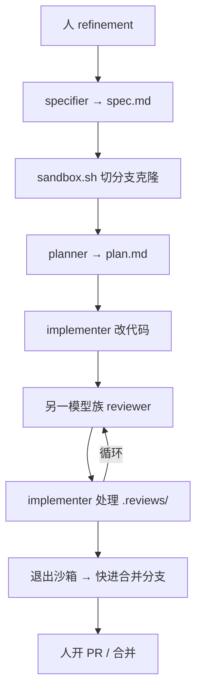

# 角色分工加默认拒绝沙箱

通用（不限工具）

**一句话看懂**：Nora Reit 开源 AgentRite：用 specifier / planner / implementer / reviewer 四角色和 Markdown 产物交接，并故意让**实现与审查来自不同模型族**。真正敢“YOLO”的前提是 `./sandbox.sh`——默认拒绝出网（按 TLS 主机名放行）、不看家目录、只在分支克隆上干活、启动前自证防火墙有效。

## 读完你能带走的 8 条收获

1. **过程给人留意图与批准，步骤尽量交给角色 + 产物文件**（见 3.1）。
2. **spec 不写怎么做；plan 不写什么必须为真**——合同与做法分开（见 3.2）。
3. **审查换模型族**，避免“自己改自己的作业”（见 3.3）。
4. **本地模型做过 `rm -rf`、偷看别的项目**——靠配置白名单不如进容器（见 3.4）。
5. **沙箱默认拒绝**：出网按握手主机名、非 root、只读根、只带回该分支提交（见 3.4）。
6. **启动自证**：拦不住的主机拦不住、放行的主机够不着 → 拒绝启动（见 3.4）。
7. **明确不做**：不审提交内容本身；`--in-place` 风险更高；DNS 仍开、允许主机仍是通道（见 3.5）。
8. **审查环会过严或死循环**——人要下场决断；编排层仍在路上（见 3.6）。

::: tip 小白先懂这几个词
- [沙箱（Sandbox）](/glossary#sandbox)：限制文件系统、网络与权限的执行环境。
- [子代理 / 角色](/glossary#subagent)：这里是 Claude Code / OpenCode 里配置的具名角色代理。
- 默认拒绝（default-deny）：未显式允许的出站与路径一律不可用。
- 产物：`spec.md` / `plan.md` / `record.md` 等，角色之间的书面交接。
- TLS 握手主机名：按证书里的名字判允许，不只按 IP（防同 IP 旁路）。
:::

## 1. 基本信息

<SourceCard type="文章" title="AgentRite - roles and sandbox" author="Nora Reit" date="2026-10-04" url="https://norareit.com/posts/agentrite-roles-sandbox" />

| 项目 | 内容 |
|---|---|
| 链接 | https://norareit.com/posts/agentrite-roles-sandbox |
| 类型 | 个人工程博客（开源项目说明） |
| 作者 | Nora Reit |
| 发布日期 | 2026-10-04 |
| 使用工具 | Claude Code、OpenCode；Docker Compose 自研沙箱；npm 包 `agentrite` |
| 分析依据 | 原文全文，2026-10-26 抓取。作者明确未在重负载生产系统验证；数字与轶事为个人项目经验。“我觉得”开头的段落是本站评论。 |

## 2. 这篇在回答什么

作者觉得自动化开发时**自己成了瓶颈**——想交出步骤控制，留下结果控制。答案拆成：过程描述、可承担的角色、以及代理能撒开跑但仍受控的环境。文章主体是 AgentRite 怎么把这三块落地，尤其是沙箱边界。

我觉得它和 [[91]] Cloudflare Sandboxes、[[70]] JetBrains Air 同属“代理在哪跑”，但视角是**个人可复制的 Docker 默认拒绝**，外加跨 harness 角色文件；与 [[98]] 的“开 PR 护栏”互补——一个管推送身份，一个管执行环境。

## 3. 怎么做

### 3.1 自己怎么用的九步

典型循环：用 Opus 当 specifier 共同打磨功能 → 人读 `spec.md` 并批准 → `./sandbox.sh 0007` 切分支进沙箱 → Opus planner 写计划 → Sonnet 或本地 Qwen 当 implementer → **另一模型族**（文中 OpenCode + Sol）当 reviewer → 实现者消化评审 → 6–7 循环至无新问题 → 退出沙箱（沙箱是**单独克隆**，退出时快进合并分支）→ 人再决定 PR 或标记已实现。

### 3.2 产物：合同、做法、痕迹分开

- **`process.md`**（包装内）：变更流程、提交约定、代码标准、角色在哪——许多本会复制进每个项目 `AGENTS.md` 的样板。  
- **`record.md`**：状态与类型在 frontmatter；各角色必须追加条目，人也记决策——既是审计又是代理间日志。  
- **`spec.md`**：完成后必须为真的需求列表；**不写**文件路径与任务，不写“怎么做”。  
- **`plan.md`**：对照**当下**代码的有序可勾步骤；**不决定**“什么必须为真”。  
- **`.reviews/`**：评审报告，gitignore；挂进沙箱以便跨次运行仍在。

实现者若发现 plan 与 spec 不合，退回 planner。作者把“规格”从原 plan mode 里拆出来，是为了能先堆多份 spec、将来编排器自动跑，且计划在沙箱内、对着冻结代码写。

### 3.3 角色与模型：为何审查要换家族

人类团队很少只审自己的代码；作者认为实现与审查应来自**不同模型族**，并按任务选能力：规格 / 计划要会跟人一起想；实现要会跟计划、别过度自作主张；审查要够聪明找洞。她的搭配示例：specifier/planner 用 Claude Opus 或 Fable；implementer 用 Sonnet（复杂再用 Opus）或本地 Qwen；reviewer 用 OpenCode + Sol。

### 3.4 沙箱：从“吓一跳”到默认拒绝

本地 Qwen 曾对自建临时文件跑 `rm -rf`、未被告知就看其他项目；OpenCode 配置怎么锁都仍大量 “allow always”。结论：不如容器里全开权限模式，同时限制碰得到什么、发得出去什么。

设计对齐 Docker Sandboxes 与 Anthropic 参考 devcontainer：**放行名单管网，藏起主机**。作者把上千行 shell / Compose / Node 说成把「两个 CLI 的 Docker」收成：

::: tr 默认拒绝环境。
> "default-deny environment"
:::

限制包括：

- **网络**：出站默认拒绝，仅 HTTPS 到主机名白名单（模型厂商、npm、AgentRite 发布源、项目追加项）；校验看 TLS 握手主机名而非 IP。主机上可留一端口给本地模型服务。  
- **机器**：只见该变更单元分支的克隆、`.reviews/`、每项目 harness 日志目录、git 身份与状态行脚本；**不见** SSH 密钥、云凭证、其他仓库。  
- **进程**：非 root、无额外 capability、只读根文件系统、内存 / CPU / 进程数限制。  
- **仓库**：开工前克隆该分支；退出只带回该分支提交；评审目录直接挂载所以回主机。  
- **启动证明**：必须先证明被拦主机确实被拦、放行主机可达，否则**拒绝启动**——坏掉的防火墙不能默默放行。

便利：`./sandbox.sh 0007` 一键；文件属主是你的 uid；登录态可持久；同单元并排两容器默认禁止，可用 `--connect`；崩溃可恢复未提交克隆。

### 3.5 故意不承诺什么

- **不审查提交内容**：克隆内的 hook / `.git/config` / `node_modules` 脚本不会直接进你的主仓，但**提交会回来**——你 checkout 再跑就在主机执行，差别是先能读 diff。  
- **`--in-place`** 挂真实仓库，风险升高。  
- **防不住针对性外泄**：DNS 仍开，白名单主机本身是通道。  
- **不保护 harness 登录态不被代理读**，只限制它们别从非列表主机溜走。  
- **代价是随意上网**：Claude 搜索可用，任意网页要进名单；因此规格（有时计划）常在沙箱外做。  
- 是容器不是 VM；新克隆无 `node_modules`，要先 `npm ci`；沙箱设置来自你的 checkout，单元改白名单要你先检出才生效。

### 3.6 现状与编排野心

诚实限制：实现者几乎照单全改评审意见（好坏未定）；评审环有时停不下来，要人用系统思维打断；沙箱内仍大量手动切换。作者想做编排器：人写 spec → 自动 plan/implement/review 循环 → 人只看最终产物。目前仍是宠物项目，**未在重负载生产验证**，也不做成功承诺。入门：`npm i -D agentrite` 后 `npx agentrite init claude opencode`。

## 4. 结果与局限

- **结果**：可运行的角色文件 + 千行级 shell/Compose/Node 沙箱；个人多项目并行使用中。  
- **局限**：无生产证据；评审过严 / 死循环靠人；产品自推 npm 包；与 [[91]] 托管沙箱比，运维与加固责任全在自建方。

## 5. 结论

跨模型角色分工解决的是“谁写谁审”；**默认拒绝沙箱**解决的是“审之前会不会已经把主机弄坏 / 密钥弄走”。两者缺一，YOLO 都是赌运气。

**你可以这样试**

1. 把“规格 / 计划 / 实现 / 审查”拆成四个具名代理，审查换另一家模型。  
2. 实现与测试只在：克隆 + 出网白名单 + 启动自证 的容器里跑。  
3. 写清沙箱**不**保证的三条（提交内容、DNS、登录态），避免假安全感。

**读完自测**

1. 你的审查代理和实现代理是否共享同一上下文或同一模型族？  
2. 代理进程看得到 `~/.ssh` 或任意出网吗？  
3. 防火墙坏掉时，环境会拒绝启动，还是默默变成“全开”？
