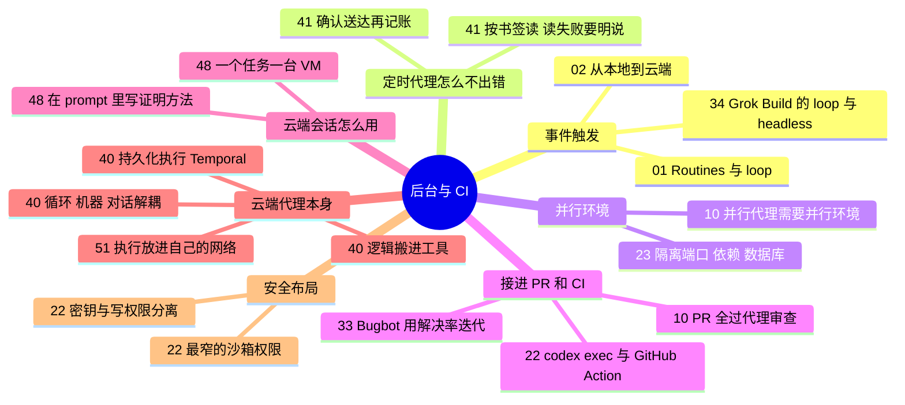

# 自动化 · 后台代理与 CI/CD

**这个阶段回答**：代理怎么脱离聊天框，被事件唤醒、在后台和 CI 里跑？收录 10 份资料（按发布日期从新到旧，持续更新的文档在后）：[[41]]、[[48]]、[[02]]、[[51]]、[[01]]、[[40]]、[[10]]、[[33]]、[[22]]、[[34]]。并行开发（[[23]]）放在 [去执行](/guide/execution)，本页只引用和自动化相关的部分。

::: tip 怎么用这页
每个问题下面列出“哪份资料的哪一节回答了它”。指南只做串联和对照，原话和细节请点进原文。
:::

## 1. 怎么让代理被事件唤醒，而不是等人开口？

- **Routines**：Claude Code 团队有人设 routine 监听某个功能的所有工单和 issue，代理主动提交修复 PR；另一个 routine 专找 5 小时内没人响应的 bug report（[[01§3.3]]）。
- **从“和代理说话”到“和 loop 说话”**（[[01§3.5]]）；把代理从笔记本搬到云端托管容器，合上电脑它也继续跑（[[02§3.4]]）。
- **在 Slack 里派活**：工作入口搬到 Slack 原生的 Claude Tag（[[02§3.1]]）。
- **Claude Code routines**：由定时（最频繁每小时一次）、HTTP 调用或 GitHub 事件触发，每次运行就是一个云端会话，没有审批提示，默认推到 `claude/` 前缀的分支（[[48§3.4]]）。
- **定时重复一个提示词**：Grok Build 的 `/loop 5m ...` 按间隔重复执行，最短 60 秒、7 天过期；实时日志用监视器（[[34§3.3]]）。

- **Codex 的两种自动化**：线程内心跳按定时器反复跑直到完成；新线程在 Scheduled 页面设置，每次开新线程（[[42§3.4]]）。

## 2. 无人值守的定时代理，怎么才不会悄悄出错？

- **按书签读，不按时间窗读**：每个数据源记下上次读到的位置，早跑晚跑都不漏不重（[[41§3.3]]）。
- **读失败不等于没新内容**：书签不动，用其他源写，并在输出末尾写明读不到什么（[[41§3.4]]）。
- **副作用确认后再记账**：先查是否已发过，只有对方确认才算发出，之后才更新书签和账本；不确定就标记“可能已发”，什么都不改（[[41§3.5]]）。
- **发出前再查一次**：读到的状态可能已变，查不到就去掉（[[41§3.6]]）。
- **偏好每次重读、时区写明**：偏好放在代理只读的记忆库里，读不到就停；日期按读者时区算（[[41§3.7]]）。
- **最小权限 + 花费上限**：只读的地方给只读 token，上限从正常成本的 3–5 倍起步，触顶会“安静暂停”（[[41§3.8]]）。

## 3. 后台并行跑，环境怎么准备？

- **每个代理一个工作目录**：issue → worktree → PR 的完整流程见 [去执行](/guide/execution) 和 [[23§3.1]]。
- **并行代理需要并行环境**：每个代理能在自己的 worktree / checkout 里起 dev server 和 worker（[[10§3.2]]）。Cole 现场解决了三个真实问题：端口冲突（按目录名哈希分配端口）、依赖重复安装（预装）、数据库互相污染（每个 worktree 一个数据库分支）（[[23§3.5]]）。
- **云端代理要一整套运行层**：Cursor 认为完整的开发环境是云端代理输出质量的最大因素，而环境缺东西时往往不报错，只是质量悄悄变差（[[40§3.1]]）。跑几小时到几周的任务要扛住 VM 和推理服务故障，他们从自建的 work-stealing 架构迁到 Temporal，可靠性从“一个 9”提到“两个 9”以上（[[40§3.2]]）；代理循环、机器状态、对话状态分开管（[[40§3.3]]）。Cursor 自己的仓库怎么为云端代理准备环境，见 [[37]]。
- **一个任务一台机器**：Claude Code 云端会话给每个任务一台新 VM 和新分支，三个会话 87 秒内并行修完三个问题；会话彼此看不见，要按文件边界拆任务、按顺序合并（[[48§3.1]]）。什么时候留在本地（内网、GPU、真实本地数据）见 [[48§3.3]]；让会话能自己跑测试的环境设置（初始化脚本、SessionStart hook、测试命令写进 CLAUDE.md）见 [[48§3.6]]。
- **执行环境放在自己的网络里**：Cursor Self-Hosted Machines 只把执行搬进客户网络，推理和规划仍在 Cursor 云端；worker 主动开出站长连接，pool 按排队请求扩容、空闲时休眠快照（[[51§3.1]]、[[51§3.2]]）。Claude Code 的 self-hosted 环境（beta）是同类选项（[[48§3.3]]）。
- **代码量涨上去以后，CI 和合并队列本身会成为瓶颈**：Anthropic 每天合并 3 万多个改动，测试还在跑就有成百上千个改动合入，于是放弃全局锁的合并队列，改为合并后、部署前的自动测试（[[49§3.6]]）；CI 检出改成按需拉取后快了两个数量级（[[49§4]]）。
- **模型变强后，harness 少做一点**：CI Autofix 早期由 harness 抓失败日志写进 VM，现在只给代理 GitHub CLI，把大输出写成文件（[[40§3.4]]）。无人值守时阻塞代价高，提示词要鼓励代理更自主（[[40§3.4]]）。

## 4. 怎么把代理接进 PR 和 CI？

- **PR 先过代理审查**：OpenAI 100% 的 PR 都先过 Codex review，没过就不找同事审；审查有意做得“不吵”，标准可以写进 AGENTS.md（[[10§3.3]]）。
- **CI 失败自动修**：`codex exec` 是 Codex 的非交互模式，可以接管道、输出 JSONL、用 `--output-schema` 约束输出（[[22§3.1]]）；官方范例在 CI 失败后触发新工作流，由 Codex 生成补丁（[[22§3.3]]）。
- **把漏网问题回灌**：同类问题反复漏过 review，就编码进 review 规则或验证工具（[[10§3.4]]）。
- **非交互运行的通用写法**：Grok Build 用 `grok -p ... --output-format json`，CI 里加 `--no-auto-update`（[[34§3.1]]）。
- **常驻 PR 审查机器人怎么衡量和迭代**：Cursor 的 Bugbot 第一版用 8 次并行审查 + 多数投票压低误报（[[33§3.1]]），团队特有规则写成 Bugbot rules（[[33§3.2]]），用“解决率”衡量效果并据此做了 40 次实验（[[33§3.3]]、[[33§3.4]]）。审查器的设计原则见 [做验证](/guide/verification) 和 [[31§3.1]]。

## 5. 安全怎么做？

- **密钥和写权限分开**：旧版 cookbook 把 API key 设成整个 job 的环境变量，又给了写权限；构建脚本、测试、依赖钩子都能读到它。现在的推荐布局是：只读 job 拿密钥生成补丁 → artifact → 无密钥的 job 开 PR（[[22§3.2]]、[[22§3.3]]）。
- **权限开关**：Codex GitHub Action 的沙箱和权限选项，以及“只在受控环境里用 danger-full-access”（[[22§3.4]]）。
- **hook 出错时默认放行**：Grok Build 的 hook 超时、崩溃或输出格式错误时，工具调用照常执行，只有明确的 deny 才会拦截（[[34§3.2]]）；Claude Code 也只有退出码 2 或明确的拒绝决定才会拦截（[[28§3.3]]）。关键的安全检查要在 CI 或沙箱层再做一道。
- **凭据不进沙箱**：Anthropic 的托管代理把凭据放在保险库，沙箱里只有占位符，请求出站时才替换（[[41§3.2]]、[[45§3.3]]）。
- **云端代理的“企业 IT”**：出站网络限制、范围受限的 git 访问、提交里的密钥扫描和工具结果里的密钥脱敏（[[37§3.1]]、[[40§3.1]]）。
- **云端会话里的凭据和网络**：GitHub token 留在 VM 外的代理里，会话只拿到能推自己分支的短期凭据；网络可设为 None，但仍会请求 Anthropic API（[[48§3.2]]、[[48§3.4]]）。自托管执行时，工具输出仍会回到厂商云端（[[51§3.4]]）。
- **把不可信输入当攻击面**：PR 标题、issue 正文进入提示词前要清洗（[[22§5]]）。放开权限无人值守跑时的隔离做法，见 [[24§3.1]]。

## 6. 来源之间的分歧与互补

| 议题 | 观点 A | 观点 B | 怎么理解 |
|---|---|---|---|
| 并行隔离用什么 | Cole：git worktree + 自定义脚本处理端口、依赖、数据库（[[23§3.5]]） | Peter：不用 worktree，直接多份 checkout（[[11§3.2]]） | 都是“每个代理一个独立工作目录”。worktree 省磁盘、便于脚本化；多 checkout 最简单。真正的难点在端口、依赖、数据库这些共享资源。 |
| 谁来审代理开的 PR | OpenAI：代理 review 先过，再找同事（[[10§3.3]]） | Cole：全新会话 + 跨模型审查之后，合并前人仍然要自己审（[[23§3.3]]、[[23§4]]） | 不矛盾：代理审查是第一道关，人是最后一道关。 |
| 确定性步骤放哪 | Ralph：commit、push、是否回滚交给外层脚本，不交给模型（[[24§3.5]]） | Cursor 云端代理：早期 harness 强制 commit 和 push，模型变强后把这些逻辑搬进代理能控制的工具（[[40§3.4]]） | 取决于你多信任模型和出错代价。可以从确定性脚本开始，模型稳定后再逐步交给代理（同“逐个拆脚手架”，[[16§3.5]]）。 |
| 执行环境放在哪 | Claude Code：默认一个任务一台 Anthropic 托管的 VM，需要内网时用 self-hosted 环境或留在本地（[[48§3.3]]） | Cursor：默认 Cursor 托管 VM，也可以把执行搬进客户网络，推理留在云端（[[51§2]]） | 两家的结构几乎一样：循环在厂商侧，执行可以下放。选哪种取决于任务要不要碰内网、特殊硬件，以及能否接受工具输出离开网络。 |
| 审查机器人怎么衡量 | OpenAI：看作者用代码修改回应评论的比例（52.7%）和表情反应（[[31§4]]） | Cursor：表情反应不够清楚，用合并时 AI 判断的“解决率”（[[33§3.3]]） | 两者都在看“作者有没有真的改”。解决率把这件事自动化并显示在仪表盘上，更适合拿来做实验对比。 |

## 7. 推荐阅读顺序

1. [[01]]：先建立“事件触发 + 自己验证”的观念。
2. [[48]]：上手云端会话，命令和排错表可以直接用。
3. [[41]]：定时代理的六条规则，配置可以直接参考。
4. [[22]]：能抄进仓库的 CI 配置和安全布局。
5. [[10]]：团队级的 PR 审查与 CI 看护。
6. [[33]]：常驻 PR 审查机器人怎么衡量和迭代。
7. [[34]]：用 Grok Build 的话，headless、hooks、/loop 怎么配。
8. [[02]]：Claude Code 团队自己的工作流。
9. [[40]]：想了解云端代理背后的基础设施时再读。
10. [[51]]：需要让云端代理碰内网或特殊硬件时再读。

::: info 上一阶段 / 下一阶段
← [做验证](/guide/verification)：放大自动化之前，先补验证体系 ｜ 想知道这些机制背后怎么实现，见 [看原理](/guide/harness) →
:::
