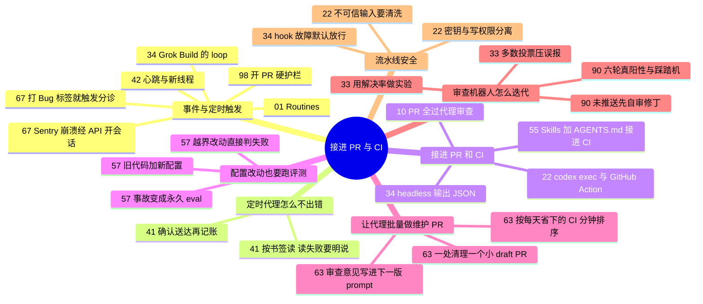

# 接进 PR 与 CI · 触发、审查与流水线

**这个阶段回答**：代理怎么被定时或事件唤醒、无人值守也不悄悄出错，又怎么接进团队的 PR 审查和 CI？收录 11 份资料（按发布日期从新到旧，持续更新的文档在后）：[[63]]、[[98]]、[[41]]、[[90]]、[[57]]、[[10]]、[[55]]、[[67]]、[[33]]、[[22]]、[[34]]。代理具体跑在哪台机器上（云端会话、托管 VM、自托管机器、沙箱机队），见下一阶段 [云端与后台运行环境](/guide/cloud)。

::: tip 怎么用这页
每个问题下面列出“哪份资料的哪一节回答了它”。指南只做串联和对照，原话和细节请点进原文。本阶段和下一阶段原来合在“自动化”里，2026-10-15 按任务顺序拆开：先接进流水线，再决定在哪里跑。
:::

## 自托管写权限：开 PR 的硬护栏

- **变更只走窄闸**：一改一 worktree、一次性 GitHub App 令牌、无 Workflows 权限、ruleset 挡 `main`、推送每次 `!yes`（[[98§3.2]]）。
- **测试在无网 Docker**；代理试图换说法绕过 hook 时，规则必须在 hook/令牌/平台设置里（[[98§3.4]]、[[98§3.5]]）。设计上代理只开 PR，人合并（[[98§3.6]]）。

## 核心问题

1. 怎么让代理被事件或定时器唤醒，而不是等人开口？
2. 无人值守的定时代理，怎么才不会悄悄出错？
3. 怎么把代理接进 PR 审查和 CI？
4. 常驻的审查机器人，怎么知道它真的有用？
5. 流水线里的密钥、权限和输入，怎么布局才安全？
6. 改了 CLAUDE.md、skills、hooks，怎么在 CI 里证明代理没有变差？
7. 代理写得越快，维护债和 CI 负载涨得越快，怎么让代理批量开维护 PR？

## 1. 怎么让代理被事件唤醒，而不是等人开口？

- **Routines**：Claude Code 团队有人设 routine 监听某个功能的所有工单和 issue，代理主动提交修复 PR；另一个 routine 专找 5 小时内没人响应的 bug report（[[01§3.3]]）。
- **Claude Code routines 的触发方式**：定时（最频繁每小时一次）、HTTP 调用或 GitHub 事件，每次运行就是一个云端会话，没有审批提示，默认推到 `claude/` 前缀的分支（[[48§3.4]]）。
- **定时重复一个提示词**：Grok Build 的 `/loop 5m ...` 按间隔重复执行，最短 60 秒、7 天过期；实时日志用监视器（[[34§3.3]]）。
- **接在团队已有的习惯后面**：Cognition 在 Linear 工单加上 Bug 标签就自动触发分诊，按工程师平时的调查步骤先查一遍，把根因和修复思路写回工单（[[67§3.3]]）；每天早上扫过去 24 小时合并的 PR 找设计系统违规（[[67§3.3]]）；Sentry 崩溃、部署失败经 REST API 直接开会话（[[67§3.5]]）。这是厂商讲自家产品，数字都是自报。
- **Codex 的两种自动化**：线程内心跳按定时器反复跑直到完成；新线程在 Scheduled 页面设置，每次开新线程（[[42§3.4]]）。

## 2. 无人值守的定时代理，怎么才不会悄悄出错？

- **按书签读，不按时间窗读**：每个数据源记下上次读到的位置，早跑晚跑都不漏不重（[[41§3.3]]）。
- **读失败不等于没新内容**：书签不动，用其他源写，并在输出末尾写明读不到什么（[[41§3.4]]）。
- **副作用确认后再记账**：先查是否已发过，只有对方确认才算发出，之后才更新书签和账本；不确定就标记“可能已发”，什么都不改（[[41§3.5]]）。
- **发出前再查一次**：读到的状态可能已变，查不到就去掉（[[41§3.6]]）。
- **偏好每次重读、时区写明**：偏好放在代理只读的记忆库里，读不到就停；日期按读者时区算（[[41§3.7]]）。
- **最小权限 + 花费上限**：只读的地方给只读 token，上限从正常成本的 3–5 倍起步，触顶会“安静暂停”（[[41§3.8]]）。

## 3. 怎么把代理接进 PR 和 CI？

- **PR 先过代理审查**：OpenAI 100% 的 PR 都先过 Codex review，没过就不找同事审；审查有意做得“不吵”，标准可以写进 AGENTS.md（[[10§3.3]]）。
- **CI 失败自动修**：`codex exec` 是 Codex 的非交互模式，可以接管道、输出 JSONL、用 `--output-schema` 约束输出（[[22§3.1]]）；官方范例在 CI 失败后触发新工作流，由 Codex 生成补丁（[[22§3.3]]）。
- **审查发现问题就让代理接着修**：Cognition 每个 PR 都过 Devin Review，审查或 GitHub 机器人标出 bug、CI 或 lint 不过时，代理自动修到检查全过；PR 打开、推新提交、加审查者都会触发审查（[[67§3.2]]）。
- **把漏网问题回灌**：同类问题反复漏过 review，就编码进 review 规则或验证工具（[[10§3.4]]）。
- **把维护流程写成仓库里的 Skills 再搬进 CI**：OpenAI Agents SDK 仓库用 AGENTS.md 的 if/then 规则规定何时必须调用哪个 Skill，验证命令按固定顺序写进 Skill，“不通过不算完成”（[[55§3.2]]）；发版评审默认放行、阻止必附证据和解锁清单（[[55§3.4]]）；本地跑稳后才用 Codex GitHub Action 上 CI，公开仓库要限制触发者、清洗输入、Codex 放最后一步（[[55§3.5]]）。
- **非交互运行的通用写法**：Grok Build 用 `grok -p ... --output-format json`，CI 里加 `--no-auto-update`（[[34§3.1]]）。
- **代码量涨上去以后，CI 和合并队列本身会成为瓶颈**：Anthropic 每天合并 3 万多个改动，于是放弃全局锁的合并队列，改为合并后、部署前的自动测试（[[49§3.6]]）；CI 检出改成按需拉取后快了两个数量级（[[49§4]]）。

## 4. 常驻的审查机器人，怎么知道它真的有用？

- **先压误报**：Cursor 的 Bugbot 第一版用 8 次并行审查 + 多数投票压低误报（[[33§3.1]]），团队特有规则写成 Bugbot rules（[[33§3.2]]）。Codex Code Review 则把团队特有规则写进按目录生效的 `AGENTS.md`，并用“该触发 / 安全反例 / 无关改动”三个 PR 测规则会不会制造噪声（[[75§3.5]]）。
- **用“解决率”衡量**：合并时由 AI 判断评论是否被真正解决，并据此做了 40 次实验（[[33§3.3]]、[[33§3.4]]）。
- **预审问错题时，机器人会挖出另一类真问题**：Chris Jones 一次全绿 PR 上 Copilot + Claude Review 挖出 32 条真阳性；修丁引入的 job/锁会续租审查轮次。把问题前移到 `implement` 正确性一轮，triage 先审未推送修丁，并设硬顶五轮（[[90§3.2]]–[[90§3.4]]）。
- 审查器本身的设计原则（精确率优先、能读整个仓库）属于 [验收这一次的产出](/guide/review)，见 [[31§3.1]]。

## 5. 流水线里的密钥、权限和输入，怎么布局才安全？

- **密钥和写权限分开**：旧版 cookbook 把 API key 设成整个 job 的环境变量，又给了写权限；构建脚本、测试、依赖钩子都能读到它。现在的推荐布局是：只读 job 拿密钥生成补丁 → artifact → 无密钥的 job 开 PR（[[22§3.2]]、[[22§3.3]]）。
- **权限开关**：Codex GitHub Action 的沙箱和权限选项，以及“只在受控环境里用 danger-full-access”（[[22§3.4]]）。
- **hook 出错时默认放行**：Grok Build 的 hook 超时、崩溃或输出格式错误时，工具调用照常执行，只有明确的 deny 才会拦截（[[34§3.2]]）；Claude Code 也只有退出码 2 或明确的拒绝决定才会拦截（[[28§3.3]]）。关键的安全检查要在 CI 或沙箱层再做一道。
- **定时代理的凭据**：凭据放在保险库，沙箱里只有占位符，请求出站时才替换（[[41§3.2]]、[[45§3.3]]）。
- **调试代理只给只读权限**：Cognition 让代理查 Datadog 日志和数据库的只读副本，追到出问题的提交，交出带回归测试的 PR（[[67§3.4]]）。
- **把不可信输入当攻击面**：PR 标题、issue 正文进入提示词前要清洗（[[22§5]]）。

## 6. 改了代理配置，怎么在 CI 里证明它没变差？

- **把配置当代码做回归**：Anthropic 的 playbook 建议从近期工作里收 20–50 个真实任务写成 eval，定时跑，并且 CLAUDE.md、skills、hooks 一改就跑；让通过率下降的改动先审再合并（[[57§3.1]]）。
- **一条 eval 的格式**：`from`（任务之前的 commit）、prompt、`may_change`（允许改的目录）、一组可执行检查，原文 JSON 见 [[57§3.2]]。
- **旧代码 + 新配置**：workflow 为每条 eval 建 worktree 检出旧 commit，删掉 `evals/` 和 `.claude/`，再拷入被测分支的配置，用 `claude -p` 重做；不要加 `--bare`，它会跳过要测的配置（[[57§3.3]]）。
- **防止靠改规则过关**：评测文件先拷到别处；`check.sh` 在检查前后各查一次越界改动（[[57§3.4]]）。
- **检查测行为不测写法**，以及一次删掉 CLAUDE.md 一行规则后被拦下的演示（[[57§3.5]]）；每次事故写成一条 eval，衡量“事故多久变成 eval”（[[57§3.6]]）。
- 评测的概念、评分器和 pass@k 见 [评测代理本身与给动作把关](/guide/evals)（[[19§3.4]]、[[19§3.5]]）；评测 Skill 的脚本见 [[47§3.5]]。

## 7. 代理写得越快维护债越多，怎么让代理批量开维护 PR？

- **短 prompt + 安全边界 + 证据**：OpenAI 实验平台团队让 Codex 自己翻历史 PR、Slack、功能开关平台和性能剖析表，确认代码没被执行再删，并写出每处删除的理由；5 人两周兼职合并 1,400 多个 PR（[[63§3.1]]）。
- **一处清理一个小 draft PR，附证据链接**；prompt 里写清要保留生产行为、运维保护和 killswitch，不改线上配置；拿不准的（被标成 Permanent 的开关）交给人（[[63§3.2]]）。
- **prompt 跟着审查长大**：先在两个项目里跑，人评论 PR，再让模型把评论写进全库的 `/goal` prompt，产出按 owner 分组、带 CPU 成本的报告（[[63§3.2]]、[[63§3.5]]）。
- **CI 本身也是维护对象**：让 Codex 按“每天省下的 CI 分钟数”给提速办法排序，落地约 30 个 PR，中位耗时约 10 → 4.5 分钟；flaky test 和 AGENTS.md 指令也各有一段可照抄的 prompt（[[63§3.4]]）。
- **先比较模型再放量**：同一 prompt、同一块代码，便宜模型拿到 92% 的发现、14% 的成本；找出它漏掉的模式写回 prompt（[[63§3.3]]）。
- 维护流程写成仓库里的 Skills，见 [[55]]；定时运行时的规则，见 [[41]]。

## 8. 来源之间的分歧与互补

| 议题 | 观点 A | 观点 B | 怎么理解 |
|---|---|---|---|
| 谁来审代理开的 PR | OpenAI：代理 review 先过，再找同事（[[10§3.3]]） | Cole：全新会话 + 跨模型审查之后，合并前人仍然要自己审（[[23§3.3]]、[[23§4]]） | 不矛盾：代理审查是第一道关，人是最后一道关。 |
| 审查机器人怎么衡量 | OpenAI：看作者用代码修改回应评论的比例（52.7%）和表情反应（[[31§4]]） | Cursor：表情反应不够清楚，用合并时 AI 判断的“解决率”（[[33§3.3]]） | 两者都在看“作者有没有真的改”。解决率把这件事自动化并显示在仪表盘上，更适合拿来做实验对比。 |
| 确定性步骤放哪 | Ralph：commit、push、是否回滚交给外层脚本，不交给模型（[[24§3.5]]） | Cursor 云端代理：模型变强后把这些逻辑搬进代理能控制的工具（[[40§3.4]]） | 取决于你多信任模型和出错代价。CI 里可以从确定性脚本开始，模型稳定后再逐步交给代理（同“逐个拆脚手架”，[[16§3.5]]）。 |
| 配置改动怎么验证 | Anthropic playbook：每次改 CLAUDE.md、skills、hooks 都在 CI 里重跑 20–50 个真实任务，全部通过才合并（[[57§3.3]]） | OpenAI Agents SDK：把验证命令写进 Skill，本地跑稳再上 CI，评审默认放行（[[55§3.2]]、[[55§3.4]]） | 前者测“代理在新配置下还会不会做对”，后者让代理“按规定流程验证代码”。两者可以叠加：Skill 定流程，eval 测这套 Skill 改了以后还管不管用。 |
| 维护 PR 谁来开、谁来审 | OpenAI 实验平台团队：模型找机会、给证据、开小 draft PR，审查分发给有上下文的团队，审查意见回写进 prompt（[[63§3.2]]） | OpenAI Agents SDK：维护流程写成 Skills，规定必须跑哪些验证，评审默认放行（[[55§3.2]]、[[55§3.4]]） | 前者适合“找出要清理什么”这种探索型维护，后者适合“每次都要按同一流程验证”的重复型维护；两者都把人放在审查和定优先级的位置。 |
| 发版评审默认怎么判 | OpenAI Agents SDK：发版评审默认放行，要阻止必须附证据和解锁清单（[[55§3.4]]） | Bugbot：第一版靠多数投票压误报，宁可少报（[[33§3.1]]） | 方向一致：常驻在流水线里的代理，最怕的是“狼来了”。阻止和报错都要付出证据成本。 |

## 9. 推荐阅读顺序

1. [[01]]：先建立“事件触发 + 自己验证”的观念（本篇归在下一阶段，Routines 部分适合先读）。
2. [[41]]：定时代理的六条规则，配置可以直接参考。
3. [[22]]：能抄进仓库的 CI 配置和安全布局。
4. [[55]]：把维护流程写成 Skills、再接进 CI 和 PR 审查。
5. [[57]]：给 CLAUDE.md、skills、hooks 的改动加一道评测关卡，三个文件可以照抄。
6. [[10]]：团队级的 PR 审查与 CI 看护。
7. [[33]]：常驻 PR 审查机器人怎么衡量和迭代。
8. [[90]]：六轮机器人审查与补丁踩踏机——把问题写进开 PR 前。
8. [[34]]：用 Grok Build 的话，headless、hooks、/loop 怎么配。
9. [[63]]：让代理批量开维护 PR：删死代码、清过期实验、给 CI 提速，prompt 原文可直接借用。
10. [[67]]：一家公司把代理接进 Slack、工单标签、PR 和告警之后的样子；厂商自述，Playbook 六要素可以直接借。

::: info 上一阶段 / 下一阶段
← [评测代理本身与给动作把关](/guide/evals)：放大自动化之前，先补验证和评测体系 ｜ 流水线接好了，再决定代理在哪里跑：[云端与后台运行环境](/guide/cloud) →
:::
