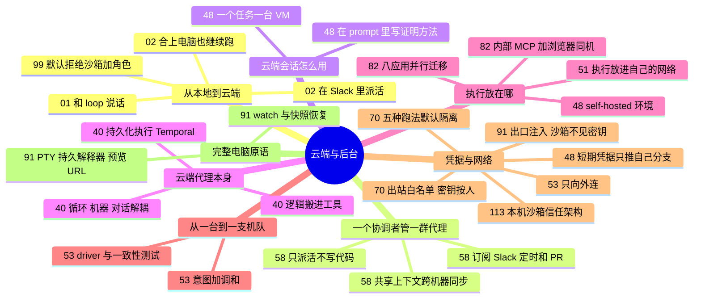

# 云端与后台运行环境 · 代理在哪里跑

**这个阶段回答**：代理离开你的笔记本以后跑在哪里，环境怎么准备，机器怎么扩缩，凭据和网络怎么管？收录 12 份资料（按发布日期从新到旧）：[[82]]、[[53]]、[[70]]、[[48]]、[[99]]、[[58]]、[[02]]、[[51]]、[[01]]、[[40]]、[[91]]、[[113]]。怎么被事件触发、怎么接进 PR 和 CI，见上一阶段 [接进 PR 与 CI](/guide/ci)；本地并行开发（[[23]]）放在 [单代理推进与一人多线](/guide/solo)。

::: tip 怎么用这页
每个问题下面列出“哪份资料的哪一节回答了它”。指南只做串联和对照，原话和细节请点进原文。本阶段和上一阶段原来合在“自动化”里，2026-10-15 按任务顺序拆开。
:::

## 自建默认拒绝沙箱

- **角色产物 + 换模型族审查**：spec/plan/implement/review 分文件；审查不用实现同一模型族（[[99§3.2]]、[[99§3.3]]）。
- **sandbox.sh 默认拒绝**：TLS 主机名白名单、不挂家目录、只带回分支提交、启动自证防火墙；明确不审提交内容、DNS 仍开（[[99§3.4]]、[[99§3.5]]）。与 [[91]] 托管沙箱、[[70]] 每任务 VM 对照看“谁运维边界”。

## 核心问题

1. 为什么要把代理从笔记本搬到云端，搬过去以后怎么派活？
2. 云端会话和后台并行，环境要怎么准备？
3. 云端代理产品本身要扛住什么？
4. 执行要不要放进自己的网络，一支沙箱机队怎么管？
5. 云端运行时，凭据和网络怎么管？
6. 本地 / 远程五种跑法，默认隔离差在哪？

## 1. 为什么要把代理搬到云端，搬过去以后怎么派活？

- **从“和代理说话”到“和 loop 说话”**（[[01§3.5]]）；把代理从笔记本搬到云端托管容器，合上电脑它也继续跑（[[02§3.4]]）。
- **在 Slack 里派活**：工作入口搬到 Slack 原生的 Claude Tag（[[02§3.1]]）。
- **再往上一层：让一个协调代理替你管代理**：Cursor Projects 的协调者只派活不写代码，所以随时响应；默认在云端运行，需要本机测试时起本地代理；一组共享上下文文件同步到所有机器；能订阅 Slack、定时任务和 PR（[[58§3.1]]、[[58§3.2]]）。迁移类工作早期逐个审 PR、稳定后少审；设计系统 Project 看到同一个错误两次就加 lint 规则（[[58§3.3]]）。
- **一个任务一台机器**：Claude Code 云端会话给每个任务一台新 VM 和新分支，三个会话 87 秒内并行修完三个问题；会话彼此看不见，要按文件边界拆任务、按顺序合并（[[48§3.1]]）。
- **什么时候留在本地**：要碰内网、GPU、真实本地数据时（[[48§3.3]]）。

## 2. 云端会话和后台并行，环境要怎么准备？

- **并行代理需要并行环境**：每个代理能在自己的 worktree / checkout 里起 dev server 和 worker（[[10§3.2]]）。本地并行时的端口、依赖、数据库问题见 [[23§3.5]]。
- **让会话能自己跑测试**：初始化脚本、SessionStart hook、测试命令写进 CLAUDE.md（[[48§3.6]]）。
- **环境缺东西时往往不报错**：Cursor 认为完整的开发环境是云端代理输出质量的最大因素，而环境缺东西时质量只会悄悄变差（[[40§3.1]]）。Cursor 自己的仓库怎么为云端代理准备环境，见 [[37]]（归在 [打地基](/guide/foundation)）。

## 3. 云端代理产品本身要扛住什么？

- **持久化执行**：跑几小时到几周的任务要扛住 VM 和推理服务故障，Cursor 从自建的 work-stealing 架构迁到 Temporal，可靠性从“一个 9”提到“两个 9”以上（[[40§3.2]]）。
- **三种状态分开管**：代理循环、机器状态、对话状态解耦（[[40§3.3]]）。
- **模型变强后，harness 少做一点**：CI Autofix 早期由 harness 抓失败日志写进 VM，现在只给代理 GitHub CLI，把大输出写成文件；无人值守时阻塞代价高，提示词要鼓励代理更自主（[[40§3.4]]）。
- “大脑与双手解耦”的设计原理见 [看原理](/guide/harness) 和 [[45]]。

## 4. 执行要不要放进自己的网络，一支沙箱机队怎么管？

- **执行环境放在自己的网络里**：Cursor Self-Hosted Machines 只把执行搬进客户网络，推理和规划仍在 Cursor 云端；worker 主动开出站长连接，pool 按排队请求扩容、空闲时休眠快照（[[51§3.1]]、[[51§3.2]]）。Claude Code 的 self-hosted 环境（beta）是同类选项（[[48§3.3]]）。
- **自托管上并行跑迁移**：Navan 把 Spring Boot 4 迁移的 8 个应用和 15 个库交给自托管 Cloud Agents；GitHub 工作可在 Cursor 托管侧，Snowflake / Slack 等内部 MCP 与浏览器验证留在自托管机器；约一周完成，而两年前同类迁移一个多月且曾锁 master 一天（[[82§3.1]]、[[82§3.2]]）。旧方案要求桌面会话一直开着，做不到并行异步。
- **从一台机器到一支机队**：代理被告警、定时任务、Slack 委托唤醒时，需要按需开机、暂停、销毁一批沙箱。Factory OpenCompute 先把意图写进 Postgres，再由 reconciler 调和；每种平台一个 gRPC driver，用必选 Core 加可选 Suspend、Snapshot、Fork 档位诚实处理差异，不支持的请求在改状态前就拒绝（[[53§3.1]]、[[53§3.3]]）。

## 5. 云端运行时，凭据和网络怎么管？

- **云端会话里的凭据和网络**：GitHub token 留在 VM 外的代理里，会话只拿到能推自己分支的短期凭据；网络可设为 None，但仍会请求 Anthropic API（[[48§3.2]]、[[48§3.4]]）。
- **云端代理的“企业 IT”**：出站网络限制、范围受限的 git 访问、提交里的密钥扫描和工具结果里的密钥脱敏（[[37§3.1]]、[[40§3.1]]）。
- **自托管也只向外连**：OpenCompute 主动建出站 TLS WebSocket，签名挑战证明身份，私钥可放 KMS；但算力位置和推理路由、会话存储是两回事（[[53§3.4]]）。Cursor 自托管执行时，工具输出仍会回到厂商云端（[[51§3.4]]）。
- 放开权限无人值守跑时的隔离做法，见 [[24§3.1]]。

## 6. 本地和远程五种跑法，默认隔离差在哪？

- **本机工作区 / git worktree**：默认可逃出目录或仅文件分开；隔离靠客户端用 landrun、sandbox-exec、Sandboxie 等包一层（[[70§3.2]]）。Claude Code 与 Codex 都用 bwrap/seccomp/Seatbelt，但 Codex 偏 sandbox-first+升级协议，Claude 偏可配置+违规可见与事后裸仓清理（[[113§3.2]]、[[113§3.3]]、[[113§3.4]]）。
- **SSH / Docker / Cloud**：默认与开发者机器隔离；差别主要在谁配置。Docker Sandboxes 每代理一台 microVM；Air 每任务新 VM，代理在 VM 内容器中，出站经 proxy，默认只放行源码托管与包仓库，密钥按开发者本人仓库权限注入（[[70§3.3]]）。
- **出口注入凭据 + 完整电脑原语**：Cloudflare Sandboxes GA 用 `outboundByHost` 在 Worker 侧加认证头，沙箱进程不见密钥；另提供 PTY、持久解释器、`waitForLog`/`exposePort`、文件 `watch` 与快照恢复（[[91§3.2]]–[[91§3.5]]）。
- 和自托管执行机器（[[51]]）、OpenCompute 沙箱机队（[[53]]）对照时，先问默认隔离、出站策略和密钥是否按人权限。

## 7. 来源之间的分歧与互补

| 议题 | 观点 A | 观点 B | 怎么理解 |
|---|---|---|---|
| 执行环境放在哪 | Claude Code：默认一个任务一台 Anthropic 托管的 VM，需要内网时用 self-hosted 环境或留在本地（[[48§3.3]]） | Cursor：默认 Cursor 托管 VM，也可以把执行搬进客户网络，推理留在云端（[[51§2]]） | 两家的结构几乎一样：循环在厂商侧，执行可以下放。选哪种取决于任务要不要碰内网、特殊硬件，以及能否接受工具输出离开网络。 |
| 自托管执行怎么管 | Cursor：worker 主动连回云端，pool 由团队写的 spawn 脚本扩缩（[[51§3.2]]） | Factory：把生命周期做成一个自托管服务，平台差异放进 driver，用一致性测试约束（[[53§3.3]]） | 机器少、团队熟悉自己的基础设施时，spawn 脚本够用；平台多、需要统一暂停快照策略时，独立的编排层更省心。 |
| 谁来管一群云端代理 | Cursor Projects：你只和协调代理对话，它派活给成千子代理，靠共享上下文文件跨会话积累（[[58§3.1]]、[[58§3.2]]） | Claude Code 云端会话：每个任务一个会话，人按文件边界拆任务、按顺序合并（[[48§3.1]]） | 任务少、边界清楚时人来拆就够；跨月、几百个 PR 的迁移或持续维护，才值得多一层协调者。Projects 的效果数字是厂商自报（[[58§3.4]]）。 |
| 本机沙箱默认姿态 | Codex：策略驱动、总会评估，阻塞走升级对话框（[[113§3.2]]） | Claude Code：设置驱动、每命令门闩，阻塞偏违规透明（[[113§3.3]]） | 同 OS 原语；要强制遏制还是开发者可调，决定控制面放哪。 |
| 密钥能不能进沙箱 | Air / Claude 云端：短期或按人注入到环境（[[70§3.3]]、[[48§3.2]]） | Cloudflare：网络层注入，沙箱内进程看不到密钥（[[91§3.2]]） | 都要限制出站。差别在密钥是否出现在代理可读环境里。 |
| 自托管机器上还跑什么 | Cursor 文档侧重执行节点与出站连接（[[51]]） | Navan：同一批自托管机器上跑内部 MCP 和浏览器点流程，迁移与评测循环异步继续（[[82§3.2]]） | 互补：#51 讲怎么把执行放进自己的网络；#82 是一次真实迁移里“内网工具 + 浏览器验证”和写代码代理同机的案例。厂商客户故事，数字不可核对。 |
| 并行隔离用什么 | 云端：一个任务一台新 VM（[[48§3.1]]） | 本地：Cole 用 git worktree + 脚本处理端口、依赖、数据库（[[23§3.5]]）；Peter 直接多份 checkout（[[11§3.2]]） | 都是“每个代理一个独立环境”。云端 VM 把共享资源问题一次解决，代价是碰不到本地数据和内网。 |

## 8. 推荐阅读顺序

1. [[01]]：先建立“和 loop 说话、让代理自己验证”的观念。
2. [[48]]：上手云端会话，命令和排错表可以直接用。
3. [[02]]：Claude Code 团队自己怎么把工作搬到云端和 Slack。
4. [[40]]：想了解云端代理背后的基础设施时再读。
5. [[51]]：需要让云端代理碰内网或特殊硬件时再读。
6. [[58]]：工作量大到要一个代理替你管代理时再读，注意它是产品发布文。
7. [[53]]：要管理一整批代理沙箱、或想看“合约 + 一致性测试”怎么让代理写基础设施时再读。

8. [[70]]：五种跑法默认隔离对照；Air 的出站白名单与按人权限。
9. [[91]]：沙箱即完整电脑——凭据注入、预览 URL、快照。
10. [[113]]：本机 Claude / Codex 沙箱：同原语、不同信任架构。
11. [[82]]：自托管 Cloud Agents 并行迁多个应用的客户案例（作 #51 的补充，注意是成功故事）。

::: info 上一阶段 / 下一阶段
← [接进 PR 与 CI](/guide/ci) ｜ 想知道这些机制背后怎么实现，见 [看原理](/guide/harness) →
:::

