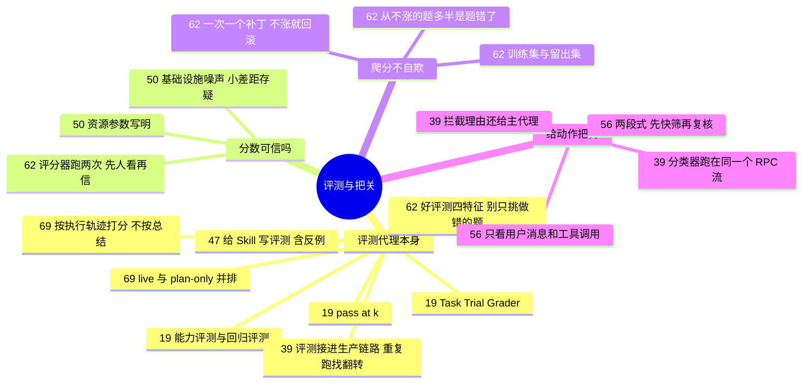

# 评测代理本身与给动作把关 · 评测、分类器与分数噪声

**这个阶段回答**：上一阶段验收的是“这一次的产出”；这一阶段问的是更长期的事：怎么系统地评测代理和它的配置（prompt、Skill、harness），分数本身可不可信，以及代理在动手之前，谁来判断这个动作该不该放行？收录 7 份资料（按发布日期从新到旧）：[[69]]、[[62]]、[[39]]、[[56]]、[[50]]、[[47]]、[[19]]。把评测接进 CI、挡住合并，见下一阶段 [接进 PR 与 CI](/guide/ci)（[[57]]）。

::: tip 怎么用这页
每个问题下面列出“哪份资料的哪一节回答了它”。指南只做串联和对照，原话和细节请点进原文。
:::

**核心问题**：① 怎么评测“代理”本身？② 评测分数本身可信吗？③ 分数涨了，怎么知道不是在自欺？④ 怎么给代理的动作把关，分类器能替代人工审批吗？

## 1. 怎么评测“代理”本身？

- **零件**：Task、Trial、Grader、Transcript 与 Outcome；被测对象是 harness + 模型的组合（[[19§3.1]]）。
- **评分器怎么选**：能用确定性评分就用确定性评分，LLM 评分次之，人工评分审慎使用（[[19§3.2]]）；原文 YAML 示例见 [[19§3.3]]。
- **能力评测 vs 回归评测**（[[19§3.4]]）；**随机性**用 pass@k / pass^k 描述（[[19§3.5]]）；从 0 到 1 的路线图（[[19§3.6]]）。
- **一个接进生产的例子**：Cursor 评测 Auto-review 分类器时，用约 12 小时内部会话整理出 6,122 条标注数据代表“不该拦的日常工作”，再用合成用例补“必须拦的最坏情况”；策略一改就重标评测集；评测跑在和生产相同的后端循环里；同一用例重复跑，把结果来回翻转的找出来收紧（[[39§3.4]]）。
- **按执行轨迹打分，不按总结**：LLM 裁判只看最终回复时，会把“做对但没自夸”判失败；打开 tool-call 日志才能核实命令是否真跑过。遥测要保留 turn 结构，避免抹掉并行 tool_calls；live 与 plan-only 并排，约一半重要发现来自两者差；用专家 golden sets 压整栈（[[69§3.1]]–[[69§3.4]]）。
- **给 Skill 写评测，从小做起**：OpenAI 把 Skill 当提示词评测：先写可检查的“完成的定义”（[[47§3.1]]），10–20 条 prompt 里至少放一条不该触发的反例（[[47§3.4]]；给 AI 审查规则做评测时同样要放安全反例，并单独测“加规则后普通 bug 还能不能抓到”，见 [[75§3.3]]），先用 `codex exec --json` 的事件流做确定性检查（[[47§3.5]]），主观风格再用 `--output-schema` 让模型按固定格式打分（[[47§3.6]]）。

## 2. 评测分数本身可信吗？

- **分数里混着基础设施噪声**：Anthropic 只改容器资源，Terminal-Bench 2.0 分数就差 6 个百分点；3x 以内的资源修的是稳定性，再往上就是在帮代理解题（[[50§3.2]]、[[50§3.3]]）。
- **小差距先存疑**：配置没有公开并对齐时，低于 3 个百分点的差距不足以下结论（[[50§4]]）。比较自己两版 prompt 或 Skill 时，也要固定资源、超时，并多跑几次（[[50§3.5]]；随机性的描述方法见 [[19§3.5]]）。
- **评测应写明两个资源参数**：保证分配和硬上限分开写，区间校准到两端分数在噪声范围内（[[50§3.6]]）。

## 3. 分数涨了，怎么知道不是在自欺？

- **先把尺子做准**：好评测贴近生产、随模型能力单调、最强配置也远低于 100%、运行间方差小；别只挑当前模型做错的题，否则测的是它的“失败指纹”（[[62§3.1]]）。
- **评分器先验证再相信**：能用代码判就别用模型判；模型裁判的标准写成可逐条核对的断言，不是 1–5 分，裁判不能是被测模型；先读一批打过分的记录，对同一输出跑两次评分器看判决变不变（[[62§3.2]]）。
- **爬分选便宜、可归因、目标清楚的面**；评测饱和时把目标改成“效果不降、成本降低”（[[62§3.3]]）。
- **防过拟合**：随机拆训练集和留出集，每轮只提一个补丁；训练涨、留出不涨就回滚；不把失败内容贴进提示词；第一轮前确认噪声小于你在意的最小改进（[[62§3.3]]、[[62§3.4]]）。
- **爬不动时先怀疑尺子**：停滞两三轮就把剩余失败按原因分类；从来不涨的题，常常是题目和评分器要求不一致（[[62§3.5]]）。
- 同样的“一次只改一处”也可以用真实会话重放来做：OpenAI 让 Codex 在同一快照上重放一条历史 prompt，比较一条 AGENTS.md 指令改前改后（[[63§3.4]]）。

## 4. 怎么给代理的动作把关？

- **给代理的动作把关，也是一种验证**：分类器结合用户意图判断风险，拦截时把理由还给主代理而不是弹窗问人（[[39§3.1]]、[[39§3.3]]）；同类设计见 Codex Auto Review（[[09§3.4]]）。Claude Code auto mode 把分类器拆成两段：单 token 快速过滤宁可错拦，被拦的再推理复核；分类器只看用户消息和工具调用，不看代理的解释和工具输出（[[56§3.4]]、[[56§3.5]]）。它公开了分阶段的误报和漏报：完整流程在真实流量上误报 0.4%，对真实“过度主动”动作仍漏 17%（[[56§4]]）。
- 这类分类器解决的是“每步都点允许太累、全放开又太险”的问题；它和上一阶段的审查不同，判断发生在动作执行**之前**。
- 分类器本身也要评测：Cursor 用真实会话标注数据加合成最坏情况，重复跑找结果翻转的用例（[[39§3.4]]）；Anthropic 分阶段公开误报和漏报（[[56§4]]）。

## 5. 来源之间的分歧

| 议题 | 观点 A | 观点 B | 怎么理解 |
|---|---|---|---|
| 用模型验收模型可靠吗 | Anthropic 长任务 harness：可以，但开箱即用的 Claude 是很差的 QA 代理，要反复读日志调教（[[16§3.4]]） | Agent Evals 文章：能用确定性评分就别用 LLM 评分（[[19§3.2]]） | 能写成测试或状态检查的，用确定性评分；“设计好不好看”这类主观标准，才需要调教过的模型评委。 |
| 风格这类主观项怎么评 | OpenAI：让 Codex 读生成的仓库，按 JSON Schema 输出每项通过与否（[[47§3.6]]） | Agent Evals 文章：LLM 评分要和人工评分校准，审慎使用（[[19§3.2]]） | 不矛盾：#47 用固定格式让结果可比较，但没讨论评分模型自己的偏差；上线前仍应抽查一批，和人的判断对一下。 |
| 评测题从哪来 | Agent Evals 文章：从真实失败和 bug 报告里攒题，早期 20–50 道就够（[[19§3.6]]） | Anthropic eval playbook：真实失败要先过“说得出为什么难”这一关；只挑当前模型做错的题会测成失败指纹，纯用户流量又会偏简单（[[62§3.1]]） | 不矛盾，后者是前者的边界条件：真实失败是好来源，但要按“人判断它难”入选，并混入不同难度。 |
| 动作分类器能替代人工审批吗 | Anthropic：17% 漏报是诚实数字；比 `--dangerously-skip-permissions` 好得多，但比逐条认真审是倒退，不能替代高风险基础设施上的人工审查（[[56§4]]） | Cursor：分类器拦截后把理由还给主代理，让它换做法，而不是弹窗问人（[[39§3.3]]） | 两家都把分类器定位成“替代全放开”，不是替代认真审查；两边数据集和口径不同，百分比不能直接比较。 |

## 6. 推荐阅读顺序

1. [[19]]：先建立评测的基本概念：Task、Trial、Grader、pass@k。
2. [[47]]：给自己的 Skill 写第一套评测，脚本可以照抄。
3. [[50]]：读分数之前，先知道分数里有多少噪声。
4. [[39]]：看一个评测怎么接进真实产品链路，以及动作分类器怎么设计。
5. [[56]]：同类分类器的另一种设计，带分阶段误报漏报数据。
6. [[62]]：评测建好之后怎么爬分而不自欺：留出集、一次一个补丁、回滚规则。

::: info 上一阶段 / 下一阶段
← [验收这一次的产出](/guide/review) ｜ 验证可靠之后，才适合交给后台：[接进 PR 与 CI](/guide/ci) →
:::
